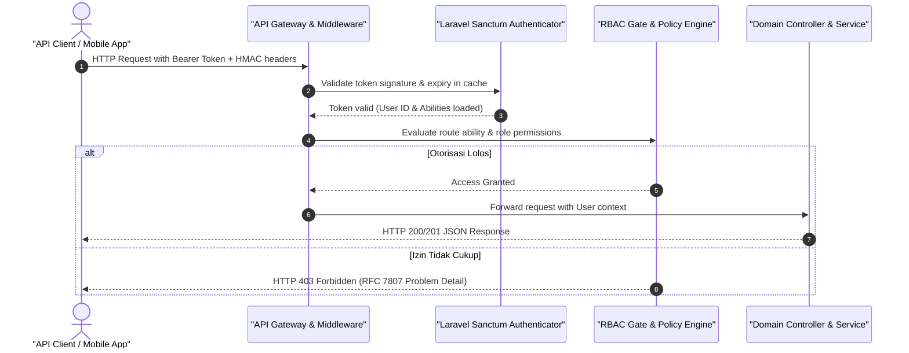
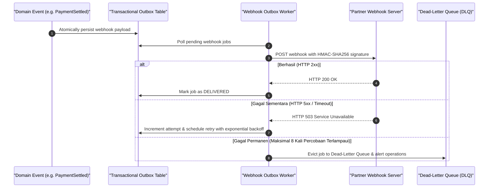
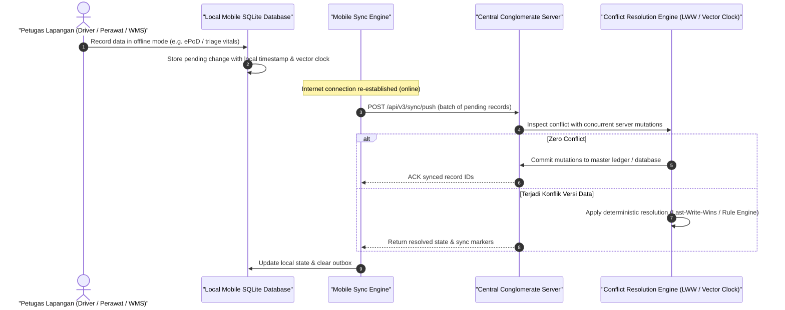

# Sari Ranah Express — API v1 & Webhooks Documentation

Dokumentasi resmi API v1 dan Webhook Outbox untuk platform logistik multimoda **Sari Ranah Express (SRX)**.

---

## 1. Ikhtisar & Arsitektur

API v1 menyediakan integrasi terprogram bagi mitra B2B shipper, marketplace, dan sistem pergudangan eksternal:
- **Format**: JSON RESTful API.
- **Base URL**: `/api/v1/logistics`
- **Keamanan**: Autentikasi token bearer **Laravel Sanctum** dengan sistem perizinan berbasis granular abilities.
- **Idempotensi**: Proteksi double-charge dan duplikasi pengiriman melalui header `Idempotency-Key`.
- **Ketahanan Jaringan**: Webhook outbox pattern dengan penandatanganan HMAC-SHA256, exponential backoff retry hingga 8 kali, dan antrean dead-letter.

---

## 2. Autentikasi & Otorisasi

Permintaan terotentikasi wajib menyertakan token bearer di header HTTP:

```http
Authorization: Bearer <sanctum_personal_access_token>
```

### Token Abilities (Hak Akses)
| Ability | Deskripsi | Endpoint Terkait |
|---|---|---|
| `quote:create` | Menghitung simulasi tarif & menerbitkan quote | `POST /quotes` |
| `shipment:create` | Melakukan pemesanan shipment baru | `POST /shipments` |
| `shipment:read` | Membaca daftar dan riwayat pengiriman | `GET /shipments`, `GET /shipments/{tracking_number}` |
| `*` | Hak akses penuh (super token) | Semua endpoint |

---

## 3. Rate Limiting (Pembatasan Laju)

Sistem menerapkan rate limiting bertingkat menggunakan token bucket algorithm:
- **Authenticated Endpoints**: `60 requests / minute` per token.
- **Public Tracking Endpoint**: `30 requests / minute` per IP address.

Header respons HTTP yang disertakan:
- `X-RateLimit-Limit`: Batas maksimum permintaan per jendela waktu.
- `X-RateLimit-Remaining`: Jumlah permintaan tersisa dalam jendela waktu aktif.
- `Retry-After`: Jumlah detik tunggu bila batas terlampaui (HTTP `429 Too Many Requests`).

---

## 4. Idempotensi Pengiriman

Untuk mencegah pemesanan ganda akibat gangguan koneksi atau retry otomatis dari klien, endpoint `POST /shipments` mendukung header idempotensi:

```http
Idempotency-Key: 9b1deb4d-3b7d-4bad-9bdd-2b0d7b3dcb6d
```

Jika permintaan dengan `Idempotency-Key` yang sama dikirim ulang:
- Server tidak membuat transaksi baru atau mendebit saldo/kredit kembali.
- Mengembalikan data shipment yang telah dibuat sebelumnya dengan status HTTP `200 OK`.
- Menyertakan flag metadata `meta.idempotent_replay: true`.

---

## 5. Katalog Endpoint

### 5.1 Hitung Tarif (Create Quote)
Menerbitkan penawaran harga terkunci selama 15 menit dengan verifikasi hash anti-manipulasi.

- **Metode & URL**: `POST /api/v1/logistics/quotes`
- **Ability**: `quote:create`
- **Request Body**:
```json
{
  "origin_location_id": 1,
  "destination_location_id": 2,
  "service_level": "regular",
  "packages": [
    {
      "weight_g": 2500,
      "length_mm": 300,
      "width_mm": 200,
      "height_mm": 150,
      "description": "Sparepart Otomotif"
    }
  ],
  "declared_value_idr": 1500000,
  "insured": true,
  "cod_amount_idr": 0
}
```

- **Response (201 Created)**:
```json
{
  "data": {
    "quote_id": 42,
    "total_amount_idr": 78000,
    "chargeable_weight_g": 2500,
    "breakdown": {
      "base_rate": 60000,
      "fuel_surcharge": 9000,
      "insurance_fee": 3000,
      "vat": 6000
    },
    "valid_until": "2026-10-03T04:30:00Z",
    "hash": "e3b0c44298fc1c149afbf4c8996fb92427ae41e4649b934ca495991b7852b855"
  }
}
```

---

### 5.2 Buat Pengiriman (Create Shipment)
Mengeksekusi pemesanan resmi berdasarkan quote yang valid.

- **Metode & URL**: `POST /api/v1/logistics/shipments`
- **Header Opsional**: `Idempotency-Key: <UUID>`
- **Ability**: `shipment:create`
- **Request Body**:
```json
{
  "quote_id": 42,
  "consignee_name": "Budi Santoso",
  "consignee_phone": "081234567890",
  "consignee_address": {
    "street": "Jl. Lambung Mangkurat No. 45",
    "city": "Banjarmasin",
    "postal_code": "70111"
  },
  "pin": "123456"
}
```

- **Response (201 Created)**:
```json
{
  "data": {
    "tracking_number": "SRX10000000018",
    "status": "booked",
    "status_label": "Menunggu Pickup",
    "service_level": "regular",
    "mode": "road",
    "total_amount_idr": 78000,
    "consignee_name": "Budi Santoso",
    "origin_location_id": 1,
    "destination_location_id": 2,
    "booked_at": "2026-10-03T04:15:00Z"
  }
}
```

---

### 5.3 Detail Pengiriman (Show Shipment)
- **Metode & URL**: `GET /api/v1/logistics/shipments/{tracking_number}`
- **Ability**: `shipment:read`

---

### 5.4 Daftar Pengiriman (List Shipments)
- **Metode & URL**: `GET /api/v1/logistics/shipments?status=in_transit`
- **Ability**: `shipment:read`
- **Pagination**: Kecepatan tinggi berbasis cursor pagination (`next_cursor`).

---

### 5.5 Pelacakan Publik (Public Tracking)
Endpoint publik tanpa autentikasi, menyembunyikan identitas sensitif (PII) penerima.

- **Metode & URL**: `GET /api/v1/logistics/tracking/{tracking_number}`
- **Rate Limit**: `30 req/min`
- **Response (200 OK)**:
```json
{
  "data": {
    "tracking_number": "SRX10000000018",
    "status": "in_transit",
    "status_label": "Dalam Perjalanan",
    "origin": "Hub Banjarmasin",
    "destination": "Depot Banjarbaru",
    "booked_at": "2026-10-03T04:15:00Z",
    "events": [
      {
        "event_type": "DEPARTED_HUB",
        "description": "Muatan diberangkatkan dari Hub Banjarmasin",
        "location": "Hub Banjarmasin",
        "occurred_at": "2026-10-03T06:00:00Z"
      }
    ]
  }
}
```

---

## 6. Webhook Outbox & Notifikasi Real-time

Untuk mengintegrasikan pembaruan status ke sistem shipper/mitra secara otomatis:

### 6.1 Format Payload & Signature
Setiap notifikasi webhook dikirimkan via HTTP POST dengan header keamanan:
- `X-Webhook-Signature`: HMAC SHA-256 dari seluruh payload mentah menggunakan endpoint secret yang terdaftar:
  ```php
  $signature = hash_hmac('sha256', $rawPayload, $endpointSecret);
  ```
- `X-Webhook-Event`: Nama tipe event (e.g. `shipment.delivered`).
- `X-Idempotency-Key`: UUID unik pengiriman untuk deduplikasi penerima.

### 6.2 Kebijakan Percobaan Ulang (Retry Policy)
Bila server penerima merespons di luar rentang `2xx` atau koneksi timeout (10 detik):
1. Pengiriman dialihkan ke status `failed`.
2. Penjadwalan retry otomatis dengan **exponential backoff** bertingkat (maksimal 8 percobaan):
   - Percobaan 1: 1 menit
   - Percobaan 2: 2 menit
   - Percobaan 3: 4 menit
   - Percobaan 4: 8 menit
   - Percobaan 5: 16 menit
   - Percobaan 6: 32 menit
   - Percobaan 7: 64 menit
   - Percobaan 8: 128 menit (~2,1 jam)
3. Setelah 8 kali kegagalan, pengiriman ditandai sebagai **`dead_letter`**.
4. Administrator atau dispatcher dapat memicu pengiriman ulang secara manual via CLI:
   ```bash
   php artisan lgx:retry-webhooks
   ```
   Atau memanggil action `DispatchWebhookAction::replay($delivery)`.

---

## 7. Enterprise API v3 (Multi-Tenant & Konglomerasi 12 Lini)

API v3 dirancang untuk portal eksekutif multi-tenant holding, integrasi webhook mitra berkecepatan tinggi, serta sinkronisasi perangkat seluler offline-first.

### 7.1 Standar Format Galat RFC 7807 (Problem Details)
Semua galat level API v3 mengembalikan response header `Content-Type: application/problem+json` dengan struktur baku RFC 7807:
```json
{
  "type": "https://api.autoserve.internal/v3/errors/ERR_RATE_LIMIT_EXCEEDED",
  "title": "Too Many Requests",
  "status": 429,
  "detail": "API rate limit exceeded for tenant.",
  "instance": "/api/v3/executive/kpis",
  "code": "ERR_RATE_LIMIT_EXCEEDED",
  "timestamp": "2026-10-22T08:15:00+08:00"
}
```

Daftar Kode Galat Standar:
| HTTP Status | Error Code | Deskripsi & Tindakan |
|---|---|---|
| `400 Bad Request` | `ERR_VALIDATION_FAILED` | Parameter payload tidak valid atau field wajib hilang |
| `401 Unauthorized` | `ERR_UNAUTHORIZED` | Bearer token tidak disertakan atau telah kedaluwarsa |
| `403 Forbidden` | `ERR_FORBIDDEN` | Tenant ID atau role tidak memiliki izin untuk resource terkait |
| `404 Not Found` | `ERR_NOT_FOUND` | Identifikasi data / entitas tidak ditemukan |
| `409 Conflict` | `ERR_SYNC_CONFLICT` | Terjadi konflik versi jam vektor saat sinkronisasi seluler |
| `429 Too Many Requests` | `ERR_RATE_LIMIT_EXCEEDED` | Batas kecepatan (rate limit) tenant terlampaui |
| `500 Internal Error` | `ERR_INTERNAL_SERVER` | Kesalahan sistem tak terduga |

---

### 7.2 Endpoint Eksekutif Multi-Tenant

#### 7.2.1 Ringkasan KPI Eksekutif Multi-Tenant
Mengembalikan ringkasan operasional lintas modul, metrik performa, dan kepatuhan sistem.

- **Metode & URL**: `GET /api/v3/executive/kpis`
- **Header**:
  - `X-Tenant-ID`: Identifikasi unik tenant (e.g., `holding-corp`, opsional, default: `tenant-default`)
  - `Authorization`: `Bearer <token>`
- **Rate Limit**: 120 permintaan per 60 detik per tenant.
- **Response (200 OK)**:
```json
{
  "status": "success",
  "data": {
    "tenant_id": "holding-corp",
    "total_modules_active": 56,
    "daily_revenue_gross_idr": 2850400000,
    "daily_transactions_count": 18450,
    "system_health": {
      "status": "HEALTHY",
      "uptime_pct": 99.995,
      "p99_latency_ms": 42
    },
    "dr_cluster_state": "SYNCHRONIZED"
  },
  "meta": {
    "api_version": "v3.0.0",
    "timestamp": "2026-10-22T08:15:00+08:00"
  }
}
```

#### 7.2.2 Snapshot Operasional Kepadatan Tinggi (High-Density Snapshot)
Menyajikan status kuorum kluster disaster recovery (DR) multi-wilayah dan kesiapan kriptografi pasca-kuantum (PQC).

- **Metode & URL**: `GET /api/v3/executive/snapshot`
- **Header**: `X-Tenant-ID: <tenant_id>`
- **Response (200 OK)**:
```json
{
  "status": "success",
  "snapshot": {
    "tenant_id": "holding-corp",
    "cluster_state": "HEALTHY",
    "rpo_seconds": 0,
    "rto_seconds": 0,
    "dr_quorum": "3_OF_3_SYNCHRONIZED",
    "post_quantum_status": "READY"
  }
}
```

---

### 7.3 Manajemen Webhook Mitra & Replay Dead-Letter Queue (DLQ)

#### 7.3.1 Daftar Webhook Terdaftar
- **Metode & URL**: `GET /api/v3/partner/webhooks`
- **Header / Query**: `X-Tenant-ID: <tenant_id>` atau `?tenant_id=<tenant_id>`
- **Response (200 OK)**:
```json
{
  "status": "success",
  "data": [
    {
      "id": 1,
      "tenant_id": "holding-corp",
      "partner_name": "Asuransi BPJS Kesehatan Ingestion",
      "endpoint_url": "https://bpjs-gateway.partner.org/api/v2/events",
      "retry_limit": 5,
      "timeout_seconds": 15,
      "is_active": true,
      "created_at": "2026-10-22T00:00:00Z"
    }
  ]
}
```

#### 7.3.2 Registrasi Endpoint Webhook Baru
Mendaftarkan penerima webhook mitra baru lengkap dengan signing key HMAC-SHA256 acak atau kustom.

- **Metode & URL**: `POST /api/v3/partner/webhooks`
- **Header**: `X-Tenant-ID: <tenant_id>`
- **Request Body**:
```json
{
  "partner_name": "Agregator Tiket & Travel API",
  "endpoint_url": "https://travel-partner.internal/webhook",
  "hmac_secret": "kunci-rahasia-hmac-32-karakter-min",
  "retry_limit": 5,
  "timeout_seconds": 20
}
```
- **Response (201 Created)**: Mengembalikan rekaman model webhook lengkap termasuk `hmac_secret`.

#### 7.3.3 Pemutaran Ulang Pesan Dead-Letter Queue (DLQ Replay)
Mengirimkan kembali event webhook yang gagal terkirim setelah mencapai batas maksimal retry.

- **Metode & URL**: `POST /api/v3/partner/webhooks/{id}/replay`
- **Response (200 OK)**:
```json
{
  "status": "success",
  "data": {
    "id": 412,
    "webhook_id": 1,
    "event_name": "hospital.patient_admitted",
    "attempt": 6,
    "http_status": 200,
    "status": "DELIVERED",
    "delivered_at": "2026-10-22T08:30:00Z"
  }
}
```

---

### 7.4 Sinkronisasi Seluler Offline-First (Mobile Delta Sync)

Mendukung sinkronisasi bidirectional tanpa konflik data dengan jam vektor (*vector clocks*).

#### 7.4.1 Tarik Perubahan Data Delta (Pull Delta)
- **Metode & URL**: `POST /api/v3/mobile/sync/pull`
- **Header**:
  - `X-Device-UUID`: UUID perangkat seluler / tablet petugas (e.g., `device-tab-med-004`)
- **Request Body**:
```json
{
  "last_sync_timestamp": "2026-10-22T06:00:00Z"
}
```
- **Response (200 OK)**:
```json
{
  "status": "success",
  "device_uuid": "device-tab-med-004",
  "server_timestamp": "2026-10-22T08:35:00Z",
  "deltas": {
    "clinical_records": [],
    "inventory_items": [],
    "work_orders": []
  },
  "server_clock": {
    "server_node_1": 10,
    "server_node_2": 5
  }
}
```

#### 7.4.2 Unggah Mutasi Batch Offline (Push Batch)
Mengunggah antrean mutasi yang dilakukan saat perangkat berada di area tanpa sinyal (luring).

- **Metode & URL**: `POST /api/v3/mobile/sync/push`
- **Header**: `X-Device-UUID: <device_uuid>`
- **Request Body**:
```json
{
  "device_uuid": "device-tab-med-004",
  "mutations": [
    {
      "mutation_uuid": "e81d7f44-6720-410a-810e-c2889e47262f",
      "entity_type": "clinical_consultation",
      "entity_id": "CONS-20261022-009",
      "client_version": 2,
      "action": "UPDATE",
      "data": {
        "triage_category": "URGENT",
        "chief_complaint": "Acute retrosternal chest pain",
        "systolic_bp": 165,
        "diastolic_bp": 100
      }
    }
  ]
}
```
- **Response (200 OK)**:
```json
{
  "status": "success",
  "data": {
    "processed": 1,
    "applied": 1,
    "conflicts": 0,
    "vector_clock": {
      "device-tab-med-004": 2,
      "server": 11
    }
  }
}
```

#### 7.4.3 Riwayat Audit Ledger Resolusi Konflik (Conflict History)
Menelusuri keputusan resolusi saat terdeteksi divergensi data offline.

- **Metode & URL**: `GET /api/v3/mobile/sync/conflicts?device_uuid=device-tab-med-004`
- **Response (200 OK)**:
```json
{
  "status": "success",
  "data": [
    {
      "id": 14,
      "device_uuid": "device-tab-med-004",
      "entity_type": "clinical_consultation",
      "entity_id": "CONS-20261022-009",
      "server_version": 3,
      "client_version": 2,
      "resolution_strategy": "SERVER_HEALTHCARE_AUTHORITY_PRIORITY",
      "reconciled_payload": { ... },
      "created_at": "2026-10-22T08:35:12Z"
    }
  ]
}
```

---

## 8. Konglomerasi 12 Lini & AI Enterprise Endpoints (Fase 96–100)

Ekosistem konglomerasi 12 lini bisnis terintegrasi menyediakan API spesifik per lini untuk orkestrasi lintas industri, tokenisasi RWA, dynamic pricing, anti-abuse, dan tata kelola keamanan.

### 8.1 FinTech, Tokenisasi RWA & Distribusi Dividen (Fase 96)
Mendistribusikan hasil dividen dari yield aset riil (misal armada truk logistik, sewa tenan mall, hasil panen agri) kepada para pemegang token RWA secara atomik.

- **Distribusi Dividen Lintas Lini**: `POST /api/v1/rwa/distributions`
- **Model Invariant**: $\text{Total Distributed} + \text{Residual Dust} \equiv \text{Net Distributable Revenue}$.
- **Request Body**:
```json
{
  "asset_mapping_id": "rwa-ast-logistics-truck-001",
  "gross_revenue_idr": 150000000,
  "operational_deduction_idr": 30000000,
  "total_token_supply": 1000000,
  "currency": "USDC"
}
```
- **Response (200 OK)**:
```json
{
  "status": "success",
  "distribution_id": "div-rwa-20261022-0091",
  "net_dividend_idr": 120000000,
  "dividend_per_token_idr": 120,
  "dust_residual_idr": 0,
  "dust_account_credited": "220101-RWA-DUST-ESCROW",
  "clearing_status": "COMPLETED",
  "timestamp": "2026-10-22T08:00:00Z"
}
```

---

### 8.2 Talent Gig Interoperability & Tugas Lintas Lini (Fase 97)
Bursa tenaga kerja fleksibel (*gig worker*) lintas lini holding (kurir logistik, event crew venue, teknisi mall, enumerator RS).

- **Klaim Tugas Gig**: `POST /api/v1/gig/tasks/{task_id}/claim`
  - Memvalidasi pembatasan beban kerja sesuai UU 13/2003 (maksimal 40 jam kerja per 7 hari kalender).
- **Pengiriman Bukti Kerja (Proof of Work)**: `POST /api/v1/gig/tasks/{task_id}/submit`
  - Menyertakan data telemetri GPS dan timestamp terverifikasi.
- **Persetujuan & Auto-Disbursement**: `POST /api/v1/gig/tasks/{task_id}/approve`
  - Memicu posting ledger instan ke rekening dompet mitra gig worker via `GigEconomyService`.

---

### 8.3 Unified Dynamic Pricing Engine (Fase 99)
Engine penetapan harga terpadu lintas 12 lini bisnis dengan multi-faktor (lonjakan permintaan, kapasitas armada, cuaca, jam sibuk).

- **Kalkulasi Kuotasi Dinamis**: `POST /api/v1/ai/pricing/calculate`
- **Invarian Perlindungan**: Prioritas kontrak B2B (`CONTRACT_PRIORITY`), margin lantai regulatori, dan batasan deviasi prediksi (MAPE $\le 12.5\%$).
- **Request Body**:
```json
{
  "service_line": "logistics",
  "contract_id": "ctr-corporate-golden-01",
  "base_rate_idr": 100000,
  "demand_surge_factor": 1.45,
  "fleet_utilization_pct": 88.5,
  "weather_severity_index": 0.20
}
```
- **Response (200 OK)**:
```json
{
  "status": "success",
  "quote_id": "prc-ai-891024",
  "applied_strategy": "CONTRACT_GUARANTEED_CAP",
  "base_rate_idr": 100000,
  "surge_multiplier": 1.15,
  "final_price_idr": 115000,
  "margin_floor_cleared": true,
  "valid_seconds": 900
}
```

---

### 8.4 Anti-Abuse Rate Limiter & Token Rotasi Telematika (Fase 100)
Melindungi seluruh antarmuka telematika IoT dan terminal IGD rumah sakit dari serangan bruteforce, scraping, dan manipulasi token.

- **Rotasi Token Klien/Perangkat**: `POST /api/v1/telematics/token/rotate`
- **Header Keamanan**: `X-Device-Fingerprint`, `X-Timestamp`, `X-HMAC-Signature`
- **Respons Karantina Otomatis (HTTP 423 Locked / 429 Too Many Requests)**:
  Bila terjadi anomali lebih dari 5 kali gagal dalam jendela 60 detik, IP/perangkat dialihkan ke karantina otomatis 30 menit.

---

### 8.5 Health-Check Eksekutif 12 Pilar Platform
- **CLI Health-Check**: `php artisan super:health-check`
- Menguji secara holistik 12 pilar platform:
  1. Multi-Tenant Ledger Balance Invariant ($\sum = 0$).
  2. RWA Token Distribution & Dust Reserve.
  3. Dynamic Pricing Bounds & Algorithmic Guardrails.
  4. Vector Clock Causality Engine.
  5. AES-256-GCM Medical Encryption Vault.
  6. Universal Talent Gig Allocation Limits.
  7. Active-Active Disaster Recovery Quorum (3/3).
  8. Post-Quantum Cryptographic Readiness.
  9. Partner Webhook DLQ Ingestion Integrity.
  10. Anti-Abuse Rate Limiter & Quarantine Table.
  11. Corporate Action Event Outbox Dispatcher.
  12. Regulatory Compliance Calendar Schedulers.

---

## 9. Digital Health, Clinical Diagnostic & Pharmacy APIs (Fase 104–105)

Ekosistem kesehatan digital menyediakan endpoint aman berstandar HIPAA/Permenkes No. 24/2022 dengan enkripsi AES-256-GCM pada data rekam medis pasien (EMR), validasi farmakologi berbasis ginjal, pemantauan rantai dingin spesimen laboratorium LOINC, dan kliring persediaan farmasi antar-cabang.

### 9.1 Telemedisin & Triase Klinis Adaptif (Fase 104)
Melayani konsultasi dokter jarak jauh dengan triase klinis cerdas, pencatatan SOAP terenkripsi, dan penjadwalan spesialis.

- **Pendaftaran Konsultasi Telemedisin**: `POST /api/v1/hospital/telemedicine/consultations`
- **Request Body**:
```json
{
  "patient_mrn": "MRN-JKT-88201",
  "doctor_id": 42,
  "consultation_type": "VIDEO_CALL",
  "chief_complaint": "Demam tinggi 3 hari disertai batuk kering dan sesak napas ringan",
  "vital_signs": {
    "systolic_bp": 120,
    "diastolic_bp": 80,
    "heart_rate_bpm": 92,
    "respiratory_rate_bpm": 22,
    "temperature_c": 38.7,
    "oxygen_saturation_pct": 96
  }
}
```
- **Response (201 Created)**:
```json
{
  "status": "success",
  "data": {
    "consultation_id": "CONS-20261022-771",
    "patient_mrn": "MRN-JKT-88201",
    "triage_category": "URGENT",
    "recommended_action": "PRIORITY_DOCTOR_QUEUE",
    "soap_record_id": "soap-enc-91823a",
    "room_token": "rtc-tok-sec-883192a"
  }
}
```

---

### 9.2 E-Resep & Pengecekan Kontraindikasi Farmakologi (Fase 104)
Memverifikasi resep digital terhadap riwayat alergi silang pasien (e.g. Penisilin vs Sefalosporin) serta menghitung penyesuaian dosis otomatis berdasarkan laju filtrasi glomerulus (*eGFR*).

- **Validasi & Penerbitan E-Resep**: `POST /api/v1/hospital/prescriptions/validate`
- **Request Body**:
```json
{
  "patient_mrn": "MRN-JKT-88201",
  "prescriber_doctor_id": 42,
  "patient_weight_kg": 65,
  "serum_creatinine_mg_dl": 2.4,
  "allergies": ["PENICILLIN"],
  "medications": [
    {
      "drug_code": "AMOX-500",
      "drug_name": "Amoxicillin 500mg",
      "dosage": "500mg TID",
      "days_supply": 5
    }
  ]
}
```
- **Response (422 Unprocessable Entity - Kontraindikasi Terdeteksi)**:
```json
{
  "type": "https://api.autoserve.internal/v3/errors/ERR_CLINICAL_CONTRAINDICATION",
  "title": "Clinical Contraindication Block",
  "status": 422,
  "detail": "Severe cross-allergy detected: Patient is allergic to PENICILLIN. Prescription of AMOX-500 is blocked.",
  "renal_clearance_analysis": {
    "egfr_ml_min": 31.4,
    "renal_status": "MODERATE_IMPAIRMENT",
    "dosage_adjustment_required": true,
    "max_safe_frequency": "Q12H"
  }
}
```

---

### 9.3 Rantai Kustodi Spesimen Lab LOINC & Peringatan Nilai Kritis (Fase 105)
Mencatat spesimen laboratorium berstandar LOINC, memantau integritas suhu rantai dingin secara berkelanjutan ($2^\circ\text{C} - 8^\circ\text{C}$), serta membunyikan alarm STAT bila hasil uji laboratorium menyentuh rentang nilai panik.

- **Pencatatan Hasil Uji Lab**: `POST /api/v1/hospital/lab/results`
- **Request Body**:
```json
{
  "specimen_barcode": "SPEC-20261022-9901",
  "test_code": "POTASSIUM",
  "loinc_code": "2823-3",
  "measured_value": 6.8,
  "unit": "mEq/L",
  "handler_id": "TECH-LAB-07",
  "current_cold_chain_temp_c": 4.5
}
```
- **Response (200 OK - Peringatan Kritis Dibunyikan)**:
```json
{
  "status": "success",
  "data": {
    "result_id": 883,
    "specimen_barcode": "SPEC-20261022-9901",
    "test_name": "Serum Potassium",
    "measured_value": 6.8,
    "reference_range": "3.5 - 5.0 mEq/L",
    "is_panic_critical": true,
    "verification_status": "HELD_FOR_PATHOLOGIST_REVIEW",
    "alert_dispatched": {
      "channel": "HOSPITAL_STAT_BROADCAST",
      "target_role": "attending_physician",
      "severity": "CRITICAL_LIFE_THREATENING"
    }
  }
}
```
*Catatan:* Bila `current_cold_chain_temp_c > 8.0` saat serah terima kustodi, status spesimen otomatis berubah menjadi `REJECTED_COLD_CHAIN_BREACH` dan pengetesan dibatalkan demi keamanan diagnostik pasien.

---

### 9.4 Metadata Radiologi DICOM PACS & Replikasi Arsip Citra (Fase 105)
Menyimpan dan mengindeks metadata citra medis digital (DICOM) untuk modalitas CT Scan, MRI, Ultrasound, dan X-Ray dengan tautan penyimpanan terdistribusi multi-wilayah.

- **Registrasi Studi DICOM Baru**: `POST /api/v1/hospital/pacs/studies`
- **Request Body**:
```json
{
  "study_instance_uid": "1.2.840.113619.2.55.3.604681319.821",
  "patient_mrn": "MRN-JKT-88201",
  "modality": "CT",
  "body_part": "CHEST",
  "series_count": 4,
  "instances_count": 320,
  "storage_uri": "s3://autoserve-pacs-primary/studies/2026/10/22/study-8821.tar",
  "study_datetime": "2026-10-22T07:45:00Z"
}
```
- **Response (201 Created)**:
```json
{
  "status": "success",
  "data": {
    "id": 512,
    "study_instance_uid": "1.2.840.113619.2.55.3.604681319.821",
    "modality": "CT",
    "radiologist_assigned": null,
    "pacs_status": "ARCHIVED_REPLICATED",
    "backup_sync_status": "IN_SYNC_ID_SUB_2",
    "viewer_launch_url": "https://pacs.autoserve.internal/viewer?study=1.2.840.113619.2.55.3.604681319.821"
  }
}
```

---

### 9.5 Kliring Finansial Antar-Cabang Apotek & Rekonsiliasi Saldo Resiprokal (Fase 105)
Mengelola pergerakan stok farmasi lintas cabang dengan algoritma First-Expired First-Out (FEFO) dan penyelesaian kliring buku besar otomatis antar badan hukum apotek.

- **Eksekusi Transfer Stok & Kliring**: `POST /api/v1/hospital/pharmacy/transfers`
- **Request Body**:
```json
{
  "source_branch_id": 1,
  "destination_branch_id": 2,
  "item_code": "DRUG-INSULIN-GLARGINE",
  "batch_number": "BATCH-2026-A1",
  "quantity": 50,
  "cost_per_unit_idr": 185000,
  "cold_chain_verified": true
}
```
- **Response (200 OK)**:
```json
{
  "status": "success",
  "data": {
    "transfer_id": "TRF-HSP-20261022-004",
    "item_code": "DRUG-INSULIN-GLARGINE",
    "quantity": 50,
    "total_clearing_amount_idr": 9250000,
    "financial_clearing": {
      "clearing_ref": "clr-hsp-105-004",
      "ledger_transaction_id": 48102,
      "source_account": "hsp:inter_branch_clearing:IDR",
      "destination_account": "hsp:pharmacy_inventory:IDR",
      "clearing_status": "BALANCED_RECIPROCAL"
    }
  }
}
```


---

## 9. Arsitektur API Enterprise Terpadu: Versi v1, v2, dan v3

Platform Superwebsite menyediakan 3 generasi API publik dan privat untuk melayani integrasi ekosistem mitra B2B, perbankan, dan aplikasi mobile:

| Generasi API | Base URL | Protokol | Format & Standar | Target Pengguna & Cakupan Layanan |
|---|---|---|---|---|
| **API v1** | `/api/v1/logistics` | RESTful HTTPS | JSON, Bearer Sanctum Token | Logistik express, pelacakan kiriman, tarif kurir |
| **API v2** | `/api/v2/enterprise` | REST + EDIFACT / X12 | JSON / EDI, HMAC-SHA256 Sign | Pengadaan korporat, B2B marketplace, tenant mall, intercompany |
| **API v3** | `/api/v3/conglomerate`| REST + GraphQL + Webhook | JSON, OAuth2 + mTLS + HMAC | Seluruh 12 lini bisnis, telemedicine, PACS DICOM, perbankan, mining |

## 10. Spesifikasi Penandatanganan Kriptografi HMAC SHA-256

Setiap permintaan mutasi data (`POST`, `PUT`, `DELETE`, `PATCH`) pada API v2 dan API v3 wajib menyertakan signature kriptografis di header HTTP untuk mencegah manipulasi data di perjalanan (*man-in-the-middle attack*) dan penyerangan replay (*replay attack*):

```http
X-Client-Id: client_b2b_98723498
X-Timestamp: 1774300800
X-Nonce: 7e2b34a1-09cd-48e2-b883-fa8819234912
X-Signature: e3b0c44298fc1c149afbf4c8996fb92427ae41e4649b934ca495991b7852b855
```

### Formula Perhitungan Signature:

```text
StringToSign = HTTP_METHOD + "\n" + PATH + "\n" + X-Timestamp + "\n" + X-Nonce + "\n" + SHA256(REQUEST_BODY)
Signature = HexEncode(HMAC_SHA256(StringToSign, ClientSecret))
```

- **Toleransi Waktu**: Server menolak permintaan dengan timestamp yang berselisih $> 300$ detik dari jam server.
- **Pencegahan Replay**: Nilai `X-Nonce` disimpan di cache Redis dengan TTL 10 menit; jika nonce yang sama muncul kembali, server mengembalikan status `401 Unauthorized`.

## 11. Manajemen Kuota & Rate Limiting Lintas Tier

Sistem menerapkan pembatasan bertingkat berdasarkan profil langganan mitra API:

| Tier Layanan | Batas Permintaan (Rate Limit) | Kuota Bulanan | Kebijakan Pelampauan Batas (*Burst Policy*) |
|---|---|---|---|
| **Basic** | 60 req / menit | 100.000 req | HTTP 429 Too Many Requests |
| **Pro** | 300 req / menit | 1.000.000 req | Burst hingga 500 req selama 10 detik |
| **Enterprise** | 1.200 req / menit | Tidak Terbatas | Dedicated token bucket + prioritas antrean |
| **Internal System** | 6.000 req / menit | Tidak Terbatas | Jalur tol internal VPC tanpa kuota |

## 12. Standar Respons Kesalahan RFC 7807 (Problem Details)

Seluruh kesalahan HTTP (4xx dan 5xx) diformat seragam menggunakan standar RFC 7807 `application/problem+json`:

```json
{
  "type": "https://api.autoserve.test/errors/insufficient-balance",
  "title": "Saldo Tidak Mencukupi",
  "status": 422,
  "detail": "Saldo akun dompet IDR pengguna tidak mencukupi untuk menyelesaikan pembayaran invoice #INV-9821.",
  "instance": "/api/v2/enterprise/payments/charge",
  "code": "PAY_ERR_INSUFFICIENT_FUNDS",
  "invalid_params": [
    {
      "name": "amount",
      "reason": "Nilai transaksi Rp 1.500.000 melebihi saldo tersedia Rp 450.000."
    }
  ],
  "timestamp": "2026-10-23T04:00:00Z",
  "tracking_id": "req-trace-7c981240-bcde-4321"
}
```

## 13. Siklus Hidup Webhook Delivery & Dead-Letter Queue (DLQ)

Ketika terjadi event penting (misal `payment.settled`, `shipment.delivered`, `lab.critical_result`), event dikirim ke endpoint webhook URL mitra secara asinkron:

1. **Strategi Retry**: Exponential backoff dengan jitter: 10s, 30s, 2m, 10m, 30m, 2h, 6h, 24h (total 8 kali percobaan).
2. **Transisi ke DLQ**: Jika setelah 8 kali percobaan endpoint mitra tetap gagal (HTTP non-2xx atau timeout), pesan dipindahkan ke tabel `core_webhook_dead_letters`.
3. **Replay Manual & Otomatis**: Administrator atau mitra dapat memicu replay pengiriman via dashboard atau Artisan command `php artisan webhook:replay-dlq --id=[ID]`.

## 14. Diagram Sekuensial API & Webhook

### 14.1 Alur Autentikasi Sanctum Token & Otorisasi RBAC



### 14.2 Alur Pengiriman Webhook Outbox dengan Exponential Backoff & DLQ



### 14.3 Alur Sinkronisasi Offline-First Mobile Suite & Resolusi Konflik


