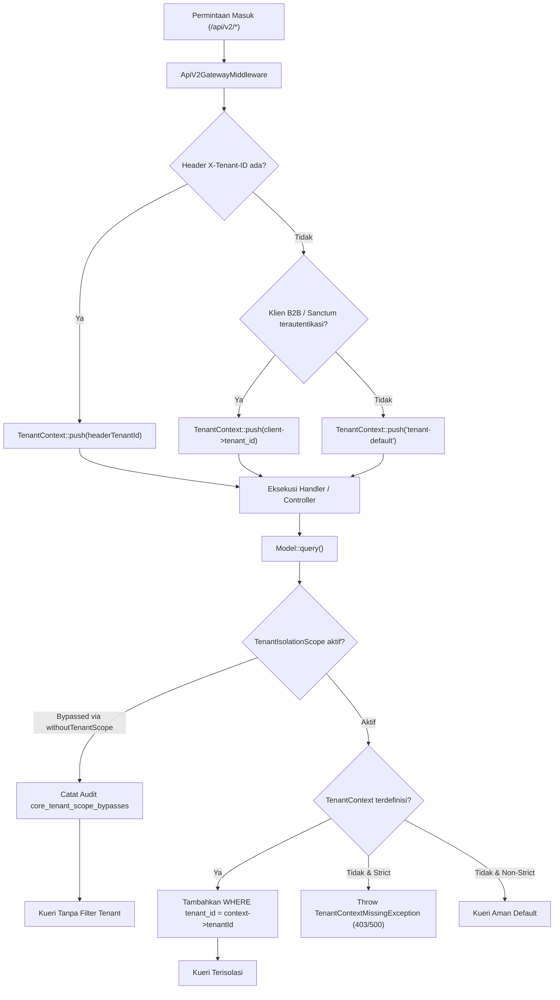

# Matriks Isolasi Multi-tenancy & Batas Kepemilikan Data (Fase 55)

**Klasifikasi Dokumen:** Arsitektur Keamanan Data Superweb  
**Standar Kepatuhan:** W8-D51 / Fase 55.4  
**Tanggal:** 2026-11-12  

---

## 1. Prinsip Desain: Isolasi Fail-Closed (*Fail-Closed Tenant Isolation*)

Arsitektur multi-tenancy Superweb beroperasi dengan paradigma *fail-closed strict enforcement*:
1. **Penyaringan Otomatis Global**: Setiap model terdaftar menerapkan `TenantIsolationScope` yang secara otomatis menambahkan klausa `WHERE tenant_id = ?` pada setiap operasi query Eloquent (`select`, `update`, `delete`).
2. **Ketiadaan Konteks Memicu Eksepsi**: Dalam mode penegakan ketat (`withStrictEnforcement`), kueri ke model ber-scope tanpa menginisialisasi `TenantContext` akan melempar `TenantContextMissingException`. Tidak ada pembacaan liar lintas tenant tanpa izin eksplisit.
3. **Penyimpangan Berbayang Diaudit (*Audited Scope Bypass*)**: Pembacaan lintas tenant hanya diizinkan melalui metode terkelola `TenantScopeRegistry::withoutTenantScope($ability, $reason, $callback)`. Setiap pemanggilan dicatat ke dalam tabel fakta append-only `core_tenant_scope_bypasses` lengkap dengan aktor, alasan, dan stempel waktu.
4. **Validasi Header Gerbang API**: Middleware `ApiV2GatewayMiddleware` membaca header `X-Tenant-ID`. Jika tidak disediakan, konteks secara deterministik dipetakan ke tenant pemilik kunci API klien atau token Sanctum yang diautentikasi.

---

## 2. Matriks Model Domain Ber-Scope Lintas Modul

Tabel berikut mendefinisikan model-model operasional di 9 modul yang terikat pada kontrak `TenantScopedModelProvider`:

| Modul Pemilik | Model Class | Kolom Tenant | Provider Adapter | Tindakan Kueri |
| :--- | :--- | :--- | :--- | :--- |
| **Core** | `Modules\Core\Domain\Models\CoreApiClient` | `tenant_id` | `CoreTenantScopedModelProvider` | Terisolasi penuh per tenant penyewa |
| **Core** | `Modules\Core\Domain\Models\CoreWebhook` | `tenant_id` | `CoreTenantScopedModelProvider` | Subskripsi webhook hanya terlihat oleh tenant pemilik |
| **Logistics** | `Modules\Logistics\Domain\Models\DockAppointment` | `tenant_id` | `LogisticsTenantScopedModelProvider` | Jadwal dermaga dan pelacakan armada per tenant |
| **Mall** | `Modules\Mall\Domain\Models\Invoice` | `tenant_id` | `MallTenantScopedModelProvider` | Faktur penyewa mall retail terisolasi |
| **Mall** | `Modules\Mall\Domain\Models\Lease` | `tenant_id` | `MallTenantScopedModelProvider` | Kontrak sewa tenant mall |
| **Contract** | `Modules\Contract\Domain\Models\Contract` | `tenant_id` | `ContractTenantScopedModelProvider` | Perjanjian hukum dan klausul komersial per tenant |
| **Asset** | `Modules\Asset\Domain\Models\Asset` | `tenant_id` | `AssetTenantScopedModelProvider` | Aset fisik, kapital, dan peralatan operasional |
| **Procurement** | `Modules\Procurement\Domain\Models\Requisition` | `tenant_id` | `ProcurementTenantScopedModelProvider` | Permintaan pengadaan barang/jasa internal |
| **Esg** | `Modules\Esg\Domain\Models\EsgEmission` | `tenant_id` | `EsgTenantScopedModelProvider` | Catatan emisi karbon dan pemantauan ESG per tenant |
| **Distribution** | `Modules\Distribution\Domain\Models\Distributor` | `tenant_id` | `DistributionTenantScopedModelProvider` | Jaringan distribusi dan alokasi kredit |
| **Manufacturing**| `Modules\Manufacturing\Domain\Models\Plant` | `tenant_id` | `ManufacturingTenantScopedModelProvider` | Fasilitas pabrikasi dan kapasitas lini produksi |

---

## 3. Diagram Alur Resolusi Konteks Tenant



---

## 4. Mekanisme Audit Bypass & Integritas Penetrasi

Ketika proses sistem (seperti perintah audit integritas platform `api:audit`, konsolidasi keuangan korporat, atau agregasi laporan emisi ESG grup) perlu membaca data agregat seluruh tenant, bypass dilakukan dengan pola berikut:

```php
$scopeRegistry = app(TenantScopeRegistry::class);

$totalClients = $scopeRegistry->withoutTenantScope(
    ability: 'tenancy:audit_read',
    reason: 'Penetration test & scheduled platform compliance audit',
    callback: function (): int {
        return CoreApiClient::count();
    }
);
```

### Aturan Wajib Audit Bypass:
1. **Tidak Ada Bypass Terselubung**: Mengakses tabel via Eloquent tanpa parameter alasan eksplisit dilarang keras.
2. **Kekebalan Tabel Audit**: Tabel `core_tenant_scope_bypasses` tidak memiliki kolom `updated_at` dan hanya mengizinkan operasi `INSERT`.
3. **Penyimpanan Identitas Aktor**: Bila dipanggil dari sesi web/API, ID pengguna yang melakukan bypass (`actor_user_id`) wajib tersimpan. Bila dari CLI sistem/CRON, nilai `null` diizinkan namun alasan (`reason`) wajib mendeskripsikan konteks tugas.

---

## 5. Audit Berkala melalui Perintah `api:tenancy-coverage`

Perintah terjadwal `api:tenancy-coverage` dijalankan harian untuk mendeteksi apakah terdapat model domain baru yang ditambahkan ke modul tanpa mendaftarkan provider scope:

```bash
$ php artisan api:tenancy-coverage
Auditing Multi-tenancy Model Scoping Coverage...
+---------------+-------------------------------------------------+----------------------+
| Module        | Model Class                                     | TenantIsolationScope |
+---------------+-------------------------------------------------+----------------------+
| Core          | Modules\Core\Domain\Models\CoreWebhook          | ACTIVE               |
| Core          | Modules\Core\Domain\Models\CoreApiClient        | ACTIVE               |
| Logistics     | Modules\Logistics\Domain\Models\DockAppointment | ACTIVE               |
| Mall          | Modules\Mall\Domain\Models\Invoice              | ACTIVE               |
| Mall          | Modules\Mall\Domain\Models\Lease                | ACTIVE               |
| Contract      | Modules\Contract\Domain\Models\Contract         | ACTIVE               |
| Asset         | Modules\Asset\Domain\Models\Asset               | ACTIVE               |
| Procurement   | Modules\Procurement\Domain\Models\Requisition   | ACTIVE               |
| Esg           | Modules\Esg\Domain\Models\EsgEmission           | ACTIVE               |
| Distribution  | Modules\Distribution\Domain\Models\Distributor  | ACTIVE               |
| Manufacturing | Modules\Manufacturing\Domain\Models\Plant       | ACTIVE               |
+---------------+-------------------------------------------------+----------------------+
Total Scoped Models: 11. Active: 11. Missing: 0.
```

Kriteria Keberhasilan:
- Status exit code = 0 bila `Missing: 0`.
- Status exit code = 1 bila ditemukan model berpotensi multi-tenant yang tidak terlindungi scope.

