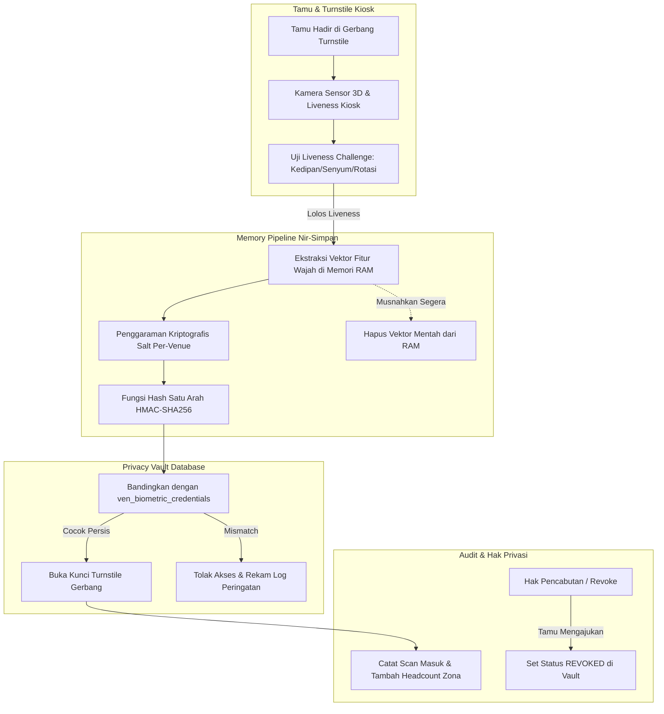

# Arsitektur Biometrik Privacy Vault & Turnstile IoT — Fase 117

## 1. Prinsip Privasi Berbasis Desain (Privacy by Design)
Sistem gerbang biometrik venue dibangun di atas kepatuhan regulasi UU Perlindungan Data Pribadi (UU PDP No. 27/2022) dan GDPR Pasal 9 (Kategori Khusus Data Biometrik):
1. **Zero Raw Biometric Storage:** Vektor landmark wajah atau citra foto wajah pengunjung **DILARANG KERAS** disimpan di media persisten (SSD, HDD, Database, atau Log S3).
2. **Ephemeral Memory Processing:** Komputasi ekstraksi fitur dan hashing dijalankan dalam enclave memori terisolasi yang di-zeroize segera setelah nilai hash templat dihitung.
3. **One-Way Salted Digest:** Basis data hanya menyimpan representasi hash HMAC-SHA256 64-karakter yang tidak memiliki jalur inversi matematis untuk merekonstruksi fitur wajah asli.
4. **Hak Pencabutan Otomatis (Right to be Forgotten):** Pengunjung berhak sewaktu-waktu mencabut persetujuan biometrik melalui portal profil pengguna, yang seketika mematikan kredensial biometrik (`status = REVOKED`) dan mewajibkan penggunaan tiket barcode standar.

