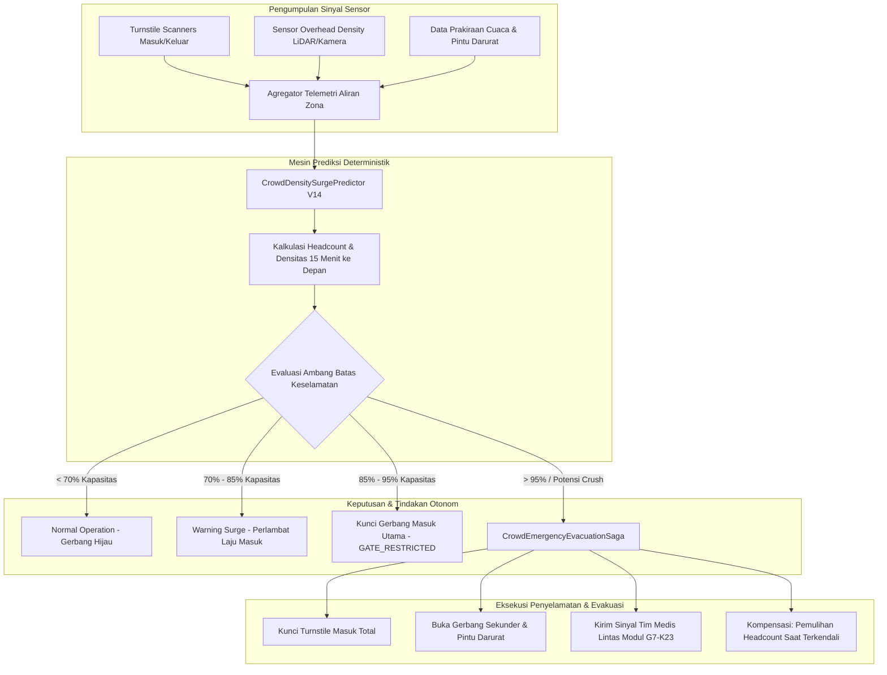

# Arsitektur Crowd Safety Prediction & Evakuasi Real-Time — Fase 117

## 1. Pencegahan Bencana Kerumunan (Anti-Crush Engineering)
Bencana crowd crush umumnya terjadi karena fenomena penumpukan asimetris pada pintu masuk yang terus menerima arus orang baru saat kapasitas aula atau lantai dansa telah melebihi batas elastisitas fisik:
- **Ambang Kritis Kepadatan:** Pada densitas $> 4.0 \text{ orang/m}^2$, pergerakan bebas individu mulai terhambat. Pada $> 5.0 \text{ orang/m}^2$, gelombang kejut kerumunan (shockwaves) terjadi.
- **Intervensi 15 Menit Mendahului:** Prediktor V14 membaca kecepatan aliran ($V_{in}$) dan memproyeksikan headcount 15 menit ke depan. Tindakan pembatasan gerbang diambil saat proyeksi menyentuh $4.5 \text{ orang/m}^2$, sebelum kerumunan fisik menyentuh titik jenuh.
- **Saga Evakuasi Darurat Terkoordinasi:** Mengamankan pintu darurat dan memanggil ambulans via kontrak aditif kesehatan secara simultan dengan log audit yang tidak dapat diubah.

