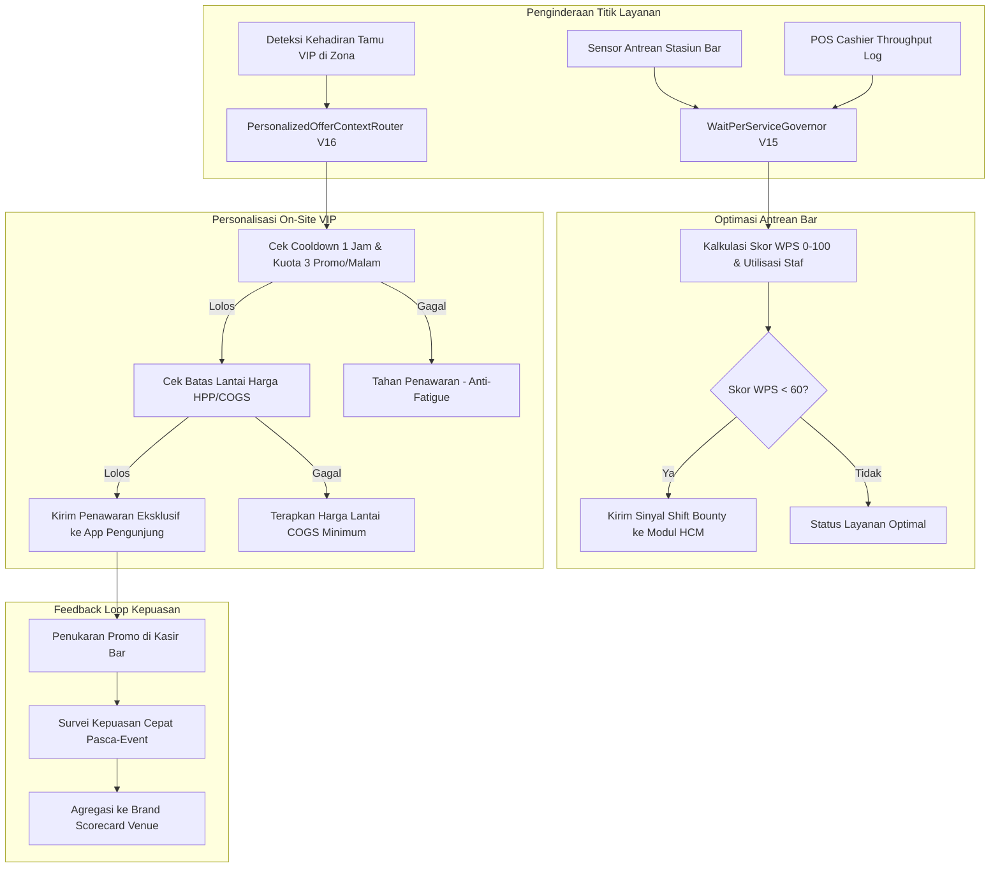

# Arsitektur Guest Experience AI & Personalization Loop — Fase 117

## 1. Integrasi Nilai Bisnis & Pengalaman Pengunjung
- **Reduksi Waktu Tunggu Bar:** Dengan memantau laju layanan dan kedatangan menggunakan teori antrean M/M/c, lonjakan pesanan langsung diimbangi oleh pembukaan kasir cadangan sebelum pengunjung frustrasi.
- **Peningkatan Belanja Per Tamu (RevPAT):** Tamu VIP di zona premium menerima diskon khusus untuk produk bermargin tinggi secara personal tanpa menimbulkan perangkap diskon berlebihan berkat margin guardrail.
- **Kepatuhan Anti-Spam:** Batasan deterministik memastikan tamu merasa dihargai dengan penawaran relevan, bukan terganggu oleh banjir notifikasi.

