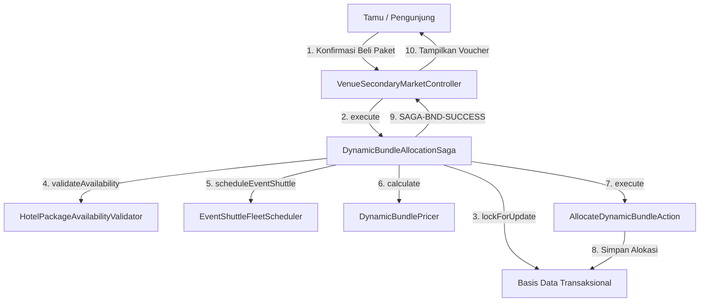

# Arsitektur Integrasi Hotel, Shuttle & Dynamic Bundling

## 1. Latar Belakang & Kebutuhan Integrasi Multidomain
Tuntutan industri festival modern mewajibkan orkestrasi pengalaman terpadu yang melintasi domain hiburan, perhotelan, dan logistik transportasi. Pengunjung seringkali membatalkan niat menghadiri acara konser musik berskala internasional apabila mereka tidak mendapatkan kepastian penginapan di dekat gedung pertunjukan atau menghadapi kendala transportasi penjemputan dari bandara internasional menuju lokasi venue.

Arsitektur Superweb menghadirkan solusi menyeluruh melalui pola orkestrasi **Dynamic Bundling (Fase 116)** yang menghubungkan tiga modul independen:
1. **Modul Venue (`modules/Venue`):** Pusat orkestrasi penjualan tiket hiburan dan pengemasan paket promosi.
2. **Modul Hotel (`modules/Hotel`):** Penyedia alokasi inventaris kamar hotel dan validasi reservasi penginapan (G7-K20).
3. **Modul Logistics (`modules/Logistics`):** Penyedia penjadwalan armada shuttle bus eksekutif dan alokasi kursi penumpang (G7-K21).

---

## 2. Alur Transaksi Saga Orkestrasi Alokasi Paket Bundling
Ketika pelanggan memilih dan melakukan checkout atas sebuah paket bundling (misalnya *Paket Soundwave All-in-One Luxury VIP*):

---

## 3. Penanganan Kegagalan & Kompensasi Rollback (Compensating Actions)
Kelebihan utama arsitektur Saga terdistribusi adalah kemampuan pemulihan otomatis saat salah satu mitra gagal memenuhi reservasi:
1. **Kegagalan Skenario A (Kamar Hotel Penuh):**
   Jika `HotelPackageAvailabilityValidator` mengembalikan nilai `false`, eksekusi segera dihentikan sebelum pemesanan shuttle bus atau pemotongan dana tiket venue dijalankan. Sistem melempar `DomainException` dengan pesan spesifik bagi pengguna.
2. **Kegagalan Skenario B (Armada Shuttle Tidak Beroperasi):**
   Jika kamar hotel berhasil divalidasi namun jadwal shuttle bus penuh, transaksi dibatalkan seketika dan status ketersediaan kamar hotel tidak terpengaruh karena belum terjadi penguncian saldo permanen.
3. **Kegagalan Skenario C (Pelanggaran Floor Price):**
   Bila konfigurasi promosi menghasilkan kalkulasi di bawah biaya modal gabungan, mesin guardrail secara otomatis menaikkan harga ke batas aman tanpa menyebabkan kerugian finansial platform.

