# Arsitektur State Machine Biometrik & Insiden Kerumunan — Fase 117

```mermaid
flowchart TD
    subgraph State Machine Pendaftaran Biometrik
        P1[PENDING_CONSENT] -->|Tamu Menyetujui Persetujuan Privasi| P2[CONSENTED]
        P2 -->|Mulai Perekaman Kamera/Kios| P3[CAPTURE_IN_PROGRESS]
        P3 -->|Liveness Anti-Spoofing Berhasil| P4[LIVENESS_VERIFIED]
        P4 -->|Ekstraksi & Hashing HMAC-SHA256| P5[TEMPLATE_HASHED]
        P5 -->|Aktivasi Kredensial di Gerbang| P6[ENROLLED_ACTIVE]
        P6 -->|Tamu Mencabut Hak Biometrik / Admin Revoke| P7[REVOKED]
    end

    subgraph State Machine Insiden Kerumunan
        C1[NORMAL] -->|Kepadatan Mendekati 85%| C2[WARNING_SURGE]
        C2 -->|Proyeksi 15m Melebihi Kapasitas / Densitas > 4.5| C3[GATE_RESTRICTED]
        C3 -->|Buka Pintu Sekunder / Alihkan Massa| C4[SECONDARY_DISPATCH]
        C4 -->|Kondisi Kritis / Alarm Panik| C5[EVACUATION_STANDBY]
        C5 -->|Aliran Terkendali & Zona Kembali Aman| C6[RESOLVED_CLEAR]
        C3 -->|Tekanan Mereda Tanpa Evakuasi| C6
        C6 -->|Reset Sistem Gerbang| C1
    end
```

## 1. Aturan Transisi & Keamanan Status
1. **Transisi Satu Arah Status Biometrik:** Status `REVOKED` adalah status terminal (sink state). Sekali kredensial dicabut, kredensial tersebut tidak dapat diaktifkan kembali secara otomatis melainkan wajib melalui alur persetujuan baru dari awal (`PENDING_CONSENT`).
2. **Audit Trail Insiden Kerumunan:** Setiap perubahan status dalam `CrowdIncidentStateMachine` wajib merekam timestamp mikro-detik, ID operator keselamatan yang bertugas, zona terdampak, dan rekomendasi algoritma AI yang memicu transisi.

