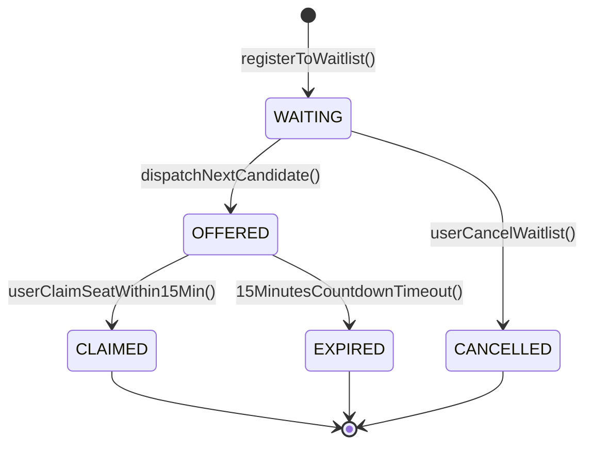
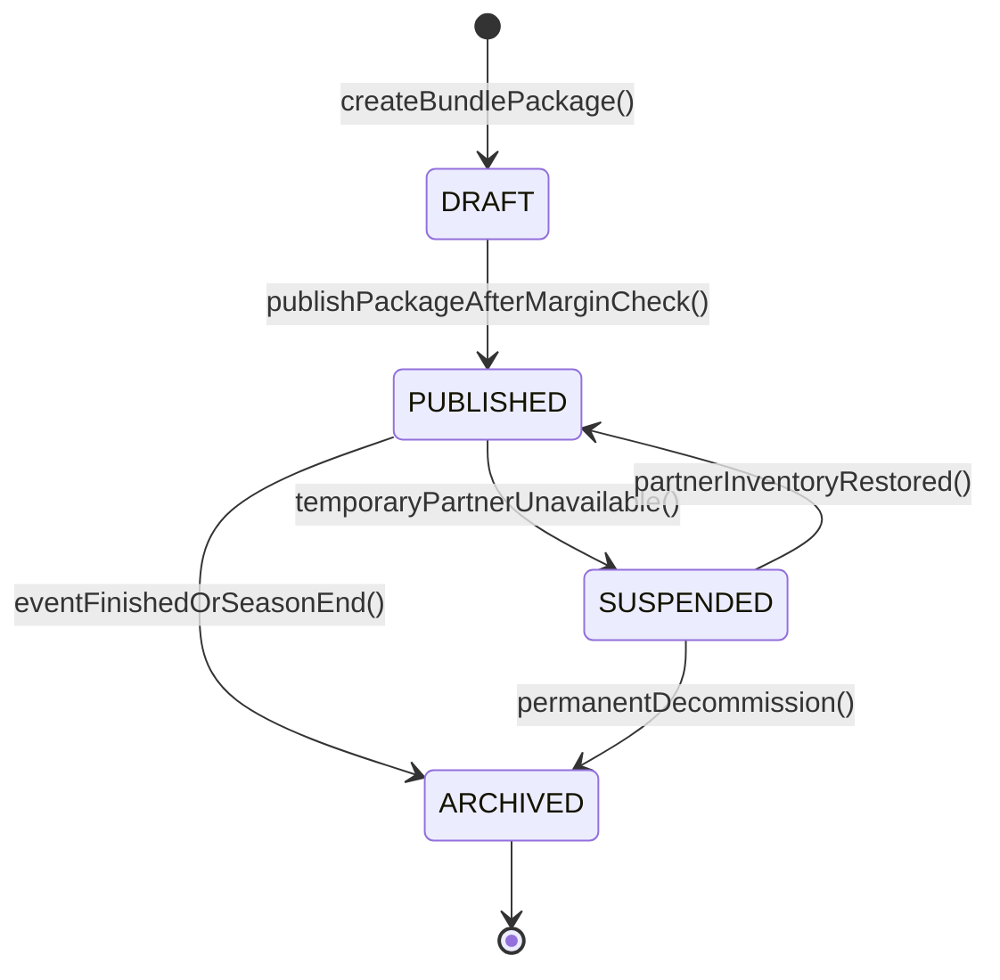

# Arsitektur State Machine Antrean Waitlist & Dynamic Bundling

## 1. Daur Hidup & State Machine Antrean Waitlist (`WaitlistStateMachine`)
Antrean daftar tunggu tiket pertunjukan dikendalikan oleh model keadaan diskrit terdefinisi (*finite state machine*) `WaitlistStateMachine`. Model ini memastikan tidak ada tiket yang menguap atau dialokasikan tanpa jejak audit.

### 1.1. Diagram Keadaan

### 1.2. Transisi Status & Invarian Bisnis
- `WAITING`: Status awal saat pengguna mendaftar ke antrean tiket yang habis terjual. Skor prioritas dihitung secara dinamis oleh `WaitlistPriorityGovernor`.
- `OFFERED`: Tiket tersedia dan dialokasikan eksklusif kepada pengguna teratas. Sistem menerbitkan token reservasi kriptografis dan menetapkan jendela kedaluwarsa tepat 15 menit.
- `CLAIMED`: Pengguna menyelesaikan checkout dan pembayaran dalam jendela 15 menit. Tiket resmi dipindahtangankan.
- `EXPIRED`: Jendela waktu 15 menit berakhir tanpa konfirmasi pembayaran. Tiket dilepaskan dan dialokasikan ke antrean berikutnya.
- `CANCELLED`: Pengguna secara sukarela keluar dari antrean daftar tunggu.

---

## 2. Daur Hidup & State Machine Dynamic Bundling (`DynamicBundlePackageStateMachine`)
Paket bundling terpadu yang memadukan tiket konser, hotel, dan shuttle bus dikelola oleh `DynamicBundlePackageStateMachine`.

### 2.1. Diagram Keadaan

### 2.2. Invarian Operasional
- `DRAFT`: Paket baru dibuat oleh staf kurasi venue. Penjualan ke publik masih ditutup.
- `PUBLISHED`: Paket aktif dan dapat dibeli oleh konsumen di bursa. Validasi memverifikasi bahwa marjin kotor sehat ($\ge 15\%$) dan floor guardrail terkonfigurasi.
- `SUSPENDED`: Ditangguhkan sementara bila inventaris kamar hotel mitra atau armada bus habis.
- `ARCHIVED`: Paket ditutup permanen setelah acara selesai.

