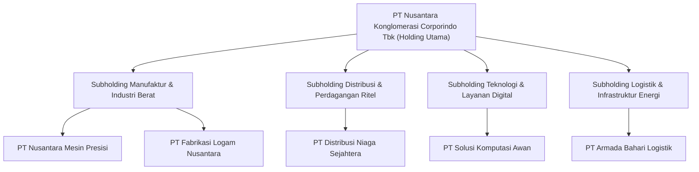

# Arsitektur Tata Kelola Konglomerasi: Struktur Holding, Subholding Sektoral & Anak Perusahaan Operasional

## 1. Desain Struktur Organisasi Korporat
Konglomerasi beroperasi dengan struktur induk berjenjang (*multi-tier corporate holding structure*) yang memisahkan kepemilikan modal strategis dan pelaksanaan operasional komersial.

---

## 2. Hak Tata Kelola & Mekanisme Pengendalian
1. **Hak Pengangkatan Direksi & Komisaris**:
   - Holding memiliki hak mutlak dalam menunjuk dan memberhentikan anggota Direksi dan Dewan Komisaris di seluruh entitas anak.
2. **Kebijakan Dividen Upstream Terjadwal**:
   - Anak perusahaan yang membukukan laba bersih wajib mengalirkan dividen ke entitas induk dengan rasio pembayaran dividen (*Dividend Payout Ratio*) minimal $40\%$ dari laba bersih terverifikasi, setelah pembentukan cadangan wajib sesuai UU Perseroan Terbatas No. 40/2007.
3. **Penyusunan Rencana Kerja & Anggaran Perusahaan (RKAP)**:
   - Setiap entitas anak menyusun RKAP tahunan yang diselaraskan dengan arahan strategis holding sebelum dikunci ke dalam modul `EnterpriseFinance`.

---

## 3. Batas Intervensi Operasional
- Holding berfokus pada alokasi modal (*capital allocation*), audit independen, pemantauan covenant utang, dan sinergi lintas entitas.
- Operasional komersial harian diserahkan penuh kepada manajemen profesional anak perusahaan dengan batasan yang diatur dalam matriks Delegasi Wewenang (*Delegation of Authority / DoA*).
