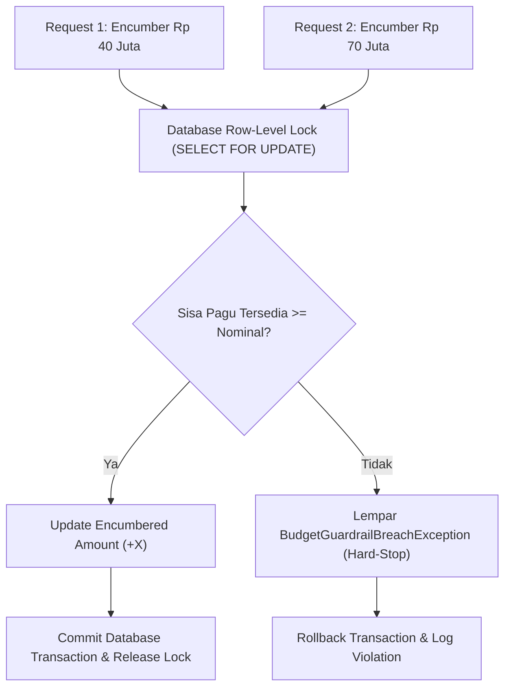

# Arsitektur Teknis: Engine Reservasi Komitmen Anggaran (Encumbrance Engine)

## 1. Masalah Konkurensi & Integritas Belanja
Pada sistem berskala *enterprise*, jamak departemen atau user dapat mengajukan reservasi belanja komitmen secara simultan (*concurrent spend requests*). Jika tidak dilindungi oleh kontrol konkurensi ketat, transaksi paralel dapat menyebabkan kondisi *race condition* yang memicu *budget overdraft* (total pemakaian melampaui pagu yang dialokasikan).



---

## 2. Mekanisme Locking Pesimistik (Pessimistic Row Locking)
Untuk pos anggaran bertipe `HARD_STOP`, proses pengecekan sisa pagu dan penambahan nilai encumbrance dibungkus dalam transaksi database atomik dengan klausa `lockForUpdate()`:
```php
DB::transaction(function () use ($budgetCode, $amountMinor) {
    $budget = EnterpriseBudget::where('budget_code', $budgetCode)
        ->lockForUpdate()
        ->firstOrFail();

    $available = $budget->allocated_amount_idr - ($budget->encumbered_amount_idr + $budget->spent_amount_idr);

    if ($amountMinor > $available && $budget->control_type === 'HARD_STOP') {
        throw new BudgetGuardrailBreachException(
            "Pagu anggaran {$budgetCode} tidak mencukupi (Tersedia: {$available}, Diminta: {$amountMinor})."
        );
    }

    $budget->encumbered_amount_idr += $amountMinor;
    $budget->save();
});
```

---

## 3. Penanganan Pembatalan Komitmen (Encumbrance Release)
Apabila pesanan pembelian (*Purchase Order*) dibatalkan sebelum barang dikirim atau ditolak dalam proses verifikasi mutu, nilai encumbrance dilepaskan kembali secara instan:
$$\text{Encumbered} \leftarrow \max(0, \text{Encumbered} - \text{CancelledAmount})$$
Sehingga pagu belanja kembali tersedia bagi kebutuhan operasional lainnya.
