# Katalog Dependensi Modul SuperWeb

Dokumen ini dihasilkan secara deterministik oleh perintah `php artisan arch:boundaries --format=md`.

## 1. Ringkasan Eksekutif
- **Total Modul**: 65 modul terdaftar
- **Total Busur Dependensi**: 307 dependensi
- **Total Pelanggaran Batas**: 15 pelanggaran
- **Skor Cakupan Kontrak**: 982 permil (98.2%)
- **Jumlah Siklus Dependensi**: 0 siklus

## 2. Diagram Graf Dependensi (Mermaid)

```mermaid
graph TD
    Agency --> Banking
    Agency --> Core
    Agency --> Shared
    Agri --> Banking
    Agri --> Governance
    Asset --> Banking
    Asset --> Core
    Asset --> Shared
    AutoDex --> Core
    AutoDex --> Shared
    AutoServe --> Banking
    AutoServe --> Core
    AutoServe --> Inventory
    AutoServe --> Logistics
    AutoServe --> Mall
    AutoServe --> Mobility
    AutoServe --> Payment
    AutoServe --> Shared
    AutoServe --> Store
    Aviation --> Asset
    Aviation --> Banking
    Aviation --> Core
    Aviation --> Hotel
    Aviation --> Insurance
    Aviation --> Logistics
    Aviation --> Shared
    B2b --> Banking
    Banking --> Agri
    Banking --> B2b
    Banking --> Circular
    Banking --> CloudKitchen
    Banking --> Core
    Banking --> Edu
    Banking --> Egy
    Banking --> EnterpriseFinance
    Banking --> Epc
    Banking --> Esg
    Banking --> Forest
    Banking --> Hcm
    Banking --> Hospital
    Banking --> Hotel
    Banking --> Insurance
    Banking --> Logistics
    Banking --> Manufacturing
    Banking --> Marine
    Banking --> Med
    Banking --> Mining
    Banking --> Mobility
    Banking --> Pricing
    Banking --> ProServices
    Banking --> Proptech
    Banking --> Ret
    Banking --> Rwa
    Banking --> Shared
    Banking --> Tlx
    Banking --> Trade
    Banking --> TradeFinance
    Banking --> Treasury
    Banking --> Vending
    Banking --> Venue
    Banking --> Wealth
    Circular --> Banking
    Circular --> Core
    Circular --> Logistics
    Circular --> Manufacturing
    Circular --> Shared
    CloudKitchen --> Banking
    CloudKitchen --> Core
    CloudKitchen --> Shared
    Contract --> Banking
    Contract --> Core
    Contract --> Logistics
    Contract --> Mall
    Contract --> Party
    Contract --> Resto
    Contract --> Shared
    ControlTower --> Shared
    Core --> Banking
    Core --> Shared
    Crypto --> Banking
    Crypto --> Shared
    Distribution --> Banking
    Distribution --> Core
    Distribution --> Inventory
    Distribution --> Logistics
    Distribution --> Shared
    Distribution --> Store
    Edu --> Banking
    Edu --> Core
    Edu --> Shared
    Egy --> Asset
    Egy --> Banking
    Egy --> Core
    Egy --> Esg
    Egy --> Intercompany
    Egy --> Mobility
    Egy --> Shared
    EnterpriseFinance --> Banking
    EnterpriseFinance --> Shared
    Epc --> Banking
    Epc --> Shared
    Esg --> Banking
    Esg --> Core
    Esg --> Egy
    Fashion --> Shared
    Finance --> Banking
    Finance --> Crypto
    Finance --> Inventory
    Finance --> Payment
    Finance --> Shared
    Finance --> Store
    Forest --> Banking
    Forest --> Esg
    Forest --> Shared
    Governance --> Core
    Governance --> Epc
    Governance --> Hcm
    Governance --> Rwa
    Governance --> Shared
    Hcm --> Banking
    Hcm --> Core
    Hcm --> Edu
    Hcm --> Shared
    Hospital --> Banking
    Hospital --> Core
    Hospital --> Insurance
    Hospital --> Shared
    Hotel --> Banking
    Hotel --> Core
    Hotel --> Hcm
    Hotel --> Resto
    Hotel --> Shared
    Insurance --> Agri
    Insurance --> Banking
    Insurance --> Core
    Insurance --> Hospital
    Insurance --> Party
    Insurance --> Rwa
    Insurance --> Shared
    Integration --> Core
    Integration --> Edu
    Integration --> Egy
    Integration --> Med
    Integration --> Ret
    Integration --> Shared
    Integration --> Tlx
    Intercompany --> Banking
    Intercompany --> Core
    Intercompany --> Shared
    Intercompany --> Treasury
    International --> Banking
    International --> Shared
    Inventory --> Resto
    Inventory --> Store
    Logistics --> AutoDex
    Logistics --> Banking
    Logistics --> Core
    Logistics --> Esg
    Logistics --> Inventory
    Logistics --> Manufacturing
    Logistics --> Payment
    Logistics --> Pricing
    Logistics --> Shared
    Logistics --> Store
    Mall --> Banking
    Mall --> Core
    Mall --> Payment
    Mall --> Shared
    Manufacturing --> Asset
    Manufacturing --> Banking
    Manufacturing --> Core
    Manufacturing --> Edu
    Manufacturing --> Logistics
    Manufacturing --> Pricing
    Manufacturing --> Procurement
    Manufacturing --> Resto
    Manufacturing --> Shared
    Manufacturing --> Store
    Manufacturing --> Supplier
    Marine --> Banking
    Marine --> Insurance
    Marine --> Logistics
    Marine --> Shared
    Marine --> TradeFinance
    Med --> Banking
    Med --> Core
    Med --> Shared
    Mining --> Asset
    Mining --> Banking
    Mining --> Core
    Mining --> Manufacturing
    Mining --> Procurement
    Mining --> Shared
    Mining --> TradeFinance
    Mobility --> Banking
    Mobility --> Core
    Mobility --> Shared
    Partner --> Banking
    Partner --> Core
    Partner --> Shared
    Party --> Logistics
    Party --> Mall
    Party --> Shared
    Payment --> Banking
    Payment --> Core
    Payment --> Shared
    Port --> Asset
    Port --> Banking
    Port --> Esg
    Port --> Insurance
    Port --> Logistics
    Port --> Shared
    Pricing --> Banking
    Pricing --> Core
    Pricing --> Shared
    Pricing --> Store
    ProServices --> Banking
    ProServices --> Core
    ProServices --> Hcm
    ProServices --> Shared
    Procurement --> Banking
    Procurement --> Core
    Procurement --> Inventory
    Procurement --> Logistics
    Procurement --> Manufacturing
    Procurement --> Party
    Procurement --> Shared
    Procurement --> Supplier
    Procurement --> Trade
    Proptech --> Banking
    Proptech --> Shared
    Resto --> Banking
    Resto --> Core
    Resto --> Inventory
    Resto --> Mall
    Resto --> Payment
    Resto --> Shared
    Resto --> Supplier
    Ret --> Banking
    Ret --> Core
    Ret --> Shared
    Rwa --> Banking
    Rwa --> Core
    Rwa --> Party
    Rwa --> Shared
    Shared --> Banking
    Shared --> Core
    Store --> AutoDex
    Store --> AutoServe
    Store --> Banking
    Store --> Core
    Store --> Inventory
    Store --> Logistics
    Store --> Mall
    Store --> Manufacturing
    Store --> Payment
    Store --> Shared
    Supplier --> Contract
    Supplier --> Core
    Supplier --> Party
    Supplier --> Resto
    Supplier --> Shared
    Syariah --> Agri
    Syariah --> Banking
    Syariah --> Core
    Syariah --> Rwa
    Syariah --> Shared
    Tlx --> Banking
    Tlx --> Core
    Tlx --> Intercompany
    Tlx --> Shared
    Trade --> Banking
    Trade --> Contract
    Trade --> Shared
    Trade --> Treasury
    TradeFinance --> Banking
    TradeFinance --> Core
    TradeFinance --> Crypto
    TradeFinance --> Esg
    TradeFinance --> Logistics
    TradeFinance --> Shared
    TradeFinance --> Treasury
    Treasury --> Banking
    Treasury --> Core
    Treasury --> Finance
    Treasury --> Shared
    Vending --> Banking
    Vending --> Core
    Vending --> Shared
    Venue --> Banking
    Venue --> Core
    Venue --> Hospital
    Venue --> Hotel
    Venue --> Insurance
    Venue --> Logistics
    Venue --> Party
    Venue --> Payment
    Venue --> Shared
    Venue --> Trade
    Wealth --> Banking
    Wealth --> Core
    Wealth --> Shared
    Wms --> Core
    Wms --> Inventory
    Wms --> Logistics
    Wms --> Shared
    Wms --> Store
```

## 3. Komponen Terhubung Kuat (SCC)
| ID SCC | Jumlah Modul | Anggota Modul |
|---|---|---|
| SCC-01 | 1 | Agency |
| SCC-02 | 1 | Agri |
| SCC-03 | 1 | Asset |
| SCC-04 | 1 | AutoDex |
| SCC-05 | 1 | AutoServe |
| SCC-06 | 1 | Aviation |
| SCC-07 | 1 | B2b |
| SCC-08 | 1 | Banking |
| SCC-09 | 1 | Circular |
| SCC-10 | 1 | CloudKitchen |
| SCC-11 | 1 | Contract |
| SCC-12 | 1 | ControlTower |
| SCC-13 | 1 | Core |
| SCC-14 | 1 | Crypto |
| SCC-15 | 1 | Distribution |
| SCC-16 | 1 | Edu |
| SCC-17 | 1 | Egy |
| SCC-18 | 1 | EnterpriseFinance |
| SCC-19 | 1 | Epc |
| SCC-20 | 1 | Esg |
| SCC-21 | 1 | Fashion |
| SCC-22 | 1 | Finance |
| SCC-23 | 1 | Food |
| SCC-24 | 1 | Forest |
| SCC-25 | 1 | Governance |
| SCC-26 | 1 | Hcm |
| SCC-27 | 1 | Hospital |
| SCC-28 | 1 | Hotel |
| SCC-29 | 1 | Insurance |
| SCC-30 | 1 | Integration |
| SCC-31 | 1 | Intercompany |
| SCC-32 | 1 | International |
| SCC-33 | 1 | Inventory |
| SCC-34 | 1 | Logistics |
| SCC-35 | 1 | Mall |
| SCC-36 | 1 | Manufacturing |
| SCC-37 | 1 | Marine |
| SCC-38 | 1 | Med |
| SCC-39 | 1 | Mining |
| SCC-40 | 1 | Mobility |
| SCC-41 | 1 | Partner |
| SCC-42 | 1 | Party |
| SCC-43 | 1 | Payment |
| SCC-44 | 1 | Platform |
| SCC-45 | 1 | Plm |
| SCC-46 | 1 | Port |
| SCC-47 | 1 | Pricing |
| SCC-48 | 1 | ProServices |
| SCC-49 | 1 | Procurement |
| SCC-50 | 1 | Proptech |
| SCC-51 | 1 | Resto |
| SCC-52 | 1 | Ret |
| SCC-53 | 1 | Rwa |
| SCC-54 | 1 | Shared |
| SCC-55 | 1 | Store |
| SCC-56 | 1 | Supplier |
| SCC-57 | 1 | Syariah |
| SCC-58 | 1 | Tlx |
| SCC-59 | 1 | Trade |
| SCC-60 | 1 | TradeFinance |
| SCC-61 | 1 | Treasury |
| SCC-62 | 1 | Vending |
| SCC-63 | 1 | Venue |
| SCC-64 | 1 | Wealth |
| SCC-65 | 1 | Wms |

## 4. Skor Cakupan Kontrak per Modul
| Modul Pemanggil | Skor Permil | Persentase |
|---|---|---|
| Agency | 1000 | 100.0% |
| Agri | 400 | 40.0% |
| Asset | 1000 | 100.0% |
| AutoDex | 1000 | 100.0% |
| AutoServe | 1000 | 100.0% |
| Aviation | 1000 | 100.0% |
| B2b | 1000 | 100.0% |
| Banking | 1000 | 100.0% |
| Circular | 1000 | 100.0% |
| CloudKitchen | 571 | 57.1% |
| Contract | 1000 | 100.0% |
| Core | 1000 | 100.0% |
| Crypto | 1000 | 100.0% |
| Distribution | 1000 | 100.0% |
| Edu | 1000 | 100.0% |
| Egy | 1000 | 100.0% |
| EnterpriseFinance | 1000 | 100.0% |
| Epc | 1000 | 100.0% |
| Esg | 1000 | 100.0% |
| Finance | 1000 | 100.0% |
| Forest | 1000 | 100.0% |
| Governance | 1000 | 100.0% |
| Hcm | 357 | 35.7% |
| Hospital | 1000 | 100.0% |
| Hotel | 1000 | 100.0% |
| Insurance | 1000 | 100.0% |
| Integration | 1000 | 100.0% |
| Intercompany | 1000 | 100.0% |
| International | 1000 | 100.0% |
| Inventory | 1000 | 100.0% |
| Logistics | 1000 | 100.0% |
| Mall | 1000 | 100.0% |
| Manufacturing | 1000 | 100.0% |
| Marine | 1000 | 100.0% |
| Med | 1000 | 100.0% |
| Mining | 1000 | 100.0% |
| Mobility | 1000 | 100.0% |
| Partner | 1000 | 100.0% |
| Party | 1000 | 100.0% |
| Payment | 1000 | 100.0% |
| Port | 1000 | 100.0% |
| Pricing | 1000 | 100.0% |
| ProServices | 1000 | 100.0% |
| Procurement | 1000 | 100.0% |
| Proptech | 1000 | 100.0% |
| Resto | 1000 | 100.0% |
| Ret | 1000 | 100.0% |
| Rwa | 1000 | 100.0% |
| Shared | 1000 | 100.0% |
| Store | 1000 | 100.0% |
| Supplier | 1000 | 100.0% |
| Syariah | 1000 | 100.0% |
| Tlx | 1000 | 100.0% |
| Trade | 1000 | 100.0% |
| TradeFinance | 1000 | 100.0% |
| Treasury | 1000 | 100.0% |
| Vending | 1000 | 100.0% |
| Venue | 1000 | 100.0% |
| Wealth | 1000 | 100.0% |
| Wms | 1000 | 100.0% |
