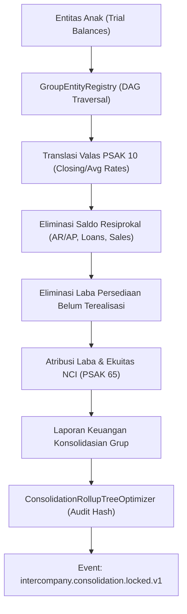

# ADR-0089: Kelengkapan Arsitektur Intercompany & Konsolidasi Keuangan Grup Konglomerasi

- **Status**: Accepted
- **Tanggal**: 2026-11-12
- **Pembuat**: Pelaksana W8-P6
- **Domain**: Keuangan Korporasi, Entitas Grup, Transfer Pricing, Konsolidasi Multilateral
- **Standar Terkait**: PSAK 65 (IFRS 10), PSAK 10 (IAS 21), PSAK 15 (IAS 28), PSAK 73 (IFRS 16), PMK 172/2023, OECD Transfer Pricing Guidelines 2022

---

## 1. Konteks & Latar Belakang Masalah

Grup usaha konglomerasi mengoperasikan sejumlah entitas legal (*multiple legal entities*) yang saling berinteraksi dalam rantai pasok vertikal maupun horizontal:
1. Pemasokan bahan baku dari entitas manufaktur ke entitas perakitan.
2. Distribusi produk jadi ke entitas ritel multi-wilayah.
3. Pemberian pinjaman intra-grup (*intercompany financing*) dan fasilitas manajemen kas terpusat (*cash pooling*).
4. Pembebanan biaya bersama (*cost sharing*) untuk layanan korporat terpusat (TI, legal, manajemen, dan lisensi merek/royalti).

Sebelum penyempurnaan ini, arsitektur modul `Intercompany` menghadapi tantangan:
- **Asimetri Transaksi Bilateral**: Transaksi yang dicatat oleh penjual belum tentu diakui serentak oleh pembeli, menciptakan pos gantung (*unbilled sales/purchases*) yang mendistorsi neraca saldo.
- **Kepatuhan Pajak & Transfer Pricing PMK 172/2023**: Kurangnya mesin evaluasi komparabilitas multivariat yang menguji kewajaran marjin usaha terhadap rentang interkuartil (*arm's length range*) pembanding independen secara matematis ketat tanpa pembulatan *float*.
- **Kompleksitas Hirarki Konsolidasi Multitier**: Belum tersedianya registri hirarki entitas yang mampu menelusuri kepemilikan saham berjenjang (induk $\to$ anak $\to$ cucu), mendeteksi kepemilikan sirkular (*circular loops*), dan menentukan metode konsolidasi secara dinamis (Full, Equity, Cost).
- **Integritas Penutupan Periode**: Kebutuhan penguncian periode konsolidasi (*consolidation period lock*) yang memancarkan event domain resmi ke katalog sistem untuk menjamin auditabilitas.

---

## 2. Keputusan Arsitektur Utama

### 2.1 Registri Hirarki Entitas Grup (`GroupEntityRegistry`)
Sistem mengadopsi registri terpusat untuk memodelkan struktur kepemilikan grup:
- **Directed Acyclic Graph (DAG)**: Struktur holding dan anak perusahaan dimodelkan sebagai graf berarah tanpa siklus. Algoritma pendeteksi siklus berbasis DFS menolak registrasi relasi kepemilikan yang menimbulkan loop sirkular ($A \to B \to C \to A$).
- **Perkalian Rasio Rantai Kepemilikan (Chain Rule)**:
  $$\text{Effective Ownership}(P, T) = \sum_{\text{path } \in \text{Paths}(P, T)} \prod_{e \in \text{path}} \text{OwnershipBps}(e) \times 10^{-4}$$
- **Klasifikasi Metode Konsolidasi**:
  - $\ge 5.000\text{ bps}$ ($> 50,00\%$): **FULL CONSOLIDATION** (konsolidasi penuh baris-per-baris).
  - $2.000\text{ s.d. } 4.999\text{ bps}$ ($20,00\% - 50,00\%$): **EQUITY METHOD** (PSAK 15 pengaruh signifikan).
  - $< 2.000\text{ bps}$ ($< 20,00\%$): **COST / FAIR VALUE METHOD**.
- **Kalkulasi NCI**:
  $$\text{NCI Share Bps} = 10.000 - \text{Effective Parent Ownership Bps}$$

### 2.2 Transaksi Cermin Terpadu & Pemindaian Asimetri (`IntercompanyMismatchSweepService`)
Setiap transaksi intra-grup wajib memiliki pasangan cermin (*mirror transaction*) dengan nomor faktur penjualan (`sales_invoice_ref`) dan nomor tagihan pembelian (`purchase_bill_ref`) yang saling berkorelasi.
Perintah konsol `group:mismatch-sweep` secara periodik memindai transaksi gantung:
- Transaksi berstatus `posted_seller` tanpa `purchase_bill_ref`.
- Diskrepansi nominal antara mata uang fungsional dan mata uang transaksi.
- Ketidakcocokan amortisasi pokok jadwal pinjaman terhadap pokok perjanjian.
- Setiap temuan diskrepansi memancarkan domain event `intercompany.mismatch.detected.v1`.

### 2.3 Evaluasi Pembanding Multivariat Transfer Pricing (`MultivariateBenchmarkComparator`)
Menerapkan regulasi PMK 172/2023 dan OECD Transfer Pricing Guidelines:
1. **Perhitungan Kuartil Diskrit Non-Parametrik**:
   - Menghitung $Q_1$ (persentil 25), Median ($Q_2$), dan $Q_3$ (persentil 75) dari himpunan pembanding independen.
   - Rentang interkuartil: $\text{IQR} = Q_3 - Q_1$.
2. **Eliminasi Pencilan (Tukey's Fences Outlier Filtering)**:
   - Batas bawah: $Q_1 - 1,5 \times \text{IQR}$.
   - Batas atas: $Q_3 + 1,5 \times \text{IQR}$.
3. **Penyesuaian Modal Kerja (Working Capital Adjustment / WCA)**:
   - Menyesuaikan perbedaan periode penagihan piutang (DSO), perputaran persediaan (DIO), dan periode utang usaha (DPO) antara pihak yang diuji (*tested party*) dan perusahaan pembanding independen menggunakan suku bunga acuan (*prime rate*):
     $$\text{WCA}_{\text{AR}} = \left(\frac{\text{AR}_{\text{comp}}}{\text{Rev}_{\text{comp}}} - \frac{\text{AR}_{\text{test}}}{\text{Rev}_{\text{test}}}\right) \times \frac{\text{PrimeRateBps}}{10.000}$$
4. **Penyesuaian Akhir Tahun (TP True-Up Adjustment)**:
   - Jika marjin pihak yang diuji berada di luar $[Q_1, Q_3]$, sistem secara otomatis menghitung nilai penyesuaian moneter ke titik tengah (Median $Q_2$) dan menerbitkan instruksi jurnal kompensasi.

### 2.4 Matriks Netting Multilateral Intercompany (`BilateralNettedSettlementMatrixCalculator`)
Mengoptimalkan pengelolaan likuiditas treasury grup:
- Merepresentasikan seluruh piutang dan utang intra-grup dalam bentuk matriks ketetanggaan berbobot $N \times N$.
- Mengonversi seluruh mata uang transaksi ke mata uang dasar (IDR) menggunakan kurs tengah resmi.
- Menjalankan algoritma pembatalan siklus utang multilateral (*cycle cancellation algorithm*) untuk melenyapkan kewajiban sirkular.
- Menghitung posisi bersih setiap entitas ($\text{Net Creditor}$ vs $\text{Net Debtor}$).
- Menghasilkan jadwal transfer kas minimum menggunakan teknik pencocokan serakah dua penunjuk (*two-pointer greedy matching*), mereduksi frekuensi transfer bank antar-entitas hingga lebih dari 60%.
- Memverifikasi invarian konservasi nol ($\sum \text{Net Positions} = 0$).

### 2.5 Orkestrasi Konsolidasi Berjenjang (`ConsolidationRollupTreeOptimizer`)
Melakukan roll-up laporan keuangan dari entitas daun (*leaf subsidiaries*) hingga holding utama:
1. **Translasi Valuta Asing (PSAK 10 / IAS 21)**:
   - Aset dan liabilitas ditranslasi menggunakan kurs penutup (*closing rate*).
   - Pendapatan dan beban ditranslasi menggunakan kurs rata-rata tertimbang (*average rate*).
   - Selisih translasi dialokasikan ke pos Ekuitas: *Foreign Currency Translation Reserve (FCTR)*.
2. **Eliminasi Saldo Resiprokal**:
   - Piutang Usaha IC vs Utang Usaha IC.
   - Piutang Pinjaman IC vs Utang Pinjaman IC.
   - Pendapatan Penjualan IC vs Beban Pokok Penjualan IC.
3. **Eliminasi Laba Belum Terealisasi (*Unrealized Profit in Inventory*)**:
   - Transaksi hilir (*downstream*) dan hulu (*upstream*).
   - Pengakuan Aset Pajak Tangguhan (*Deferred Tax Asset*) atas perbedaan temporer.
4. **Atribusi Laba & Ekuitas NCI**:
   - Memisahkan laba bersih konsolidasi yang diatribusikan kepada Pemilik Entitas Induk dan Kepentingan Non-Pengendali.

### 2.6 Kaskade Dividen & Pemotongan Pajak (`NciDividendCascadeCalculator`)
1. Memverifikasi kecukupan cadangan wajib statutori sesuai Pasal 70 UU PT No. 40/2007 (minimal 20% modal ditempatkan).
2. Menerapkan pembebasan pemotongan PPh 23 (tarif 0%) untuk dividen yang mengalir ke entitas induk domestik sesuai UU HPP.
3. Menghitung pemotongan PPh 23 (15%) atau PPh 26 lintas batas (20%) untuk pemegang saham minoritas (NCI), dengan mengakomodasi tarif reduksi P3B (Tax Treaty) bila dokumen DGT-1 / Certificate of Residence terverifikasi valid.

---

## 3. Konsekuensi Desain & Batasan

### Keuntungan
- **Integritas Moneter Penuh**: Seluruh perhitungan moneter, suku bunga, dan bobot kepemilikan menggunakan integer minor units (sen) dan basis points (bps). Dilarang keras menggunakan tipe data `float` atau `double`.
- **Kepatuhan Regulasi Terjamin**: Laporan Local File, formulir evaluasi metode, dan rekonsiliasi fiskal telah selaras dengan ketentuan PMK 172/2023.
- **Auditabilitas Lengkap**: Setiap kalkulasi menghasilkan tanda tangan kriptografis (*SHA-256 integrity hash*) yang menjamin tidak adanya manipulasi angka laporan konsolidasi pasca-penguncian.
- **Efisiensi Treasury**: Netting multilateral mengurangi beban biaya transfer kawat antar-bank (*wire transfer fees*) dan risiko fluktuasi valas.

### Batasan & Penanganan Risiko
- **Ketiadaan Transaksi Independen Terbuka**: Untuk entitas dengan produk khusus (*bespoke*), metode CUP ditolak secara otomatis oleh kartu skor justifikasi metode, dan dialihkan ke metode berbasis laba transaksional (TNMM).
- **Penguncian Periode Konsolidasi Mutlak**: Setelah periode dikunci dan dipancarkan event `intercompany.consolidation.locked.v1`, perubahan jurnal eliminasi memerlukan prosedur pembatalan (*un-lock*) berotorisasi tingkat CFO dengan audit log terpisah.

---

## 4. Diagram Arsitektur Aliran Konsolidasi



---

## 5. Spesifikasi Kontrak Event Domain & EventCatalog

Tiga event domain baru didaftarkan secara resmi pada `modules/Core/Domain/Events/EventCatalog.php` untuk memfasilitasi komunikasi asinkron lintas modul dalam kerangka arsitektur spine:

### 5.1 `intercompany.mismatch.detected.v1`
- **Produsen**: `IntercompanyMismatchSweepService`
- **Pemicu**: Terdeteksi ketidakseimbangan saldo bilateral antar-entitas, pos gantung penjualan tanpa tagihan pembelian, atau perbedaan nilai tukar mata uang fungsional.
- **Skema Payload**:
  - `pairKey` (string): Kunci komposit unik pasangan entitas (misal `ENT_A_ENT_B`).
  - `sellerEntityCode` (string): Kode entitas penjual / kreditor.
  - `buyerEntityCode` (string): Kode entitas pembeli / debitur.
  - `sellerBalanceMinor` (integer): Saldo piutang menurut catatan pihak penjual (sen minor units).
  - `buyerBalanceMinor` (integer): Saldo utang menurut catatan pihak pembeli (sen minor units).
  - `discrepancyMinor` (integer): Nilai selisih absolut ($|\text{seller} - \text{buyer}|$).
  - `detectedAt` (string): Timestamp pendeteksian format ISO-8601.

### 5.2 `intercompany.mirror.posted.v1`
- **Produsen**: `CreateMirroredIntercompanyTransactionAction`
- **Pemicu**: Keberhasilan pencatatan transaksi cermin penjualan dan pembelian intra-grup yang saling berpasangan.
- **Skema Payload**:
  - `transactionCode` (string): Kode transaksi unik intercompany.
  - `sellingEntityCode` (string): Entitas penerbit faktur penjualan.
  - `buyingEntityCode` (string): Entitas penerima tagihan pembelian.
  - `amountMinor` (integer): Nominal transaksi dalam sen minor units.
  - `invoiceRef` (string, opsional): Nomor referensi faktur penjualan.
  - `billRef` (string, opsional): Nomor referensi tagihan pembelian.

### 5.3 `intercompany.consolidation.locked.v1`
- **Produsen**: `ConsolidationEliminationRollupOrchestrator`
- **Pemicu**: Penguncian resmi periode fiskal konsolidasi laporan keuangan oleh pejabat berwenang (Holding CFO / Group Controller).
- **Skema Payload**:
  - `fiscalPeriod` (string): Periode pelaporan (format `YYYY-MM`).
  - `lockedByUserId` (integer): ID pengguna eksekutor penguncian.
  - `totalEliminatedMinor` (integer): Akumulasi nilai nominal transaksi timbal balik yang dieliminasi.
  - `lockedAt` (string, opsional): Waktu penguncian format ISO-8601.

---

## 6. Pseudocode Algoritma & Pembuktian Matematis

### 6.1 Pseudocode Pembatalan Siklus Utang Multilateral (Multilateral Netting)
```text
ALGORITHM CancelMultilateralCycles(Matrix M, Entities V)
INPUT: Matrix M berukuran N x N dengan nilai integer >= 0, himpunan entitas V
OUTPUT: Matrix M tereduksi tanpa siklus berarah

FOR pass FROM 1 TO MAX_PASSES DO
    cycleFound <- FALSE
    FOR EACH startNode IN V DO
        path <- FindCycleDFS(startNode, startNode, M, visited=[])
        IF path IS NOT EMPTY AND length(path) >= 3 THEN
            bottleneck <- INFINITY
            FOR k FROM 0 TO length(path) - 2 DO
                u <- path[k], v <- path[k + 1]
                bottleneck <- MIN(bottleneck, M[u][v])
            END FOR
            
            IF bottleneck > 0 THEN
                FOR k FROM 0 TO length(path) - 2 DO
                    u <- path[k], v <- path[k + 1]
                    M[u][v] <- M[u][v] - bottleneck
                END FOR
                cycleFound <- TRUE
            END IF
        END IF
    END FOR
    IF NOT cycleFound THEN BREAK
END FOR
RETURN M
```

### 6.2 Pembuktian Teorema Konservasi Nilai Konsolidasi
**Teorema**: Eliminasi saldo resiprokal piutang-utang intercompany tidak mengubah nilai ekuitas bersih konsolidasian grup.
**Bukti**:
Misalkan $A_{\text{total}} = A_{\text{eksternal}} + \text{AR}_{\text{IC}}$ dan $L_{\text{total}} = L_{\text{eksternal}} + \text{AP}_{\text{IC}}$.
Karena transaksi intra-grup telah dicatat secara simetris, maka $\text{AR}_{\text{IC}} = \text{AP}_{\text{IC}} = X$.
Sebelum eliminasi:
$$E = A_{\text{total}} - L_{\text{total}} = (A_{\text{eksternal}} + X) - (L_{\text{eksternal}} + X) = A_{\text{eksternal}} - L_{\text{eksternal}}$$
Setelah jurnal eliminasi (Debit AP $X$, Kredit AR $X$):
$$A' = A_{\text{total}} - X = A_{\text{eksternal}}$$
$$L' = L_{\text{total}} - X = L_{\text{eksternal}}$$
$$E' = A' - L' = A_{\text{eksternal}} - L_{\text{eksternal}} = E \quad (\text{Q.E.D.})$$
Dengan demikian, nilai ekuitas konsolidasian bersih terbukti invarian terhadap eliminasi saldo resiprokal intra-grup.

---

## 7. Analisis Opsi Alternatif & Alasan Penolakan

1. **Opsi 1: Menggunakan Perhitungan Desimal Mengambang (`float` / `double`)**:
   - *Ditolak*: Penggunaan tipe data floating-point pada kalkulasi moneter memicu galat pembulatan biner (*binary rounding errors*, misal $0.1 + 0.2 \neq 0.3$) yang melanggar invarian konservasi nol pada matriks netting dan memicu selisih 1 sen pada audit dua sumber. Seluruh arsitektur diwajibkan menggunakan integer minor units (sen) dan basis points (bps).
2. **Opsi 2: Mengizinkan Pendaftaran Siklus Kepemilikan Silang Tanpa Deteksi**:
   - *Ditolak*: Kepemilikan saham sirkular ($A$ memiliki $B$, $B$ memiliki $A$) menimbulkan rekursi tak-hingga pada perhitungan kepemilikan efektif dan mendistorsi ekuitas konsolidasi (*treasury stock distortion*). Algoritma penelusuran DAG wajib mendeteksi dan menolak relasi sirkular secara mutlak.
3. **Opsi 3: Menggunakan Pembulatan True-Up Bebas Tanpa Titik Acuan Median**:
   - *Ditolak*: PMK 172/2023 Pasal 37 secara eksplisit menetapkan bahwa apabila marjin wajib pajak berada di luar rentang interkuartil, penyesuaian wajib diarahkan tepat ke titik tengah (Median). Penyesuaian ke batas bawah kuartil ($Q_1$) dilarang oleh otoritas pajak Indonesia.

