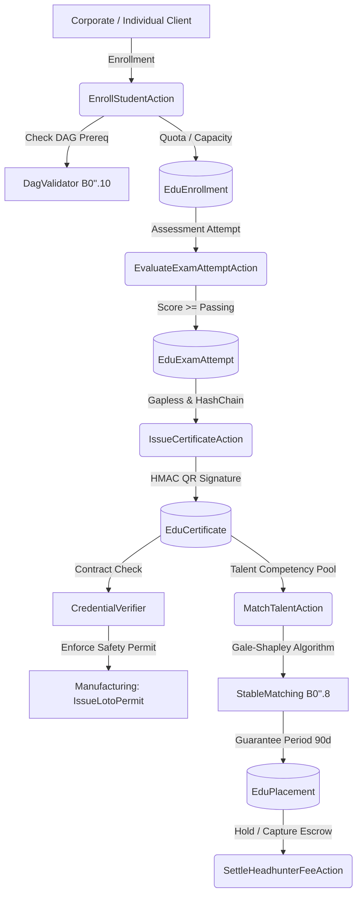

# Design Specification — Lini 16: Pendidikan & Talent (Edu) MVP

## 1. Arsitektur Komponen

Modul `Edu` mengelola siklus hidup pelatihan profesional, asesmen terakreditasi, penerbitan sertifikat digital ber-hash-chain, verifikasi kredensial lintas modul, dan pencocokan talenta pasar kerja (Gale-Shapley).



---

## 2. Skema Database Relasional

### 2.1 Tabel Inti Pelatihan & Asesmen
```sql
-- Program Pelatihan
CREATE TABLE edu_programs (
    id VARCHAR(36) PRIMARY KEY,
    program_code VARCHAR(64) UNIQUE NOT NULL,
    title VARCHAR(255) NOT NULL,
    industry_sector VARCHAR(64) NOT NULL,
    tuition_fee_minor BIGINT NOT NULL,
    passing_score INT NOT NULL DEFAULT 75,
    validity_months INT NOT NULL DEFAULT 24,
    status VARCHAR(32) NOT NULL DEFAULT 'ACTIVE',
    created_at TIMESTAMP NULL,
    updated_at TIMESTAMP NULL
);

-- Graf Prasyarat (Anti-Siklus DAG)
CREATE TABLE edu_prerequisites (
    id VARCHAR(36) PRIMARY KEY,
    program_id VARCHAR(36) NOT NULL,
    prerequisite_program_id VARCHAR(36) NOT NULL,
    created_at TIMESTAMP NULL,
    updated_at TIMESTAMP NULL,
    FOREIGN KEY (program_id) REFERENCES edu_programs(id) ON DELETE CASCADE,
    FOREIGN KEY (prerequisite_program_id) REFERENCES edu_programs(id) ON DELETE CASCADE,
    UNIQUE (program_id, prerequisite_program_id)
);

-- Rombongan Belajar (Cohort)
CREATE TABLE edu_cohorts (
    id VARCHAR(36) PRIMARY KEY,
    cohort_code VARCHAR(64) UNIQUE NOT NULL,
    program_id VARCHAR(36) NOT NULL,
    instructor_party_id VARCHAR(64) NOT NULL,
    max_capacity INT NOT NULL,
    enrolled_count INT NOT NULL DEFAULT 0,
    start_date DATE NOT NULL,
    end_date DATE NOT NULL,
    status VARCHAR(32) NOT NULL DEFAULT 'ACTIVE',
    created_at TIMESTAMP NULL,
    updated_at TIMESTAMP NULL,
    FOREIGN KEY (program_id) REFERENCES edu_programs(id) ON DELETE CASCADE
);

-- Kuota Korporat B2B
CREATE TABLE edu_corporate_quotas (
    id VARCHAR(36) PRIMARY KEY,
    corporate_client_id VARCHAR(64) NOT NULL,
    program_id VARCHAR(36) NOT NULL,
    quota_total INT NOT NULL,
    quota_used INT NOT NULL DEFAULT 0,
    unit_price_minor BIGINT NOT NULL,
    status VARCHAR(32) NOT NULL DEFAULT 'ACTIVE',
    idempotency_key VARCHAR(128) UNIQUE NULL,
    created_at TIMESTAMP NULL,
    updated_at TIMESTAMP NULL,
    FOREIGN KEY (program_id) REFERENCES edu_programs(id) ON DELETE CASCADE
);

-- Pendaftaran Siswa
CREATE TABLE edu_enrollments (
    id VARCHAR(36) PRIMARY KEY,
    enrollment_code VARCHAR(64) UNIQUE NOT NULL,
    student_user_id BIGINT UNSIGNED NOT NULL,
    cohort_id VARCHAR(36) NOT NULL,
    corporate_quota_id VARCHAR(36) NULL,
    amount_paid_minor BIGINT NOT NULL DEFAULT 0,
    status VARCHAR(32) NOT NULL DEFAULT 'ENROLLED',
    idempotency_key VARCHAR(128) UNIQUE NULL,
    created_at TIMESTAMP NULL,
    updated_at TIMESTAMP NULL,
    FOREIGN KEY (student_user_id) REFERENCES users(id) ON DELETE CASCADE,
    FOREIGN KEY (cohort_id) REFERENCES edu_cohorts(id) ON DELETE CASCADE,
    FOREIGN KEY (corporate_quota_id) REFERENCES edu_corporate_quotas(id) ON DELETE SET NULL,
    UNIQUE (student_user_id, cohort_id)
);

-- Fakta Asesmen Append-Only
CREATE TABLE edu_exam_attempts (
    id VARCHAR(36) PRIMARY KEY,
    attempt_code VARCHAR(64) UNIQUE NOT NULL,
    student_user_id BIGINT UNSIGNED NOT NULL,
    enrollment_id VARCHAR(36) NOT NULL,
    score INT NOT NULL,
    passing_score INT NOT NULL,
    is_passed BOOLEAN NOT NULL,
    proctor_verification_hash VARCHAR(64) NOT NULL,
    status VARCHAR(32) NOT NULL DEFAULT 'COMPLETED',
    created_at TIMESTAMP NULL,
    updated_at TIMESTAMP NULL,
    FOREIGN KEY (student_user_id) REFERENCES users(id) ON DELETE CASCADE,
    FOREIGN KEY (enrollment_id) REFERENCES edu_enrollments(id) ON DELETE CASCADE
);

-- Sertifikat Digital Gapless Ber-Hash-Chain
CREATE TABLE edu_certificates (
    id VARCHAR(36) PRIMARY KEY,
    certificate_number VARCHAR(64) UNIQUE NOT NULL,
    program_id VARCHAR(36) NOT NULL,
    student_user_id BIGINT UNSIGNED NOT NULL,
    exam_attempt_id VARCHAR(36) NOT NULL,
    issued_at TIMESTAMP NOT NULL,
    expires_at TIMESTAMP NOT NULL,
    prev_hash VARCHAR(64) NOT NULL,
    certificate_hash VARCHAR(64) NOT NULL,
    qr_token VARCHAR(255) NOT NULL,
    status VARCHAR(32) NOT NULL DEFAULT 'ACTIVE',
    idempotency_key VARCHAR(128) UNIQUE NULL,
    created_at TIMESTAMP NULL,
    updated_at TIMESTAMP NULL,
    FOREIGN KEY (program_id) REFERENCES edu_programs(id) ON DELETE CASCADE,
    FOREIGN KEY (student_user_id) REFERENCES users(id) ON DELETE CASCADE,
    FOREIGN KEY (exam_attempt_id) REFERENCES edu_exam_attempts(id) ON DELETE CASCADE
);

-- Sekuens Penomoran Gapless per Program per Tahun
CREATE TABLE edu_certificate_sequences (
    id VARCHAR(36) PRIMARY KEY,
    program_id VARCHAR(36) NOT NULL,
    year_period INT NOT NULL,
    last_sequence BIGINT NOT NULL DEFAULT 0,
    updated_at TIMESTAMP NULL,
    FOREIGN KEY (program_id) REFERENCES edu_programs(id) ON DELETE CASCADE,
    UNIQUE (program_id, year_period)
);
```

### 2.2 Tabel Talent Matching & Headhunter
```sql
-- Lowongan Pekerjaan
CREATE TABLE edu_job_openings (
    id VARCHAR(36) PRIMARY KEY,
    opening_code VARCHAR(64) UNIQUE NOT NULL,
    hiring_entity VARCHAR(64) NOT NULL,
    title VARCHAR(255) NOT NULL,
    capacity INT NOT NULL DEFAULT 1,
    annual_salary_minor BIGINT NOT NULL,
    headhunter_fee_bps INT NOT NULL DEFAULT 1500,
    required_credential_code VARCHAR(64) NOT NULL,
    status VARCHAR(32) NOT NULL DEFAULT 'OPEN',
    created_at TIMESTAMP NULL,
    updated_at TIMESTAMP NULL
);

-- Preferensi Pelamar
CREATE TABLE edu_talent_preferences (
    id VARCHAR(36) PRIMARY KEY,
    student_user_id BIGINT UNSIGNED NOT NULL,
    opening_id VARCHAR(36) NOT NULL,
    rank_order INT NOT NULL,
    created_at TIMESTAMP NULL,
    updated_at TIMESTAMP NULL,
    FOREIGN KEY (student_user_id) REFERENCES users(id) ON DELETE CASCADE,
    FOREIGN KEY (opening_id) REFERENCES edu_job_openings(id) ON DELETE CASCADE,
    UNIQUE (student_user_id, opening_id)
);

-- Penempatan Kerja (Placement)
CREATE TABLE edu_placements (
    id VARCHAR(36) PRIMARY KEY,
    placement_code VARCHAR(64) UNIQUE NOT NULL,
    student_user_id BIGINT UNSIGNED NOT NULL,
    opening_id VARCHAR(36) NOT NULL,
    placed_at DATE NOT NULL,
    guarantee_days INT NOT NULL DEFAULT 90,
    status VARCHAR(32) NOT NULL DEFAULT 'PLACED',
    idempotency_key VARCHAR(128) UNIQUE NULL,
    created_at TIMESTAMP NULL,
    updated_at TIMESTAMP NULL,
    FOREIGN KEY (student_user_id) REFERENCES users(id) ON DELETE CASCADE,
    FOREIGN KEY (opening_id) REFERENCES edu_job_openings(id) ON DELETE CASCADE
);

-- Fee Headhunter & Escrow Warranty
CREATE TABLE edu_headhunter_fees (
    id VARCHAR(36) PRIMARY KEY,
    placement_id VARCHAR(36) NOT NULL,
    fee_minor BIGINT NOT NULL,
    status VARCHAR(32) NOT NULL DEFAULT 'HELD',
    held_at TIMESTAMP NOT NULL,
    captured_at TIMESTAMP NULL,
    released_at TIMESTAMP NULL,
    idempotency_key VARCHAR(128) UNIQUE NULL,
    created_at TIMESTAMP NULL,
    updated_at TIMESTAMP NULL,
    FOREIGN KEY (placement_id) REFERENCES edu_placements(id) ON DELETE CASCADE
);
```

---

## 3. Matriks Transaksi & Pembukuan Ledger

| Skenario Bisnis | Akun Debit (-) | Akun Kredit (+) | Keterangan |
|---|---|---|---|
| Pembayaran Tuition Mandiri | `edu:tuition_receivable:IDR` | `edu:tuition_revenue:IDR` | Pengakuan pendapatan pendaftaran publik |
| Tagihan Pelatihan Korporat B2B | `ar:edu:corporate:{client}:IDR` | `edu:corporate_revenue:IDR` | Tagihan kuota korporat prabayar |
| Penempatan Headhunter (Hold Escrow) | `edu:headhunter_receivable:IDR` | `escrow:headhunter_guarantee:IDR` | Dana fee ditahan selama garansi 90 hari |
| Lolos Garansi Kerja (Capture) | `escrow:headhunter_guarantee:IDR` | `edu:headhunter_revenue:IDR` | Pengakuan pendapatan jasa talent |
| Resign Sebelum Garansi (Release) | `escrow:headhunter_guarantee:IDR` | `edu:headhunter_receivable:IDR` | Pengembalian dana fee kepada klien perekrut |

---

## 4. Algoritma & Verifikasi Sertifikat

### 4.1 Validasi Graf Prasyarat DAG (B0″.10 `DagValidator`)
1. Setiap penambahan sisi prasyarat $(u, v)$ divalidasi tidak menimbulkan siklus.
2. Jika ditemukan siklus, sistem menolak dengan `PrerequisiteCycleException` menyertakan lintasan siklus $A \to B \to C \to A$.
3. Pendaftaran siswa menghitung penutupan transitif (transitive closure) $T(u)$. Siswa wajib memiliki sertifikat aktif untuk seluruh $v \in T(u)$.

### 4.2 Penomoran Gapless & Hash-Chain Sertifikat (S4)
1. Penomoran sekuensial dikunci atomik dengan `lockForUpdate` pada `edu_certificate_sequences`.
2. Format nomor: `CERT-{YEAR}-{PROGRAM_CODE}-{SEQUENCE:06d}`.
3. Hash kanonik dihitung berantai:
   $$\text{Hash}_n = \text{SHA256}(\text{Hash}_{n-1} \parallel \text{JSON}(\text{Payload Kanonik}))$$
4. Generator token verifikasi publik:
   $$\text{QR} = \text{UUID} \cdot \text{KEY\_ID} \cdot \text{HMAC-SHA256}(\text{UUID} \parallel \text{KEY\_ID}, \text{SecretKey})$$
5. Endpoint verifikasi publik hanya menampilkan status sertifikat, nama program, tanggal terbit, dan masa berlaku (tanpa PII sensitif).

### 4.3 Talent Matching (B0″.8 `StableMatching`)
1. Many-to-one Gale-Shapley matching di mana kandidat bertindak sebagai pihak yang mengusulkan (*proposers*).
2. Preferensi perusahaan didasarkan pada skor kompetensi terverifikasi (dari sertifikat aktif).
3. Hasil matching diverifikasi oleh `BlockingPairVerifier` untuk menjamin tidak ada pasangan yang saling lebih memilih satu sama lain di luar hasil matching.

---

## 5. Audit Dua Sumber (`edu:audit`)

1. **Rekonsiliasi Sertifikat vs Asesmen**:
   $$\text{EduCertificate::count()} \le \text{EduExamAttempt::where('is_passed', true)->count()}$$
2. **Integritas Penomoran Gapless**:
   Verifikasi tidak ada nomor urut yang hilang per program per tahun ($\max(\text{seq}) = \text{count}(\text{seq})$).
3. **Verifikasi Rantai Hash Kanonik**:
   Setiap link pada program diverifikasi dengan `CanonicalHashChainVerifier::verifyChain`.
4. **Rekonsiliasi Kuota Korporat**:
   $$\sum \text{quota\_used} = \text{EduEnrollment::whereNotNull('corporate_quota_id')->count()}$$
5. **Rekonsiliasi Escrow Headhunter**:
   Saldo `escrow:headhunter_guarantee:IDR` harus persis sama dengan $\sum \text{fee}$ berstatus `HELD`.
