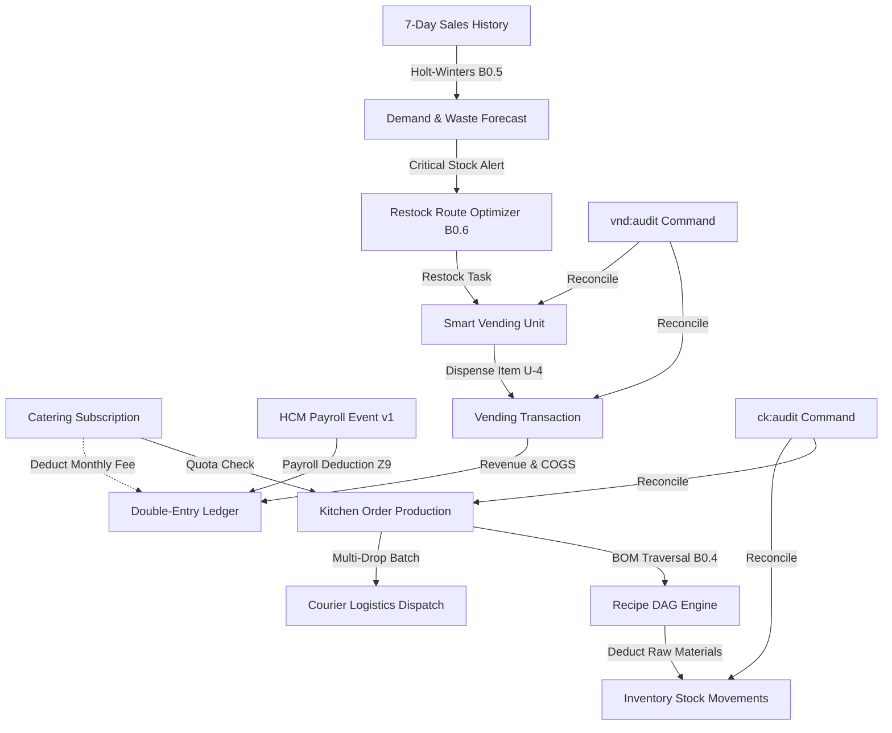

# Architecture Design Document — LINI 5: Kuliner (CloudKitchen & Smart Vending MVP)

## 1. Ikhtisar Arsitektur Lini 5

Lini Kuliner menyatukan dapur bersama modern (CloudKitchen) dan jaringan ritel otomatis nir-awak (Smart Vending) ke dalam ekosistem konglomerasi SuperWeb. Seluruh transaksi finansial terikat ke double-entry general ledger, perhitungan biaya dan pendapatan mematuhi U-1 (integer minor rupiah, basis points, zero floats), dan pergerakan persediaan bahan baku maupun produk jadi dikelola secara deterministik.

---

## 2. Skema Basis Data & Prefiks Canonical (Z12, Z13)

Sesuai aturan KONSEP §3F baris 651 dan `config/modules.php`:
- Modul CloudKitchen menggunakan prefiks canonical: `ckt_*`.
- Modul Vending menggunakan prefiks canonical: `vnd_*`.

### Tabel CloudKitchen (`ckt_*`)
1. **`ckt_kitchens`**: Data master fasilitas dapur hantu (ghost kitchen).
   - `id`, `kitchen_code` (unique), `name`, `type` (satellite, central, licensed_outlet), `hourly_capacity` (int), `current_hourly_load` (int), `service_radius_km` (int/scale), `is_active` (bool), timestamps.
2. **`ckt_recipes`**: Master resep masakan / menu virtual brand (BOM header).
   - `id`, `recipe_code` (unique), `name`, `brand_name`, `selling_price_idr` (int), `estimated_prep_minutes` (int), `is_active` (bool), timestamps.
3. **`ckt_recipe_ingredients`**: Edge komponen bahan dalam graf resep (BOM DAG).
   - `id`, `parent_recipe_id` (FK), `child_recipe_id` (FK nullable untuk sub-resep), `ingredient_code` (string), `quantity_required` (int), `unit` (gram, ml, piece), `cost_per_unit_idr` (int), timestamps.
4. **`ckt_catering_subscriptions`**: Pendaftaran langganan katering karyawan korporat.
   - `id`, `subscription_code` (unique), `user_id` (FK users), `package_name` (string), `daily_quota` (int), `monthly_fee_idr` (int), `daily_meal_price_idr` (int), `starts_at` (date), `expires_at` (date), `status` (active, paused, cancelled), timestamps.
5. **`ckt_orders`**: Pesanan makanan katering / virtual brand yang diproduksi.
   - `id`, `order_code` (unique), `subscription_id` (FK ckt_catering_subscriptions), `kitchen_id` (FK ckt_kitchens), `recipe_id` (FK ckt_recipes), `delivery_date` (date), `meal_slot` (lunch, dinner), `status` (pending, preparing, in_transit, delivered, cancelled), `meal_cost_idr` (int), `idempotency_key` (unique), timestamps.
6. **`ckt_ingredient_consumptions`**: Catatan konsumsi bahan baku per batch produksi dapur (append-only facts).
   - `id`, `order_id` (FK ckt_orders), `ingredient_code` (string), `quantity_consumed` (int), `unit_cost_idr` (int), `total_cogs_idr` (int), `movement_idempotency_key` (unique), created_at.

### Tabel Vending (`vnd_*`)
1. **`vnd_units`**: Mesin smart vending terdaftar sebagai lokasi stok.
   - `id`, `unit_code` (unique), `location_name` (string), `latitude` (int scale 1e6), `longitude` (int scale 1e6), `current_stock` (int), `max_capacity` (int), `critical_threshold` (int), `status` (active, maintenance, offline), `total_sales_count` (int), `total_sales_idr` (int), timestamps.
2. **`vnd_items`**: Katalog item/produk makanan & minuman dalam mesin.
   - `id`, `item_code` (unique), `name`, `category` (beverage, snack, fresh_meal), `base_price_idr` (int), `cost_price_idr` (int), `shelf_life_hours` (int), timestamps.
3. **`vnd_transactions`**: Riwayat transaksi penjualan item vending (append-only facts).
   - `id`, `tx_code` (unique), `vending_unit_id` (FK vnd_units), `item_code` (string), `qty` (int), `price_idr` (int), `cogs_idr` (int), `payment_method` (QRIS, BIOMETRIC, WALLET), `biometric_token_hash` (string nullable), `status` (COMPLETED, FAILED, REFUNDED), `idempotency_key` (unique), created_at.
4. **`vnd_demand_forecasts`**: Hasil peramalan permintaan & limbah Holt-Winters (B0′.5).
   - `id`, `forecast_code` (unique), `outlet_code` (string), `item_code` (string), `forecast_date` (date), `algorithm_model` (string), `forecast_qty` (int), `waste_forecast_qty` (int), `actual_qty` (int nullable), `waste_actual_qty` (int nullable), `mape_percent` (int bps), `suggest_scaledown` (bool), timestamps.
5. **`vnd_restock_tasks`**: Tugas pengisian ulang logistik vending (B0′.6).
   - `id`, `task_code` (unique), `vending_unit_id` (FK vnd_units), `suggested_qty` (int), `actual_restocked_qty` (int default 0), `status` (SCHEDULED, IN_TRANSIT, COMPLETED), `sequence_order` (int default 0), timestamps.
6. **`vnd_auto_pos`**: Usulan otomatis Purchase Order saat stok mendekati nol.
   - `id`, `auto_po_code` (unique), `outlet_code` (string), `item_code` (string), `qty_ordered` (int), `estimated_total_idr` (int), `daily_plafon_idr` (int), `status` (AUTO_APPROVED, PENDING_APPROVAL, REJECTED), timestamps.

---

## 3. Bagan Akun Standar (CoA) Lini 5 (KONSEP §3F baris 659-665)

| Kode Akun | Nama Akun | Jenis (Kind) | Mata Uang | Allow Negative |
|---|---|---|---|---|
| `ckt:catering_revenue:IDR` | Cloud Kitchen Catering Revenue | REVENUE | IDR | false |
| `resto:catering_revenue:IDR` | Resto Catering Revenue | REVENUE | IDR | false |
| `hcm:meals_deduction:IDR` | HCM Meals Deduction Transit | LIABILITY | IDR | true |
| `expense:resto:cogs:IDR` | Resto & Kitchen COGS Expense | EXPENSE | IDR | false |
| `inventory:resto:central:IDR` | Resto Central Kitchen Inventory Asset | ASSET | IDR | false |
| `vnd:sales_revenue:IDR` | Smart Vending Sales Revenue | REVENUE | IDR | false |
| `ven:clearing:IDR` | Vending Payment Clearing | CLEARING | IDR | true |
| `ven:sales_revenue:IDR` | Legacy Vending Sales Revenue | REVENUE | IDR | false |
| `wallet:user:{id}:IDR` | User Customer Wallet | LIABILITY | IDR | false |

---

## 4. Alur Bisnis Utama (Core Workflows)

### Alur 1: Pesanan Katering & Traversal Resep BOM DAG (B0′.4)
1. Karyawan memiliki langganan aktif `CateringSubscription` dengan `daily_quota = 2`.
2. Saat jam makan (misal `lunch`), pesanan diajukan via `KitchenOrderService::orderMeal(...)`.
3. Validasi kuota harian: jika pesanan pada tanggal tersebut sudah $\ge$ `daily_quota`, tolak dengan `InvalidArgumentException`.
4. Eksekusi `RecipeDagResolver` (B0′.4):
   - Telusuri seluruh rantai bahan mentah (misal Ayam, Beras, Bumbu) secara topologis.
   - Jika terdeteksi referensi melingkar (siklus), batalkan dan lempar `CycleDetectedException`.
   - Traversal kedua independen memvalidasi kuantitas dan menerbitkan `BOMVerificationCertificate`.
5. Potong persediaan di Inventory secara idempoten:
   - Debit: `expense:resto:cogs:IDR`
   - Kredit: `inventory:resto:central:IDR`
   - Catat baris append-only di `ckt_ingredient_consumptions`.
6. Alokasikan dapur dengan beban terkecil yang masih memiliki sisa kapasitas jam berjalan (`current_hourly_load < hourly_capacity`).

### Alur 2: Integrasi Payroll HCM untuk Potongan Katering (Z9)
1. Modul CloudKitchen mendengarkan event domain: `hcm.payroll.posted.v1`.
2. Event payload membawa: `{employee_id, payroll_period, salary_net_idr, idempotency_key}`.
3. Listener `HcmPayrollDeductionListener` memvalidasi langganan katering aktif karyawan:
   - Jika langganan ada, posting pemotongan katering ke ledger sebagai baris payroll resmi:
     - Debit: `hcm:salary_payable:{employee_id}:IDR` (atau `hcm:meals_deduction:IDR`)
     - Kredit: `ckt:catering_revenue:IDR`
   - Rekonsiliasi konsumsi: pastikan jumlah hari pemesanan aktual sinkron dengan nilai potongan periode tersebut.

### Alur 3: Holt-Winters 7-Day Demand & Waste Forecast (B0′.5)
1. Input: runtun waktu penjualan harian 14 hari terakhir per mesin vending dan faktor footfall.
2. Inisialisasi komponen Level ($L_0$), Tren ($T_0$), dan Musiman Mingguan ($S_0 \dots S_6$) dengan $\alpha = 0.3, \beta = 0.1, \gamma = 0.1$.
3. Peramalan 7 hari ke depan dengan random seed tetap (42).
4. Peramalan limbah (waste projection): estimasi produk segar yang melampaui masa simpan.
5. Catat MAPE aktual vs perkiraan harian:
   $$\text{MAPE} = \frac{1}{n} \sum \left|\frac{A_t - F_t}{A_t}\right| \times 100\%$$
6. Jika limbah aktual melampaui forecast sebesar >20%, aktifkan rekomendasi `suggest_scaledown = true`.

### Alur 4: Smart Vending Dispense & Restock Routing (B0′.6)
1. Konsumen memindai QRIS atau menggunakan token biometrik di unit vending.
2. `SmartVendingService::dispenseItem(...)` memeriksa stok mesin:
   - Jika `current_stock < requested_qty`, transaksi ditolak seketika.
   - Kunci unit dengan `lockForUpdate()`, kurangi `current_stock`.
   - Catat transaksi append-only di `vnd_transactions`.
   - Posting ledger dua sisi:
     - Debit: `ven:clearing:IDR` (atau dompet pelanggan)
     - Kredit: `vnd:sales_revenue:IDR`
3. Jika `current_stock <= critical_threshold`:
   - Terbitkan `VendingRestockTask` (jika belum ada task berjalan / anti-duplikat).
   - Optimalkan rute kunjungan teknisi menggunakan `RouteOptimizer` (B0′.6):
     - Jika jumlah titik mesin $\le 12$, gunakan TSP eksak brute-force/branch-and-bound.
     - Jika $> 12$, gunakan 2-opt dengan batas bawah MST dan sertifikat verifikasi.

---

## 5. Strategi Audit Dua-Sumber & Deteksi Korupsi (Z7, Z8)

### CloudKitchen Audit (`ck:audit`)
- Sumber 1: Akumulasi kuantitas dan rupiah pada tabel konsumsi bahan dapur `ckt_ingredient_consumptions`.
- Sumber 2: Mutasi stok keluar bahan baku pada log persediaan dan buku besar COGS `expense:resto:cogs:IDR`.
- Sumber 3: Akumulasi potongan katering pada langganan katering vs total kredit pada akun `ckt:catering_revenue:IDR`.
- Fixture Korupsi:
  - Mengubah kuantitas konsumsi secara sepihak di database tanpa mutasi persediaan menyebabkan selisih tak seimbang $\to$ audit gagal (exit code 1).

### Smart Vending Audit (`vnd:audit`)
- Sumber 1: Total penjualan pada tabel fisik unit `vnd_units.total_sales_idr`.
- Sumber 2: Total transaksi berhasil pada `vnd_transactions.price_idr`.
- Sumber 3: Total saldo kredit pada buku besar pendapatan vending `vnd:sales_revenue:IDR`.
- Fixture Korupsi:
  - Merusak nilai `vnd_units.current_stock` atau menginjeksi transaksi palsu tanpa mutasi unit $\to$ audit gagal (exit code 1).
