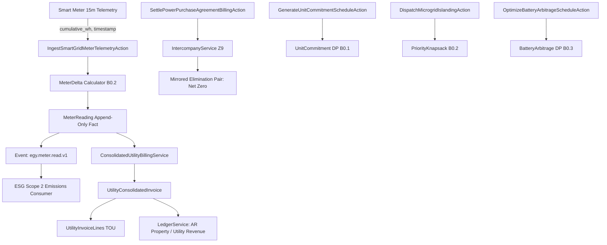
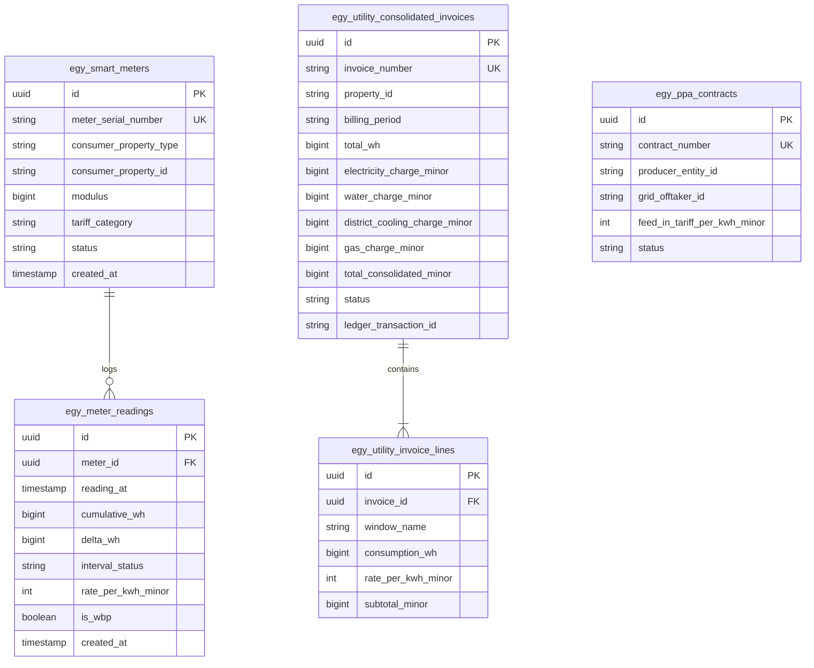
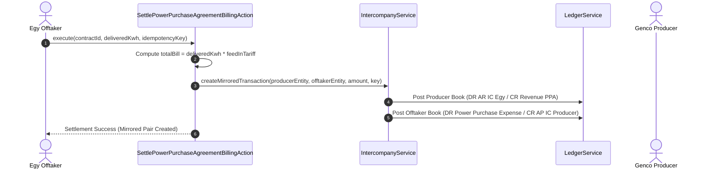

# Technical Design: Lini 13 — Energi & Utilitas (Egy MVP)

## 1. Arsitektur Komponen



---

## 2. Skema Data & Relasi (ERD)



---

## 3. Alur Intercompany PPA (Z9 / E-4)



---

## 4. Idempotensi & Validasi Fakta Append-Only (PR4, PR5, U-4)
1. **Idempotency Key Format**:
   - Meter Telemetry: `egy:telemetry:{meter_serial}:{timestamp_iso}`.
   - Invoice Generation: `egy:invoice:{property_id}:{billing_period}`.
   - PPA Settlement: `egy:ppa:{contract_number}:{period_or_batch_id}`.
2. **Append-Only Fact Model Guards**:
   Model `MeterReading` meng-override event `updating` dan `deleting` pada Eloquent:
   ```php
   static::updating(function () {
       throw new \RuntimeException('MeterReading is an immutable append-only fact.');
   });
   static::deleting(function () {
       throw new \RuntimeException('MeterReading is an immutable append-only fact.');
   });
   ```
3. **Rollover & Missing Data Handling**:
   - Jika `reading_at` berselisih > 15 menit dari bacaan terakhir, interval yang terlewat dicatat dengan `interval_status = 'MISSING'` dan `delta_wh = 0`.
   - Modulus rollover register (misal dari 99.999.000 ke 15.000 Wh dengan modulus 100.000.000 Wh) dihitung dengan `MeterDelta::calculate(99999000, 15000, 100000000) = 16000 Wh` dan status `'ROLLOVER'`.
   - Event reset manual dicatat dengan status `'RESET'`.

---

## 5. Rencana UI Operator Grid (375px Responsive)
- Header ringkas dengan status operasional jaringan, total konsumsi hari ini (kWh), beban puncak (MW), dan frekuensi/tegangan nominal.
- Tabel meter dengan badge status interval (OK, Rollover, Missing) yang dapat di-tap pada layar mobile.
- Tombol aksi darurat: Islanding Microgrid dengan slider alokasi beban prioritas (RS > Pabrik > Mall).
