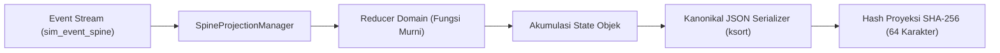

# Desain Teknis — Proyeksi & Reducer Deterministik (Fase R8)

## 1. Konsep Proyeksi Event Sourcing Murni

Dalam arsitektur event-driven SuperWeb, aliran pesan append-only pada `sim_event_spine` berperan sebagai satu-satunya sumber kebenaran (*single source of truth*) atas kejadian historis. Untuk menyajikan data dalam bentuk yang siap dibaca oleh aplikasi (*read-model*), sistem menerapkan pola **Deterministik Projection Reducer**.

Sebuah Proyeksi (*Projection*) adalah status turunan yang dibangun kembali secara inkremental dengan menerapkan sekumpulan event pada status awal (*zero-state*). Determinisasi absolut dijamin jika dan hanya jika:
1. **Fungsi Reducer Murni (*Pure Function*)**: Fungsi reducer hanya menerima `(currentState, event)` dan mengembalikan `nextState` tanpa menimbulkan efek samping eksternal (tidak memanggil HTTP, tidak mengirim email, tidak mengacak state global).
2. **Pengurutan Event Ketat (*Strict Event Ordering*)**: Event diproses dalam urutan kronologis offset `id ASC`.
3. **Serialisasi Kanonikal Deterministik**: Status hasil proyeksi diserialisasi ke JSON kanonikal dengan pengurutan seluruh kunci secara rekursif (`ksort()`), lalu di-hash menggunakan algoritma SHA-256.

---

## 2. Reducer Terdaftar & Domain yang Didukung

`SpineProjectionManager` mengelola pendaftaran 5 reducer domain spesifik:

### 1. OrderFulfillmentProjectionReducer
- **Topik Langganan**: `store.order.*`, `store.order.paid.v1`
- **Tanggung Jawab**:
  - Mengakumulasikan metrik total pendapatan toko (`total_amount`).
  - Merekam daftar pesanan lunas (`paid_orders`), jumlah item, dan ID pelanggan.
  - Memperbarui hitungan pesanan sukses per toko.

### 2. LogisticsShipmentProjectionReducer
- **Topik Langganan**: `lgx.shipment.*`, `lgx.shipment.delivered.v1`, `lgx.temperature.breached.v1`
- **Tanggung Jawab**:
  - Melacak status pengiriman kargo dan nomor resi pengiriman.
  - Mencatat anomali pelanggaran suhu cold-chain kargo sensitif.
  - Menghitung agregat total pengiriman berhasil dan total pelanggaran suhu.

### 3. TelematicsTelemetryProjectionReducer
- **Topik Langganan**: `auto.telematics.*`, `auto.ev.*`
- **Tanggung Jawab**:
  - Melacak status kesehatan baterai (*State-of-Health / SoH*) unit kendaraan listrik.
  - Mengakumulasikan konsumsi energi kWh untuk penghitungan emisi Scope 2.
  - Merekam riwayat anomali telematika armada unit transportasi.

### 4. BanquetEventOrderProjectionReducer
- **Topik Langganan**: `hotel.banquet.*`, `hotel.banquet.beo_finalized.v1`
- **Tanggung Jawab**:
  - Melacak status BEO perjamuan dan MICE yang telah difinalisasi.
  - Mengakumulasikan jumlah pax terjamin dan nilai kontrak perjamuan.

### 5. HospitalEmergencyProjectionReducer
- **Topik Langganan**: `hospital.code_blue.*`, `hospital.code_blue.activated.v1`
- **Tanggung Jawab**:
  - Merekam insiden resusitasi darurat aktif (Code Blue) di seluruh bangsal rumah sakit.
  - Mencatat dokter penanggung jawab dan lokasi kamar insiden.

---

## 3. Verifikasi Konsistensi Hash Dua Kali Replay

Berdasarkan keputusan **W8-D39**, pemutaran ulang aliran pesan dari offset yang sama wajib menghasilkan keadaan dan hash proyeksi yang identik:
$$h_1 = \text{SHA256}(\text{canonicalJson}(\text{project}(\text{stream})))$$
$$h_2 = \text{SHA256}(\text{canonicalJson}(\text{project}(\text{stream})))$$
$$h_1 \equiv h_2$$

Jika ditemukan perbedaan antara $h_1$ dan $h_2$, sistem segera membunyikan alarm audit integritas karena terdapat faktor non-deterministik (seperti ketergantungan pada jam lokal sistem non-injeksi, fungsi acak, atau mutasi state global).
