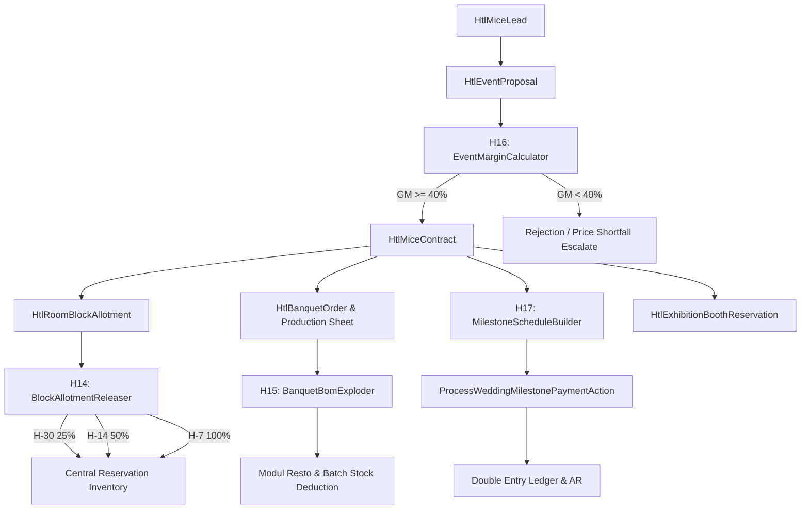

# Desain Sistem & Arsitektur Fase 114: MICE, Banquet BEO & Global Event Sales Engine

## 1. Arsitektur Domain & Hubungan Komponen
Modul Hotel Fase 114 mengintegrasikan manajemen acara multi-skala dengan pipeline penjualan enterprise, otomasi alokasi inventaris kamar blok, lembar kerja produksi jamuan dapur, serta konektor pameran perdagangan expo:

## 2. Model Data & Skema Database
Entitas utama yang ditambahkan pada Fase 114:
1. `htl_mice_leads`:
   - Menyimpan kontak calon klien, tipe event (konferensi, pernikahan, pameran, gala dinner), estimasi jumlah peserta (*expected pax*), tanggal tentatif, dan anggaran perkiraan.
2. `htl_event_proposals`:
   - Komponen penawaran multi-item: sewa hall, paket katering F&B, paket AV, alokasi blok kamar, dan sewa booth pameran.
   - Status: `DRAFT`, `PENDING_CALCULATION`, `GUARDRAIL_PASSED`, `GUARDRAIL_FAILED`, `OFFERED`, `ACCEPTED`, `EXPIRED`.
   - Kolom `timelock_expires_at` untuk pembatasan masa berlaku penawaran harga.
3. `htl_mice_contracts`:
   - Kontrak formal berkekuatan hukum yang mengikat harga, klausul penalti pembatalan, jaminan minimum pax, dan total nilai kontrak.
4. `htl_room_block_allotments`:
   - Data alokasi blok kamar grup, mencakup kuota awal, kuota saat ini, jumlah pickup, cutoff date H-30, H-14, H-7, serta status pelepasan kuota.
5. `htl_banquet_orders` & `htl_banquet_production_sheets`:
   - Lembar kerja BEO untuk dapur dan tim banquet, rincian susunan menu, resep BOM, breakdown gramatur bahan mentah, varians penuangan minuman, dan alokasi shift tenaga kerja kasual.
6. `htl_wedding_milestone_schedules`:
   - Rincian termin pembayaran wedding berjenjang (DP 20%, Termin I 30%, Termin II 30%, Pelunasan 20%) lengkap dengan status lunas dan referensi bukti bayar.
7. `htl_exhibition_booth_reservations`:
   - Pemesanan booth pameran expo, penomoran booth, add-on daya listrik kVA, dedicated LAN, dan simulasi proyeksi footfall sensor.

## 3. Integrasi Lintas Modul
1. **Modul Venue (G7-K16 RoomBlockReserver):**
   - Service `RoomBlockReserverService` yang telah ada dipertahankan dan diperkuat dengan integrasi langsung ke `htl_room_block_allotments`. Paket multi-stage festival atau VIP concert venue dapat memanggil `reserveBlock` untuk mengunci kamar hotel dengan aman.
2. **Modul Resto (F&B Batch Deduction):**
   - Saat status produksi BEO dimulai (`PRODUCTION_COMMENCED`), sistem mencatat pemakaian bahan baku banquet dan memotong saldo inventaris dapur pada modul Resto.
3. **General Ledger (Financial Accounting):**
   - Setiap pembayaran milestone wedding, sewa booth expo, dan penagihan invoice banquet dicatat menggunakan pembukuan berpasangan (*double-entry journal entry*) ke akun kas/bank, pendapatan diterima dimuka (*unearned revenue*), dan piutang korporat (*City Ledger AR*).
