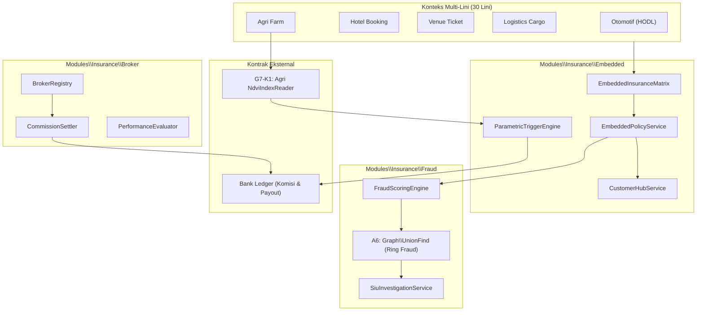

# Arsitektur & Desain Fase 158 — Lini 18: Insurance Embedded 30 Lini & Broker Marketplace

## 1. Diagram Arsitektur Komponen

## 2. Model Relasional & Skema Database
- `ins_embedded_products`: Penawaran embedded per lini dan jenis konteks.
- `ins_embedded_policies`: Polis yang diterbitkan secara embedded dari transaksi lini lain.
- `ins_parametric_triggers`: Definisi trigger parametrik (indikator, ambang, formula payout).
- `ins_parametric_events`: Rekaman eksekusi trigger dan bukti data oracle/sensor.
- `ins_brokers`: Profil broker/agen (merujuk ke Party), status lisensi, rating kinerja.
- `ins_broker_commissions`: Riwayat komisi dan status penyelesaian ledger.
- `ins_fraud_assessments`: Penilaian skor risiko fraud per klaim atau pengajuan.
- `ins_siu_investigations`: Berkas investigasi SIU, temuan ring fraud, keputusan four-eyes.
- `ins_blacklisted_entities`: Entitas/identitas yang diblacklist dari hasil investigasi SIU.

## 3. Algoritma Bersertifikat A6 (`UnionFind`)
- Struktur data Disjoint Set Union (DSU) dengan path compression dan rank heuristic.
- Mendeteksi kluster/lingkaran entitas terkait (alamat sama, rekening sama, perangkat sama, nomor telepon sama) antar klaim berulang.
- Mengembalikan komponen terhubung dan sertifikat disjoint sets untuk divalidasi oleh `UnionFindCertificateVerifier`.

## 4. Kontrak Antar-Modul G7-K1 (`NdviIndexReader`)
- Interface `Modules\Agri\Contracts\NdviIndexReader` dengan metode `readIndex(string $plotCode, CarbonImmutable $date): array{ndvi_score: int, rainfall_deficit_bps: int}`.
- Diimplementasikan di `Modules\Agri\Application\Services\AgriNdviIndexReaderService`.

