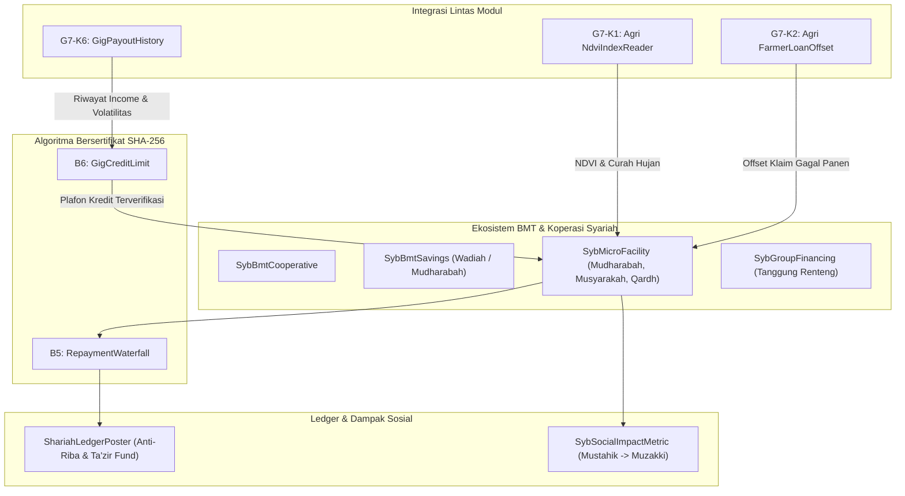

# Desain Teknis — Fase 163 (Microfinance, BMT & Pemberdayaan Ekonomi Syariah)

## 1. Arsitektur & Alur Kerja

Fase 163 mendigitalkan operasional BMT (Baitul Maal wat Tamwil), koperasi syariah, serta pembiayaan mikro berjenjang terintegrasi data riwayat gig worker (G7-K6) dan data satelit cuaca/NDVI pertanian (G7-K1/G7-K2).



---

## 2. Kontrak Lintas Modul G7-K6 (`GigPayoutHistory`)

Didefinisikan di namespace `Modules\Syariah\Contracts\GigPayoutHistory`:

```php
interface GigPayoutHistory
{
    /**
     * Mengambil riwayat pendapatan bulanan gig worker dalam sen/minor unit.
     * @return array<int, array{month: string, gross_amount: int, net_payout: int, tasks_completed: int}>
     */
    public function getMonthlyPayoutHistory(string $workerPartyId, int $months = 6): array;

    /**
     * Mengambil skor reputasi / penyelesaian amanah gig worker (0-100).
     */
    public function getAmanahScore(string $workerPartyId): int;
}
```

Implementasi default: `Modules\Syariah\Application\Services\SyariahGigPayoutHistoryService` menyediakan pembacaan deterministik dari modul gig/freelance atau fallback data profil nasabah.

---

## 3. Integrasi Kontrak G7-K1 (`NdviIndexReader`) & G7-K2 (`FarmerLoanOffset`)

- Pembiayaan mikro pertanian (akad Salam & Muzaraah) terikat kode petak (`plot_code`).
- Petugas lapangan/sistem memvalidasi kelayakan pencairan milestone pembiayaan salam berbasis indeks vegetasi satelit dari `NdviIndexReader::readIndex($plotCode, $date)`.
- Jika terjadi kekeringan atau banjir ekstrem (`is_drought_triggered === true`), klaim asuransi pertanian parametrik langsung memotong sisa pokok pembiayaan petani melalui `FarmerLoanOffset::offsetLoanBalance()`.

---

## 4. Algoritma Bersertifikat SHA-256

### Algoritma B5: `RepaymentWaterfall`
- **Fungsi**: Membagi pembayaran angsuran masuk ke 3 bucket berjenjang:
  1. *Ujrah / Margin Bagi Hasil* jatuh tempo.
  2. *Pokok Pembiayaan* (Principal).
  3. *Ta'zir Kebajikan* (jika ada denda keterlambatan akibat kelalaian). Denda ta'zir wajib dialokasikan ke pos kebajikan sosial `syb:tazir_social_fund:IDR`, **dilarang mutlak diakui sebagai pendapatan BMT/bank**.
- Verifier Sertifikat: `RepaymentWaterfallCertificateVerifier` memverifikasi hash SHA-256 deterministik dari payload alokasi.

### Algoritma B6: `GigCreditLimit`
- **Fungsi**: Menghitung batas maksimum plafon pembiayaan mikro untuk gig worker:
  - *Rata-rata Pendapatan Bulanan*: $\bar{x} = \frac{1}{n} \sum x_i$
  - *Koefisien Variasi*: $CV = \frac{\sigma}{\bar{x}}$
  - *Faktor Volatilitas*: Semakin tinggi variasi pendapatan, semakin konservatif Debt Service Ratio (DSR).
  - *Skor Amanah*: Mengalikan plafon akhir dengan indeks keandalan tugas ($0.5$ hingga $1.0$).
- Verifier Sertifikat: `GigCreditLimitCertificateVerifier` memvalidasi integritas kalkulasi.

---

## 5. Skema Data & State Machine

### Status Pembiayaan Mikro (`MicroFacilityStatus`):
`draft` -> `surveyed` -> `dps_review` -> `approved` -> `active` -> `paid_off` | `restructured` | `defaulted` | `written_off`

### Tabel Database (`syb_*`):
1. `syb_bmt_cooperatives`: data legal, izin koperasi, kantor cabang.
2. `syb_bmt_savings`: rekening simpanan wadiah / mudharabah.
3. `syb_micro_facilities`: kontrak pembiayaan mikro berjenjang.
4. `syb_group_financings`: grup tanggung renteng (solidarity group) dengan tanggung renteng aktif.
5. `syb_gig_microloans`: fasilitas kredit gig worker terikat Kontrak G7-K6.
6. `syb_agri_micro_facilities`: fasilitas pembiayaan tani salam/muzaraah terikat NDVI & cuaca.
7. `syb_social_impact_metrics`: penyerapan tenaga kerja, rasio peningkatan omzet, metrik mustahik->muzakki.
8. `syb_bmt_repayments`: catatan riwayat angsuran waterfall.

---

## 6. Ledger Posting Anti-Riba

Semua akun terdaftar di `SyariahAccounts`:
- Pencairan Pembiayaan:
  - `DEBIT` `syb:micro_financing_receivable:IDR` (atau `agri`, `qardh`)
  - `CREDIT` `syb:cash_pool:IDR`
- Angsuran Masuk via Waterfall (B5):
  - `DEBIT` `syb:cash_pool:IDR`
  - `CREDIT` `syb:micro_financing_receivable:IDR` (pokok)
  - `CREDIT` `syb:micro_ujrah_income:IDR` (atau `mudharabah_profit_share_income`)
  - `CREDIT` `syb:tazir_social_fund:IDR` (ta'zir kebajikan)
- Offset Asuransi Pertanian (G7-K2):
  - `DEBIT` `syb:takaful_claim_offset_clearing:IDR`
  - `CREDIT` `syb:agri_financing_receivable:IDR`

