# Dokumen Desain — Fase 164 (Lini 19: Islamic Trade Finance & Cross-Border Syariah)

## 1. Arsitektur Domain & Alur Transaksi

```mermaid
flowchart TD
    subgraph ImportLC["Islamic Letter of Credit (LC)"]
        LC[Pengajuan LC Impor] --> Istisna[Akad Istisna' Manufaktur]
        Istisna --> POC[Cost-to-Cost POC Engine]
        LC --> Wakalah[Akad Wakalah bil Ujrah Logistik/Bea Cukai]
        POC --> LCSettle[Settlement Fiat/Stablecoin Syariah]
    end

    subgraph SalamTrading["Salam & Parallel Salam"]
        Farmer[Produsen / Petani] --> Advance[Bayar Tunai Penuh Di Muka]
        Advance --> SalamContract[Kontrak Salam Terstandar]
        SalamContract --> PosBook[B7: SalamPositionBook]
        PosBook --> ParallelHedge[Parallel Salam Offtake End-Buyer]
        SalamContract --> WarehouseDelivery[Penyerahan Komoditas di Gudang]
    end

    subgraph SCFFinance["Murabahah Supply Chain Finance"]
        Supplier[Pemasok Barang] --> Custody[Verifikasi Kepemilikan Riil / Qabdh]
        Custody --> BankPurchase[Bank Beli Tunai dari Pemasok]
        BankPurchase --> DeferredSale[Jual Bertempo ke Buyer + Margin Terbuka]
        DeferredSale --> ScheduleSCF[Jadwal Cicilan Tanpa Denda Riba]
    end

    subgraph TawarruqExchange["Commodity Murabahah FX (Tawarruq)"]
        FXOrder[Permintaan Lindung Nilai Valas] --> Bursa1[Beli Lot Komoditas Riil Bursa A]
        Bursa1 --> LotVerify[Validasi Serial Number Komoditas]
        LotVerify --> SaleToClient[Jual ke Nasabah Tenor - IDR]
        SaleToClient --> WakalahSale[Nasabah Kuasakan Agen Jual Tunai Bursa B - USD]
        WakalahSale --> B8Alg[B8: TawarruqFx Calculator & Verifier]
    end
```

## 2. Struktur Data & Skema Database

### 2.1 Skema Tabel `syb_` Baru:
1. `syb_letters_of_credit`:
   - `id`, `lc_number`, `applicant_party_ref`, `beneficiary_party_ref`, `issuing_bank_party_ref`, `amount_currency`, `amount_cents`, `margin_deposit_cents`, `status`, `expiry_date`, `created_at`, `updated_at`.
2. `syb_istisna_contracts`:
   - `id`, `lc_id`, `contract_number`, `manufacturer_party_ref`, `specification_summary`, `total_price_cents`, `budgeted_cost_cents`, `actual_cost_incurred_cents`, `recognized_revenue_cents`, `progress_percent`, `status`, `created_at`, `updated_at`.
3. `syb_salam_contracts`:
   - `id`, `contract_number`, `seller_party_ref`, `buyer_party_ref`, `commodity_code`, `commodity_grade`, `quantity_unit`, `quantity_ordered`, `quantity_delivered`, `advance_payment_cents`, `promised_delivery_date`, `delivery_warehouse_code`, `status`, `created_at`, `updated_at`.
4. `syb_parallel_salam_hedges`:
   - `id`, `original_salam_id`, `hedge_contract_number`, `offtaker_party_ref`, `agreed_sale_price_cents`, `quantity_hedged`, `delivery_date`, `status`, `created_at`, `updated_at`.
5. `syb_scf_murabahah_facilities`:
   - `id`, `facility_number`, `buyer_party_ref`, `supplier_party_ref`, `limit_amount_cents`, `margin_rate_bps`, `max_tenor_days`, `status`, `created_at`, `updated_at`.
6. `syb_scf_invoices`:
   - `id`, `facility_id`, `invoice_number`, `supplier_invoice_ref`, `principal_cost_cents`, `margin_profit_cents`, `total_sale_price_cents`, `qabdh_verified_at`, `due_date`, `status`, `created_at`, `updated_at`.
7. `syb_tawarruq_fx_orders`:
   - `id`, `order_number`, `customer_party_ref`, `source_currency`, `source_amount_cents`, `target_currency`, `target_amount_cents`, `effective_rate_bps`, `tenor_days`, `status`, `created_at`, `updated_at`.
8. `syb_commodity_lots`:
   - `id`, `lot_number`, `exchange_name`, `commodity_type`, `physical_serial_number`, `warehouse_location`, `unit_quantity`, `acquisition_cost_cents`, `lot_status`, `assigned_tawarruq_order_id`, `created_at`, `updated_at`.
9. `syb_trade_custody_documents`:
   - `id`, `document_type` (BL, AWB, SeaWaybill, WarehouseReceipt), `document_number`, `issuer_name`, `carrier_name`, `cargo_description`, `document_hash_sha256`, `verified_qabdh_at`, `verifier_officer_ref`, `created_at`, `updated_at`.

## 3. Algoritma Bersertifikat B7 & B8

### 3.1 B7: `SalamPositionBook`
- **Tujuan:** Mengelola posisi komoditas dari kontrak Salam (long position dari advance payment) dan Parallel Salam (short position dari forward commitment), menghitung eksposur netto (*net open position*), mark-to-market berbasis harga indeks komoditas pasar, serta memverifikasi alokasi komoditas pada tanggal jatuh tempo tanpa risiko gagal serah (*settlement default*).
- **Struktur:**
  - `SalamPositionBookInput`: array kontrak salam masuk, array hedge parallel salam, indeks harga komoditas pasar aktual per grade.
  - `SalamPositionBookResult`: total kuantum long, total kuantum short, net open position, mark-to-market PnL dalam sen, rasio pemenuhan penyerahan (*fulfillment ratio*), hash sertifikat tamper-proof sha256.
  - `SalamPositionBookCertificateVerifier`: verifikasi bahwa rasio short tidak melebihi kuantum salam long (larangan *short selling* komoditas belum dimiliki), dan PnL MTM dihitung secara deterministik.

### 3.2 B8: `TawarruqFx`
- **Tujuan:** Menghitung struktur transaksi tawarruq tiga pihak untuk konversi valas dan lindung nilai syariah:
  1. Pembelian komoditas bursa global (mata uang sumber).
  2. Penjualan ke nasabah secara tangguh dengan mark-up ujrah/biaya administrasi.
  3. Penjualan komoditas ke pihak ketiga tunai dalam mata uang tujuan via wakalah.
- **Keluaran:** Kurs efektif, jadwal amortisasi tangguh, pemisahan margin dari pokok valas, dan pembuktian isolasi lot komoditas bursa (mencegah *bai' al-inah*).
- `TawarruqFxCertificateVerifier`: memverifikasi bahwa serial komoditas bersifat unik, kurs terikat batas deviasi pasar, dan tidak ada pengenaan bunga tersembunyi.

## 4. Ledger Accounts & Transaksi

| Kode Akun | Jenis | Deskripsi |
|---|---|---|
| `syb:trade_lc_liability:IDR` | LIABILITY | Kewajiban penerbitan LC atas nama pemohon impor |
| `syb:trade_lc_margin_deposit:IDR` | LIABILITY | Setoran jaminan margin deposit dari importir |
| `syb:istisna_work_in_progress:IDR` | ASSET | Aset dalam penyelesaian pekerjaan manufaktur istisna' |
| `syb:istisna_contract_revenue:IDR` | REVENUE | Pendapatan kontrak istisna' diakui berbasis POC |
| `syb:salam_financing_advance:IDR` | ASSET | Piutang penyerahan barang komoditas salam di muka |
| `syb:salam_inventory:IDR` | ASSET | Persediaan komoditas salam yang telah diterima di gudang |
| `syb:salam_hedging_reserve:IDR` | EQUITY | Cadangan lindung nilai fluktuasi harga komoditas salam |
| `syb:scf_murabahah_receivable:IDR` | ASSET | Piutang murabahah SCF dari pembeli |
| `syb:scf_inventory:IDR` | ASSET | Persediaan barang SCF yang telah di-qabdh oleh bank |
| `syb:scf_margin_income:IDR` | REVENUE | Pendapatan margin murabahah SCF |
| `syb:tawarruq_broker_payable:IDR` | LIABILITY | Kewajiban penyelesaian pembelian komoditas ke broker bursa |
| `syb:tawarruq_commodity_holding:IDR` | ASSET | Kepemilikan sementara komoditas tawarruq bursa |
| `syb:tawarruq_fx_clearing:IDR` | ASSET | Rekening kliring valuta asing hasil penjualan tawarruq |
| `syb:trade_ujrah_fee_income:IDR` | REVENUE | Pendapatan fee/ujrah keagenan wakalah dan administrasi LC |
