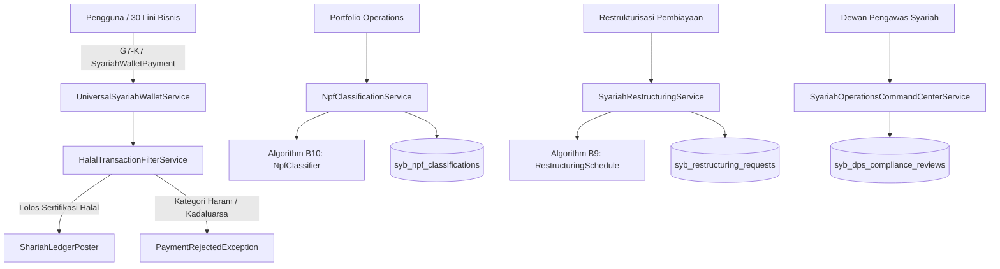

# Dokumen Desain Teknis — Fase 165: Syariah Operations, Compliance & Integrasi 30 Lini

## 1. Arsitektur Komponen
Modul `Syariah` bertanggung jawab penuh atas operasi harian perbankan syariah, manajemen risiko pembiayaan (NPF), pengawasan kepatuhan Dewan Pengawas Syariah (DPS), dan antarmuka pembayaran universal (G7-K7) bagi 30 lini industri super-app.



## 2. Struktur Database Migrasi
1. `syb_npf_classifications` & `syb_npf_provisions`:
   - Menyimpan history DPD (Days Past Due), status kolektibilitas (1-5: PASS, SMA, SUB, DBT, LOSS), saldo pokok, saldo margin yang ditangguhkan, dan cadangan kerugian penurunan nilai (CKPN).
2. `syb_restructuring_requests` & `syb_restructured_schedules`:
   - State machine: `REQUESTED`, `ASSESSED`, `DPS_REVIEWED`, `APPROVED`, `EXECUTED`, `REJECTED`.
   - Menghitung restrukturisasi murni tanpa bunga majemuk, tenor baru, grace period, dan penghapusan denda keterlambatan (ta'zir/ta'widh dialihkan ke dana kebajikan).
3. `syb_halal_merchants` & `syb_halal_merchant_categories`:
   - Registri merchant 30 lini: Food & Beverage, Hospitality, Venue, Retail, Healthcare, Logistics, Media, dll.
   - Status sertifikat halal BPJPH/MUI, tanggal masa berlaku, kategori industri, dan status pemblokiran ketat (blacklist).
4. `syb_universal_wallet_transactions`:
   - Implementasi kontrak G7-K7 `SyariahWalletPayment`.
   - Atribut: transaction_ref, customer_account_ref, merchant_id, line_code, gross_amount, fee_amount, net_amount, halal_verified, ledger_journal_ref.
5. `syb_dps_compliance_reviews` & `syb_ops_incident_logs`:
   - Catatan pengawasan DPS, penelaahan transaksi mencurigakan non-syariah, resolusi insiden operasional.

## 3. Algoritma Bersertifikat
- **B9: `RestructuringSchedule`**:
  - Amortisasi linear sisa pokok pembiayaan murabahah/ijarah setelah haircut margin/diskon qardh.
  - Memastikan tidak ada pengenaan denda bunga atau pertambahan utang baru di atas pokok (anti-riba).
- **B10: `NpfClassifier`**:
  - Klasifikasi DPD ke dalam 5 tingkatan kolektibilitas:
    - Kol 1: Lancar (DPD 0) -> Cadangan 1%
    - Kol 2: Dalam Perhatian Khusus (DPD 1–90) -> Cadangan 5%
    - Kol 3: Kurang Lancar (DPD 91–120) -> Cadangan 15%
    - Kol 4: Diragukan (DPD 121–180) -> Cadangan 50%
    - Kol 5: Macet (DPD > 180) -> Cadangan 100%
  - Perhitungan NPF Gross = (Saldo Kol 3 + Kol 4 + Kol 5) / Total Portfolio * 100%.

## 4. Kontrak Publik Lintas Modul G7-K7
`Modules\Syariah\Contracts\SyariahWalletPayment`:
```php
namespace Modules\Syariah\Contracts;

interface SyariahWalletPayment
{
    public function pay(
        string $customerAccountRef,
        string $merchantCode,
        string $businessLineCode,
        int $amountMinor,
        string $orderReference,
        array $metadata = []
    ): SyariahPaymentResult;

    public function verifyHalalStatus(string $merchantCode, string $businessLineCode): bool;
}
```
