# Dokumen Desain Teknis — Fase 177: Aviation Core (Lini 26)

## 1. Arsitektur Komponen & Konteks Modul
Modul `Aviation` dibangun sebagai vertical slice mandiri di bawah namespace `Modules\Aviation`, menggantikan rancangan purwarupa lama di `Modules\Integration\Application\Services\AviationService`. Modul ini mengendalikan operasional bandara terkoordinasi, armada pesawat udara komersial, perizinan slot musiman, dispatch kelaikan terbang, inventori kursi dan reservasi tiket, serta penerimaan kargo udara regulasi IATA DG.

```mermaid
flowchart TD
    subgraph CorePlatform ["Core Platform & External Modules"]
        CoreAuth["Core RBAC & Auth"]
        AssetMod["Asset (ast_) Maintenance WO"]
        LgxMod["Logistics (lgx_) Custody & Multimodal"]
        PtyMod["Party (pty_) KYC & Sanctions"]
        HcmMod["Hcm Employee Directory (Crew)"]
        LedgerMod["Banking / Ledger Posting"]
        ExtGateway["AviationExternalFactors (avi_external_factors)"]
    end

    subgraph AviationModule ["Aviation Module (avi_)"]
        MasterAviation["Master: Aircraft, Airports, Routes, Operators"]
        SlotMgr["A1: Slot Coordination & Season Allocator"]
        DispatchGate["A2: Airworthiness Dispatch & A3: W&B Engine"]
        SeatInv["G7-K26: Seat Inventory & Reserver Engine"]
        TicketBooking["Passenger Booking & A4: Refund Engine"]
        AirCargo["Air Cargo Reception & A5: DG Eligibility Engine"]
        MaintTracker["Aircraft Maintenance & Airworthiness Tracker"]
        SagaCoordinator["Aviation Distributed Saga Coordinator"]
        AuditEngine["avi:audit Double-Source Reconciler"]
    end

    CoreAuth --> AviationModule
    AviationModule --> LedgerMod
    MaintTracker -->|K9 Request| AssetMod
    AirCargo -->|Custody Verifier| LgxMod
    TicketBooking -->|KYC Check| PtyMod
    DispatchGate -->|Crew Lookup| HcmMod
    ExtGateway --> AviationModule
```

---

## 2. Diagram State Machine (D1)

### 2.1 State Machine Penerbangan (`FlightStateMachine` — 8 Status)
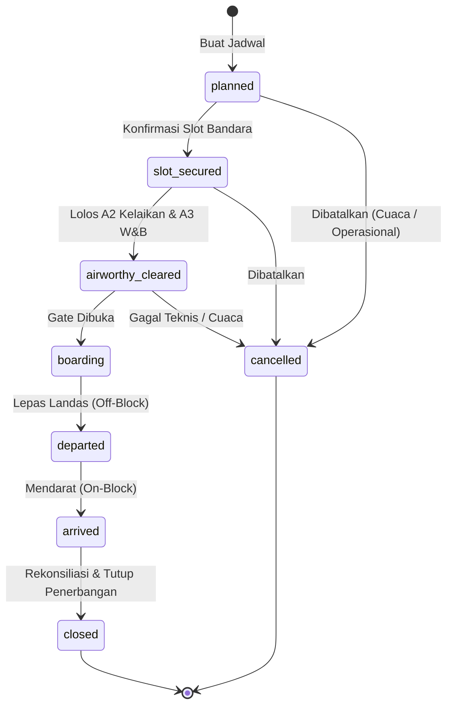

### 2.2 State Machine Tiket Penumpang (`TicketStateMachine` — 8 Status)
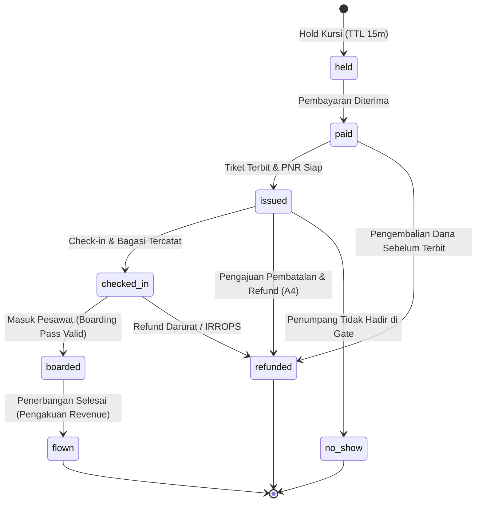

### 2.3 State Machine Permintaan Slot (`SlotRequestStateMachine` — 8 Status)
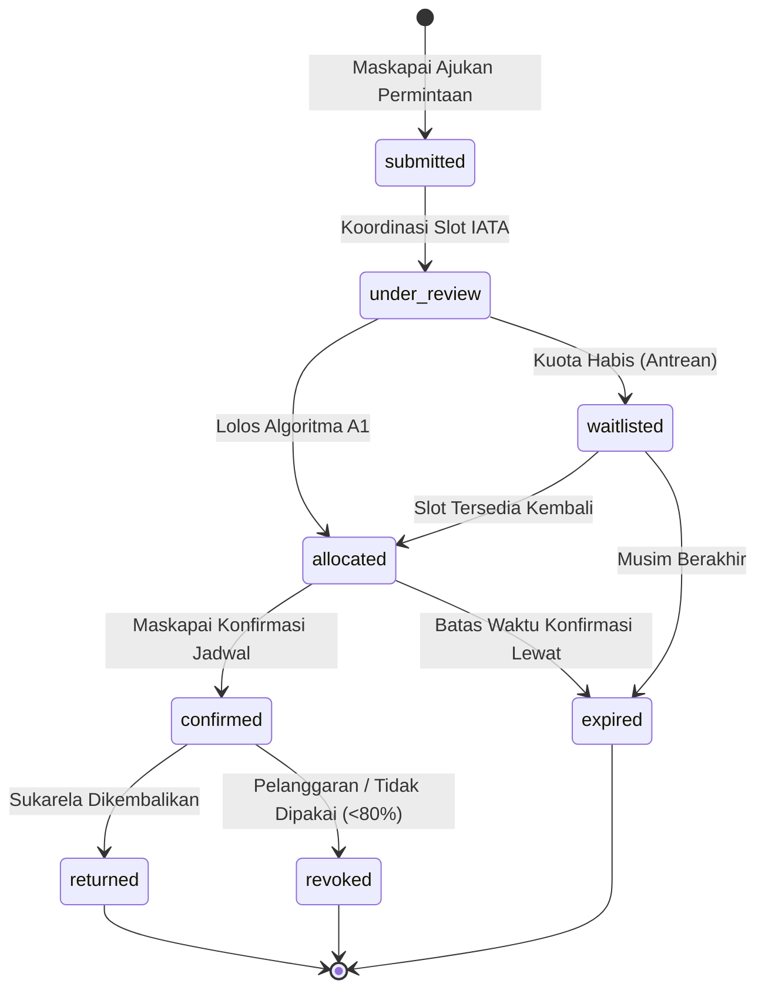

### 2.4 State Machine Konsinyasi Kargo Udara (`CargoConsignmentStateMachine` — 7 Status)
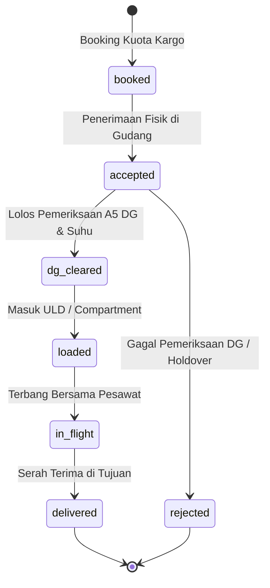

### 2.5 State Machine Kunjungan Perawatan (`MaintenanceVisitStateMachine` — 7 Status)
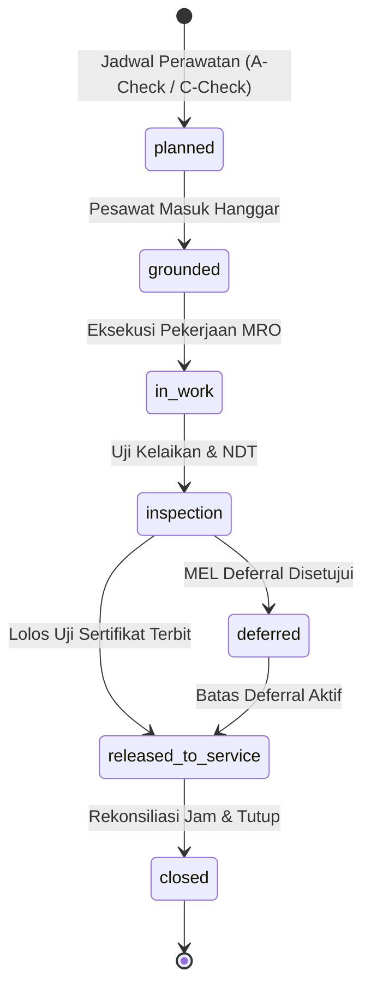

---

## 3. Diagram Alur Utama & Saga Kompensasi (D2)

### 3.1 Alur Reservasi Penumpang (`PassengerBookingSaga`)
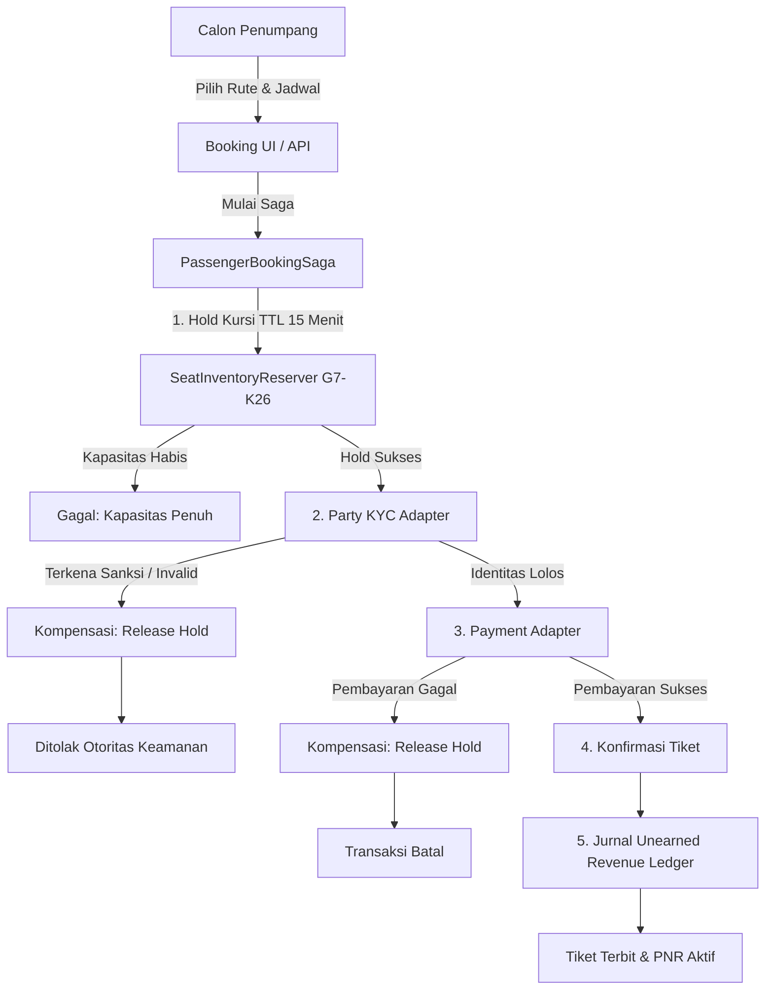

### 3.2 Alur Penerimaan Kargo Udara & Pemeriksaan DG (`AirCargoAcceptanceSaga`)
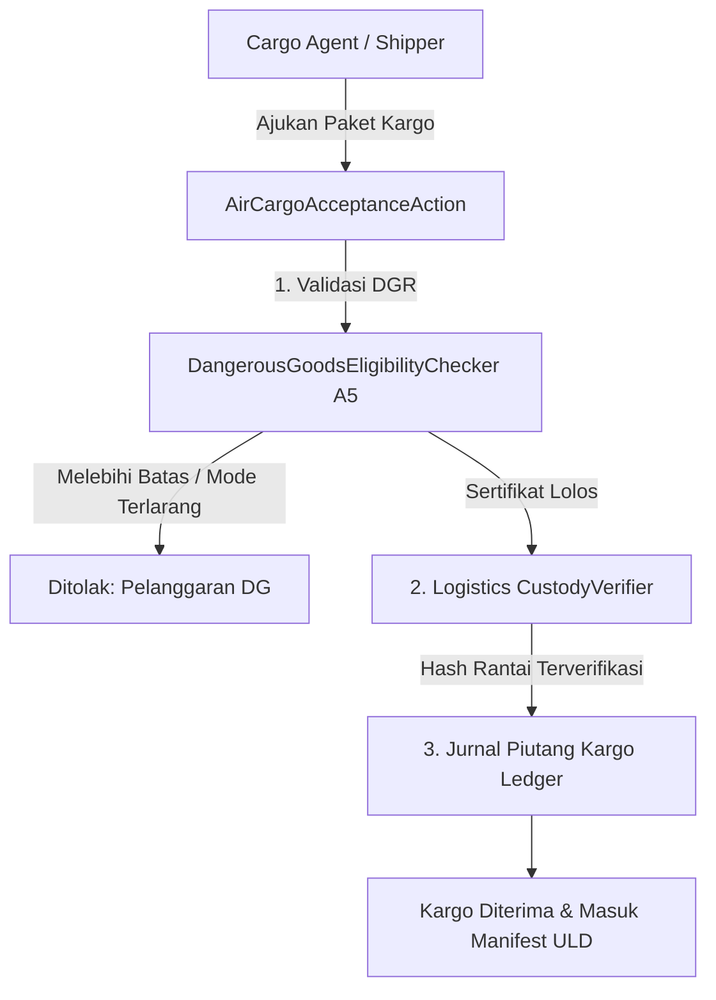

---

## 4. Entity-Relationship Diagram (D3)

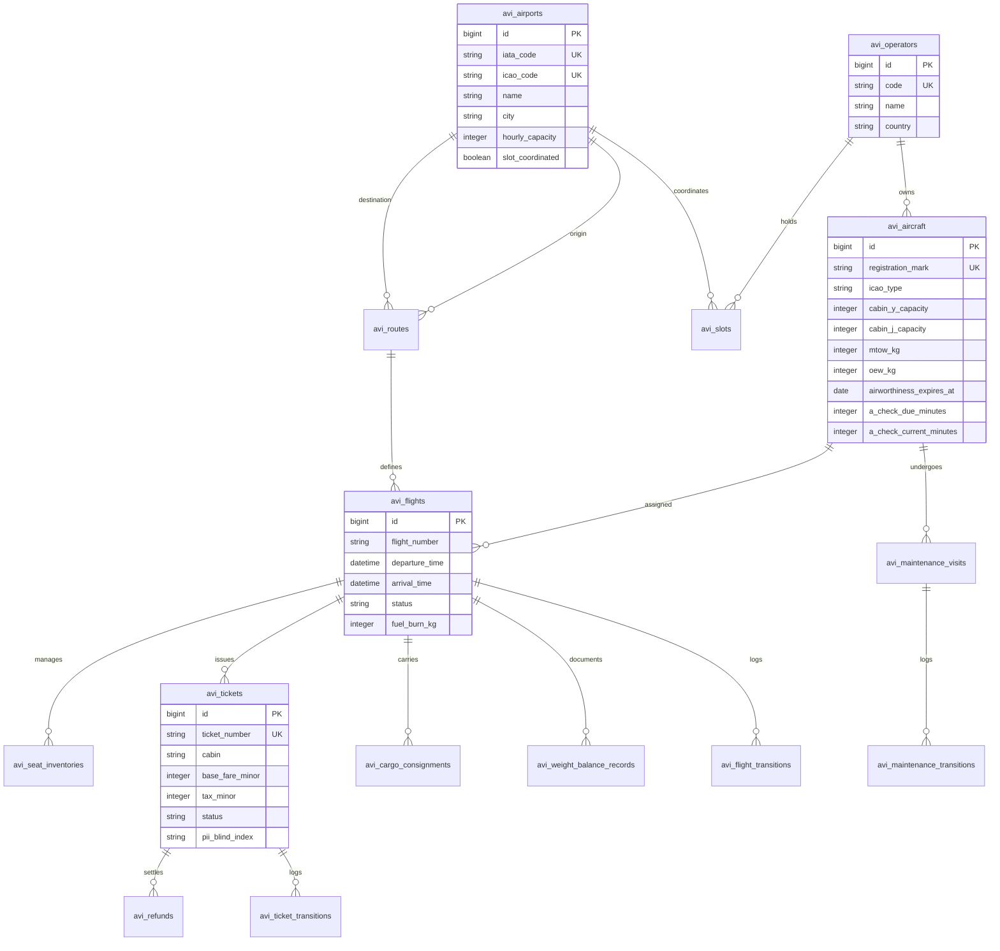

---

## 5. Flowchart Siklus Penjurnalan Buku Besar (D4)

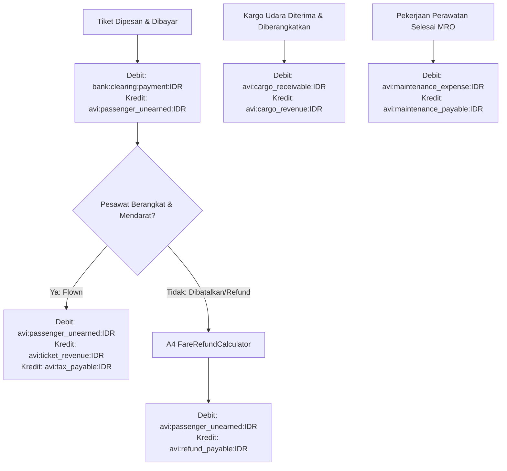

---

## 6. Flowchart Konteks Lintas Modul & Event Spine (D5)

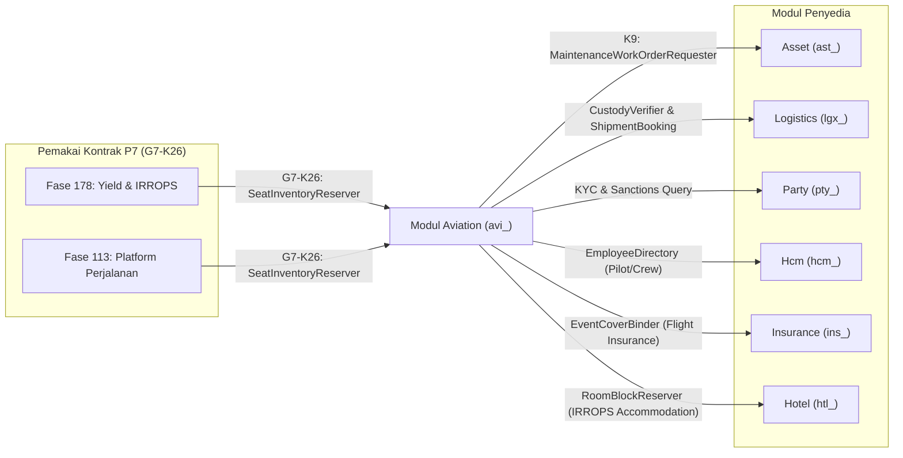

