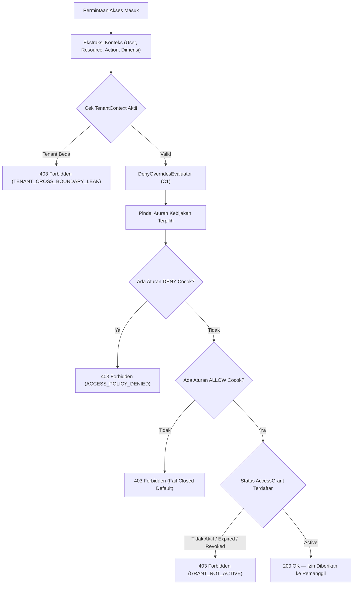
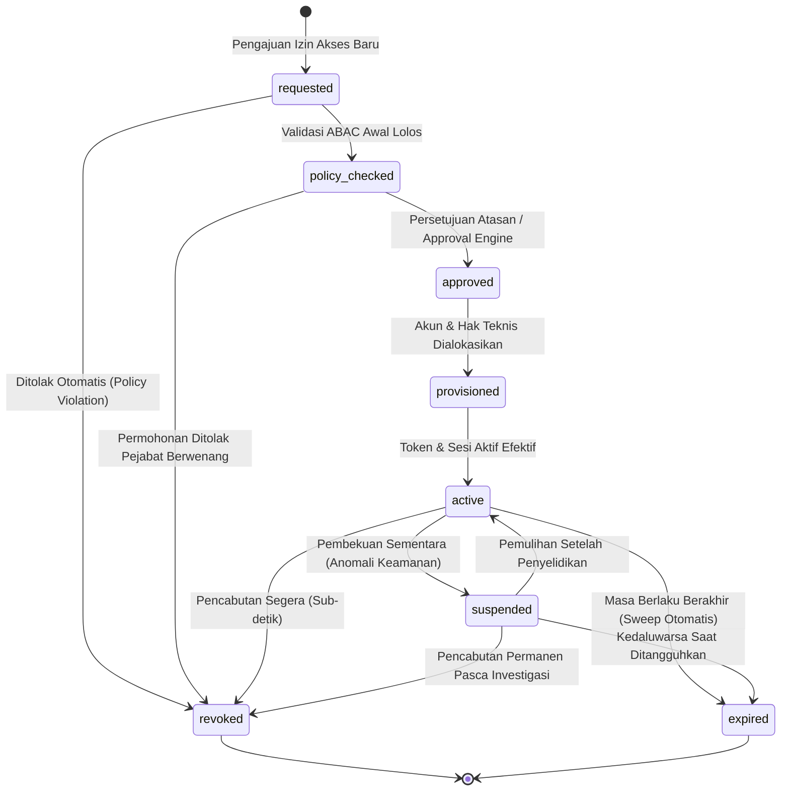
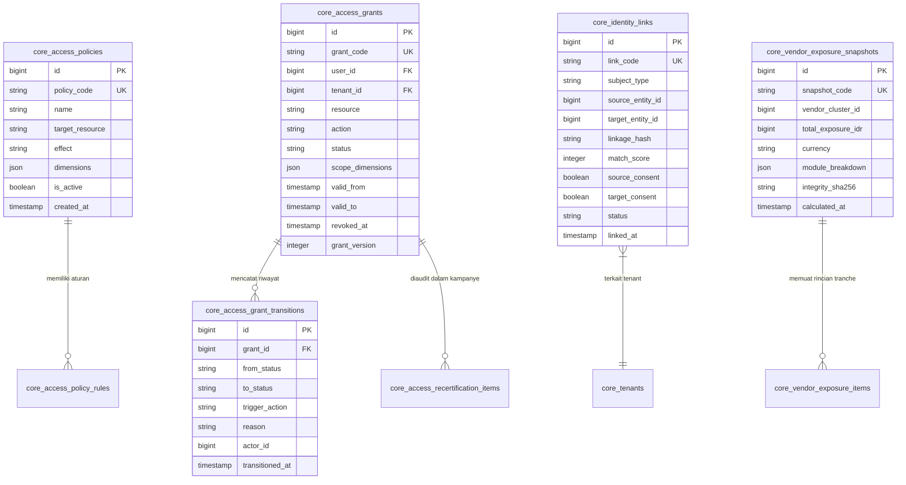

# Dokumen Desain Arsitektur — Fase 188: Tata Kelola Identitas, Akses & Multi-Tenancy 30 Lini

**Penanggung Jawab:** Tim Arsitektur Platform & Pelaksana W8-P4  
**Target:** 30 Lini Bisnis Enterprise SuperWeb  
**Tautan ADR:** [`ADR-0053`](../decisions/ADR-0053-abac-memory-deny-overrides.md) s/d [`ADR-0060`](../decisions/ADR-0060-audit-akses-dua-sumber.md)  
**Runbook Operasional:** [`docs/runbooks/access-governance-operations.md`](../runbooks/access-governance-operations.md)

---

## 1. Ikhtisar Arsitektur & Prinsip Desain

Fase 188 mengimplementasikan fondasi terpadu tata kelola identitas, otorisasi berbasis atribut (*Attribute-Based Access Control / ABAC*), dan penegakan isolasi multi-tenancy di seluruh 30 lini bisnis platform SuperWeb.

Sistem bertumpu pada 5 pilar utama:
1. **Evaluator Kebijakan ABAC Murni Memori (C1):** Evaluasi hak akses berlangsung seketika tanpa melakukan kueri basis data pada jalur kritis (*hot-path*). Strategi *Deny-Overrides* menjamin keamanan *fail-closed*.
2. **Matriks Cakupan Multi-Dimensi:** Izin pengguna dibatasi secara granular berdasarkan dimensi entitas legal, wilayah operasional, fasilitas fisik/site, kode proyek, dan interval waktu berlaku.
3. **Siklus Hidup Hak Akses Terawasi (8 Status):** Setiap pemberian hak akses dikelola melalui state machine formal dengan audit trail lengkap dan kapabilitas pencabutan sub-detik.
4. **Graf Identitas Berbobot Multi-Pihak (C2):** Menggabungkan profil pengguna atau vendor yang tersebar di berbagai lini bisnis melalui pembobotan atribut kriptografis dengan proteksi persetujuan ganda (*double consent*).
5. **Agregasi Eksposur Risiko Vendor Lintas Lini (C3):** Menghitung total eksposur liabilitas grup vendor di seluruh divisi bisnis secara deterministik berbasis sen/minor-unit IDR.

---

## 2. Diagram Alur Utama (Alur Evaluasi ABAC & State Machine Akses)

---

## 3. Spesifikasi Siklus Hidup Access Grant (8 Status)

Siklus hidup permohonan hak akses dikelola secara mutlak oleh `AccessGrantStateMachine`:

### Tabel Transisi Sah & Guard Mutlak:

| Dari Status | Ke Status | Aksi / Trigger | Guard Wajib |
|---|---|---|---|
| `requested` | `policy_checked` | `checkPolicy()` | Atribut pemohon lengkap dan lolos pre-flight ABAC |
| `requested` | `revoked` | `reject()` | Catatan penolakan diisi oleh sistem atau pemeriksa |
| `policy_checked` | `approved` | `approve()` | Telah disetujui approver yang berhak (SoD terpenuhi) |
| `policy_checked` | `revoked` | `reject()` | Approver menolak pengajuan akses |
| `approved` | `provisioned` | `provision()` | Sistem provisi berhasil mengalokasikan identitas teknis |
| `provisioned` | `active` | `activate()` | Verifikasi awal berhasil; stempel waktu aktif dicatat |
| `active` | `suspended` | `suspend()` | Alasan penangguhan darurat wajib disertakan |
| `suspended` | `active` | `unsuspend()` | Evaluator keamanan menyetujui pembukaan suspensi |
| `active` | `revoked` | `revoke()` | Pencabutan segera; versi cache izin dinaikkan |
| `suspended` | `revoked` | `revoke()` | Pencabutan permanen |
| `active` | `expired` | `expire()` | Stempel waktu `expires_at` telah berlalu |
| `suspended` | `expired` | `expire()` | Stempel waktu `expires_at` telah berlalu |

---

## 4. Entity-Relationship Diagram (ERD Skema Tata Kelola Akses)

---

## 5. Ringkasan Tiga Algoritma Kunci (C1, C2, C3)

### A. Algoritma C1: `DenyOverridesEvaluator`
- **Tujuan:** Memvalidasi hak akses ABAC secara deterministik di memori.
- **Logika:**
  - Evaluasi setiap aturan yang cocok dengan `(resource, action, context_dimensions)`.
  - Jika ada minimal 1 aturan ber-efek `DENY` $\implies$ Evaluasi seketika bernilai `DENY`.
  - Jika tidak ada `DENY` dan terdapat $\ge 1$ aturan ber-efek `ALLOW` $\implies$ Evaluasi bernilai `ALLOW`.
  - Kasus dasar tanpa kecocokan $\implies$ Evaluasi bernilai `DENY` (prinsip *fail-closed*).
- **Integritas:** Menghasilkan sertifikat SHA-256 yang memuat urutan evaluasi dan cap waktu untuk audit forensic.

### B. Algoritma C2: `WeightedIdentityLinker`
- **Tujuan:** Menautkan identitas pelanggan atau mitra yang tersebar di lini bisnis berbeda secara matematis dan etis.
- **Atribut & Bobot:**
  - NIK Hash (HMAC-SHA256): 100 poin
  - Email Hash (HMAC-SHA256): 60 poin
  - No. Telp Hash (HMAC-SHA256): 50 poin
  - Nama Lengkap + Tgl Lahir Hash: 40 poin
- **Ambang Batas & Consent:**
  - Skor total $\ge 90$ diperlukan untuk kualifikasi tautan.
  - Persetujuan eksplisit kedua pihak (`source_consent = true` dan `target_consent = true`) bersifat wajib. Bila salah satu absen, status tautan ditetapkan `BLOCKED_NO_CONSENT`.

### C. Algoritma C3: `VendorExposureAggregator`
- **Tujuan:** Menyatukan seluruh eksposur liabilitas finansial terhadap grup vendor yang terafiliasi di berbagai modul.
- **Formula:**
  $$\text{TotalExposure} = \sum_{\text{tranches}} \text{AmountIDRMinorUnits}$$
- **Tranche Terintegrasi:**
  1. Procurement: Purchase Orders terbuka yang belum diselesaikan.
  2. Logistics: Penerimaan barang (Goods Receipts) yang belum menerima faktur.
  3. CloudKitchen: Saldo simpanan jaminan fasilitas vendor.
  4. AutoServe: Klaim garansi atau perbaikan dalam proses penagihan.
- **Ketelitian:** Menolak tipe data pecahan/float IEEE 754 dan seluruh pembulatan dilakukan ke sen terdekat menggunakan integer arithmetic murni.

---

## 6. Integrasi Kontrak Lintas-Modul (Shared Contract Architecture)

Untuk mempertahankan kepatuhan penuh terhadap aturan arsitektur A1 (*zero cross-module domain import*) dan A9 (*zero kernel import of business modules*), modul Core tidak berinteraksi langsung dengan model database modul bisnis. Sebagai gantinya, Core memanfaatkan mekanisme *Service Tagging* dan antarmuka bersama:

1. **Antarmuka Bersama (`VendorExposureProviderInterface`)**:
   Didefinisikan di namespace `Modules\Shared\Contracts\VendorExposureProviderInterface`. Memungkinkan modul Procurement, Logistics, TradeFinance, dan Supplier mengekspos tranche liabilitas finansial secara seragam.
2. **Penandaan Kontainer (`core.vendor_exposure_provider`)**:
   Modul bisnis mendaftarkan penyedia layanannya dengan tag `core.vendor_exposure_provider` pada *Service Provider* masing-masing.
3. **Penemuan Dinamis (*Dynamic Provider Discovery*)**:
   `VendorExposureService` memanggil `app()->tagged('core.vendor_exposure_provider')` untuk mengagregasi tranche tanpa mengetahui tabel internal modul penyedia.

---

## 7. Spesifikasi Audit Dua-Sumber & Penjaminan Korupsi Sintetis

Sistem audit berkala `access:audit` menjamin integritas data melalui rekonsiliasi matematis dua sumber data independen:

1. **Sumber 1 — Tabel Status Mutable (`core_access_grants`)**:
   Menyimpan status hak akses saat ini (`status`, `expires_at`, `authorized_by`).
2. **Sumber 2 — Buku Besar Append-Only (`core_access_grant_transitions`)**:
   Menyimpan seluruh jejak kronologis perpindahan status yang tidak dapat diubah (*immutable*), dilengkapi dengan hash verifikasi kriptografis.

### Algoritma Rekonsiliasi Dua-Sumber
- **Deteksi Ghost Grants**: Hak akses yang terdaftar pada tabel status mutable tetapi tidak memiliki entri transisi awal di buku besar append-only akan langsung ditandai sebagai `GHOST_GRANT` (Tingkat Keparahan: KRITIS).
- **Deteksi Divergensi Status**: Jika status terkini di `core_access_grants` tidak identik dengan `to_status` pada transisi terakhir di `core_access_grant_transitions`, sistem menandai anomali sebagai `STATUS_DIVERGENCE` (Tingkat Keparahan: TINGGI).
- **Deteksi Rantai Terputus**: Memverifikasi bahwa setiap `from_status` pada transisi $N$ identik dengan `to_status` pada transisi $N-1$.

---

## 8. Matriks Invarian Keamanan & Protokol Pemulihan Bencana

| Invarian | Batas Penegakan | Mekanisme Pemulihan Otomatis |
|---|---|---|
| **Pencabutan Sub-Detik** | Latensi < 1.0 detik dari panggilan mutasi | Invalidation bus segera membersihkan `AbacMemoryCache`, mem-flush tag Redis, dan mendaftarkan token ke blacklist memori. |
| **Isolasi Tenansi Mutlak** | 100.0% kueri berlingkup tenant | Kueri tanpa klausa tenant otomatis digagalkan oleh `TenantScope` dan memicu alarm SOC. |
| **Batas Kredit Vendor Rp 500M** | Eksekusi dibekukan jika total liabilitas > Rp 500M | Penolakan penerbitan PO baru secara otomatis oleh `ExposureBreachEnforcer`. |
| **Persetujuan Ganda Tautan Identitas** | Wajib `source_consent` & `target_consent` bernilai `true` | Jika salah satu consent bernilai false, status otomatis dibekukan ke `BLOCKED_MISSING_CONSENT`. |

