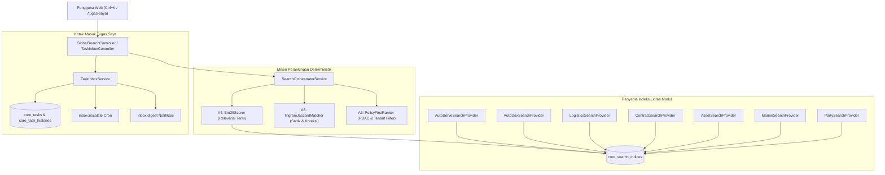
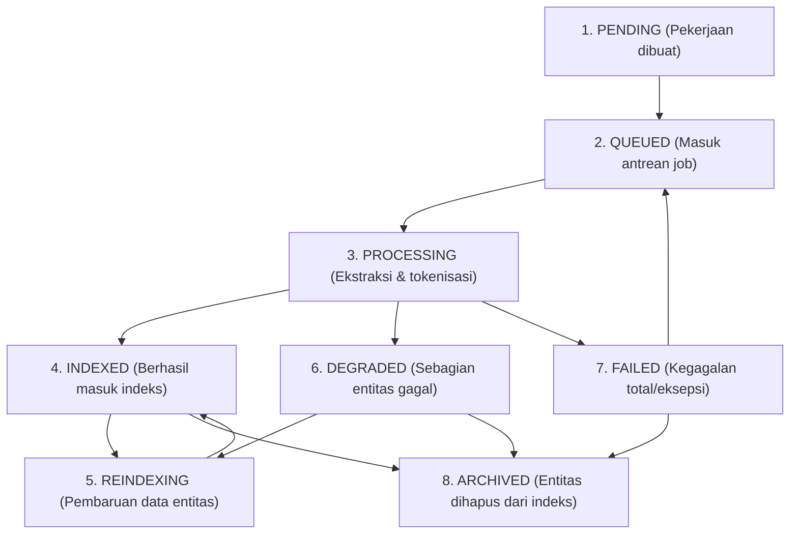
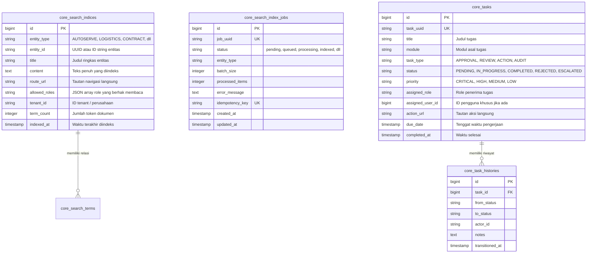

# Desain Arsitektur & Spesifikasi Teknis — Fase 194

**Fase:** 194 — Platform: Scope-Aware Global Search, Enterprise Command Palette & Kotak Masuk "Tugas Saya"  
**Modul Pemilik:** `Core` & `Shared`  
**Status:** DRAFT (Menunggu Verifikasi & Penggabungan)

---

## 1. Arsitektur Komponen & Alur Data

Pencarian global dan kotak masuk tugas dibangun di atas tiga pilar utama:
1. **Pipa Indeksasi Terdistribusi (Distributed Indexing Pipeline):** Setiap modul bisnis mengimplementasikan `SearchProviderInterface` dan `TaskProviderInterface`. Pembaruan entitas bisnis memicu pembaruan indeks secara asinkron atau batch melalui `IndexJob`.
2. **Mesin Relevansi & Perankingan Multi-Kriteria (Ranking Engine):** Kueri pengguna diproses melalui tiga lapisan: Tokenizer & Trigram Generator -> BM25 Document Scorer -> Policy-First Ranker (evaluasi filter peran RBAC dan tenant scope).
3. **Pusat Aksi Tugas Saya (Task Inbox Action Center):** Konsolidasi seluruh item tugas lintas modul ke dalam tabel terpadu `core_tasks` dengan transisi status yang dapat diaudit dan dieksekusi secara instan dari antarmuka web.

---

## 2. Diagram State Machine 8 Status: `IndexJobStateMachine`

Siklus pekerjaan pengindeksan data pencarian dikendalikan oleh mesin status 8 status deterministik:

### Matriks Transisi Status yang Sah:
| Status Asal | Status Target yang Diizinkan | Guard Condition |
|---|---|---|
| `pending` | `queued`, `archived` | Idempotency key terdaftar |
| `queued` | `processing`, `failed` | Worker alur kerja mengambil job |
| `processing` | `indexed`, `degraded`, `failed` | Parsial / total keberhasilan pemrosesan term |
| `indexed` | `reindexing`, `archived` | Mutasi entitas bisnis terdeteksi |
| `reindexing` | `indexed`, `degraded`, `failed` | Hasil indeks ulang tersedia |
| `degraded` | `reindexing`, `archived` | Percobaan remediasi parsial |
| `failed` | `queued`, `archived` | Retry backoff policy terpenuhi |
| `archived` | *(status terminal)* | Nihil |

---

## 3. Skema Database Entitas (`core_search_*` & `core_task_*`)

---

## 4. Karakteristik Algoritma Inti

1. **A4: `Bm25Scorer`**  
   - Menghitung BM25 kueri multi-term terhadap kumpulan dokumen indeks.
   - Menggunakan cache statistik koleksi ($N$, $\text{avgdl}$, $n(q_i)$).
   - Menghasilkan skor relevansi dalam integer basis points (bps) dan tanda tangan kriptografis HMAC-SHA256 untuk audit trail.

2. **A5: `TrigramJaccardMatcher`**  
   - Menghasilkan token n-gram 3 karakter dengan sentry `$$`.
   - Mengukur koefisien Jaccard $J(A, B) \times 10.000$ (basis point).
   - Menyediakan pencarian koreksi saltik saat ambang batas $J \ge 0.35$ terpenuhi.

3. **A6: `PolicyFirstRanker`**  
   - Memastikan pengguna tanpa role yang sah mendapatkan skor 0 secara instan sebelum pemrosesan peringkat lanjutan (zero information leak).
   - Memadukan faktor BM25, faktor saltik Jaccard, penyesuaian resensi waktu (decay fungsi eksponensial), dan bobot prioritas tipe entitas bisnis.
