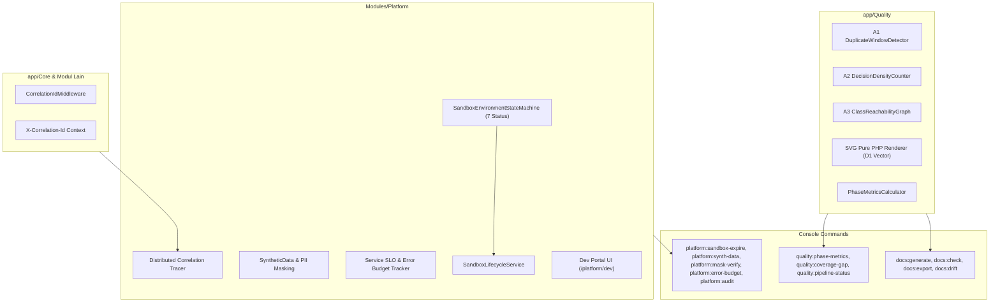

# Desain Teknis — Fase 237: Kualitas Kode, Metrik Fase & Platform DX

## 1. Arsitektur Komponen Modul Platform

---

## 2. State Machine Sandbox (`SandboxEnvironmentStateMachine`)

Sandbox Environment memiliki 7 status transisi ketat:
1. `requested`: Permintaan alokasi lingkungan baru diterima.
2. `provisioning`: Pembuatan skema database dan alokasi resource sandbox.
3. `seeded`: Injeksi data awal dan synthetic data bertopeng PII.
4. `ready`: Lingkungan aktif dan siap digunakan developer/test runner.
5. `expiring`: Masa aktif TTL sandbox hampir habis (warning period).
6. `expired`: TTL sandbox habis, akses dinonaktifkan.
7. `destroyed`: Resource dihapus, database di-teardown, catatan ditutup.

### Tabel Transisi Diizinkan:
- `requested` $\rightarrow$ `provisioning`, `destroyed`
- `provisioning` $\rightarrow$ `seeded`, `destroyed`
- `seeded` $\rightarrow$ `ready`, `destroyed`
- `ready` $\rightarrow$ `expiring`, `expired`, `destroyed`
- `expiring` $\rightarrow$ `ready` (jika extended), `expired`, `destroyed`
- `expired` $\rightarrow$ `destroyed`, `provisioning` (reset)
- `destroyed` $\rightarrow$ (terminal)

---

## 3. Desain Algoritma & Sertifikat Matematika (A1, A2, A3)

### A1: DuplicateWindowDetector (Rabin-Karp Rolling Hash)
- Menggunakan polynomial base $B = 257$ dan modulo prima besar $M = 1\,000\,000\,007$.
- Menormalkan baris kode: tokenisasi PHP `token_get_all`, mengabaikan komentar (`T_COMMENT`, `T_DOC_COMMENT`) dan whitespace (`T_WHITESPACE`), menstandarkan nama variabel token (`$var`).
- Sliding window ukuran $K = 25$ token.
- Tabulasi hash lookup $O(N)$ waktu linier dengan verifikasi langsung saat terjadi kecocokan hash (menghilangkan false positive).
- Output: `Certificate` berisi hash input, daftar token span, total duplicate token pairs, dan rasio duplikasi.

### A2: DecisionDensityCounter
- Menghitung decision points cyclomatic: `T_IF`, `T_ELSEIF`, `T_FOR`, `T_FOREACH`, `T_WHILE`, `T_CASE`, `T_CATCH`, `T_BOOLEAN_AND`, `T_BOOLEAN_OR`, `T_COALESCE`, operator ternary.
- Menghitung jumlah statement eksekutabel.
- Menghitung rasio $R = \frac{\text{decision\_points}}{\max(1, \text{executable\_statements})}$.
- Menghasilkan sertifikat matematis yang dapat diverifikasi oleh `DecisionDensityCertificateVerifier`.

### A3: ClassReachabilityGraph
- Membangun directed graph simpul kelas PHP dari parser namespace, imports (`use`), extends, implements, konstruktor type-hints, dan pemanggilan statis.
- Menetapkan root set: seluruh kelas Controllers, Console Commands, Event Listeners, dan Service Providers.
- Menjalankan pencarian BFS/DFS untuk mendeteksi:
  1. Set kelas terjangkau ($R \subseteq V$).
  2. Set kelas yatim ($O = V \setminus R$) yang tidak memiliki rute pemanggilan dari root set mana pun.
- Output sertifikat berisi simpul graph, total edge, daftar kelas yatim terisolasi, dan verifier hash.

---

## 4. Desain Generator Dokumentasi Murni PHP (D1 Vector SVG)
- Menghilangkan dependensi eksternal (Python, Node/Puppeteer, Chromium).
- Kelas `SvgCanvas`: Primitif SVG murni (rect, path, text, line, polygon, arrowheads, gradient).
- Kelas `MermaidToSvgCompiler`: Parser subset Mermaid diagram:
  - `flowchart TD` / `flowchart LR`
  - `stateDiagram-v2` / `stateDiagram`
- Layout engine deterministik: Topological sorting hierarkis, pemosisian grid node, perutean garis ortogonal/bézier, auto-sizing kotak berbasis panjang teks label.
- Output SVG sepenuhnya memenuhi standar SVG 1.1/2.0 mandiri, scalable, tanpa dependency eksternal.

---

## 5. Audit Dua Sumber (`platform:audit`)
Memvalidasi rekonsiliasi dua arah:
1. **Sumber 1 (Database)**: Catatan status sandbox, snapshot metrik fase, SLO burn rate, dan audit logs.
2. **Sumber 2 (Fisik / Git / Filesystem)**:
   - Integritas file snapshot metrik di filesystem vs DB.
   - Status ratchet allowlist vs konfigurasi aktual.
   - Verifikasi hash sertifikat algoritma A1, A2, A3.
3. Kriteria Lolos:
   - Exit code `0` saat semua data sinkron dan tidak ada korupsi integritas.
   - Exit code `1` saat terdeteksi selisih hash, file tampering, atau korupsi status sandbox.

