# Desain Arsitektur — Fase 238: Release Train, Change Management & Keamanan Deploy

## 1. Ikhtisar Arsitektur
Fase 238 memperluas modul `Platform` dengan sub-sistem tata kelola perubahan enterprise, orkestrasi rilis berkelanjutan, pemindaian keamanan migrasi skema basis data, dan perlindungan deployment berbasis canary statistik dengan rollback otomatis.

```mermaid
flowchart TD
    subgraph ChangeGovernance["Change Management & Risk Scoring"]
        CR["ChangeRequest (plt_change_requests)"] --> Scorer["A4: ChangeRiskScorer"]
        Scorer --> RiskEval["Risk Evaluation (plt_risk_weights)"]
        RiskEval -->|Score > 65| CAB["CAB Review Required"]
        RiskEval -->|Score <= 65| AutoApprove["Standard Approval Path"]
        CR --> SM["ChangeRequestStateMachine (9 Status)"]
    end

    subgraph SchemaSafety["Database Migration Safety"]
        MigFiles["Migration Files"] --> Linter["A5: MigrationSafetyLinter"]
        Linter --> RuleEngine["Safety Rules Engine"]
        RuleEngine -->|Violation Found| BlockDeploy["Block Deployment (Exit 1)"]
        RuleEngine -->|Clean| SafePass["Safe for Production DDL"]
    end

    subgraph ReleaseDeployment["Release Train & Canary Verification"]
        Train["ReleaseTrain (plt_release_trains)"] --> Deploy["Deployment Engine"]
        Deploy --> CanaryObs["A6: CanaryErrorEvaluator"]
        CanaryObs -->|Z-Score > 3.0 / Error x3| AutoRollback["Trigger Rollback Plan"]
        CanaryObs -->|Healthy Metrics| PromoteProd["Promote to 100% Traffic"]
    end

    subgraph DataOperations["Backfill Management"]
        BFJob["BackfillJob (plt_backfills)"] --> Chunker["Chunk Processor"]
        Chunker --> Checkpoint["plt_backfill_chunks (Idempotent Resumption)"]
    end
```

---

## 2. Model Entitas Basis Data (`plt_`)

### 2.1 `plt_risk_weights`
Menyimpan konfigurasi bobot parameter risiko:
- `id` (bigint, pk)
- `factor_key` (varchar, unique, e.g. `loc_diff`, `core_module_impact`, `has_ddl_migration`, `hotfix_urgency`, `author_track_record`)
- `weight_bps` (integer, basis point, e.g. 2500 = 25%)
- `description` (varchar)
- `metadata` (json)
- `timestamps`

### 2.2 `plt_change_requests`
Menyimpan tiket pengajuan perubahan:
- `id` (bigint, pk)
- `reference_number` (varchar, unique, e.g. `CR-2026-0001`)
- `title` (varchar)
- `description` (text)
- `requester_id` (foreignId to users)
- `target_module` (varchar)
- `change_type` (varchar, enum: `standard`, `normal`, `emergency`, `hotfix`)
- `status` (varchar, enum 9 status: `draft`, `assessed`, `cab_review`, `approved`, `scheduled`, `deploying`, `verified`, `rolled_back`, `closed`)
- `risk_score` (integer, scale 0-10000 e.g. 7550 = 75.50)
- `risk_tier` (varchar, enum: `low`, `medium`, `high`, `critical`)
- `release_train_id` (foreignId to plt_release_trains, nullable)
- `scheduled_at` (timestamp, nullable)
- `deployed_at` (timestamp, nullable)
- `closed_at` (timestamp, nullable)
- `metadata` (json)
- `timestamps`

### 2.3 `plt_change_transitions`
Jejak audit transisi status change request:
- `id` (bigint, pk)
- `change_request_id` (foreignId to plt_change_requests)
- `from_status` (varchar)
- `to_status` (varchar)
- `operator_id` (foreignId to users)
- `reason` (varchar, nullable)
- `transition_metadata` (json)
- `created_at` (timestamp)

### 2.4 `plt_rollback_plans`
Rencana pemulihan perubahan:
- `id` (bigint, pk)
- `change_request_id` (foreignId to plt_change_requests, unique)
- `strategy` (varchar, enum: `blue_green_switch`, `feature_flag_disable`, `git_revert`, `database_down_migration`)
- `estimated_rto_seconds` (integer)
- `automated` (boolean, default true)
- `playbook_steps` (json)
- `verification_checklist` (json)
- `timestamps`

### 2.5 `plt_release_trains`
Kelompok rilis bertahap:
- `id` (bigint, pk)
- `train_code` (varchar, unique, e.g. `REL-2026-W45`)
- `version` (varchar, e.g. `v8.1.0`)
- `release_manager_id` (foreignId to users)
- `status` (varchar, enum: `open`, `frozen`, `staging`, `deploying`, `active`, `cancelled`, `archived`)
- `freeze_at` (timestamp)
- `scheduled_deploy_at` (timestamp)
- `deployed_at` (timestamp, nullable)
- `release_notes_markdown` (text, nullable)
- `timestamps`

### 2.6 `plt_hotfixes`
Hotfix darurat yang disisipkan ke dalam rilis:
- `id` (bigint, pk)
- `hotfix_number` (varchar, unique, e.g. `HF-2026-001`)
- `release_train_id` (foreignId to plt_release_trains)
- `change_request_id` (foreignId to plt_change_requests)
- `severity` (varchar, enum: `p1_blocker`, `p2_critical`)
- `approved_by` (foreignId to users)
- `isolation_status` (varchar, enum: `quarantined`, `verified`, `merged`)
- `timestamps`

### 2.7 `plt_deployments`
Catatan eksekusi deployment:
- `id` (bigint, pk)
- `release_train_id` (foreignId to plt_release_trains)
- `environment` (varchar, e.g. `staging`, `canary`, `production`)
- `strategy` (varchar, enum: `canary`, `rolling`, `recreate`)
- `traffic_percentage` (integer, e.g. 5, 25, 50, 100)
- `status` (varchar, enum: `pending`, `in_progress`, `succeeded`, `rolled_back`, `failed`)
- `started_at` (timestamp)
- `completed_at` (timestamp, nullable)
- `timestamps`

### 2.8 `plt_canary_observations`
Metrik observasi canary:
- `id` (bigint, pk)
- `deployment_id` (foreignId to plt_deployments)
- `sample_window_start` (timestamp)
- `sample_window_end` (timestamp)
- `baseline_requests` (integer)
- `baseline_errors` (integer)
- `canary_requests` (integer)
- `canary_errors` (integer)
- `z_score` (integer, fixed point scaled by 1000 e.g. 3250 = 3.25)
- `relative_risk_bps` (integer)
- `recommendation` (varchar, enum: `continue`, `promote`, `rollback`)
- `timestamps`

### 2.9 `plt_backfills` & `plt_backfill_chunks`
Tabel manajemen migrasi data batch idempoten:
- `plt_backfills`: definisi job backfill (`job_name`, `target_table`, `total_records`, `chunk_size`, `status`, `cursor_pointer`).
- `plt_backfill_chunks`: status per chunk (`chunk_index`, `start_id`, `end_id`, `records_processed`, `status`, `retry_count`, `error_message`).

---

## 3. Algoritma Bersertifikat (Domain Algorithms)

### 3.1 Algoritma A4: `ChangeRiskScorer`
Menghitung skor risiko komprehensif berdasarkan 4 dimensi deterministik:
$$S_{total} = w_{loc} \cdot S_{loc} + w_{mod} \cdot S_{mod} + w_{ddl} \cdot S_{ddl} + w_{hist} \cdot S_{hist}$$
Di mana:
- $S_{loc} = \min(100, \text{diff LOC} / 50)$
- $S_{mod} =$ bobot kekritisan modul (Core/Banking/Finance = 100, E-Commerce/Logistics = 70, UI/Tooling = 30)
- $S_{ddl} =$ nilai risiko skema (Destructive DDL = 100, Column Addition = 50, No DDL = 0)
- $S_{hist} =$ rasio insiden masa lalu dari author/komponen target ($0 \dots 100$)

### 3.2 Algoritma A5: `MigrationSafetyLinter`
Memeriksa AST atau token SQL file migrasi untuk mendeteksi bahaya:
1. `RuleTableLock`: Menolak penambahan `UNIQUE` atau `FOREIGN KEY` tanpa sintaks non-blocking.
2. `RuleNotNullWithoutDefault`: Menolak `nullable(false)` tanpa `default(...)` pada tabel yang telah ada.
3. `RuleImmediateDrop`: Menolak `$table->dropColumn(...)` atau `Schema::drop(...)` kecuali diberi tag `#approved-destructive`.
4. `RuleAutoIncrementChange`: Menolak perubahan kolom bertipe auto-increment.

### 3.3 Algoritma A6: `CanaryErrorEvaluator`
Mengevaluasi apakah rasio error canary deployment secara statistik signifikan lebih buruk daripada baseline traffic menggunakan uji proporsi dua populasi:
$$Z = \frac{p_{canary} - p_{baseline}}{\sqrt{p_{pooled}(1 - p_{pooled}) \left(\frac{1}{n_{canary}} + \frac{1}{n_{baseline}}\right)}}$$
Jika $Z \ge 3.0$ (probabilitas $\alpha < 0.0013$) ATAU rasio error canary $\ge 3.0 \times$ rasio error baseline dengan sampel $n_{canary} \ge 100$, evaluator mengembalikan status rekomendasi `rollback` dan memicu callback auto-rollback plan.

