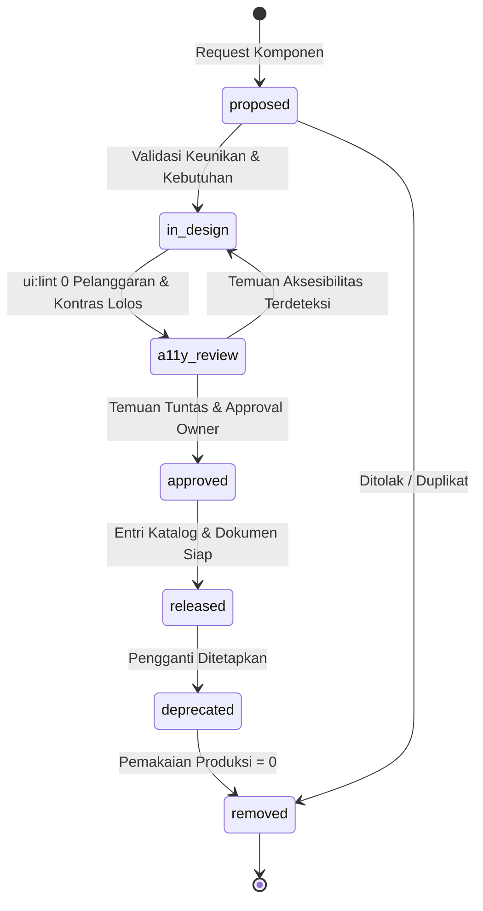
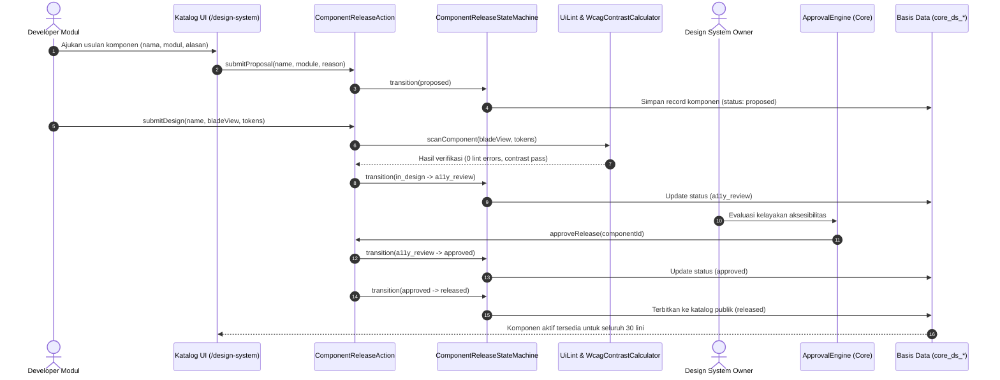
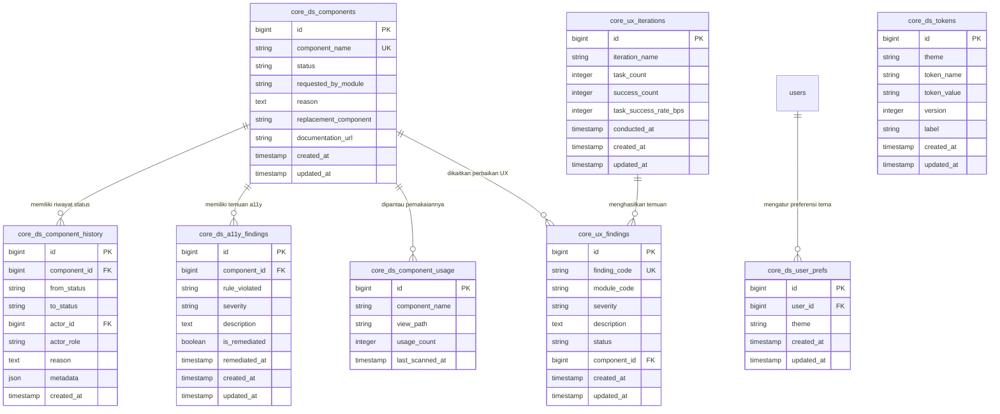
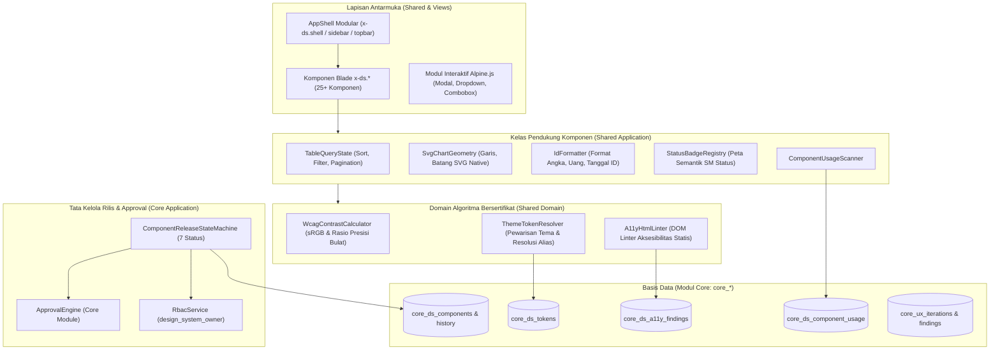

# Desain Arsitektur & Spesifikasi Teknis — Fase 240: Design System & Aksesibilitas

**Dokumen:** `docs/design/fase-240.md`  
**Fase:** Fase 240 (Gelombang 8, Prompt W8-P2.1)  
**Tujuan Arsitektur:** Membangun fondasi sistem desain kanonikal terpadu lintas 30 lini bisnis SuperWeb, tata kelola aksesibilitas standar WCAG 2.1 AA/AAA presisi matematis, penegakan antarmuka responsif mobile-first 375 px, dan alur riset pengalaman pengguna (UX research loop).

---

## 1. Diagram State Machine (D1: `ComponentReleaseStateMachine`)

Diagram berikut menggambarkan 7 status siklus hidup komponen desain kanonikal dan guard penegakannya:

---

## 2. Diagram Sekuens Alur Rilis Komponen (D2: Sequence Diagram)

---

## 3. Diagram Relasi Entitas Data (D3: Entity-Relationship Diagram)

---

## 4. Diagram Arsitektur & Konteks Modul (D5: Context Flowchart)

---

## 5. Ringkasan Desain & Keputusan Arsitektur

1. **Pemisahan Logika & Presentasi (W8-D23):**
   Blade murni bertanggung jawab merender markup HTML semantik dan atribut aksesibilitas (`aria-*`). Logika berat seperti perhitungan koordinat grafik garis/batang SVG, kalkulasi delta metrik, pemilahan status badge, dan sanitasi query string tabel dipisahkan ke dalam kelas-kelas PHP berorientasi objek di `modules/Shared/Application/Ui/`.
2. **Pewarisan Token Tema Tri-State (W8-D21):**
   Variabel tema tersimpan dalam tabel `core_ds_tokens` dengan rantai warisan: tema kontras tinggi (`hc`) mewarisi nilai dari tema gelap (`dark`), dan tema gelap mewarisi nilai dari tema terang (`light`). Alias token berbentuk `{token_name}` diselesaikan secara rekursif pada tema peminta dengan proteksi siklus token (`TOKEN_CYCLE`). Perintah `ds:tokens-build` menghasilkan file stylesheet statis `resources/css/ds-tokens.css` secara otomatis.
3. **Pemberdayaan WCAG 2.1 Presisi Integer (W8-D22):**
   Untuk menghilangkan ketidakkonsistenan pembulatan angka pecahan antar arsitektur CPU dan lingkungan eksekusi, luminansi relatif dihitung dalam skala integer parts-per-million (ppm) dan rasio kontras warna disimpan dalam satuan basis points (bps). Nilai ambang AA teks normal adalah $45.000$ bps ($4.5:1$), teks besar $30.000$ bps ($3.0:1$), dan AAA $70.000$ bps ($7.0:1$).
4. **Pencegahan Komponen Zombie & Pemeliharaan Ratchet (W8-D24 & W8-D25):**
   Komponen tanpa status `released` secara tegas dicegah penggunaannya di halaman produksi oleh `ui:lint` dan `ds:audit`. Komponen deprecated yang masih dipanggil oleh halaman aktif ditolak untuk transisi status ke `removed` hingga `ds:usage-scan` membuktikan total pemanggilan telah mencapai nol.

---

## 6. Spesifikasi Rinci 25+ Komponen Kanonikal `x-ds.*`

Setiap komponen kanonikal dibangun di `modules/Shared/resources/views/components/ds/` dengan spesifikasi antarmuka:

1. `button.blade.php`:
   - Props: `variant` (`primary`, `secondary`, `danger`, `ghost`), `size` (`sm`, `md`, `lg`), `type` (`button`, `submit`), `disabled` (bool), `loading` (bool), `href` (string nullable).
   - Aksesibilitas: `aria-busy` saat loading, `focus-visible:ring-2`, kontras AA.
2. `input.blade.php`:
   - Props: `name` (string), `label` (string nullable), `type` (`text`, `password`, `email`, `number`), `placeholder`, `value`, `required` (bool), `disabled` (bool), `error` (string nullable).
   - Aksesibilitas: Hubungan ID otomatis antara label dan input, `aria-invalid` saat error, `aria-describedby` untuk pesan galat.
3. `select.blade.php`:
   - Props: `name`, `label`, `options` (array/collection asosiatif), `selected`, `required`, `placeholder`.
   - Aksesibilitas: Label semantik, keyboard navigation standar opsi.
4. `combobox.blade.php`:
   - Props: `name`, `label`, `options`, `value`, `searchable` (bool default true).
   - Komponen interaktif Alpine.js dengan penyaringan opsi dinamis dan penangkapan tombol Escape.
5. `date.blade.php`:
   - Props: `name`, `label`, `value`, `min`, `max`, `format` (default `d/m/Y`).
   - Penanganan format tanggal lokalisasi Indonesia dengan fallback ISO 8601.
6. `money-input.blade.php`:
   - Props: `name`, `label`, `value` (integer rupiah), `currency` (default `IDR`).
   - Formatting integer rupiah presisi tinggi tanpa nilai pecahan float.
7. `table.blade.php`:
   - Props: `headers` (list definisi kolom), `rows` (koleksi data), `paginator`, `exportable`, `exportUrl`.
   - Fitur enterprise lengkap: Header sticky, angka rata kanan tabular-nums, responsive card layout di $\le 375$ px.
8. `card.blade.php`:
   - Props: `title` (slot/string), `subtitle`, `footer` (slot), `variant` (`default`, `bordered`, `elevated`).
9. `stat.blade.php`:
   - Props: `title`, `value`, `delta` (string), `deltaDirection` (`up`, `down`, `neutral`), `period`, `chart` (slot).
10. `sparkline.blade.php`:
    - Props: `data` (list integer), `width` (int default 120), `height` (int default 32), `color` (`primary`, `success`, `danger`).
    - Merender jalur SVG `<path d="M...">` murni terhitung matematis di PHP.
11. `chart-line.blade.php`:
    - Props: `labels` (list string), `values` (list int), `height` (int default 240), `strokeColor`.
    - Merender grafik garis SVG lengkap dengan sumbu Y, grid lines, dan titik koordinat.
12. `chart-bar.blade.php`:
    - Props: `labels`, `values`, `height`, `barColor`.
    - Merender diagram batang SVG dengan penskalaan proporsional terstandar.
13. `badge-status.blade.php`:
    - Props: `status` (string), `size` (`sm`, `md`).
    - Terhubung otomatis dengan `StatusBadgeRegistry` untuk warna semantik yang konsisten.
14. `timeline.blade.php`:
    - Props: `events` (list objek riwayat dengan stempel waktu, aktor, peran, aksi, keterangan).
15. `modal-confirm.blade.php`:
    - Props: `id`, `title`, `confirmText`, `action`, `method`, `confirmVariant` (default `danger`).
    - Menjebak fokus keyboard (*focus trap*) dan mengunci form dari double-submit.
16. `toast.blade.php`:
    - Props: `type` (`success`, `error`, `info`, `warning`), `title`, `message`, `duration`.
17. `empty.blade.php`:
    - Props: `title`, `description`, `icon`, `action` (slot).
18. `skeleton.blade.php`:
    - Props: `type` (`text`, `card`, `table`, `avatar`), `rows`, `columns`.
19. `error.blade.php`:
    - Props: `title`, `message`, `retryUrl`, `code` (misal 403, 404, 500).
20. `breadcrumb.blade.php`:
    - Props: `items` (list array: label, url).
21. `tabs.blade.php`:
    - Props: `tabs` (list array: key, label, count, active).
22. `stepper.blade.php`:
    - Props: `steps` (list array: title, status: completed, current, upcoming).
23. `upload.blade.php`:
    - Props: `name`, `label`, `accept`, `maxSizeMb`, `multiple`.
24. `filter-bar.blade.php`:
    - Props: `filters` (definisi filter pencarian, status, tanggal).
25. `export-toolbar.blade.php`:
    - Props: `csvUrl`, `excelUrl`, `pdfUrl`, `totalCount`.
26. `theme-switch.blade.php`:
    - Props: `currentTheme` (`light`, `dark`, `hc`).
27. `contrast-badge.blade.php`:
    - Props: `ratioBps`, `level` (`AA`, `AAA`, `FAIL`).
28. `shell.blade.php`, `sidebar.blade.php`, `topbar.blade.php`, `command-palette.blade.php`:
    - Fondasi modular tata letak sistem terpadu SuperWeb.
