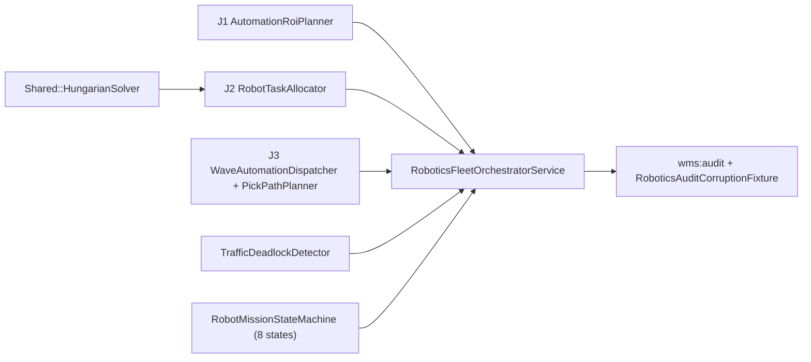

# Desain Teknis — Fase 279: Warehouse Automation & Robotics Simulation

## 1. Ikhtisar Arsitektur (`Wms\Robotics`)

## 2. Skema Database (`wms_robotics_*`)

Migrasi aditif `modules/Wms/database/migrations/2026_11_13_000003_create_wms_robotics_tables.php`:
1. `wms_robotics_plans`: rencana automasi per DC (`warehouse_id` FK `wms_warehouses.id`, `pick_method`, `target_lines_per_hour`, `capex_idr`, `annual_savings_idr`, `roi_bps`, `payback_months`, `phase_stage`).
2. `wms_robot_units`: armada AMR/conveyor (`robot_code`, `warehouse_id` FK `wms_warehouses.id`, `kind`, `battery_pct`, `status`, `current_zone_code`, `max_speed_mm_s`).
3. `wms_robot_missions`: misi tugas dengan 8-state machine (`mission_code`, `warehouse_id` FK `wms_warehouses.id`, `robot_unit_id` FK `wms_robot_units.id`, `wave_id` nullable FK `wms_waves.id`, `zone_code`, `status`, `fallback_manual`, `assigned_operator_user_id` FK `users.id`).
4. `wms_robot_zone_locks`: reservasi zona eksklusif anti-tabrakan & safety interlock (`warehouse_id` FK `wms_warehouses.id`, `zone_code`, `robot_unit_id` FK `wms_robot_units.id`, `human_present`, `interlock_active`, `speed_limit_mm_s`, `lock_status`, `locked_at`, `released_at`).

## 3. State Machine `RobotMissionStateMachine` (8 Status)

Status: `queued`, `assigned`, `en_route`, `picking`, `delivering`, `completed`, `interlocked`, `failed_fallback`.
- Jalur normal: `queued -> assigned -> en_route -> picking -> delivering -> completed`.
- Safety interlock: `en_route | picking | delivering -> interlocked -> en_route | failed_fallback`.
- Kegagalan robot / fallback manual: `assigned | en_route | picking | delivering | interlocked -> failed_fallback -> completed`.

## 4. Rute HTTP, Policy & Perintah Artisan

- Rute di `modules/Wms/routes/web.php` (terdaftar di `tests/Architecture/route-roles.php`):
  - `GET /wms/robotics/fleet` (`wms.robotics.fleet`)
  - `GET /wms/robotics/missions` (`wms.robotics.missions`)
  - `GET /wms/robotics/roi` (`wms.robotics.roi`)
  - `POST /wms/robotics/missions/dispatch` (`wms.robotics.missions.dispatch`)
  - `POST /wms/robotics/missions/{mission}/fallback` (`wms.robotics.missions.fallback`)
  - `POST /wms/robotics/interlock` (`wms.robotics.interlock`)
- Commands: `wms:robotics-dispatch`, `wms:robotics-audit`, `wms:robotics-roi-plan` (plus perluasan `wms:audit`).

