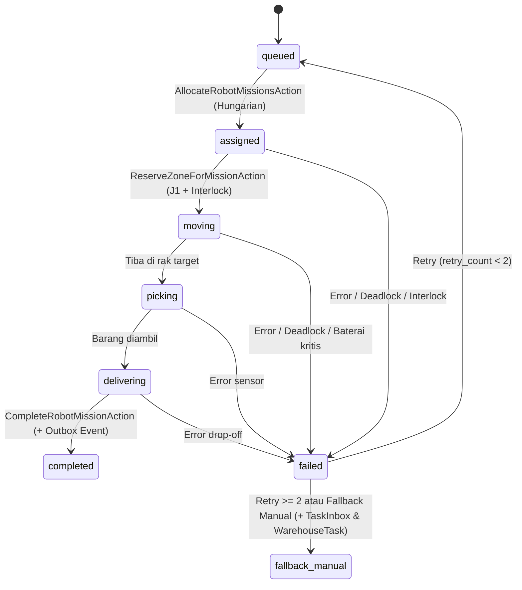
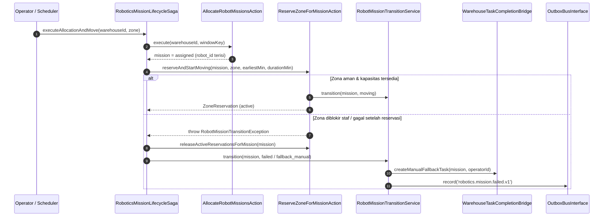
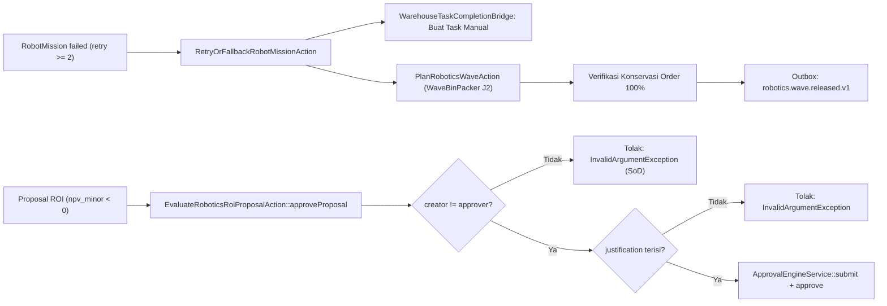

# Design — Fase 279: Gudang, Control Tower & Robotika Otomasi

## 1. Arsitektur Vertical Slice `Wms\Robotics`
Seluruh komponen Fase 279 berada di dalam modul `Wms` (`modules/Wms/`) dengan pemisahan layer tegas:
- **Domain (`modules/Wms/Domain/`)**: Value objects (`IntervalWindow`, `RationalRate`), State Machine 8 status (`RobotMissionStateMachine`), Pure Algorithms (`ZoneReservationScheduler`, `WaveBinPacker`, `AutomationNpvCalculator`, `TrafficDeadlockDetector`, `ChargingSchedulePlanner`, `RobotHealthScorer`, `ZoneCongestionHeatmapCalculator`, `RoboticsRoiSensitivityMatrixBuilder`, `RobotEnergyConsumptionEstimator`, `RobotFleetDispatchOptimizer`), Certificates (`*Certificate`), dan Domain Service (`RoboticsZoneInterlockEvaluator`).
- **Application (`modules/Wms/Application/`)**: Use-case Actions (`AllocateRobotMissionsAction`, `ReserveZoneForMissionAction`, `CompleteRobotMissionAction`, `RetryOrFallbackRobotMissionAction`, `PlanRoboticsWaveAction`, `EvaluateRoboticsRoiProposalAction`, `PlanRobotChargingScheduleAction`, `ResolveTrafficDeadlockAction`, `IngestSimulatedTelemetryBatchAction`) dan Services (`RobotMissionTransitionService`, `RoboticsMissionLifecycleSaga`, `RoboticsSimulationTickHandler`, `RoboticsSimulationScenarioRunner`, `RoboticsFleetKpiAggregator`, `RoboticsT1SimulationReportService`, `RoboticsTwoSourceAuditService`, `RobotTelemetryIngestor`, `SafetyIncidentLog`, `RoboticsCsvExportService`, `WmsRoboticsAuditCliReportFormatter`).
- **Infrastructure (`modules/Wms/Infrastructure/`)**: Adapter perangkat simulasi (`SimulatedAmrDeviceAdapter` mengimplementasikan `SimulatedDeviceAdapterInterface`) dan jembatan internal tugas gudang (`WarehouseTaskCompletionBridge`).
- **Presentation (`modules/Wms/Http/` & `resources/views/wms/robotics/`)**: `WmsRoboticsOperationsController`, `RobotMissionPolicy`, Form Requests (`PlanRoboticsWaveRequest`, `ApproveRoboticsRoiRequest`, `ReviewSafetyIncidentRequest`), ViewModels (`RoboticsMissionBoardViewModel`, `RoboticsRoiPortfolioViewModel`), dan Blade views berbasis komponen `x-ds.*`.

## 2. Diagram State Machine & Alur Saga (`RobotMission`)

## 3. Diagram Sekuens Saga & Kompensasi Kegagalan

## 4. Rute HTTP & Matriks Peran (`routes/web.php` & `route-roles.php`)
| Route Name | Method & URI | Peran Berhak |
|---|---|---|
| `wms.robotics.fleet` | `GET /wms/robotics/fleet` | `admin`, `hub_operator`, `logistics_admin`, `auditor` |
| `wms.robotics.missions` | `GET /wms/robotics/missions` | `admin`, `hub_operator`, `logistics_admin`, `auditor` |
| `wms.robotics.zones` | `GET /wms/robotics/zones` | `admin`, `hub_operator` |
| `wms.robotics.waves` | `GET /wms/robotics/waves` | `admin`, `hub_operator`, `logistics_admin` |
| `wms.robotics.waves.plan` | `POST /wms/robotics/waves/plan` | `admin`, `hub_operator`, `logistics_admin` |
| `wms.robotics.roi` | `GET /wms/robotics/roi` | `admin`, `auditor`, `procurement` |
| `wms.robotics.roi.approve` | `POST /wms/robotics/roi/{proposal}/approve` | `admin` |
| `wms.robotics.simulations` | `GET /wms/robotics/simulations` | `admin`, `auditor` |
| `wms.robotics.charging` | `GET /wms/robotics/charging` | `admin`, `hub_operator` |
| `wms.robotics.incidents` | `GET /wms/robotics/incidents` | `admin`, `hub_operator`, `auditor` |
| `wms.robotics.incidents.review` | `POST /wms/robotics/incidents/{incident}/review` | `admin`, `hub_operator` |
| `wms.robotics.export` | `GET /wms/robotics/export/{entity}` | `admin`, `auditor` |

## 5. Daftar Command CLI & Event Katalog
- **Commands (`8`)**: `robotics:allocate`, `robotics:reservation-sweep`, `robotics:wave-plan`, `robotics:roi`, `robotics:simulate`, `robotics:audit`, `robotics:charge-plan`, `robotics:deadlock-scan`.
- **EventCatalog (`3`)**: `robotics.mission.completed.v1`, `robotics.mission.failed.v1`, `robotics.wave.released.v1`.
- **Audit Fixture (`app/Quality/Audit/Fixtures/RoboticsAuditCorruptionFixture.php`)**: Terdaftar pada `AuditCommandRegistry` untuk command `robotics:audit`.

## 6. Skema Tabel Basis Data (`2026_11_13_000004_create_wms_robotics_full_tables.php`)
| Tabel | Peran & Kolom Kunci | Aturan Integritas |
|---|---|---|
| `wms_robots` | Armada AMR/AGV/ASRS (`warehouse_id`, `robot_code`, `is_online`, `battery_pct`, `health_score`, `position_x`, `position_y`) | Unique `(warehouse_id, robot_code)`, FK ke `wms_warehouses` |
| `wms_traffic_zones` | Zona lalu lintas (`zone_code`, `capacity_k`, `staff_blocked`, `block_start_min`, `block_end_min`, `block_reason`) | Unique `(warehouse_id, zone_code)`, FK ke `wms_warehouses` |
| `wms_zone_reservations` | Slot interval setengah-terbuka `[start_min, end_min)` (`traffic_zone_id`, `mission_id`, `robot_id`, `status`) | FK ke `wms_traffic_zones`, `wms_robot_missions`, `wms_robots` |
| `wms_robot_missions` | Entitas misi 8 status (`robot_id`, `traffic_zone_id`, `warehouse_task_id`, `retry_count`, `priority`, `fallback_manual`) | FK ke `wms_robots`, `wms_traffic_zones`, `wms_tasks` |
| `wms_robot_mission_events` | Jejak transisi state machine (`from_status`, `to_status`, `reason_code`, `actor_user_id`, `recorded_at`) | Append-only (updating/deleting melempar `LogicException`) |
| `wms_robot_waves` | Wave order FFD `J2` (`batch_code`, `carrier_code`, `cutoff_hhmm`, `capacity`, `total_load`, `order_ids`, `certificate_hash`) | JSON `order_ids` + SHA-256 `WaveBinPackerCertificate` |
| `wms_robotics_roi_proposals` | Proposal CAPEX & NPV `J3` (`capex_minor`, `annual_cashflows_minor`, `npv_minor`, `irr_bps`, `payback_months`, `justification`, `created_by_user_id`, `approved_by_user_id`) | Integer minor IDR, SoD (`created_by != approved_by`) |
| `wms_robot_charge_schedules` | Jadwal pengisian daya (`robot_id`, `charger_bay`, `window_start_min`, `window_end_min`, `target_battery_pct`) | FK ke `wms_robots` dan `wms_warehouses` |
| `wms_robot_telemetries` | Log telemetri deterministik (`robot_id`, `battery_pct`, `error_count`, `downtime_minutes`, `health_score`, `idempotency_key`) | Append-only, unique `idempotency_key` (`tel:{robot_id}:{tickKey}`) |
| `wms_robot_safety_incidents` | Log insiden keselamatan (`incident_code`, `severity`, `incident_type`, `status`, `reviewed_by_user_id`) | Append-only pada entri awal, review via `SafetyIncidentLog` |

## 7. Kontrak Event Outbox (`EventCatalog.php`)
1. `robotics.mission.completed.v1`: Diterbitkan oleh `RobotMissionTransitionService` setelah `DB::afterCommit` saat misi mencapai `completed`. Payload: `warehouse_id`, `mission_id`, `mission_code`, `from_status`, `to_status`, `reason_code`.
2. `robotics.mission.failed.v1`: Diterbitkan saat misi memasuki `failed` atau `fallback_manual` (termasuk eskalasi operator).
3. `robotics.wave.released.v1`: Diterbitkan oleh `PlanRoboticsWaveAction` setelah wave FFD tersimpan dan terverifikasi `WaveBinPackerCertificate`.

## 8. Inventaris Lengkap Kelas Modul `Wms\Robotics` (Fase 279)
### A. Domain Layer (`modules/Wms/Domain/`)
| Kelas | Kategori | Tanggung Jawab Utama |
|---|---|---|
| `ValueObjects\IntervalWindow` | Value Object | Interval setengah-terbuka `[start, end)` dalam menit bulat, validasi batas, dan uji overlap |
| `ValueObjects\RationalRate` | Value Object | Bilangan rasional eksak `num/den` tanpa float dengan operasi `shiftByBasisPoints()` |
| `StateMachines\RobotMissionStateMachine` | State Machine | Menegakkan 8 status misi, transisi sah, dan batas `MAX_RETRY_ATTEMPTS = 2` |
| `Exceptions\RobotMissionTransitionException` | Exception | Pengecualian terstruktur untuk pelanggaran transisi, retry, atau interlock keselamatan |
| `Algorithms\ZoneReservationScheduler` | Algoritma `J1` | Penjadwal slot waktu minimum pada kapasitas `k` sambil menghindari blokir staf |
| `Algorithms\WaveBinPacker` | Algoritma `J2` | Bin-packing First-Fit Decreasing deterministik per `(cutoff, carrier)` |
| `Algorithms\AutomationNpvCalculator` | Algoritma `J3` | Kalkulasi NPV, IRR (bps), dan payback period berbasis integer & `RationalRate` |
| `Algorithms\TrafficDeadlockDetector` | Algoritma Graf | Deteksi siklus wait-for graph dan pemilihan victim berprioritas terendah |
| `Algorithms\ChargingSchedulePlanner` | Algoritma | Penjadwalan pengisian baterai untuk robot di bawah ambang aman |
| `Algorithms\RobotHealthScorer` | Algoritma | Skoring kesehatan robot `[0..1000]` dan klasifikasi kode anomali |
| `Algorithms\ZoneCongestionHeatmapCalculator` | Algoritma | Analisis puncak utilisasi permil per bucket waktu zona |
| `Algorithms\RoboticsRoiSensitivityMatrixBuilder` | Algoritma | Matriks sensitivitas 3x3 pergeseran suku bunga vs pengali CAPEX |
| `Algorithms\RobotEnergyConsumptionEstimator` | Algoritma | Estimasi konsumsi mWh, persentase baterai ceiling, dan jarak tempuh aman maksimum |
| `Algorithms\RobotFleetDispatchOptimizer` | Algoritma | Pengoptimal alokasi Hungarian terintegrasi interlock zona & kelayakan energi |
| `Algorithms\RobotBatteryDegradationTracker` | Algoritma | Pelacakan degradasi kapasitas pak baterai (permil) akibat siklus & deep-discharge |
| `Algorithms\WaveCutoffSlackCalculator` | Algoritma | Evaluasi kelonggaran waktu (`slack_minutes`) terhadap cutoff kurir (`CRITICAL`/`TIGHT`/`NORMAL`) |
| `Algorithms\ChargingBayContentionResolver` | Algoritma | Pewarnaan interval bay charger fisik untuk mencegah bentrok jadwal pengisian |
| `Algorithms\RobotMaintenanceWindowPlanner` | Algoritma | Penjadwal pemeliharaan preventif dengan batas konkurensi `<= 15%` armada |
| `Services\RoboticsZoneInterlockEvaluator` | Domain Service | Aturan interlock zona staf, kapasitas `k`, baterai minimum, dan batas kecepatan `800 mm/s` |
| `Services\RoboticsMissionPriorityPolicy` | Domain Service | Penentuan prioritas dinamis berdasarkan usia antrean, retry, dan risiko cutoff |
| `Certificates\*Certificate` (5 kelas) | Certificates | Sertifikat SHA-256 kanonik untuk `J1`, `J2`, `J3`, `Deadlock`, `Energy`, `BatteryDegradation` |

### B. Application & Infrastructure Layer (`modules/Wms/Application/` & `Infrastructure/`)
| Kelas | Kategori | Tanggung Jawab Utama |
|---|---|---|
| `Actions\AllocateRobotMissionsAction` | Action | Alokasi batch misi `queued` ke robot online via `HungarianSolver` + lock DB |
| `Actions\ReserveZoneForMissionAction` | Action | Penguncian zona `J1`, validasi interlock staf, dan transisi ke `moving` |
| `Actions\CompleteRobotMissionAction` | Action | Penyelesaian misi `delivering -> completed`, pelepasan zona, dan konfirmasi `WarehouseTask` |
| `Actions\RetryOrFallbackRobotMissionAction` | Action | Penanganan retry (maks 2) atau eskalasi `fallback_manual` + replanning wave `J2` |
| `Actions\PlanRoboticsWaveAction` | Action | Penyusunan wave FFD `J2` dan penerbitan `robotics.wave.released.v1` |
| `Actions\EvaluateRoboticsRoiProposalAction` | Action | Evaluasi NPV/IRR `J3` dan persetujuan via `ApprovalEngine` dengan penegakan SoD |
| `Actions\PlanRobotChargingScheduleAction` | Action | Penyusunan dan penyimpanan jadwal charging armada |
| `Actions\ResolveTrafficDeadlockAction` | Action | Resolusi siklus tunggu dan pemutusan victim |
| `Actions\IngestSimulatedTelemetryBatchAction` | Action | Ingesti telemetri batch dari `SimulatedDeviceAdapterInterface` + pembukaan insiden otomatis |
| `Actions\EscalateOverdueMissionsAction` | Action | Pemindaian SLA misi antrean, penaikan prioritas, dan notifikasi `TaskInbox` |
| `Services\RoboticsMissionLifecycleSaga` | Saga | Orkestrator transaksi dengan kompensasi otomatis pelepasan reservasi saat gagal |
| `Services\RoboticsT1SimulationReportService` | Service | Agregasi laporan T1 lengkap (KPI, heatmap zona, sensitivitas ROI, audit status) |
| `Services\RoboticsFleetReadinessService` | Service | Evaluasi kesiapan pra-shift armada (`online_ratio_permil`, audit, insiden terbuka) |
| `Services\RoboticsWaveReconciliationService` | Service | Rekonsiliasi konservasi order (`missing_order_ids`, `duplicate_order_ids`) |
| `Services\RoboticsShiftHandoverReportService` | Service | Penyusunan paket serah-terima shift operator Control Tower |
| `Services\RoboticsTwoSourceAuditService` | Audit Service | Pemeriksaan konsistensi 6 titik lintas-tabel dan kalkulasi `computeProductionStateHash()` |
| `Infrastructure\Adapters\SimulatedAmrDeviceAdapter` | Adapter | Implementasi deterministik `SimulatedDeviceAdapterInterface` |
| `Infrastructure\Adapters\WarehouseTaskCompletionBridge` | Bridge | Jembatan internal antara `RobotMission` dan `wms_tasks` (Fase 41) |

## 9. Sekuens Replanning Wave & Persetujuan ROI (SoD)

