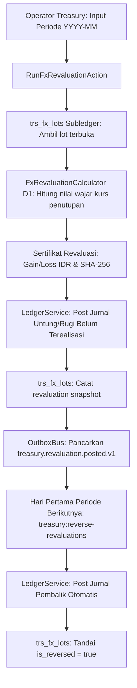
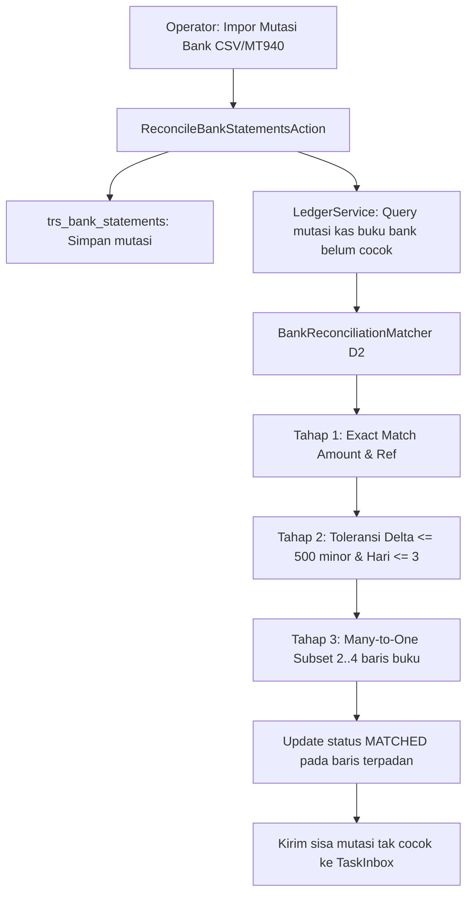
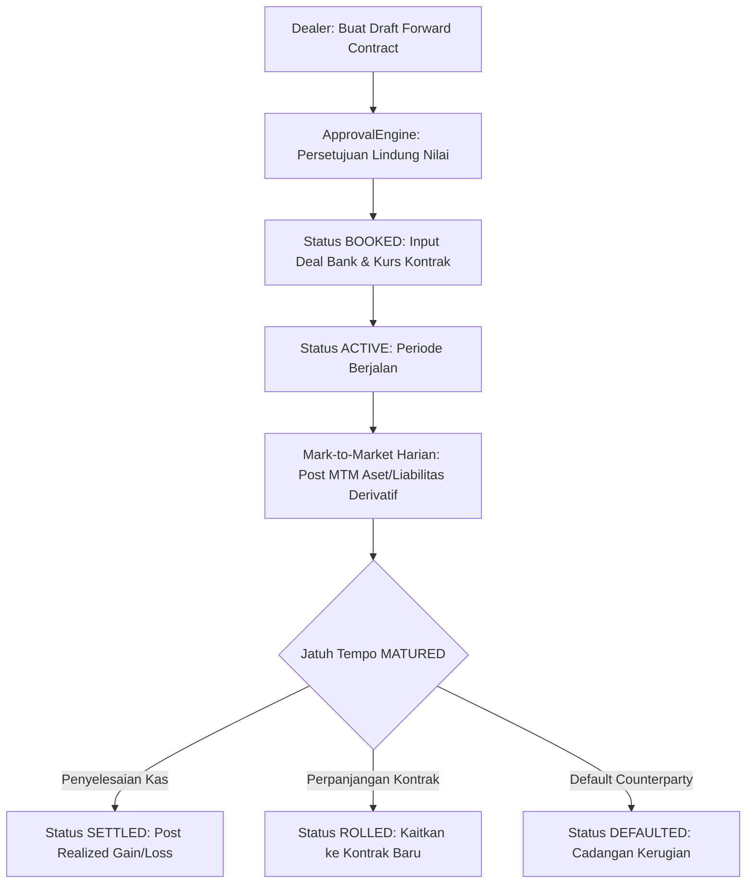
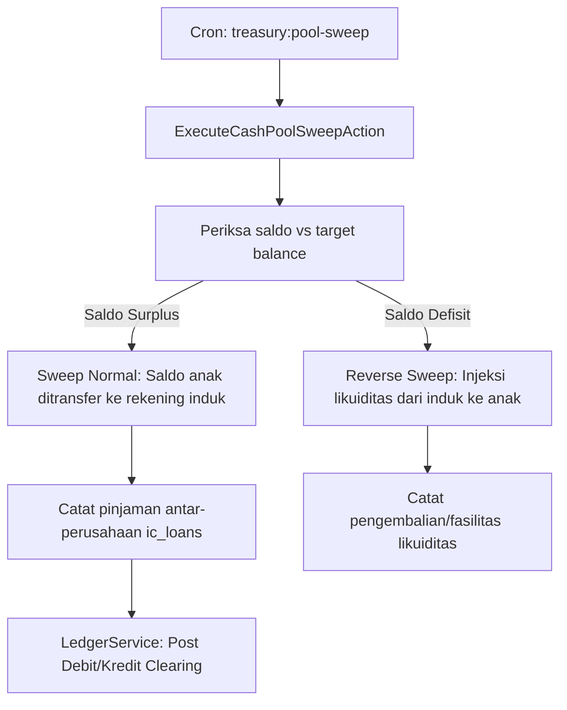

# Dokumen Desain Teknis — Fase 48: Multi-Currency & Treasury

## 1. Ringkasan Eksekutif & Sasaran Arsitektur

Fase 48 mengimplementasikan sistem perbendaharaan korporat terpadu (**Corporate Treasury Management**) yang menangani transaksi multi-mata uang, revaluasi nilai tukar akhir periode, rekonsiliasi mutasi perbankan multi-tahap, peramalan likuiditas kas 13 minggu, lindung nilai valuta asing (FX Forward Hedge), pengawasan covenant fasilitas kredit perbankan, dan pooling likuiditas grup berbasis pinjaman antar-entitas (Intercompany Loans).

Sistem ini dirancang dengan prinsip ketat perbendaharaan:
1. **Aritmetika Rasional Tanpa Float**: Seluruh kurs dan perhitungan moneter menggunakan representasi rasional integer pembilang dan penyebut (`RationalRate`), mencegah distorsi pembulatan atau selisih fraksional pada neraca keuangan.
2. **Dual-Leg Multi-Currency Balancing**: Transaksi mata uang asing diposting dua kaki seimbang dalam mata uang asal (`asset_code = CCY`) dan fungsional (`asset_code = IDR`), dengan subledger `trs_fx_lots` yang melacak carrying value per lot secara akurat.
3. **Revaluasi Valas & Pembalik Otomatis**: Pengakuan laba/rugi selisih kurs belum terealisasi pada akhir periode akuntansi, disertai pembuatan jurnal pembalik otomatis (*auto-reversal*) pada hari pertama periode berikutnya untuk mencegah dobel hitung saat pelunasan riil.
4. **Pencocokan Rekonsiliasi Bank 3-Tahap**: Algoritma deterministic matching yang membagi pencocokan ke dalam tahap exact match, tolerance window match, dan bounded many-to-one subset combination, tanpa mengubah integritas data mutasi perbankan.
5. **State Machine Lindung Nilai (HedgeContract)**: Pengendalian kontrak derivatif forward melalui 8 status yang diawasi guard otorisasi ApprovalEngine (`draft` -> `approved` -> `booked` -> `active` -> `matured` -> `settled` / `rolled` / `cancelled`).
6. **Pemantauan Kepatuhan Covenant**: Pengujian rasio solvabilitas dan likuiditas (DER, ICR) berbasis integer permille tanpa nilai float, dengan pemblokiran otomatis terhadap penarikan fasilitas yang melanggar batas kredit.
7. **Audit Dua Sumber (`treasury:audit`)**: Rekonsiliasi matematis independen antara tabel perbendaharaan operasional dan catatan jurnal buku besar (`LedgerService`).

---

## 2. Diagram Sequence Alur Utama & Saga (D2)

### A. Alur Revaluasi Kurs & Pembalik Otomatis


### B. Alur Rekonsiliasi Bank Tiga Tahap


### C. Alur Kontrak Lindung Nilai Forward Contract


### D. Alur Cash Pooling Sweep & Reverse Sweep

        SweepAction->>Intercompany: Kurangi kewajiban / catat pinjaman balik
        SweepAction->>Ledger: Post Pembalik Pinjaman IC / Kas Masuk
    end
```

---

## 3. Spesifikasi State Machine `HedgeContract` (D48-1)

Siklus hidup kontrak lindung nilai derivatif forward dikelola oleh model `ForwardContract` dengan 8 status:

```
[draft] ──(submit & approve)──> [approved] ──(input deal bank)──> [booked]
   │                               │                                 │
(cancel)                        (cancel)                         (cancel w/ fee)
   │                               │                                 │
   v                               v                                 v
[cancelled]                   [cancelled]                       [cancelled]
                                                                     │
                                                               (start date)
                                                                     │
                                                                     v
                                                                 [active]
                                                                     │
                                                               (maturity date)
                                                                     │
                                                                     v
                                                                 [matured]
                                                                  ╱     ╲
                                                      (settle)   ╱       ╲   (roll-over)
                                                                v         v
                                                           [settled]   [rolled]
```

### Aturan Transisi & Guard:
1. `draft` -> `approved`: Memerlukan otorisasi via `ApprovalEngine` dengan aturan pembuat $\ne$ penyetuju (`creator_id != approver_id`). Memvalidasi limit eksposur mata uang.
2. `draft` -> `cancelled`: Pembatalan administratif sebelum persetujuan tanpa konsekuensi finansial.
3. `approved` -> `booked`: Dealer memasukkan nomor deal konfirmasi bank dan kurs kontrak resmi.
4. `approved` -> `cancelled`: Pembatalan sebelum booking tanpa biaya pembatalan.
5. `booked` -> `active`: Kontrak mulai berlaku efektif pada tanggal transaksi.
6. `booked` -> `cancelled`: Pembatalan deal bank. Mewajibkan posting biaya pembatalan (`trs:hedge_cancellation_cost:IDR` -> `trs:bank_clearing:IDR`).
7. `active` -> `matured`: Tanggal jatuh tempo tiba. Selisih MTM terakhir dibukukan secara presisi.
8. `matured` -> `settled`: Pelunasan kontrak dengan penerimaan/pembayaran selisih kas riil dan pengakuan untung/rugi terealisasi (`trs:fx_realized_gain_loss:IDR`).
9. `matured` -> `rolled`: Kontrak diperpanjang dengan menerbitkan kontrak forward anak yang tertaut secara relasional (`rolled_to_contract_id`), menutup MTM kontrak induk.
10. Riwayat seluruh transisi dicatat secara append-only di `trs_forward_contract_histories`.

---

## 4. Spesifikasi Tiga Algoritma Baru (D1, D2, D3)

### A. Algoritma D1: `FxRevaluationCalculator`
- **Tujuan**: Menghitung revaluasi nilai tercatat pos moneter valuta asing akhir periode akuntansi sesuai PSAK 10 / IAS 21.
- **Masukan**:
  - `foreignBalanceMinor`: Bilangan bulat saldo valas dalam unit minor (contoh: sen USD, cent EUR).
  - `carryingFunctionalIdr`: Nilai tercatat dalam IDR saat ini.
  - `rateNumerator`: Pembilang kurs rasional (IDR per 1 unit mata uang dasar).
  - `rateDenominator`: Penyebut kurs rasional (bilangan bulat positif).
  - `currencyDecimals`: Jumlah desimal mata uang asing (default 2 untuk USD/EUR/SGD, 0 untuk JPY).
  - `isAsset`: Boolean penanda akun aset (`true`) atau akun liabilitas (`false`).
- **Formula**:
  $$\text{Scale} = 10^{\text{currencyDecimals}}$$
  $$\text{Revalued} = \text{round\_half\_away\_from\_zero}\left( \frac{\text{foreignBalanceMinor} \times \text{rateNumerator}}{\text{rateDenominator} \times \text{Scale}} \right)$$
  - Jika Aset: $\Delta = \text{Revalued} - \text{carryingFunctionalIdr}$. ($\Delta > 0 \implies \text{Gain}$, $\Delta < 0 \implies \text{Loss}$).
  - Jika Liabilitas: $\Delta = \text{Revalued} - \text{carryingFunctionalIdr}$. ($\Delta > 0 \implies \text{Loss}$, $\Delta < 0 \implies \text{Gain}$).
  - Pelunasan Parsial: Nilai tercatat asal dialokasikan proporsional:
    $$\text{CarryingAllocated} = \text{round\_half\_away\_from\_zero}\left( \frac{\text{settledMinor} \times \text{carryingFunctionalIdr}}{\text{totalMinor}} \right)$$
    $$\text{RealizedGainLoss} = \text{SettlementValueIdr} - \text{CarryingAllocated}$$
- **Kompleksitas**: $O(1)$ waktu, $O(1)$ ruang.

### B. Algoritma D2: `BankReconciliationMatcher`
- **Tujuan**: Memadankan mutasi rekening koran perbankan dengan buku kas perusahaan secara otomatis dan deterministik.
- **Tahap 1 — Exact Match**:
  - Kriteria: `bank.amount == book.amount` DAN `bank.reference_no == book.reference_no` (keduanya tidak kosong).
  - Menghasilkan kecocokan berpasangan 1-to-1 dengan selisih 0.
- **Tahap 2 — Tolerance Window Match**:
  - Kriteria sisa mutasi: $|\text{bank.amount} - \text{book.amount}| \le 500$ minor unit DAN $|\text{bank.date} - \text{book.date}| \le 3$ hari.
  - Pengurutan prioritas: Pasangan diurutkan berdasarkan `(abs_diff_amount ASC, abs_diff_days ASC, book_id ASC)`.
  - Greedy tie-break leksikografis deterministik.
- **Tahap 3 — Bounded Many-to-One Match**:
  - Untuk setiap baris mutasi bank tersisa yang bernilai positif:
    - Ambil kandidat baris buku bertanda sama dengan $|\text{bank.date} - \text{book.date}| \le 5$ hari dan `book.amount < bank.amount`.
    - Batasi maksimum 12 kandidat terurut berdasarkan `(date ASC, id ASC)`.
    - Cari kombinasi subset berukuran $k \in [2, 4]$ yang jumlahnya tepat sama dengan `bank.amount`.
    - Urutan pemilihan: Subset berukuran terkecil didahulukan ($k=2$ sebelum $k=3$); jika ada beberapa subset sama besar, pilih subset dengan urutan ID leksikografis terkecil.
    - Jumlah kombinasi maksimal: $\binom{12}{2} + \binom{12}{3} + \binom{12}{4} = 66 + 220 + 495 = 781$ himpunan (sangat cepat dan konstan).
- **Kompleksitas**: $O(N_B \log N_B + N_L \log N_L + N_B \times 781)$ waktu, $O(N_B + N_L)$ ruang.

### C. Algoritma D3: `SeasonalCashForecaster`
- **Tujuan**: Memproyeksikan arus kas masuk dan keluar selama 13 minggu ke depan berbasis dekomposisi musiman multiplikatif dan regresi linier OLS rasional.
- **Masukan**: Riwayat arus kas mingguan $y_1, y_2, \dots, y_n$ sebanyak $n$ minggu, dengan syarat $n$ kelipatan periode musiman $p=4$ dan $n \ge 2p$ ($n \ge 8$).
- **Langkah Perhitungan**:
  1. Hitung rata-rata keseluruhan: $\bar{y} = \frac{1}{n} \sum_{t=1}^n y_t$.
  2. Hitung rata-rata posisi musiman $k \in \{0, 1, 2, 3\}$:
     $$m_k = \frac{1}{n/p} \sum_{j=0}^{n/p - 1} y_{j \cdot p + k + 1}$$
  3. Indeks musiman rasional: $S_k = \frac{m_k}{\bar{y}}$. Disimpan sebagai rasional persis dan dilaporkan dalam permille berlantai $\lfloor 1000 \times S_k \rfloor$.
  4. Deseasonalisasi data historis: $d_t = \frac{y_t}{S_{(t-1) \bmod p}}$.
  5. Regresi linier Ordinary Least Squares (OLS) rasional atas $(t, d_t)$ untuk $t = 1, \dots, n$:
     $$\bar{t} = \frac{n+1}{2}, \quad \bar{d} = \frac{1}{n} \sum_{t=1}^n d_t$$
     $$b = \frac{\sum_{t=1}^n (t - \bar{t})(d_t - \bar{d})}{\sum_{t=1}^n (t - \bar{t})^2}, \quad a = \bar{d} - b \cdot \bar{t}$$
  6. Ramalan minggu ke-$t$ untuk $t = n+1, \dots, n+13$:
     $$\hat{y}_t = \left\lfloor (a + b \cdot t) \times S_{(t-1) \bmod p} \right\rfloor$$
- **Kompleksitas**: $O(n)$ waktu, $O(n)$ ruang.

---

## 5. Rencana Pengujian & Verifikasi Mutu

Acceptance test dibatasi maksimal 5 pengujian komprehensif di `tests/Acceptance/Treasury/`:
1. **`TreasuryAccessTest`**: Pengujian izin akses RBAC seluruh endpoint rute Treasury (role berhak 200/302 vs tidak berhak 403).
2. **`TreasuryFxRevaluationE2ETest`**: Pengujian menyeluruh algoritma D1, posting ledger fungsional & valas seimbang, pembalik otomatis awal periode, pelunasan realized parsial, dan kepatuhan idempotensi.
3. **`TreasuryBankReconciliationAndForecastTest`**: Pengujian algoritma D2 pada dataset T1, unmatch dengan jejak audit, kesesuaian saldo buku vs saldo bank, serta vektor musiman D3 dengan skenario forecast.
4. **`TreasuryHedgeAndFacilityOperationsTest`**: Pengujian siklus state machine 8 status HedgeContract, MTM harian, roll-over, penolakan penarikan fasilitas yang melanggar covenant DER integer, serta perlindungan saldo kas negatif pada sweep pooling.
5. **`TreasuryDualSourceAuditTest`**: Pengujian audit dua sumber `treasury:audit` (data bersih exit 0 vs data sengaja dikorup exit != 0 dengan pelaporan anomali).
Vektor algoritma diuji secara terpisah pada test runner algoritma tanpa menambah hitungan acceptance test suite.
