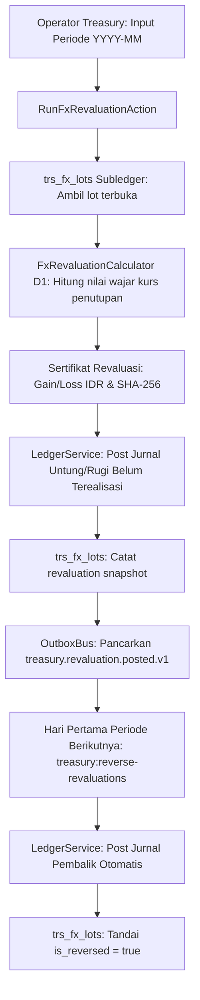
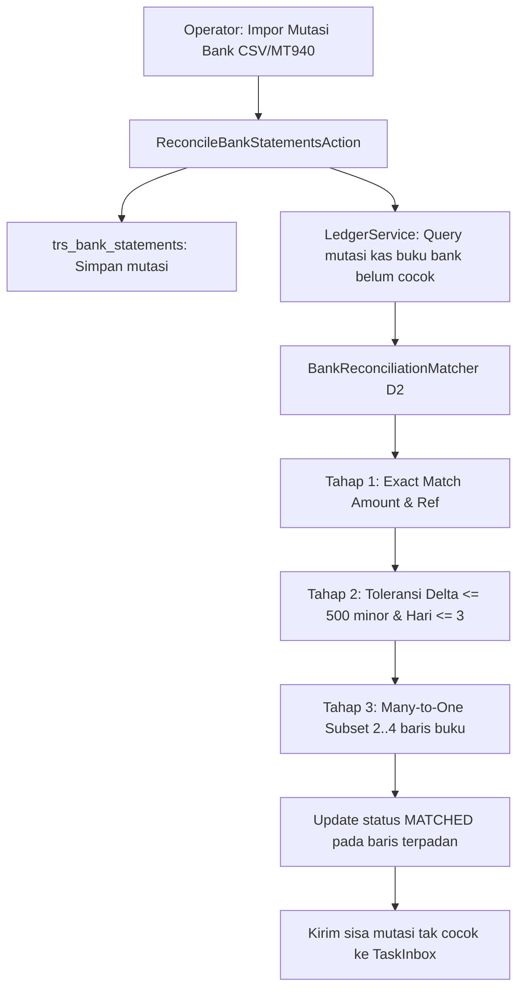
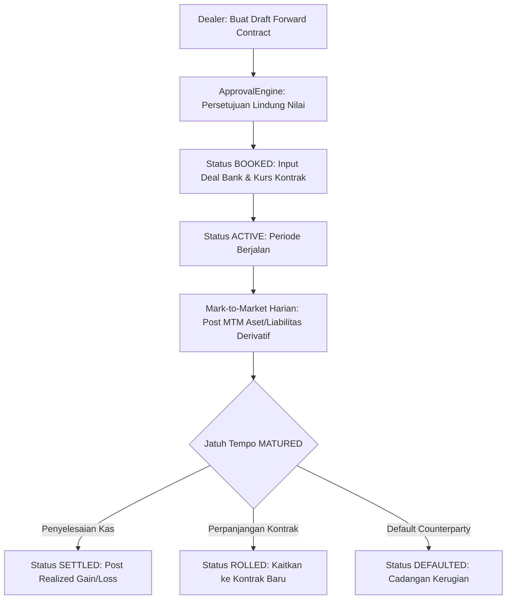
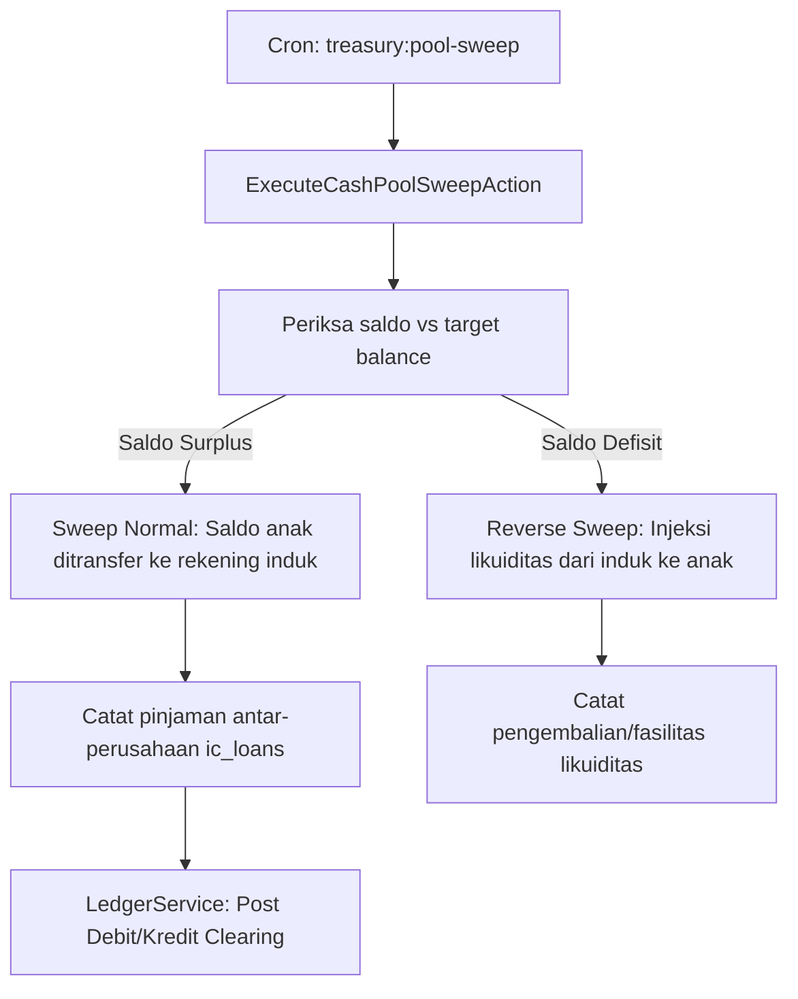
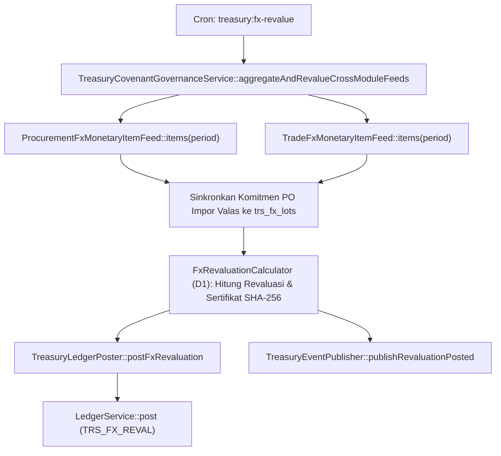
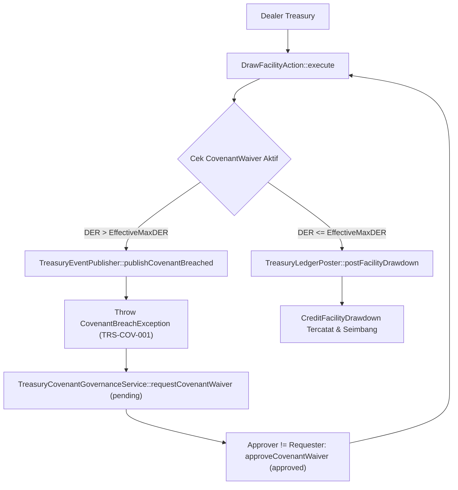

# Dokumen Desain Teknis — Fase 48: Multi-Currency & Treasury

## 1. Ringkasan Eksekutif & Sasaran Arsitektur

Fase 48 mengimplementasikan sistem perbendaharaan korporat terpadu (**Corporate Treasury Management**) yang menangani transaksi multi-mata uang, revaluasi nilai tukar akhir periode, rekonsiliasi mutasi perbankan multi-tahap, peramalan likuiditas kas 13 minggu, lindung nilai valuta asing (FX Forward Hedge), pengawasan covenant fasilitas kredit perbankan, dan pooling likuiditas grup berbasis pinjaman antar-entitas (Intercompany Loans).

Sistem ini dirancang dengan prinsip ketat perbendaharaan:
1. **Aritmetika Rasional Tanpa Float**: Seluruh kurs dan perhitungan moneter menggunakan representasi rasional integer pembilang dan penyebut (`RationalRate`), mencegah distorsi pembulatan atau selisih fraksional pada neraca keuangan.
2. **Dual-Leg Multi-Currency Balancing**: Transaksi mata uang asing diposting dua kaki seimbang dalam mata uang asal (`asset_code = CCY`) dan fungsional (`asset_code = IDR`), dengan subledger `trs_fx_lots` yang melacak carrying value per lot secara akurat.
3. **Revaluasi Valas & Pembalik Otomatis**: Pengakuan laba/rugi selisih kurs belum terealisasi pada akhir periode akuntansi, disertai pembuatan jurnal pembalik otomatis (*auto-reversal*) pada hari pertama periode berikutnya untuk mencegah dobel hitung saat pelunasan riil.
4. **Pencocokan Rekonsiliasi Bank 3-Tahap**: Algoritma deterministic matching yang membagi pencocokan ke dalam tahap exact match, tolerance window match, dan bounded many-to-one subset combination, tanpa mengubah integritas data mutasi perbankan.
5. **State Machine Lindung Nilai (HedgeContract)**: Pengendalian kontrak derivatif forward melalui 8 status yang diawasi guard otorisasi ApprovalEngine (`draft` -> `approved` -> `booked` -> `active` -> `matured` -> `settled` / `rolled` / `cancelled`).
6. **Pemantauan Kepatuhan Covenant**: Pengujian rasio solvabilitas dan likuiditas (DER, ICR) berbasis integer permille tanpa nilai float, dengan pemblokiran otomatis terhadap penarikan fasilitas yang melanggar batas kredit.
7. **Audit Dua Sumber (`treasury:audit`)**: Rekonsiliasi matematis independen antara tabel perbendaharaan operasional dan catatan jurnal buku besar (`LedgerService`).

---

## 2. Diagram Sequence Alur Utama & Saga (D2)

### A. Alur Revaluasi Kurs & Pembalik Otomatis


### B. Alur Rekonsiliasi Bank Tiga Tahap


### C. Alur Kontrak Lindung Nilai Forward Contract


### D. Alur Cash Pooling Sweep & Reverse Sweep

        SweepAction->>Intercompany: Kurangi kewajiban / catat pinjaman balik
        SweepAction->>Ledger: Post Pembalik Pinjaman IC / Kas Masuk
    end
```

---

## 3. Spesifikasi State Machine `HedgeContract` (D48-1)

Siklus hidup kontrak lindung nilai derivatif forward dikelola oleh model `ForwardContract` dengan 8 status:

```
[draft] ──(submit & approve)──> [approved] ──(input deal bank)──> [booked]
   │                               │                                 │
(cancel)                        (cancel)                         (cancel w/ fee)
   │                               │                                 │
   v                               v                                 v
[cancelled]                   [cancelled]                       [cancelled]
                                                                     │
                                                               (start date)
                                                                     │
                                                                     v
                                                                 [active]
                                                                     │
                                                               (maturity date)
                                                                     │
                                                                     v
                                                                 [matured]
                                                                  ╱     ╲
                                                      (settle)   ╱       ╲   (roll-over)
                                                                v         v
                                                           [settled]   [rolled]
```

### Aturan Transisi & Guard:
1. `draft` -> `approved`: Memerlukan otorisasi via `ApprovalEngine` dengan aturan pembuat $\ne$ penyetuju (`creator_id != approver_id`). Memvalidasi limit eksposur mata uang.
2. `draft` -> `cancelled`: Pembatalan administratif sebelum persetujuan tanpa konsekuensi finansial.
3. `approved` -> `booked`: Dealer memasukkan nomor deal konfirmasi bank dan kurs kontrak resmi.
4. `approved` -> `cancelled`: Pembatalan sebelum booking tanpa biaya pembatalan.
5. `booked` -> `active`: Kontrak mulai berlaku efektif pada tanggal transaksi.
6. `booked` -> `cancelled`: Pembatalan deal bank. Mewajibkan posting biaya pembatalan (`trs:hedge_cancellation_cost:IDR` -> `trs:bank_clearing:IDR`).
7. `active` -> `matured`: Tanggal jatuh tempo tiba. Selisih MTM terakhir dibukukan secara presisi.
8. `matured` -> `settled`: Pelunasan kontrak dengan penerimaan/pembayaran selisih kas riil dan pengakuan untung/rugi terealisasi (`trs:fx_realized_gain_loss:IDR`).
9. `matured` -> `rolled`: Kontrak diperpanjang dengan menerbitkan kontrak forward anak yang tertaut secara relasional (`rolled_to_contract_id`), menutup MTM kontrak induk.
10. Riwayat seluruh transisi dicatat secara append-only di `trs_forward_contract_histories`.

---

## 4. Spesifikasi Tiga Algoritma Baru (D1, D2, D3)

### A. Algoritma D1: `FxRevaluationCalculator`
- **Tujuan**: Menghitung revaluasi nilai tercatat pos moneter valuta asing akhir periode akuntansi sesuai PSAK 10 / IAS 21.
- **Masukan**:
  - `foreignBalanceMinor`: Bilangan bulat saldo valas dalam unit minor (contoh: sen USD, cent EUR).
  - `carryingFunctionalIdr`: Nilai tercatat dalam IDR saat ini.
  - `rateNumerator`: Pembilang kurs rasional (IDR per 1 unit mata uang dasar).
  - `rateDenominator`: Penyebut kurs rasional (bilangan bulat positif).
  - `currencyDecimals`: Jumlah desimal mata uang asing (default 2 untuk USD/EUR/SGD, 0 untuk JPY).
  - `isAsset`: Boolean penanda akun aset (`true`) atau akun liabilitas (`false`).
- **Formula**:
  $$\text{Scale} = 10^{\text{currencyDecimals}}$$
  $$\text{Revalued} = \text{round\_half\_away\_from\_zero}\left( \frac{\text{foreignBalanceMinor} \times \text{rateNumerator}}{\text{rateDenominator} \times \text{Scale}} \right)$$
  - Jika Aset: $\Delta = \text{Revalued} - \text{carryingFunctionalIdr}$. ($\Delta > 0 \implies \text{Gain}$, $\Delta < 0 \implies \text{Loss}$).
  - Jika Liabilitas: $\Delta = \text{Revalued} - \text{carryingFunctionalIdr}$. ($\Delta > 0 \implies \text{Loss}$, $\Delta < 0 \implies \text{Gain}$).
  - Pelunasan Parsial: Nilai tercatat asal dialokasikan proporsional:
    $$\text{CarryingAllocated} = \text{round\_half\_away\_from\_zero}\left( \frac{\text{settledMinor} \times \text{carryingFunctionalIdr}}{\text{totalMinor}} \right)$$
    $$\text{RealizedGainLoss} = \text{SettlementValueIdr} - \text{CarryingAllocated}$$
- **Kompleksitas**: $O(1)$ waktu, $O(1)$ ruang.

### B. Algoritma D2: `BankReconciliationMatcher`
- **Tujuan**: Memadankan mutasi rekening koran perbankan dengan buku kas perusahaan secara otomatis dan deterministik.
- **Tahap 1 — Exact Match**:
  - Kriteria: `bank.amount == book.amount` DAN `bank.reference_no == book.reference_no` (keduanya tidak kosong).
  - Menghasilkan kecocokan berpasangan 1-to-1 dengan selisih 0.
- **Tahap 2 — Tolerance Window Match**:
  - Kriteria sisa mutasi: $|\text{bank.amount} - \text{book.amount}| \le 500$ minor unit DAN $|\text{bank.date} - \text{book.date}| \le 3$ hari.
  - Pengurutan prioritas: Pasangan diurutkan berdasarkan `(abs_diff_amount ASC, abs_diff_days ASC, book_id ASC)`.
  - Greedy tie-break leksikografis deterministik.
- **Tahap 3 — Bounded Many-to-One Match**:
  - Untuk setiap baris mutasi bank tersisa yang bernilai positif:
    - Ambil kandidat baris buku bertanda sama dengan $|\text{bank.date} - \text{book.date}| \le 5$ hari dan `book.amount < bank.amount`.
    - Batasi maksimum 12 kandidat terurut berdasarkan `(date ASC, id ASC)`.
    - Cari kombinasi subset berukuran $k \in [2, 4]$ yang jumlahnya tepat sama dengan `bank.amount`.
    - Urutan pemilihan: Subset berukuran terkecil didahulukan ($k=2$ sebelum $k=3$); jika ada beberapa subset sama besar, pilih subset dengan urutan ID leksikografis terkecil.
    - Jumlah kombinasi maksimal: $\binom{12}{2} + \binom{12}{3} + \binom{12}{4} = 66 + 220 + 495 = 781$ himpunan (sangat cepat dan konstan).
- **Kompleksitas**: $O(N_B \log N_B + N_L \log N_L + N_B \times 781)$ waktu, $O(N_B + N_L)$ ruang.

### C. Algoritma D3: `SeasonalCashForecaster`
- **Tujuan**: Memproyeksikan arus kas masuk dan keluar selama 13 minggu ke depan berbasis dekomposisi musiman multiplikatif dan regresi linier OLS rasional.
- **Masukan**: Riwayat arus kas mingguan $y_1, y_2, \dots, y_n$ sebanyak $n$ minggu, dengan syarat $n$ kelipatan periode musiman $p=4$ dan $n \ge 2p$ ($n \ge 8$).
- **Langkah Perhitungan**:
  1. Hitung rata-rata keseluruhan: $\bar{y} = \frac{1}{n} \sum_{t=1}^n y_t$.
  2. Hitung rata-rata posisi musiman $k \in \{0, 1, 2, 3\}$:
     $$m_k = \frac{1}{n/p} \sum_{j=0}^{n/p - 1} y_{j \cdot p + k + 1}$$
  3. Indeks musiman rasional: $S_k = \frac{m_k}{\bar{y}}$. Disimpan sebagai rasional persis dan dilaporkan dalam permille berlantai $\lfloor 1000 \times S_k \rfloor$.
  4. Deseasonalisasi data historis: $d_t = \frac{y_t}{S_{(t-1) \bmod p}}$.
  5. Regresi linier Ordinary Least Squares (OLS) rasional atas $(t, d_t)$ untuk $t = 1, \dots, n$:
     $$\bar{t} = \frac{n+1}{2}, \quad \bar{d} = \frac{1}{n} \sum_{t=1}^n d_t$$
     $$b = \frac{\sum_{t=1}^n (t - \bar{t})(d_t - \bar{d})}{\sum_{t=1}^n (t - \bar{t})^2}, \quad a = \bar{d} - b \cdot \bar{t}$$
  6. Ramalan minggu ke-$t$ untuk $t = n+1, \dots, n+13$:
     $$\hat{y}_t = \left\lfloor (a + b \cdot t) \times S_{(t-1) \bmod p} \right\rfloor$$
- **Kompleksitas**: $O(n)$ waktu, $O(n)$ ruang.

---

## 5. Rencana Pengujian & Verifikasi Mutu

Acceptance test dibatasi maksimal 5 pengujian komprehensif di `tests/Acceptance/Treasury/`:
1. **`TreasuryAccessTest`**: Pengujian izin akses RBAC seluruh endpoint rute Treasury (role berhak 200/302 vs tidak berhak 403).
2. **`TreasuryFxRevaluationE2ETest`**: Pengujian menyeluruh algoritma D1, posting ledger fungsional & valas seimbang, pembalik otomatis awal periode, pelunasan realized parsial, dan kepatuhan idempotensi.
3. **`TreasuryBankReconciliationAndForecastTest`**: Pengujian algoritma D2 pada dataset T1, unmatch dengan jejak audit, kesesuaian saldo buku vs saldo bank, serta vektor musiman D3 dengan skenario forecast.
4. **`TreasuryHedgeAndFacilityOperationsTest`**: Pengujian siklus state machine 8 status HedgeContract, MTM harian, roll-over, penolakan penarikan fasilitas yang melanggar covenant DER integer, serta perlindungan saldo kas negatif pada sweep pooling.
5. **`TreasuryDualSourceAuditTest`**: Pengujian audit dua sumber `treasury:audit` (data bersih exit 0 vs data sengaja dikorup exit != 0 dengan pelaporan anomali).
Vektor algoritma diuji secara terpisah pada test runner algoritma tanpa menambah hitungan acceptance test suite.

---

## 6. Desain Komponen Kelengkapan W8-P5-b.3

### 6.1 Arsitektur Pengadaptasi `FxMonetaryItemFeed` Lintas-Modul
Untuk memastikan revaluasi akhir periode PSAK 10 mencakup seluruh eksposur moneter valas grup tanpa menciptakan ketergantungan melingkar (*circular dependency*):
- Modul `Treasury` mendefinisikan kontrak `Modules\Treasury\Contracts\FxMonetaryItemFeed`.
- Modul `Procurement` menyediakan `ProcurementFxMonetaryItemFeed` yang membaca komitmen PO impor valas dari `prc_purchase_orders`.
- Modul `Trade` menyediakan `TradeFxMonetaryItemFeed` yang membaca utang impor (`trd_import_orders`) dan piutang ekspor (`trd_export_shipments`).
- Seluruh implementasi didaftarkan ke container Laravel dengan tag `'treasury.fx_monetary_item_feed'` dan dikonsumsi secara malas (*lazy iteration*) oleh `TreasuryCovenantGovernanceService::aggregateAndRevalueCrossModuleFeeds()`.

### 6.2 Tata Kelola Covenant Waiver & Akrual Bunga Rasional
- Ketika proyeksi DER suatu entitas melampaui `max_der_permil` pada `trs_credit_facilities`, `DrawFacilityAction` memancarkan event `treasury.covenant.breached.v1` dan menolak penarikan dengan `CovenantBreachException`.
- Apabila bank sindikasi menerbitkan surat persetujuan keringanan sementara, dealer mengajukan `CovenantWaiver` (`trs_covenant_waivers`) yang wajib disetujui oleh pejabat berbeda (Four-Eyes principle) melalui `TreasuryCovenantGovernanceService::approveCovenantWaiver()`.
- Selama `valid_until` waiver belum kedaluwarsa dan berstatus `approved`, batas DER efektif dinaikkan ke `waived_max_der_permil`.
- Akrual bunga dihitung dengan rumus integer rasional:
  $$\text{Interest}_{\text{IDR}} = \left\lfloor \frac{\text{Drawn}_{\text{IDR}} \times \text{Rate}_{\text{permil}} \times \text{Days}}{365.000} \right\rfloor$$
  dan diposting ke `trs:interest_expense:IDR` (Debit) serta `trs:interest_payable:IDR` (Kredit).

### 6.3 Impor MT940 Idempoten & Siklus Kas Kecil Imprest
- `BankStatementImportService` mem-parsing pesan SWIFT MT940 (`:20:`, `:25:`, `:60F:`, `:61:`, `:86:`, `:62F:`) menjadi baris `trs_bank_statements` dan menyimpan hash SHA-256 payload di `trs_statement_import_batches`.
- `ProcessPettyCashVoucherAction::replenishImprestFund()` membandingkan saldo buku kas kecil terhadap hasil perhitungan fisik kas (`physical_cash_counted_idr`), memosting selisih opname (jika ada) ke `trs:bank_reconciliation_diff:IDR`, dan memosting pengisian kembali dana ke `trs:petty_cash:IDR` hingga kembali tepat sebesar `imprest_limit`.

---

## 7. Spesifikasi Skema Basis Data Lengkap (15 Tabel `trs_*`)

Seluruh tabel domain Treasury berada di bawah konvensi prefiks `trs_`, menggunakan kunci primer UUID, dan menerapkan isolasi multi-tenant via `tenant_id` serta `company_id`. Semua nama indeks dibatasi maksimal 64 karakter untuk portabilitas penuh di SQLite dan MySQL 8.

### 7.1 `trs_exchange_rates` — Master Kurs Rasional Versi Append-Only
| Kolom | Tipe Data | Kendala / Default | Deskripsi Teknis |
|---|---|---|---|
| `id` | `uuid` | PK | Identitas unik baris versi kurs |
| `tenant_id` | `uuid` | Indexed, Nullable | Identitas tenant grup |
| `from_currency` | `char(3)` | Not Null | Kode ISO 4217 mata uang asal (contoh: `USD`, `EUR`, `SGD`, `JPY`) |
| `to_currency` | `char(3)` | Not Null | Kode ISO 4217 mata uang tujuan (umumnya `IDR`) |
| `rate_date` | `date` | Not Null | Tanggal efektif berlakunya kurs |
| `rate_type` | `varchar(20)` | Default `'spot'` | Jenis kurs: `spot`, `closing`, `tax`, `forward` |
| `numerator` | `bigint` | Not Null (`> 0`) | Pembilang kurs rasional dalam satuan bulat |
| `denominator` | `bigint` | Not Null (`> 0`) | Penyebut kurs rasional dalam satuan bulat |
| `version` | `integer` | Default `1` | Nomor urut versi kurs pada kombinasi `(from, to, date, type)` |
| `source_reference` | `varchar(100)` | Nullable | Sumber kurs resmi (contoh: `JISDOR-BI`, `REUTERS-CLOSING`) |

- **Invarian**: Tidak ada operasi `UPDATE` pada baris kurs yang telah terbit. Koreksi kurs dilakukan dengan menyisipkan baris baru dengan `version = max(version) + 1`.

### 7.2 `trs_bank_accounts` — Rekening Bank Multi-Mata Uang & Dana Kas Kecil
| Kolom | Tipe Data | Kendala / Default | Deskripsi Teknis |
|---|---|---|---|
| `id` | `uuid` | PK | Identitas unik rekening |
| `tenant_id` | `uuid` | Indexed, Nullable | Identitas tenant |
| `company_id` | `uuid` | Indexed, Nullable | Entitas anak perusahaan pemilik rekening |
| `account_number` | `varchar(64)` | Unique | Nomor rekening perbankan atau kode brankas kas kecil |
| `bank_name` | `varchar(120)` | Not Null | Nama institusi bank atau deskripsi kas kecil |
| `currency` | `char(3)` | Default `'IDR'` | Mata uang denominasi rekening |
| `balance` | `bigint` | Default `0` | Saldo dalam unit minor mata uang asal |
| `functional_balance_idr` | `bigint` | Default `0` | Nilai ekuivalen saldo dalam IDR |
| `is_petty_cash` | `boolean` | Default `false` | Penanda rekening dana kas kecil imprest |
| `imprest_limit` | `bigint` | Default `0` | Plafon dana tetap kas kecil dalam IDR |

### 7.3 `trs_fx_lots` — Subledger Lot Pos Moneter Valuta Asing
| Kolom | Tipe Data | Kendala / Default | Deskripsi Teknis |
|---|---|---|---|
| `id` | `uuid` | PK | Identitas unik lot valas |
| `tenant_id` | `uuid` | Indexed, Nullable | Identitas tenant |
| `bank_account_id` | `uuid` | FK `trs_bank_accounts` | Rekening bank valas tempat lot berada |
| `currency` | `char(3)` | Not Null | Mata uang asing lot |
| `original_amount` | `bigint` | Not Null | Nominal awal perolehan lot (minor unit) |
| `remaining_amount` | `bigint` | Not Null | Sisa nominal lot yang belum terealisasi/dilunasi |
| `book_rate_num` | `bigint` | Not Null | Pembilang kurs perolehan awal |
| `book_rate_den` | `bigint` | Not Null | Penyebut kurs perolehan awal |
| `original_carrying_idr` | `bigint` | Not Null | Nilai tercatat IDR saat perolehan awal |
| `current_carrying_idr` | `bigint` | Not Null | Nilai tercatat IDR terkini setelah revaluasi/settlement parsial |
| `status` | `varchar(20)` | Default `'open'` | Status lot: `open`, `partial`, `exhausted` |

- **Invarian**: Jika `status = 'exhausted'`, maka wajib berlaku `remaining_amount = 0` dan `current_carrying_idr = 0` (diverifikasi oleh Check 6 pada `treasury:audit`).

### 7.4 `trs_revaluations` — Riwayat Revaluasi Kurs & Pembalik Otomatis
| Kolom | Tipe Data | Kendala / Default | Deskripsi Teknis |
|---|---|---|---|
| `id` | `uuid` | PK | Identitas unik rekaman revaluasi |
| `tenant_id` | `uuid` | Indexed, Nullable | Identitas tenant |
| `period` | `varchar(7)` | Indexed (`YYYY-MM`) | Periode akuntansi penutupan buku |
| `currency` | `char(3)` | Not Null | Mata uang asing yang direvaluasi |
| `foreign_balance_minor` | `bigint` | Not Null | Saldo valas yang direvaluasi |
| `carrying_idr_before` | `bigint` | Not Null | Nilai tercatat IDR sebelum revaluasi |
| `revalued_idr_after` | `bigint` | Not Null | Nilai wajar IDR berdasarkan kurs penutupan |
| `gain_loss_idr` | `bigint` | Not Null | Selisih kurs belum terealisasi (`+` untung, `-` rugi) |
| `closing_rate_num` | `bigint` | Not Null | Pembilang kurs penutupan |
| `closing_rate_den` | `bigint` | Not Null | Penyebut kurs penutupan |
| `is_reversed` | `boolean` | Default `false` | Penanda apakah jurnal pembalik awal bulan sudah dibuat |
| `reverse_of` | `uuid` | Nullable | Referensi ke ID revaluasi asli (khusus baris pembalik) |
| `ledger_transaction_id` | `varchar(64)` | Nullable | ID transaksi jurnal pada `bank_ledger_transactions` |
| `certificate` | `json` | Nullable | Payload sertifikat kriptografis D1 (`FxRevaluationCertificate`) |

### 7.5 `trs_bank_statements`, `trs_bank_reconciliation_matches`, & `trs_bank_reconciliation_unmatched`
- **`trs_bank_statements`**: Menyimpan mutasi rekening koran (`bank_account_id`, `statement_date`, `reference_no`, `description`, `amount`, `is_reconciled`, `reconciliation_status`, `matched_ledger_entry_id`, `match_stage`, `unmatch_reason`, `unmatched_by`, `unmatched_at`).
- **`trs_bank_reconciliation_matches`**: Menyimpan bukti pencocokan Tahap 1 (`exact`), Tahap 2 (`tolerance`), dan Tahap 3 (`many_to_one`) beserta `delta_amount`, `delta_days`, dan `certificate` D2.
- **`trs_bank_reconciliation_unmatched`**: Menyimpan antrean pos mutasi bank yang belum cocok lengkap dengan `aging_days`, `escalation_task_id` (tautan ke `TaskInboxService` bila umur $> 5$ hari), dan `status` (`pending` / `resolved`).

### 7.6 `trs_statement_import_batches` — Jejak Audit Impor Rekening Koran
- Mencatat setiap eksekusi impor berkas MT940 atau CSV: `bank_account_id`, `source_format` (`MT940` / `CSV`), `batch_reference`, `file_hash_sha256`, `total_lines`, `imported_lines`, `duplicate_lines`, `opening_balance_minor`, `closing_balance_minor`, `status`, dan `imported_by`.
- Menjamin idempotensi tingkat batch dan tingkat baris mutasi.

### 7.7 `trs_cash_forecasts` — Proyeksi Likuiditas 13 Minggu
- Menyimpan hasil algoritma D3 (`SeasonalCashForecaster`): `scenario` (`base`, `optimistic`, `pessimistic`), `season_period`, `history_weeks` (JSON), `seasonal_indices_permil` (JSON), `projected_weeks` (JSON 13 elemen), `projected_sum_idr`, dan `certificate` D3.

### 7.8 `trs_forward_contracts` & `trs_forward_contract_histories`
- **`trs_forward_contracts`**: Menyimpan parameter kontrak derivatif forward (`contract_number`, `counterparty_bank`, `currency`, `notional_foreign_minor`, `strike_rate_num`, `strike_rate_den`, `contract_value_idr`, `mtm_fair_value_idr`, `cumulative_mtm_idr`, `realized_gain_loss_idr`, `cancellation_penalty_idr`, `maturity_date`, `status`, `creator_id`, `approver_id`, `rolled_to_contract_id`, `ledger_transaction_id`).
- **`trs_forward_contract_histories`**: Log append-only seluruh perpindahan state (`forward_contract_id`, `from_status`, `to_status`, `actor_id`, `reason`, `metadata`).

### 7.9 `trs_credit_facilities`, `trs_credit_facility_drawdowns`, & `trs_covenant_waivers`
- **`trs_credit_facilities`**: Menyimpan plafon kredit bank (`facility_code`, `lender_bank`, `credit_limit_idr`, `drawn_amount_idr`, `interest_rate_permil`, `max_der_permil`, `min_icr_permil`, `status`).
- **`trs_credit_facility_drawdowns`**: Mencatat setiap penarikan dana (`credit_facility_id`, `amount_idr`, `verified_debt_idr`, `verified_equity_idr`, `covenant_der_permil`, `status`, `ledger_transaction_id`).
- **`trs_covenant_waivers`**: Mencatat dispensasi pelanggaran covenant (`credit_facility_id`, `waived_max_der_permil`, `original_max_der_permil`, `requested_by`, `approved_by`, `bank_waiver_reference`, `reason`, `status`, `valid_until`, `approved_at`).

### 7.10 `trs_cash_pools`, `trs_cash_pool_sweeps`, `trs_petty_cash_vouchers`, & `trs_petty_cash_replenishments`
- **`trs_cash_pools` & `trs_cash_pool_sweeps`**: Mengatur struktur zero-balancing notional/physical pooling antara rekening induk (`header_account_id`) dan rekening anak (`sub_account_id`) dengan pencatatan pinjaman intercompany otomatis (`intercompany_loan_id`).
- **`trs_petty_cash_vouchers` & `trs_petty_cash_replenishments`**: Mengelola pencairan voucher kas kecil dengan guard Four-Eyes serta siklus pengisian kembali dana imprest disertai rekonsiliasi opname fisik kas (`physical_cash_counted_idr` vs `book_balance_before_idr`).

---

## 8. Spesifikasi Teknis Parser SWIFT MT940 (`BankStatementImportService`)

Parser MT940 di `Modules\Treasury\Application\Services\BankStatementImportService` memproses pesan standar perbankan internasional tanpa pustaka eksternal:
1. **Ekstraksi Header**:
   - Tag `:20:` — Referensi batch pengiriman (`Transaction Reference Number`).
   - Tag `:25:` — Identifikasi nomor rekening bank.
   - Tag `:60F:` / `:60M:` — Saldo awal (`C`/`D`, tanggal `YYMMDD`, kode mata uang 3 huruf, nominal dengan koma desimal).
2. **Ekstraksi Baris Mutasi (`:61:` & `:86:`)**:
   - Pola regex `:61:(\d{6})(\d{4})?(C|D|RC|RD)([0-9,\.]+)([A-Z0-9]{4})([^\r\n\/]+)(?:\/\/([^\r\n]+))?` mengekstrak tanggal valuta (`YYMMDD`), indikator Debit/Kredit (termasuk reversal `RC`/`RD`), nominal minor unit bulat, kode tipe transaksi SWIFT (`NTRF`, `NMSC`, `NCHG`), dan nomor referensi nasabah.
   - Baris `:86:` langsung di bawah `:61:` digabungkan sebagai deskripsi naratif transaksi.
3. **Ekstraksi Footer (`:62F:` / `:62M:`)**:
   - Mengekstrak saldo akhir pernyataan bank dan memvalidasi konsistensi pergerakan mutasi.
4. **Penanganan Idempotensi**:
   - Setiap baris diperiksa terhadap kombinasi unik `(bank_account_id, reference_no, statement_date, amount)`. Baris yang sudah pernah diimpor dilewati secara aman dan dihitung pada metrik `duplicate_lines`.

---

## 9. Spesifikasi 8 Laporan CSV Resmi (`TreasuryReportExportService`)

Perintah `php artisan treasury:export-reports` menghasilkan 8 berkas CSV deterministik dengan header standar dan pemisah koma:
1. **`cash_position.csv`**: Posisi saldo rekening per mata uang, ekuivalen IDR, dan persentase alokasi kas grup.
2. **`fx_revaluation_summary.csv`**: Daftar revaluasi periode berjalan per mata uang, kurs penutupan rasional, nilai tercatat sebelum/sesudah, dan hash sertifikat D1.
3. **`bank_reconciliation_status.csv`**: Ringkasan mutasi terpadankan per tahap (`exact`, `tolerance`, `many_to_one`) serta daftar pos belum cocok beserta `aging_days`.
4. **`cash_forecast_13w.csv`**: Matriks proyeksi arus kas 13 minggu untuk skenario `base`, `optimistic`, dan `pessimistic` beserta indeks musiman permil.
5. **`hedge_maturity_schedule.csv`**: Jadwal jatuh tempo kontrak forward aktif, nosional valas, kurs strike, nilai MTM terkini, dan status siklus hidup.
6. **`covenant_compliance_report.csv`**: Rasio DER dan ICR aktual per fasilitas kredit dibandingkan dengan ambang batas covenant dan status waiver.
7. **`cash_pool_intercompany_balances.csv`**: Rekapitulasi penyapuan kas harian (`sub_to_header` dan `header_to_sub`) beserta nomor referensi pinjaman intercompany.
8. **`petty_cash_imprest_register.csv`**: Daftar voucher kas kecil, status persetujuan Four-Eyes, dan riwayat pengisian kembali dana imprest beserta selisih opname fisik.

---

## 10. Spesifikasi Detail Alur Lintas-Modul & Diagram Alir Integrasi (D48-11)

### 10.1 Diagram Alir Agregasi `FxMonetaryItemFeed` & Revaluasi PSAK 10


### 10.2 Diagram Alir Pengawasan Covenant, Eskalasi Breach & Dispensasi Waiver


### 10.3 Spesifikasi Struktur Sertifikat Kriptografis D1, D2, & D3

Seluruh sertifikat algoritma disimpan sebagai kolom JSON tak berubah (*immutable*) dan diverifikasi ulang oleh kelas `*CertificateVerifier`:

1. **Sertifikat D1 (`FxRevaluationCertificate`)**:
   - **`algorithm`**: `"FxRevaluationCalculator.v1"`
   - **`inputs`**:
     - `foreign_balance_minor`: `int`
     - `carrying_functional_idr`: `int`
     - `rate_numerator`: `int`
     - `rate_denominator`: `int`
     - `currency_decimals`: `int`
     - `is_asset`: `bool`
   - **`steps`**:
     - `scale_factor`: $10^{\text{currency\_decimals}}$
     - `effective_denominator`: $\text{rate\_denominator} \times \text{scale\_factor}$
     - `raw_numerator_product`: $\text{foreign\_balance\_minor} \times \text{rate\_numerator}$
   - **`results`**:
     - `revalued_functional_idr`: `int`
     - `unrealized_gain_loss_idr`: `int`
     - `direction`: `"GAIN" | "LOSS" | "NEUTRAL"`
   - **`certificateHash`**: `hash('sha256', json_encode([algorithm, inputs, steps, results]))`

2. **Sertifikat D2 (`BankReconciliationCertificate`)**:
   - **`algorithm`**: `"BankReconciliationMatcher.v1"`
   - **`inputs`**:
     - `bank_lines_count`: `int`
     - `book_lines_count`: `int`
     - `amount_tolerance_minor`: `int` (default `500`)
     - `day_window_tolerance`: `int` (default `3`)
   - **`results`**:
     - `stage1_exact_count`: `int`
     - `stage2_tolerance_count`: `int`
     - `stage3_many_to_one_count`: `int`
     - `unmatched_bank_count`: `int`
     - `unmatched_book_count`: `int`
   - **`Invarian Verifikasi`**:
     $$\text{stage1\_exact\_count} + \text{stage2\_tolerance\_count} + \text{stage3\_many\_to\_one\_count} + \text{unmatched\_bank\_count} = \text{bank\_lines\_count}$$

3. **Sertifikat D3 (`SeasonalCashForecastCertificate`)**:
   - **`algorithm`**: `"SeasonalCashForecaster.v1"`
   - **`inputs`**:
     - `history_weeks`: `list<int>`
     - `season_period`: `int` (`4`)
     - `horizon_weeks`: `int` (`13`)
   - **`steps`**:
     - `overall_mean_num`: `int`
     - `overall_mean_den`: `int`
     - `seasonal_indices_permille`: `list<int>`
     - `ols_slope_num`: `int`
     - `ols_slope_den`: `int`
     - `ols_intercept_num`: `int`
     - `ols_intercept_den`: `int`
   - **`results`**:
     - `projected_weeks`: `list<int>` (13 elemen)
     - `projected_sum`: $\sum_{k=1}^{13} \text{projected\_weeks}[k]$

---

## 11. Kontrak Keamanan, Anti-IDOR, & Segregasi Tugas (`TreasuryPolicy`)

Kelas `Modules\Treasury\Policies\TreasuryPolicy` menegakkan otorisasi berlapis pada setiap operasi perbendaharaan:
1. **`viewPosition(User $user)`**: Mengizinkan peran `admin`, `treasury`, `finance_controller`, dan `auditor` untuk melihat posisi kas dan subledger valas.
2. **`manageExchangeRates(User $user)`**: Hanya mengizinkan `admin` dan `treasury` untuk mendaftarkan versi kurs baru (`auditor` bersifat *read-only* murni).
3. **`executeReconciliation(User $user)`**: Hanya mengizinkan `admin` dan `treasury` untuk menjalankan pencocokan mutasi bank dan unmatch.
4. **`createHedge(User $user)` & `approveHedge(User $user, ForwardContract $contract)`**:
   - Memastikan pembuat draf memiliki peran `treasury` atau `admin`.
   - Memblokir persetujuan mandiri (*self-approval*): jika `$contract->creator_id === $user->id`, policy mengembalikan `false` dan state machine melempar `HedgeMakerCheckerViolationException`.
5. **`drawCreditFacility(User $user, CreditFacility $facility)`**:
   - Memeriksa kecocokan tenant/entitas untuk mencegah serangan *Insecure Direct Object Reference* (IDOR) lintas anak perusahaan.
   - Menolak akses `403 Forbidden` bagi pengguna di luar peran perbendaharaan yang sah.

---

## 12. Spesifikasi Komponen ViewModel & Pemetaan Antarmuka Pengguna (`TreasuryDashboardViewModel`)

Kelas `Modules\Treasury\ViewModels\TreasuryDashboardViewModel` merangkum metrik real-time meja perbendaharaan tanpa membebani lapisan controller dengan logika agregasi SQL:

### 12.1 Struktur Payload `toArray()`
1. **`liquidity_summary`**:
   - `total_functional_cash_idr`: Total saldo kas ekuivalen IDR dari seluruh rekening aktif (`is_active = true`).
   - `active_accounts_count`: Jumlah rekening bank korporat dan dana kas kecil aktif.
   - `petty_cash_balance_idr`: Total dana tunai tersedia pada seluruh rekening kas kecil imprest (`is_petty_cash = true`).
   - `currencies_breakdown`: Daftar saldo minor unit dan nilai buku IDR yang dikelompokkan per mata uang (`IDR`, `USD`, `EUR`, `SGD`, `JPY`).
2. **`fx_exposure_summary`**:
   - `open_lots_count`: Jumlah lot moneter valuta asing berstatus `active` di `trs_fx_lots`.
   - `total_carrying_idr`: Total nilai tercatat historis IDR seluruh lot valas terbuka.
   - `last_revaluation_period`: Periode akuntansi terakhir (`YYYY-MM`) yang telah direvaluasi.
3. **`hedge_portfolio_summary`**:
   - `active_contracts_count`: Jumlah kontrak derivatif forward pada status `booked` dan `active`.
   - `matured_pending_settlement_count`: Jumlah kontrak yang sudah mencapai status `matured` dan menunggu penyelesaian kas atau roll-over.
   - `net_mtm_fair_value_idr`: Akumulasi nilai wajar Mark-to-Market bersih seluruh portofolio lindung nilai aktif.
4. **`credit_facility_headroom`**:
   - `total_credit_limit_idr`: Total plafon fasilitas kredit sindikasi yang disetujui.
   - `total_drawn_idr`: Total pokok pinjaman yang sedang ditarik.
   - `available_headroom_idr`: Sisa plafon fasilitas kredit yang siap ditarik ($\text{Limit} - \text{Drawn}$).
   - `active_waivers_count`: Jumlah `CovenantWaiver` berstatus `approved` yang masih berlaku.
5. **`reconciliation_health`**:
   - `matched_statements_count`: Jumlah baris mutasi rekening koran yang telah terpadankan (`is_reconciled = true`).
   - `pending_unmatched_count`: Jumlah baris mutasi pada antrean `trs_bank_reconciliation_unmatched` berstatus `pending`.
   - `escalated_overdue_count`: Jumlah pos unmatched dengan `aging_days > 5` yang telah memiliki tiket eskalasi di `TaskInboxService`.


