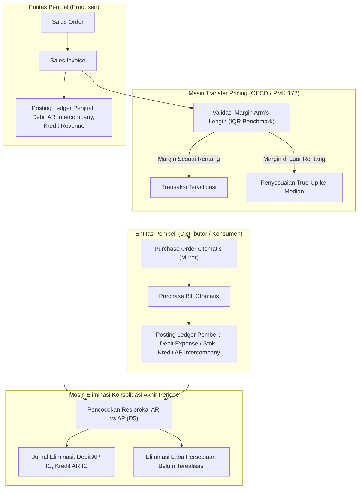
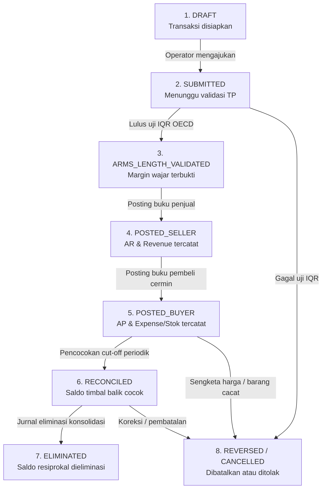

# Desain Arsitektur Fase 52 — Intercompany, Transfer Pricing & Konsolidasi Grup

**Status**: Disetujui  
**Fase**: Fase 52 (Kerja Sama Internasional II)  
**Pemilik**: Modul `Intercompany` (`ic_`)  
**Target Arsitektur**: PMK 172/2023, OECD TP Guidelines 2022, PSAK 65 (IFRS 10), PSAK 10 (IAS 21), single-sign ledger posting  

---

## 1. Ikhtisar Arsitektur
Modul `Intercompany` mengelola seluruh transaksi ekonomi antar-entitas legal dalam grup konglomerasi, memastikan kepatuhan pajak transfer pricing (Arm's Length Principle), mengeliminasi transaksi timbal balik secara bilateral agar laporan konsolidasi bebas dari *double counting*, dan membagi laba serta ekuitas kepada kepentingan non-pengendali (*Non-Controlling Interest*).

---

## 2. Struktur Modul dan Tanggung Jawab Komponen

Modul Intercompany dibagi menjadi empat sub-sistem utama yang beroperasi secara orkestratif:
1. **Intercompany Transactions Engine (Mirroring & Loans)**:
   - Menghasilkan pasangan transaksi cermin (*mirrored pair*) secara atomik ketika entitas penjual menerbitkan faktur ke entitas pembeli.
   - Mengelola fasilitas pinjaman antar-entitas (*intercompany loan*), menghasilkan skedul amortisasi bunga efektif dengan spread wajar, memotong PPh Pasal 23 (15%) atau PPh Pasal 26 (20%), serta mencatat kas masuk/keluar ke `LedgerService`.
2. **Transfer Pricing Engine (PMK 172/2023 & OECD)**:
   - Menguji kewajaran harga transfer menggunakan 4 metode utama: CUP (*Comparable Uncontrolled Price*), CPM (*Cost Plus Method*), RPM (*Resale Price Method*), dan TNMM (*Transactional Net Margin Method*).
   - Menganalisis *Interquartile Range* (IQR): Kuartil Bawah ($Q_1$), Median, dan Kuartil Atas ($Q_3$) dari data pembanding industri.
   - Menghasilkan draf dokumen TP (Local File, Master File, Analisis FAR: Fungsi, Aset, Risiko).
   - Menjalankan penyesuaian akhir tahun (*Year-End TP True-Up*) bila margin aktual bergeser dari median kewajaran.
3. **Cross-Border Asset & Stock Logistics Engine**:
   - Memindahkan aset tetap antar-entitas dengan mentransfer nilai buku neto (NBV) dan akumulasi penyusutan secara utuh tanpa distorsi nilai historis.
   - Mengirimkan barang dagangan lintas yurisdiksi dengan menyertakan dokumen pabean ekspor-impor simulasi (PEB dan PIB), memperhitungkan bea masuk dan PPN impor antar-anak perusahaan.
4. **Consolidation & Financial Elimination Engine**:
   - Mengeliminasi saldo timbal balik (*reciprocal balances*): Piutang vs Hutang intercompany.
   - Mengeliminasi transaksi pendapatan vs beban pokok intercompany agar omzet grup murni mencerminkan transaksi dengan pihak ketiga eksternal.
   - Menghitung dan mengeliminasi laba antar-perusahaan yang belum terealisasi (*unrealized inventory profit*) dalam persediaan akhir barang.
   - Melakukan translasi laporan keuangan anak perusahaan berdenominasi valas ke mata uang pelaporan IDR menggunakan metode kurs penutupan (*closing rate*) untuk neraca dan kurs rata-rata (*average rate*) untuk laba rugi, serta membukukan selisih translasi ke cadangan ekuitas *Foreign Currency Translation Reserve* (FCTR).
   - Mengalokasikan laba bersih dan ekuitas kepada pemegang saham minoritas (NCI) dan mencatat pembagian dividen ke pihak non-pengendali.

---

## 3. Alur Kerja State Machine Transaksi Intercompany (8 Status)

Siklus hidup transaksi intercompany diatur oleh mesin status 8 tahapan terverifikasi dengan audit trail tak dapat diubah (*append-only*):

Aturan Transisi & Otorisasi:
1. `DRAFT -> SUBMITTED`: Dapat dilakukan oleh staf akuntansi entitas penjual.
2. `SUBMITTED -> ARMS_LENGTH_VALIDATED`: Dieksekusi otomatis oleh algoritma `TransferPricingMarkupCalculator` atau disetujui oleh petugas kepatuhan pajak grup (*tax compliance officer*).
3. `ARMS_LENGTH_VALIDATED -> POSTED_SELLER`: Memicu posting ledger tunggal sisi penjual.
4. `POSTED_SELLER -> POSTED_BUYER`: Memicu pembuatan tagihan pembelian dan posting ledger sisi pembeli secara atomik.
5. `POSTED_BUYER -> RECONCILED`: Diverifikasi oleh modul pencocokan resiprokal bilateral (D5).
6. `RECONCILED -> ELIMINATED`: Dilakukan saat proses penutupan buku konsolidasi bulanan.
7. Transisi ke `REVERSED`: Mengharuskan pembatalan dua arah dengan jurnal pembalik simetris di kedua entitas.

---

## 4. Single-Sign Convention Posting Ledger Intercompany

Seluruh posting ke buku besar perbankan mengikuti standar KONSEP §A2.1:
- Sisi Debit bernilai negatif (`-`)
- Sisi Kredit bernilai positif (`+`)
- Netto saldo jurnal wajib tepat nol ($\Sigma = 0$) per mata uang dan mata uang fungsional IDR.
- Tidak ada saldo floating-point: seluruh angka dinyatakan dalam integer satuan terkecil (*minor units* atau Rupiah penuh).

### Matriks Pemetaan Akun dan Aliran Jurnal
1. **Penjualan Barang Antar-Anak Perusahaan (Entitas SUB_A menjual ke SUB_B senilai Rp 10.000.000)**:
   - Sisi Penjual (SUB_A):
     - Debit `ic:ar:SUB_B:SUB_A:IDR` = `-10000000`
     - Kredit `ic:sales:SUB_A:IDR` = `+10000000`
   - Sisi Pembeli (SUB_B):
     - Debit `ic:cogs:SUB_A:SUB_B:IDR` (atau `stk:inventory:SUB_B:IDR`) = `-10000000`
     - Kredit `ic:ap:SUB_A:SUB_B:IDR` = `+10000000`
2. **Pencairan Pinjaman Antar-Entitas (Holding meminjamkan Rp 50.000.000 ke SUB_B)**:
   - Sisi Pemberi Pinjaman (Holding):
     - Debit `ic:loan_receivable:SUB_B:HOLDING:IDR` = `-50000000`
     - Kredit `trs:bank_clearing:HOLDING:IDR` = `+50000000`
   - Sisi Penerima Pinjaman (SUB_B):
     - Debit `trs:bank_clearing:SUB_B:IDR` = `-50000000`
     - Kredit `ic:loan_payable:HOLDING:SUB_B:IDR` = `+50000000`
3. **Akrual Bunga dan Potongan Pajak PPh 23 (Bunga Rp 1.000.000, PPh 23 15% = Rp 150.000)**:
   - Sisi Peminjam (SUB_B):
     - Debit `ic:interest_expense:HOLDING:SUB_B:IDR` = `-1000000`
     - Kredit `ic:interest_payable:HOLDING:SUB_B:IDR` = `+850000`
     - Kredit `ic:withholding_tax_payable:SUB_B:IDR` = `+150000`
   - Sisi Pemberi Pinjaman (Holding):
     - Debit `ic:interest_receivable:SUB_B:HOLDING:IDR` = `-850000`
     - Debit `tax:prepaid_pph23:HOLDING:IDR` = `-150000`
     - Kredit `ic:interest_income:SUB_B:HOLDING:IDR` = `+1000000`
4. **Jurnal Eliminasi Konsolidasi Akhir Periode (Eliminasi AR/AP Rp 10.000.000 dan Sales/COGS Rp 10.000.000)**:
   - Eliminasi Neraca:
     - Debit `ic:ap:SUB_A:SUB_B:IDR` = `-10000000`
     - Kredit `ic:ar:SUB_B:SUB_A:IDR` = `+10000000`
   - Eliminasi Laba Rugi:
     - Debit `ic:sales:SUB_A:IDR` = `-10000000`
     - Kredit `ic:cogs:SUB_A:SUB_B:IDR` = `+10000000`

---

## 5. Ringkasan 3 Algoritma Bersertifikat
- **D4: TransferPricingMarkupCalculator**: Menghitung kuartil bawah $Q_1$, median, dan kuartil atas $Q_3$ dari himpunan margin komparabel independen. Menghasilkan sertifikat hash SHA-256 yang memverifikasi kepatuhan margin arm's length sesuai PMK 172/2023.
- **D5: BilateralEliminationMatcher**: Mengelompokkan dan mencocokkan pasangan transaksi timbal balik secara deterministik dengan mendeteksi diskrepansi tanggal transaksi (*timing difference*) atau selisih kurs valas.
- **D6: IntercompanyAmortizationScheduler**: Membangun skedul amortisasi pinjaman anuitas atau bunga efektif berdasar suku bunga acuan ditambah spread risiko arm's length, memisahkan porsi pokok, bunga neto, dan pajak potong PPh 23/26 secara gapless.
