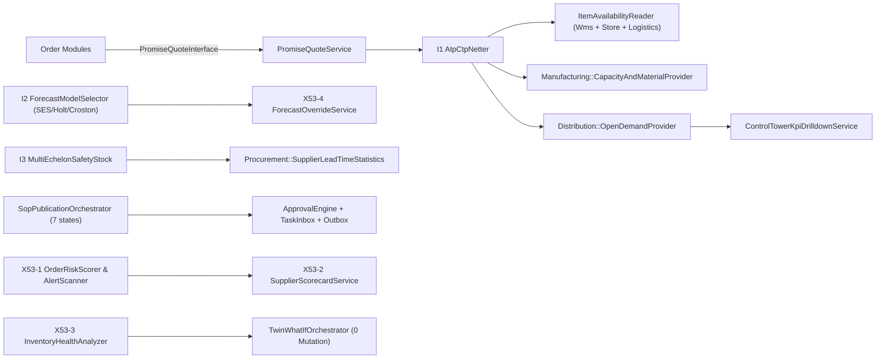
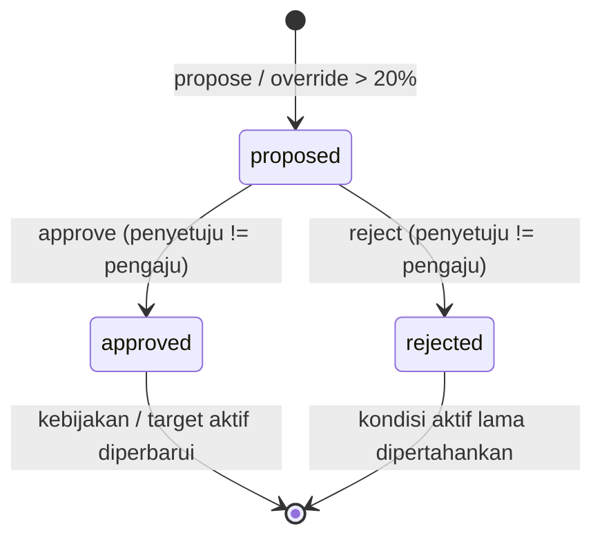
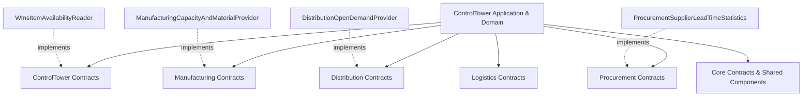

# Desain Teknis — Fase 53: Supply Chain Control Tower & S&OP

## 1. Ikhtisar Arsitektur Terintegrasi

Modul `ControlTower` (`modules/ControlTower/`, prefiks tabel `sct_`) menyatukan lapisan visibilitas, perencanaan konsensus, janji pengiriman deterministik, mitigasi risiko, analitik modal kerja, hingga simulasi Digital Twin. Seluruh interaksi ke modul operasional lain dijalankan melalui kontrak terinversi (`ADR-053`), sementara seluruh kejadian uang tetap ditangani oleh modul pemilik transaksi (`RAB Posting = 0`).

---

## 2. Arsitektur Lapisan Domain, Application, Infrastructure & Presentation

### 2.1 Domain Layer (`modules/ControlTower/Domain/`)
1. **Algoritma Deterministik (`Domain/Algorithms/`):**
   - `AtpCtpNetter` (`I1`): netting multi-periode kumulatif (`1..T`), proteksi pencurian komitmen periode mendatang (*look-ahead protection*), penentuan `status` (`on_time|late|cannot_promise`), `promised_period`, `late_periods`, kode alasan eksplisit (`INSUFFICIENT_CAPACITY|INSUFFICIENT_MATERIAL|HORIZON_EXCEEDED`), dan hash sertifikat SHA-256.
   - `AtpCtpCalculator`: evaluator janji periode tunggal dan pembangkit `OrderPromiseCertificate`.
   - `ForecastModelSelector` (`I2`): evaluasi komparatif rasional skala tetap (`10_000`) antara `SES` ($\alpha=3/10$), `HOLT` ($\alpha=3/10, \beta=1/10$), dan `CROSTON` ($\alpha=2/10$) memakai backtest *walk-forward* 6 titik terakhir, memilih `mae_scaled` minimum beserta tie-breaker deterministik `SES -> HOLT -> CROSTON`.
   - `DemandForecastEngine`: perhitungan `MOVING_AVG`, `EXP_SMOOTHING`, `HOLT_WINTERS`, `LINEAR_REGRESSION` dalam integer fixed-point.
   - `MultiEchelonSafetyStock` (`I3`): klasifikasi matriks ABC/XYZ 3×3 (`AX..CZ`) dan penggabungan variabilitas permintaan serta variabilitas waktu tunggu pemasok riil (`mean_days`, `sigma_days`) melalui akar kuadrat integer `isqrt`.
   - `SafetyStockAbcXyzOptimizer`, `BlastRadiusImpactAnalyzer`, `WhatIfTwinSimulator`: pendukung analisis echelon dan dampak kejut.
2. **State Machine (`Domain/StateMachines/`):**
   - `SopCycleStateMachine`: mengelola siklus 7 tahap kanonik (`data_gathering -> demand_review -> supply_review -> pre_sop -> exec_sop -> published -> closed`) sekaligus mempertahankan kompatibilitas jalur historis (`draft -> demand_review -> supply_review -> pre_sop_balancing -> executive_signoff -> published -> archived`), disertai pemeriksaan transisi mundur ber-alasan wajib (`assertTransitionWithReason`).
3. **Domain Services (`Domain/Services/`):**
   - `OrderRiskScorer` (`X53-1`): agregasi skor risiko pesanan `0..1000` berbasis shortfall, variabilitas pemasok, umur lot tertua, dan keterlambatan in-transit, dengan pemetaan tier `LOW|MEDIUM|HIGH|CRITICAL` serta rencana mitigasi.
   - `SupplierScorecardService` (`X53-2`): kalkulasi skor kinerja pemasok `0..1000` (OTD 45%, konsistensi lead time 30%, reliabilitas volume sampel 25%) lengkap dengan tiering `STRATEGIC|PREFERRED|WATCHLIST|AT_RISK` dan tren historis bulanan.
   - `InventoryHealthAnalyzer` (`X53-3`): klasifikasi kesehatan persediaan (`DEAD_STOCK|SLOW_MOVING|EXCESS|SHORTAGE_RISK|HEALTHY`), pembagian bucket umur (`0-30`, `31-90`, `91-180`, `>180`), kalkulasi `dos_days`, dan eksposur risiko obsolet IDR integer.
4. **Domain Models (`Domain/Models/`):**
   - `EchelonStock`, `DemandForecast`, `ForecastOverride`, `OrderPromise`, `DisruptionAlert`, `AlertRule`, `OrderRiskScore`, `SopCycle`, `SopEvent`, `SafetyStockPolicy`, `TwinScenario`, `ControlTowerKpiSnapshot`, `SupplierScorecardSnapshot`, `InventoryHealthSnapshot`.

### 2.2 Application Layer (`modules/ControlTower/Application/`)
- **Services Utama:**
  - `PromiseQuoteService` (implementasi `PromiseQuoteInterface`, `DB::transaction`, `IdempotencyConflictException`, emisi event `tower.promise.made.v1`).
  - `ForecastOverrideService` (`X53-4`: validasi alasan minimal 5 karakter, `deviation_bps`, eskalasi approval deviasi besar, serta dukungan `revertOverride`).
  - `MultiEchelonSafetyStockService`: pembuatan dan evaluasi usulan kebijakan safety stock multi-eselon.
  - `SopPublicationOrchestrator`: penghubung state machine S&OP ke `TaskInboxService::createTask()`, `ApprovalEngineInterface` four-eyes, serta emisi `tower.sop.published.v1`.
  - `OrderRiskAssessmentService` & `AlertScannerService`: pemindaian risiko pesanan, deteksi anomali echelon/transit terdeduplikasi via `dedup_key`, serta emisi `tower.alert.raised.v1`.
  - `TwinWhatIfOrchestratorService`: isolasi simulasi sandbox bebas mutasi dengan pemeriksaan kesetaraan checksum SHA-256 `before_hash === after_hash` serta komparator dua skenario.
  - `ControlTowerKpiDrilldownService`: perhitungan nyata `otif_permil` & `fill_rate_permil` dari `OpenDemandProvider::fulfillmentLines()` dengan rincian status pesanan.
  - `SupplierScorecardOrchestratorService` & `InventoryHealthOrchestratorService`: persistensi snapshot berkala idempoten per periode/tanggal.
  - `ControlTowerAuditReportService`: validasi invarian lintas tabel `sct_*` dan fixture sabotase untuk verifikasi deterministik `tower:audit`.
- **Actions:**
  - `RefreshAtpCtpHorizonAction`, `RunForecastModelSelectionAction`, `DecideSafetyStockProposalAction`, `EvaluateOrderPromiseAction`, `OverrideDemandForecastAction`, `RunConsensusSopHoltWintersForecastAction`, `DetectSupplyChainBottleneckAlertAction`, `ExecuteAutonomousReallocationPlaybookAction` (dilengkapi `proposeReallocation` dan `approveReallocation`), `StartSopCycleAction`, `TransitionSopCycleAction`, `RecalculateSafetyStockAction`, `CaptureControlTowerKpiSnapshotAction`, `RunWhatIfTwinScenarioAction`, `AnalyzeDisruptionBlastRadiusAction`.

### 2.3 Infrastructure & Cross-Module Adapters
- `Modules\ControlTower\Infrastructure\Adapters\WmsItemAvailabilityReader` -> `ItemAvailabilityReader`
- `Modules\ControlTower\Infrastructure\Adapters\ControlTowerVisibilityReaderAdapter` -> `ControlTowerVisibilityReader`
- `Modules\Manufacturing\Infrastructure\Adapters\ManufacturingCapacityAndMaterialProvider` -> `CapacityAndMaterialProvider`
- `Modules\Distribution\Infrastructure\Adapters\DistributionOpenDemandProvider` -> `OpenDemandProvider`
- `Modules\Procurement\Infrastructure\Adapters\ProcurementSupplierLeadTimeStatistics` -> `SupplierLeadTimeStatistics`
- `Modules\ControlTower\Infrastructure\Simulation\ControlTowerTwinTickHandler` -> `SimTickHandlerInterface`
- `Modules\ControlTower\Infrastructure\Audit\ControlTowerAuditCorruptionFixture`

---

## 3. Skema Migrasi Database (`sct_*`, MySQL 8.4 & SQLite Compatible)

Seluruh perubahan skema pada `W8-P6-fix` berbentuk **migrasi aditif murni**:

| Berkas Migrasi | Tabel Terpengaruh | Kolom Kunci & Foreign Key Eksplisit |
| :--- | :--- | :--- |
| `2026_10_06_530100_create_sct_tables.php` | `sct_echelon_stocks`, `sct_demand_forecasts`, `sct_order_promises`, `sct_disruption_alerts` | Dasar stok echelon, proyeksi permintaan, janji pesanan, alert disrupsi. |
| `2026_11_13_000001_create_sct_sop_cycles_and_twin_scenarios_tables.php` | `sct_sop_cycles`, `sct_sop_events`, `sct_forecast_overrides`, `sct_twin_scenarios`, `sct_kpi_snapshots`, `sct_safety_stock_policies` | FK ke `users.id`, `sct_sop_cycles.id`, `sct_demand_forecasts.id`. |
| `2026_11_14_000001_enhance_sct_order_promises_table.php` | `sct_order_promises` (alter aditif) | `idempotency_key` (unique), `payload_hash`, `promised_period`, `late_periods`, `reason_code`, `certificate_hash`, `as_of_date`, `atp_cumulative`, `ctp_cumulative`. |
| `2026_11_14_000002_enhance_sct_forecast_tables.php` | `sct_demand_forecasts`, `sct_forecast_overrides` (alter aditif) | `mae_scaled`, `candidates_json`, `certificate_hash`, `history_json`; override `status`, `deviation_bps`, `approval_id`, `reverted_at`, `reverted_by_user_id`. |
| `2026_11_14_000003_add_consensus_fields_to_sct_sop_cycles.php` | `sct_sop_cycles` (alter aditif) | `approval_id`, `task_id`, `published_at`, `published_by_user_id` FK `users.id`, `consensus_snapshot_json`, `notes`, `created_by_user_id` FK `users.id`. |
| `2026_11_14_000004_create_sct_risk_scores_and_alert_rules_tables.php` | `sct_order_risk_scores`, `sct_alert_rules`, `sct_disruption_alerts` (alter aditif) | Skor 4 komponen risiko, tier risiko, aturan ambang, `dedup_key`, proposal mitigasi. |
| `2026_11_14_000005_create_sct_scorecards_and_inventory_health_tables.php` | `sct_supplier_scorecards`, `sct_inventory_health_snapshots` | Komponen skor pemasok (`0..1000`), tier, bucket aging, `tied_capital_idr`, `obsolescence_risk_idr`. |

---

## 4. Desain Antarmuka Web (`x-ds.*`) & Responsivitas 375px

Seluruh tampilan web di `modules/ControlTower/resources/views/control_tower/` dirancang menggunakan komponen Design System standar (`<x-ds.card>`, `<x-ds.stat-card>`, `<x-ds.table>`, `<x-ds.badge>`, `<x-ds.button>`):
- Grid adaptif `grid-cols-1 md:grid-cols-3` atau `grid-cols-1 md:grid-cols-4` agar kartu metrik tersusun rapi pada viewport mobile `375px` tanpa overflow horizontal.
- Tabel data dibungkus kontainer `overflow-x-auto` dan dilengkapi formulir aksi interaktif (simulasi, kuotasi ATP, seleksi model, override forecast, transisi S&OP, mitigasi alert, penyegaran skor pemasok/kesehatan stok) serta tautan langsung ekspor `.csv`.
- Setiap rute terdaftar dalam `tests/Architecture/route-roles.php` sehingga lulus uji matrik otorisasi RBAC maupun `php artisan ui:lint --render --responsive`.

---

## 4. Desain Per-Komponen Setiap Irisan (`FIX-2` Slices 1–7)

### 4.1 State Machine & Alur Persetujuan Empat Mata
Semua perubahan parameter kritis Control Tower memisahkan peran pengaju (*planner*) dari penyetuju (*approver*) memakai `ApprovalEngineInterface`:

Tabel transisi siklus S&OP (`SopCycleStateMachine`):

| Dari Status | Tujuan Maju Valid | Tujuan Mundur (Wajib Alasan) | Efek Samping Orkestrasi |
|---|---|---|---|
| `data_gathering` | `demand_review` | — | Membuat rekaman `sct_sop_events` |
| `demand_review` | `supply_review` | `data_gathering` | Validasi baseline seri permintaan |
| `supply_review` | `pre_sop` | `demand_review`, `data_gathering` | Sinkronisasi utilisasi kapasitas pabrik |
| `pre_sop` | `financial_review` | `supply_review`, `demand_review` | Proyeksi estimasi margin & arus kas |
| `financial_review` | `executive_sop` | `pre_sop`, `supply_review` | Pengajuan antrean konsensus pimpinan |
| `executive_sop` | `consensus` | `financial_review`, `pre_sop` | Buat tugas `TaskInboxService` + `ApprovalEngineInterface` + event `tower.sop.published.v1` |
| `consensus` | `closed` | `executive_sop` | Penguncian siklus bulanan & arsip audit |
| *(legacy)* `draft` | `demand_review` | — | Jalur kompatibilitas mundur (`53.3`) |
| *(legacy)* `signed_off` | `archived`, `closed` | `executive_sop` | Jalur penutupan siklus historis |

### 4.2 Jaminan Sertifikat Deterministik & Anti-Tampering
Setiap keluaran algoritmik inti menyertakan sidik jari `SHA-256` deterministik yang dihitung dari parameter masukan dan keluaran kanonik tanpa komponen waktu acak:

1. **Kuotasi ATP/CTP (`PromiseQuoteService`):**
   - `payload_hash = sha256(json_encode([item_code, quantity, requested_period, order_reference, as_of_date]))`.
   - `certificate_hash` disusun oleh `AtpCtpNetter` atas `(atp_confirmed_qty, ctp_manufacturing_qty, promised_period, reason_code, horizon_vector)`.
   - Pengulangan request dengan `idempotency_key` sama tetapi `payload_hash` berbeda melempar `PromiseIdempotencyConflictException` (HTTP `409 Conflict`).
2. **Seleksi Forecast (`ForecastModelSelector`):**
   - Menyimpan kandidat seluruh model (`SES`, `HOLT`, `CROSTON`) pada `candidates_json` serta `mae_scaled` dalam bilangan bulat terskala `10_000`.
   - `certificate_hash` mengikat seri historis, parameter rasional pembilang/penyebut tetap (`3/10`, `3/10+1/10`, `2/10`), serta pemenang terpilih.
3. **Kebijakan Safety Stock (`MultiEchelonSafetyStock`):**
   - Menyimpan `certificate_digest` beserta `echelon_breakdown` (`PLANT`, `DC`, `OUTLET`) sebelum disetujui (`proposed_echelon_breakdown`) dan sesudah disetujui empat mata (`echelon_breakdown`).
   - Memastikan total unit across eselon selalu identik dengan `safety_stock_qty` lewat alokasi Hamilton.

### 4.3 Batas Non-Ledger & Keamanan Numerik (`A3` = `0`)
- Tidak satu pun layanan pada `modules/ControlTower/` menulis jurnal akuntansi (`JournalEntry`, `LedgerAccount`) atau memanggil `LedgerPostingEngine` (`docs/decisions/ADR-053-control-tower-non-ledger.md`).
- Seluruh rasio dan skor dinyatakan sebagai bilangan bulat: basis poin (`bps`, 10.000 = 100%) atau permil (`permil`, 1.000 = 100%) dan skala rasional tetap (`SCALE = 10_000`).
- Perhitungan nilai rupiah modal terkunci dan risiko keusangan pada `InventoryHealthAnalyzer` dan `ControlTowerKpiDrilldownService` memakai aritmetika integer `BigInt`-safe atau `Brick\Math\BigDecimal` tanpa operator floating-point (`float`, `round`, `number_format` uang).
- Semua kueri pembaca lintas modul di `Procurement`, `Manufacturing`, dan `Distribution` hanya menggunakan model/kontrak antar-modul yang sah atau tabel prefiks modulnya sendiri (`A1 = 0 baru`, `A2 = 0 baru`).

---

## 5. Topologi Ketergantungan Bersih (`A1`, `A2`, `A9`) & Kepemilikan Tabel

Aturan isolasi arsitektur yang dijaga ketat across seluruh berkas `FIX-2`:
- **Kernel Independen (`A9 = 0`):** `app/` dan Kernel tidak mengimpor namespace bisnis `Modules\ControlTower\*`.
- **Prefiks Tabel Tegas (`A2 = 0 baru`):**
  - `ControlTower` hanya mengakses tabel berprefiks `sct_*` miliknya sendiri.
  - Tabel `mfg_*` diakses eksklusif di dalam `Modules\Manufacturing\Infrastructure\Adapters\ManufacturingCapacityAndMaterialProvider`.
  - Tabel `dist_*` diakses eksklusif di dalam `Modules\Distribution\Infrastructure\Adapters\DistributionOpenDemandProvider`.
  - Tabel `prc_*` diakses eksklusif di dalam `Modules\Procurement\Infrastructure\Adapters\ProcurementSupplierLeadTimeStatistics`.
- **Impor Domain Terisolasi (`A1 = 0 baru`):** Tidak ada modul yang mengimpor kelas `Domain\*` dari modul bisnis lain atau pengecualian `Core\Domain\*`; setiap pesan bisnis lintas batas berjalan melalui kontrak DTO array / primitif atau `Modules\Core\Contracts\*`.
- **Higiene Waktu & Pengujian (`A8 = 0`, `TestHygiene`):** Seluruh waktu produksi disuntik via `Modules\Core\Contracts\ClockInterface` (`$this->clock->now()`); seluruh pengujian memverifikasi hasil nyata SQLite & kompatibilitas MySQL 8.4 DDL tanpa memodifikasi pagar baseline.

---

**Modul Pemilik:** `Modules\ControlTower` (`sct_`)  
**Cakupan:** D53-1 .. D53-10, I1 .. I3, X53-1 .. X53-4, P1–P4 Quality Gates  
**Acuan Non-Ledger:** `ADR-053` (`RAB Posting Ledger = 0`)  

---

## 1. Spesifikasi Kontrak Lintas Modul (Boundary & Payload)

### 1.1 `Modules\ControlTower\Contracts\ItemAvailabilityReader`
- **Method:** `positionFor(string $itemCode, string $asOfDate): array`
- **Skema Kembalian Wajib:**
  - `on_hand` (`int >= 0`): agregat fisik seluruh bin pada seluruh gudang yang berelasi ke SKU `$itemCode`.
  - `available` (`int >= 0`): kuantitas bersih setelah dikurangi karantina, blokir/hold, dan reservasi aktif pada tanggal `$asOfDate`.
  - `quarantine` (`int >= 0`): stok berstatus karantina/inspeksi QMS yang **wajib dikecualikan** dari kalkulasi `available` dan ATP.
  - `hold` (`int >= 0`): stok yang ditahan/diblokir untuk keperluan kualitas atau reservasi aktif.
  - `oldest_lot_age_days` (`int >= 0`): umur lot tertua dalam hari bulat terhadap `$asOfDate` sebagai masukan `InventoryHealthAnalyzer` dan `OrderRiskScorer`.
- **Invarian Batas Modul:** Implementasi `WmsItemAvailabilityReader` wajib berkomunikasi lewat `Modules\Wms\Contracts\StockAvailabilityReader`, `Modules\Store\Contracts\Product`, `Modules\Logistics\Contracts\InTransitShipmentProvider`, dan `EchelonStock`, tanpa menyentuh tabel berprefiks `wms_*`, `store_*`, maupun `lgx_*` via `DB::table`.

### 1.2 `Modules\Manufacturing\Contracts\CapacityAndMaterialProvider`
- **Method 1:** `cumulativeByPeriod(string $itemCode, int $periods, string $asOfDate): array`
  - Mengembalikan `['capacity_cumulative' => list<int>, 'material_cumulative' => list<int>]`.
  - Panjang kedua daftar wajib tepat sama dengan `$periods`; indeks `0` merepresentasikan periode `1`.
  - Barisan nilai wajib monoton tidak menurun ($\forall k > 0, \; x_k \ge x_{k-1}$).
- **Method 2:** `mpsReceipts(string $itemCode, int $periods, string $asOfDate): array`
  - Mengembalikan daftar integer sepanjang `$periods` dari jadwal penerimaan produksi (`mfg_mps_lines` + `mfg_scheduled_receipts`) milik material terkait.
- **Isolasi A2:** Implementasi `ManufacturingCapacityAndMaterialProvider` berada di `Modules\Manufacturing\Infrastructure\Adapters\` dan hanya memanggil tabel berprefiks `mfg_*`.

### 1.3 `Modules\Distribution\Contracts\OpenDemandProvider`
- **Method 1:** `commitmentsByPeriod(string $itemCode, int $periods, string $asOfDate): array`
  - Mengagregasi sisa kuantitas pesanan distribusi terbuka (`draft`, `allocated`, `partial`, `backordered`) dari `dist_orders` dan `dist_order_lines` ke dalam bucket periode `1..$periods` berdasar selisih minggu dari `$asOfDate`.
- **Method 2:** `fulfillmentLines(string $fromDate, string $toDate): array`
  - Mengembalikan daftar terurut `(due_date, order_ref)` berstruktur:
    `order_ref`, `customer_ref`, `item_code`, `ordered_qty` (`int`), `delivered_qty` (`int`), `due_date` (`YYYY-MM-DD`), `delivered_date` (`?YYYY-MM-DD`).
- **Isolasi A2:** Implementasi `DistributionOpenDemandProvider` berada di `Modules\Distribution\Infrastructure\Adapters\` dan hanya membaca tabel berprefiks `dist_*`.

### 1.4 `Modules\Procurement\Contracts\SupplierLeadTimeStatistics`
- **Method 1:** `forSupplierAndItem(string $supplierRef, string $itemCode): array` -> `mean_days`, `sigma_days`, `samples`, `on_time_permil`. Jika belum ada sampel penerimaan barang (`samples === 0`), seluruh nilai dikembalikan sebagai `0`.
- **Method 2:** `primarySupplierForItem(string $itemCode): ?string` -> mengembalikan pemasok dengan jumlah sampel terbanyak, dan apabila seri (*tie*), memilih `supplier_ref` terkecil secara leksikografis.
- **Method 3:** `allStatistics(): array` -> daftar seluruh pasangan pemasok-SKU terurut `(supplier_ref, item_code)`.
- **Method 4:** `monthlyHistory(string $supplierRef, int $months, string $asOfDate): array` -> riwayat bulanan dari lama ke baru hingga `$months` bulan terakhir sebelum/pada `$asOfDate`.
- **Isolasi A2:** Implementasi `ProcurementSupplierLeadTimeStatistics` di `Modules\Procurement\Infrastructure\Adapters\` hanya meng-query tabel `prc_*` serta membaca nama pemasok lewat model kontrak `Modules\Supplier\Contracts\Supplier`.

### 1.5 `Modules\ControlTower\Contracts\PromiseQuoteInterface`
- **Method:** `quote(string $itemCode, int $quantity, int $requestedPeriod, string $idempotencyKey, ?string $orderReference = null, ?string $asOfDate = null): array`
- **Idempotency & Concurrency:**
  - Dieksekusi di dalam `DB::transaction`.
  - Kunci `idempotency_key` sama dengan `payload_hash` identik mengembalikan hasil janji persis sama dari baris `sct_order_promises` tanpa membuat duplikat atau memancarkan event ulang.
  - Kunci `idempotency_key` sama dengan `payload_hash` berbeda melempar pengecualian konflik idempotensi deterministik.

---

## 2. Spesifikasi State Machine S&OP 7-Tahap (`SopCycleStateMachine`)

### 2.1 Peta Transisi Kanonik & Kompatibilitas Historis
1. **Jalur Resmi 7-Tahap (`canonicalStates()`):**
   - `data_gathering` -> `demand_review`
   - `demand_review` -> `supply_review` | `data_gathering` (mundur ber-alasan)
   - `supply_review` -> `pre_sop` | `demand_review` (mundur ber-alasan)
   - `pre_sop` -> `exec_sop` | `supply_review` (mundur ber-alasan)
   - `exec_sop` -> `published` | `pre_sop` (mundur ber-alasan)
   - `published` -> `closed`
   - `closed` -> `[]` (terminal; tidak dapat berpindah lagi)
2. **Jalur Kompatibilitas (`draft..archived`):**
   - `draft` -> `demand_review`
   - `demand_review` -> `draft` | `supply_review`
   - `supply_review` -> `pre_sop_balancing`
   - `pre_sop_balancing` -> `executive_signoff` | `supply_review`
   - `executive_signoff` -> `published` | `pre_sop_balancing`
   - `published` -> `archived`
   - `archived` -> `[]` (terminal)

### 2.2 Aturan Governance & Integrasi Core
- **Alasan Mundur Wajib (`assertTransitionWithReason`):** Setiap transisi ke tahap berperingkat lebih rendah mewajibkan string `$reason` non-kosong.
- **Kotak Masuk Tugas (`TaskInboxService`):** Saat siklus memasuki `demand_review`, `supply_review`, atau `pre_sop`, orkestrator menerbitkan tugas kerja ke kotak masuk peran terkait agar tinjauan bulanan terlacak dengan SLA jelas.
- **Four-Eyes Sign-Off (`ApprovalEngineInterface`):** Transisi ke `published` wajib menyertakan penyetuju berbeda dari `created_by_user_id` jika keduanya bernilai non-null. Pelanggaran menaikkan `FOUR_EYES_VIOLATION`.
- **Publikasi Event:** Perpindahan berhasil ke status `published` menyimpan stempel waktu `published_at` berbasis `ClockInterface` dan menerbitkan `tower.sop.published.v1`.

---

## 3. Spesifikasi Fungsional X53-1 .. X53-4 & Twin Sandbox

### 3.1 `X53-1` — `OrderRiskScorer`
- Masukan mencakup `item_code`, `requested_qty`, `available_qty`, `oldest_lot_age_days`, `supplier_ref`, `warehouse_code`, `order_reference`.
- Skor akhir merupakan penjumlahan 4 komponen integer (`0..400` + `0..250` + `0..200` + `0..150`) dengan batas atas keras `1000`.
- Rekomendasi mitigasi tersusun deterministik menyebut faktor dominan tertinggi (`Percepat PO pemasok`, `Prioritaskan rotasi FEFO lot tertua`, `Kirim ulang in-transit atau realokasi DC`).
- `AlertScannerService` menduplikasi deteksi berdasarkan `dedup_key = sha256(...)` sehingga menjalankan `tower:alerts-scan` berulang kali bersikap idempoten 100%.
- Pemindahan stok antar-gudang (`ExecuteAutonomousReallocationPlaybookAction::proposeReallocation`) membentuk proposal teraudit yang baru mengubah saldo node setelah dipanggil melalui `approveReallocation`.

### 3.2 `X53-2` — `SupplierScorecardService`
- Menghitung empat sub-skor integer `0..1000`:
  - `otd_score`: langsung memetakan `on_time_permil` (`0..1000`).
  - `reliability_score`: `1000` bila `sigma_days == 0 && samples > 0`, berkurang proporsional sesuai rasio `sigma_days / max(1, mean_days)`.
  - `volume_score`: berdasar kecukupan `samples` (`>= 10` sampel -> `1000`, `1..9` sampel -> `samples * 100`, `0` -> `0`).
  - `composite_score = intdiv(45 * otd_score + 30 * reliability_score + 25 * volume_score, 100)`.
- Jika `samples === 0`, `composite_score = 0` dan tier ditetapkan menjadi `AT_RISK` dengan rekomendasi onboarding evaluasi pemasok.

### 3.3 `X53-3` — `InventoryHealthAnalyzer`
- Menghitung `dos_days`: bila `daily_demand_qty > 0`, maka `intdiv(on_hand_qty, daily_demand_qty)`; bila `daily_demand_qty == 0` dan `on_hand_qty > 0`, dianggap tidak berputar (`DEAD_STOCK`).
- Pembagian bucket umur (`0-30`, `31-90`, `91-180`, `>180`) selalu menggunakan batas inklusif yang saling lepas sehingga setiap baris masuk ke tepat satu bucket.
- Eksposur obsolet (`obsolescence_risk_idr`) dihitung memakai pembobot integer (`100%` dari nilai tertahan untuk `DEAD_STOCK`, `50%` untuk `SLOW_MOVING`, `20%` untuk `EXCESS`, `0` untuk `SHORTAGE_RISK`/`HEALTHY`).

### 3.4 `X53-4` — `ForecastOverrideService`
- Menyimpan catatan historis sebelum dan sesudah pada `sct_forecast_overrides` dengan `previous_qty` asli tetap terjaga agar fungsi `revertOverride` mampu memulihkan `DemandForecast::forecast_qty` secara eksak.
- Deviasi dihitung dalam `bps`: `intdiv(abs(newQty - baselineQty) * 10_000, max(1, baselineQty))`.

### 3.5 Digital Twin Zero-Mutation Guarantee
- Tabel yang di-hash sebelum dan sesudah `TwinWhatIfOrchestratorService::runScenario()`:
  1. `sct_echelon_stocks` (`id, item_code, echelon_node, on_hand_qty, in_transit_qty, reserved_qty, safety_stock_qty`)
  2. `sct_order_promises` (`id, promise_code, requested_qty, atp_confirmed_qty, ctp_manufacturing_qty, promise_status`)
  3. `sct_disruption_alerts` (`id, alert_code, severity, status`)
- Setiap eksekusi skenario mengembalikan struktur laporan yang memuat `before_hash`, `after_hash`, dan `mutated_live_tables: false`.

---

## 4. Kriteria Penerimaan Pengujian (Verification Checklist)

1. Seluruh fitur pengujian di `modules/ControlTower/tests/Feature/Slice{1..7}*Test.php`, `ControlTowerTest.php`, `ControlTowerOperationsSliceTest.php`, dan `tests/Acceptance/ControlTower/ControlTowerSopAndTwinAcceptanceTest.php` lulus `100%` (`0` skipped, `0` failed).
2. Eksekusi `T-1c` (`/tmp/spek2.sh 53`) menghasilkan `HILANG: 0` dari `44` item kode, tabel, CLI command, event, dan rute web yang diaudit.
3. Seluruh views web Control Tower lulus `php artisan ui:lint --render --responsive` pada lebar viewport `375px` tanpa overflow horizontal dan memakai komponen `<x-ds.*>`.
4. `php artisan arch:scan --json` tidak menambah 1 pun pelanggaran di luar baseline terpasang (`A1`, `A2`, `A12`), dengan `A3=0`, `A6=0`, `A8=0`, `A11=0`.
5. `php artisan tower:audit` lulus bersih exit code `0` dalam kondisi sehat dan gagal deterministik exit code `1` setelah fixture sabotase disuntikkan.

---

## 5. Kamus Skema Basis Data Migrasi FIX-2 (`sct_*`)

Semua migrasi menjaga kompatibilitas SQLite pengujian dan MySQL 8.4 produksi (`MysqlSchemaCompatibilityTest` PASS):

| Migrasi | Tabel | Kolom Tambahan / Baru | Indeks & Batasan Integritas |
|---|---|---|---|
| `2026_11_14_000001` | `sct_order_promises` | `idempotency_key` (unique), `payload_hash`, `promised_period`, `late_periods`, `reason_code`, `certificate_hash`, `as_of_date`, `atp_cumulative`, `ctp_cumulative` | `unique(idempotency_key)` |
| `2026_11_14_000002` | `sct_demand_forecasts`, `sct_forecast_overrides` | `mae_scaled`, `candidates_json`, `certificate_hash`, `history_json`; pada overrides: `deviation_bps`, `approval_id`, `status`, `reverted_at`, `reverted_by_user_id` | FK `reverted_by_user_id -> users.id` `nullOnDelete` |
| `2026_11_13_000002` | `sct_safety_stock_policies` | `status`, `proposed_abc_class`, `proposed_xyz_class`, `proposed_service_level_bps`, `proposed_safety_stock_qty`, `proposed_reorder_point_qty`, `echelon_breakdown`, `proposed_echelon_breakdown`, `supplier_ref`, `lead_time_mean_days`, `lead_time_sigma_days`, `certificate_digest`, `approval_id`, `proposed_by_user_id`, `decided_by_user_id`, `decided_at`, `decision_notes` | FK `proposed_by_user_id`, `decided_by_user_id -> users.id` `nullOnDelete` |
| `2026_11_14_000003` | `sct_sop_cycles` | `consensus_snapshot_json`, `approval_id`, `published_at`, `published_by_user_id`, `notes`, `created_by_user_id` | FK `published_by_user_id`, `created_by_user_id -> users.id` |
| `2026_11_14_000004` | `sct_order_risk_scores`, `sct_alert_rules`, `sct_disruption_alerts` | Skor komponen & `factors_json`; aturan `rule_code`, `threshold_bps`; alert `dedup_key` (unique), `mitigation_proposal_json`, `approved_by_user_id` | `index(item_code)`, `index(risk_tier)`, `unique(dedup_key)` |
| `2026_11_14_000005` | `sct_supplier_scorecards`, `sct_inventory_health_snapshots` | `composite_score`, `otd_score`, `reliability_score`, `volume_score`, `tier`, `trend_json`; health: `health_status`, `aging_bucket`, `dos_days`, `tied_capital_idr`, `obsolescence_risk_idr` | `unique(supplier_ref, period)` (`sct_sc_sup_period_uq`), `unique(item_code, echelon_node, snapshot_date)` (`sct_ih_item_node_date_uq`) |

---

## 6. Matriks Endpoint HTTP, RBAC, dan Kolom Ekspor CSV (`route-roles.php`)

Seluruh endpoint berada di bawah prefix `/control-tower` dan wajib dilindungi middleware `['web', 'auth', 'role:...']`:

| Nama Rute | Method & URI | Role Diizinkan | Respons & Format Ekspor CSV |
|---|---|---|---|
| `control_tower.promises.quote` | `POST /promises/quote` | `admin`, `logistics_admin`, `planner` | JSON 200 idempoten atau JSON 409 (`PromiseIdempotencyConflictException`) |
| `control_tower.promises.export` | `GET /promises/export.csv` | `admin`, `logistics_admin`, `planner`, `auditor` | CSV UTF-8 (`promise_code,order_reference,item_code,requested_qty,promised_period,late_periods,reason_code,promised_delivery_date`) |
| `control_tower.forecast.index` | `GET /forecast` | `admin`, `logistics_admin`, `planner`, `auditor` | Halaman Blade `<x-ds.*>` responsif 375px |
| `control_tower.forecast.select` | `POST /forecast/select` | `admin`, `logistics_admin`, `planner` | Seleksi model walk-forward `I2` |
| `control_tower.forecast.override` | `POST /forecast/override` | `admin`, `logistics_admin`, `planner` | Override kolaboratif + validasi approval deviasi > 20% |
| `control_tower.forecast.revert` | `POST /forecast/override/{override}/revert` | `admin`, `logistics_admin`, `planner` | Revert atomik ke `previous_qty` |
| `control_tower.forecast.export` | `GET /forecast/export.csv` | `admin`, `logistics_admin`, `planner`, `auditor` | CSV akurasi forecast & status override |
| `control_tower.safety_stock.propose` | `POST /safety-stock/propose` | `admin`, `logistics_admin`, `planner` | Pengajuan proposal `I3` tanpa mengubah kebijakan aktif |
| `control_tower.safety_stock.decide` | `POST /safety-stock/{policy}/decide` | `admin`, `logistics_admin` | Keputusan empat mata (`approve`/`reject`) |
| `control_tower.safety_stock.export` | `GET /safety-stock/export.csv` | `admin`, `logistics_admin`, `planner`, `auditor` | CSV kebijakan & alokasi eselon |
| `control_tower.sop.consensus` | `POST /sop/{cycle}/consensus` | `admin`, `logistics_admin`, `planner` | Publikasi konsensus + `TaskInboxService` + `tower.sop.published.v1` |
| `control_tower.sop.export` | `GET /sop/export.csv` | `admin`, `logistics_admin`, `planner`, `auditor` | CSV siklus & dampak finansial S&OP |
| `control_tower.risk.index` | `GET /risk` | `admin`, `logistics_admin`, `planner`, `auditor` | Halaman risiko pesanan `X53-1` |
| `control_tower.risk.scan` | `POST /risk/scan` | `admin`, `logistics_admin`, `planner` | Eksekusi scan risiko pesanan |
| `control_tower.risk.export` | `GET /risk/export.csv` | `admin`, `logistics_admin`, `planner`, `auditor` | CSV skor risiko 4 komponen |
| `control_tower.alerts.index` | `GET /alerts` | `admin`, `logistics_admin`, `planner`, `auditor` | Halaman alert disrupsi |
| `control_tower.alerts.scan` | `POST /alerts/scan` | `admin`, `logistics_admin`, `planner` | Pemindaian disrupsi berbasis `dedup_key` |
| `control_tower.alerts.mitigate` | `POST /alerts/{alert}/mitigate` | `admin`, `logistics_admin`, `planner` | Pengajuan & persetujuan mitigasi alert |
| `control_tower.alerts.export` | `GET /alerts/export.csv` | `admin`, `logistics_admin`, `planner`, `auditor` | CSV daftar alert aktif & termitigasi |
| `control_tower.twin.whatif` | `POST /twin/whatif` | `admin`, `logistics_admin`, `planner` | JSON hasil sandbox zero-mutation + hash integritas |
| `control_tower.twin.export` | `GET /twin/export.csv` | `admin`, `logistics_admin`, `planner`, `auditor` | CSV skenario simulasi what-if |
| `control_tower.kpi.drilldown` | `GET /kpi/drilldown` | `admin`, `logistics_admin`, `planner`, `auditor` | JSON metrik OTIF permil & fill-rate permil dari pesanan nyata |
| `control_tower.kpi.export` | `GET /kpi/export.csv` | `admin`, `logistics_admin`, `planner`, `auditor` | CSV detail pemenuhan pesanan riil |
| `control_tower.suppliers.index` | `GET /suppliers` | `admin`, `logistics_admin`, `planner`, `auditor` | Halaman scorecard pemasok `X53-2` |
| `control_tower.suppliers.refresh` | `POST /suppliers/refresh` | `admin`, `logistics_admin`, `planner` | Refresh scorecard periodik idempoten |
| `control_tower.suppliers.export` | `GET /suppliers/export.csv` | `admin`, `logistics_admin`, `planner`, `auditor` | CSV tier & lead-time pemasok |
| `control_tower.inventory_health.index` | `GET /inventory-health` | `admin`, `logistics_admin`, `planner`, `auditor` | Halaman kesehatan inventori `X53-3` |
| `control_tower.inventory_health.refresh` | `POST /inventory-health/refresh` | `admin`, `logistics_admin`, `planner` | Refresh snapshot kesehatan & kapital terkunci IDR |
| `control_tower.inventory_health.export` | `GET /inventory-health/export.csv` | `admin`, `logistics_admin`, `planner`, `auditor` | CSV aging bucket & risiko keusangan |

---

## 7. Daftar Perintah Artisan CLI & Jadwal Cron Terdaftar

| Perintah CLI | Opsi / Argumen | Jadwal Scheduler | Deskripsi Tugas |
|---|---|---|---|
| `tower:atp-refresh` | `{--item=} {--date=}` | On-demand & via action | Menyegarkan snapshot janji ATP/CTP dari WMS + Manufacturing + Distribution |
| `tower:forecast-select` | `{--item=} {--period=}` | On-demand | Menjalankan seleksi model walk-forward `SES`/`HOLT`/`CROSTON` secara idempoten |
| `tower:safety-stock` | `{--item=} {--node=}` | On-demand | Mengajukan proposal `MultiEchelonSafetyStock` berdasarkan `SupplierLeadTimeStatistics` |
| `tower:risk-scan` | `{--as-of=}` | Setiap jam (`hourly`) | Menghitung `OrderRiskScore` deterministik seluruh pesanan terbuka |
| `tower:alerts-scan` | `{--as-of=}` | Setiap 15 menit | Memindai anomali & menerbitkan `tower.alert.raised.v1` tanpa duplikasi |
| `tower:whatif` | `{scenario} {--magnitude=} {--days=}` | On-demand | Menjalankan skenario what-if sandbox digital twin tanpa mutasi database |
| `tower:kpi` | `{--from=} {--to=}` | Harian pukul `02:30` | Mengagregasi snapshot KPI OTIF, DOS, dan cash-to-cash |
| `tower:supplier-scorecard` | `{--supplier=} {--period=}` | Harian pukul `02:30` | Memperbarui snapshot scorecard pemasok (`X53-2`) |
| `tower:audit` | — | Quality gate CI | Memverifikasi invarian zero over-promise ATP, reservasi <= supply, dan status S&OP |

---

## 8. Spesifikasi Antarmuka Web Responsif (`375px`) & Seeder Data Uji (`T1`)

### 8.1 Komponen UI Design System (`modules/ControlTower/resources/views/control_tower/`)
Seluruh antarmuka web baru dan pembaruan view lama di Control Tower memenuhi standar aksesibilitas (`ui:lint` = `0 violations` dari `15` view yang dipindai) dan tata letak responsif `375px`:

| Berkas View Blade | Rute Terhubung | Komponen `<x-ds.*>` | Fitur Interaktif Utama |
|---|---|---|---|
| `forecast.blade.php` | `control_tower.forecast.index` | `<x-ds.card>`, `<x-ds.stat>`, `<x-ds.table>`, `<x-ds.badge>`, `<x-ds.button>` | Seleksi model `SES`/`HOLT`/`CROSTON`, form override beralasan audit, tombol revert, ekspor CSV |
| `risk.blade.php` | `control_tower.risk.index` | `<x-ds.card>`, `<x-ds.stat>`, `<x-ds.table>`, `<x-ds.badge>`, `<x-ds.button>` | Rincian 4 komponen `OrderRiskScorer` (`shortfall`, `lead_time`, `shelf_life`, `transit`), tombol scan risiko |
| `alerts.blade.php` | `control_tower.alerts.index` | `<x-ds.card>`, `<x-ds.stat>`, `<x-ds.table>`, `<x-ds.badge>`, `<x-ds.button>` | Pemindaian disrupsi ber-`dedup_key`, tombol mitigasi, ekspor CSV |
| `suppliers.blade.php` | `control_tower.suppliers.index` | `<x-ds.card>`, `<x-ds.stat>`, `<x-ds.table>`, `<x-ds.badge>`, `<x-ds.button>` | Skor komposit `0..1000`, tier `STRATEGIC..AT_RISK`, tren bulanan, refresh scorecard |
| `inventory_health.blade.php` | `control_tower.inventory_health.index` | `<x-ds.card>`, `<x-ds.stat>`, `<x-ds.table>`, `<x-ds.badge>`, `<x-ds.button>` | Aging bucket (`0-30..>180`), klasifikasi `DEAD_STOCK..HEALTHY`, kapital terkunci IDR |
| `holt_winters_forecast.blade.php` | `control_tower.autonomous.forecast` | Form `<label for="...">` + `id` eksplisit | Perbaikan aksesibilitas `INPUT_LABEL` pada `item_code`, `period`, dan `alpha` |
| `autonomous_reallocation.blade.php` | `control_tower.autonomous.reallocate` | Form `<label for="...">` + `id` eksplisit | Perbaikan aksesibilitas `INPUT_LABEL` pada `item_code`, `from_node`, `to_node`, dan `transfer_qty` |

### 8.2 Spesifikasi Seeder Awal Control Tower (`ControlTowerSeeder`)
`Modules\ControlTower\database\seeders\ControlTowerSeeder` dipanggil dari `DatabaseSeeder` setelah `WmsSeeder` dengan karakter idempoten (`firstOrCreate`) dan bebas `now()` (`A8` bersih):
- **Stok Multi-Eselon:** 4 entri `EchelonStock` (`SP-001` di `PLANT`/`DC`/`OUTLET` + `SP-004` di `DC`) dengan kapasitas pasokan total melebihi reservasi.
- **Kebijakan & Forecast:** `SafetyStockPolicy` aktif untuk `SP-001` (`echelon_breakdown: PLANT=50, DC=40, OUTLET=25`) serta `DemandForecast` `FC-2026-11-SP001` (`HOLT`).
- **Siklus S&OP & Janji ATP:** `SopCycle` `SOP-2026-11` pada status kanonik `pre_sop` serta `OrderPromise` `PRM-SEED-001` (`ATP_SUFFICIENT_ON_TIME`, `requested_qty = 45`).
- **Risiko, Alert, Scorecard & Kesehatan:** `AlertRule` `RULE-STOCKOUT-HIGH`, `DisruptionAlert` `ALT-SEED-001`, `OrderRiskScore` `SO-SEED-002`, `SupplierScorecardSnapshot` `SUP-SEED-001` (`STRATEGIC`, skor `865`), `InventoryHealthSnapshot` `SP-001` (`HEALTHY`), `ControlTowerKpiSnapshot`, serta `TwinScenario` `TWIN-SEED-DEMAND15`.

---

## 9. Spesifikasi Validasi Request & Skema Ekspor CSV Terperinci

### 9.1 Aturan Validasi Input HTTP (`FormRequest`)

| Kelas Request | Field Wajib | Aturan Batas Numerik / String | Penolakan / Pesan |
|---|---|---|---|
| `QuotePromiseRequest` | `item_code`, `quantity`, `requested_period` | `quantity`: integer `>= 1`; `requested_period`: integer `0..11`; `as_of_date`: tanggal ISO opsional | `422 Unprocessable` bila `quantity <= 0` atau periode negatif |
| `StoreForecastOverrideRequest` | `demand_forecast_id` / `item_code`, `new_qty`, `reason` | `new_qty`: integer `>= 0`; `reason`: string `min:5`, `max:255` | `422 Unprocessable` bila alasan `< 5` karakter atau `new_qty < 0` |
| `SafetyStockProposalRequest` | `item_code`, `node_weights` (atau `decision`) | `node_weights.*`: integer `>= 0`; `decision`: enum `approve` / `reject` | `422` pada bobot negatif atau keputusan tidak valid |
| `PublishSopCycleRequest` | `demand_plan_qty`, `supply_plan_qty`, `capacity_utilization_bps` | Semua qty integer `>= 0`; `capacity_utilization_bps`: `0..15000`; `notes` opsional | Memicu transisi ke `consensus` + `TaskInboxService` |

### 9.2 Kamus Kolom Ekspor CSV (`UTF-8`, Streamed)

1. **`GET /control-tower/promises/export.csv`** (`control_tower.promises.export`):
   - Kolom: `promise_code`, `order_reference`, `item_code`, `requested_qty`, `atp_confirmed_qty`, `ctp_manufacturing_qty`, `promised_period`, `late_periods`, `reason_code`, `promised_delivery_date`.
2. **`GET /control-tower/forecast/export.csv`** (`control_tower.forecast.export`):
   - Kolom: `forecast_code`, `item_code`, `period`, `algorithm_model`, `forecast_qty`, `actual_qty`, `mae_scaled`, `is_overridden`, `override_reason`.
3. **`GET /control-tower/safety-stock/export.csv`** (`control_tower.safety_stock.export`):
   - Kolom: `item_code`, `abc_class`, `xyz_class`, `service_level_bps`, `safety_stock_qty`, `reorder_point_qty`, `status`, `supplier_ref`, `lead_time_mean_days`, `lead_time_sigma_days`.
4. **`GET /control-tower/sop/export.csv`** (`control_tower.sop.export`):
   - Kolom: `cycle_code`, `period`, `status`, `scenario_type`, `demand_plan_qty`, `supply_plan_qty`, `capacity_utilization_bps`, `gross_margin_est_idr`, `cash_impact_est_idr`, `published_at`.
5. **`GET /control-tower/risk/export.csv`** & **`/alerts/export.csv`**:
   - Risiko: `item_code`, `order_reference`, `risk_score`, `risk_tier`, `shortfall_component`, `lead_time_component`, `shelf_life_component`, `transit_component`, `scored_at`.
   - Alert: `alert_code`, `dedup_key`, `severity`, `category`, `title`, `affected_orders_count`, `status`.
6. **`GET /control-tower/twin/export.csv`** & **`/kpi/export.csv`**:
   - Twin: `scenario_code`, `name`, `shock_type`, `shock_magnitude_bps`, `duration_days`, `baseline_otif_bps`, `simulated_otif_bps`, `at_risk_orders_count`, `estimated_margin_delta_idr`.
   - KPI Drilldown: `order_ref`, `customer_ref`, `item_code`, `ordered_qty`, `delivered_qty`, `due_date`, `delivered_date`, `on_time`, `in_full`.
7. **`GET /control-tower/suppliers/export.csv`** & **`/inventory-health/export.csv`**:
   - Pemasok: `supplier_ref`, `supplier_name`, `period`, `composite_score`, `otd_score`, `reliability_score`, `volume_score`, `on_time_permil`, `mean_lead_time_days`, `sigma_lead_time_days`, `samples_count`, `tier`.
   - Kesehatan Inventori: `item_code`, `echelon_node`, `health_status`, `aging_bucket`, `on_hand_qty`, `quarantine_qty`, `available_qty`, `daily_demand_qty`, `dos_days`, `oldest_lot_age_days`, `tied_capital_idr`, `obsolescence_risk_idr`.
