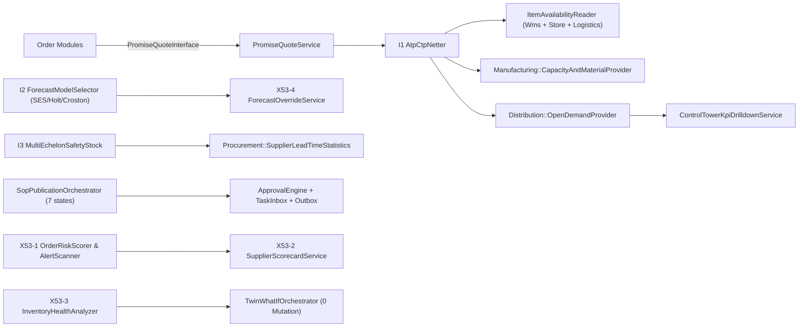
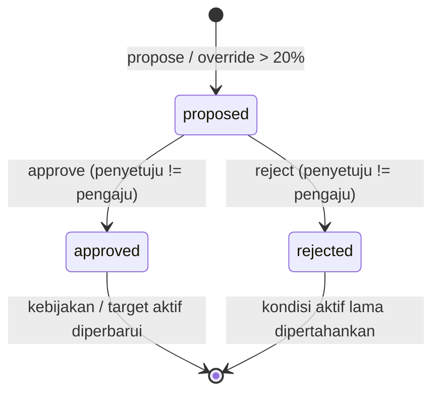
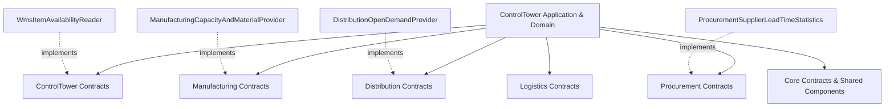

# Desain Teknis — Fase 53: Supply Chain Control Tower & S&OP

## 1. Ikhtisar Arsitektur Terintegrasi

Modul `ControlTower` (`modules/ControlTower/`, prefiks tabel `sct_`) menyatukan lapisan visibilitas, perencanaan konsensus, janji pengiriman deterministik, mitigasi risiko, analitik modal kerja, hingga simulasi Digital Twin. Seluruh interaksi ke modul operasional lain dijalankan melalui kontrak terinversi (`ADR-053`), sementara seluruh kejadian uang tetap ditangani oleh modul pemilik transaksi (`RAB Posting = 0`).

---

## 2. Arsitektur Lapisan Domain, Application, Infrastructure & Presentation

### 2.1 Domain Layer (`modules/ControlTower/Domain/`)
1. **Algoritma Deterministik (`Domain/Algorithms/`):**
   - `AtpCtpNetter` (`I1`): netting multi-periode kumulatif (`1..T`), proteksi pencurian komitmen periode mendatang (*look-ahead protection*), penentuan `status` (`on_time|late|cannot_promise`), `promised_period`, `late_periods`, kode alasan eksplisit (`INSUFFICIENT_CAPACITY|INSUFFICIENT_MATERIAL|HORIZON_EXCEEDED`), dan hash sertifikat SHA-256.
   - `AtpCtpCalculator`: evaluator janji periode tunggal dan pembangkit `OrderPromiseCertificate`.
   - `ForecastModelSelector` (`I2`): evaluasi komparatif rasional skala tetap (`10_000`) antara `SES` ($\alpha=3/10$), `HOLT` ($\alpha=3/10, \beta=1/10$), dan `CROSTON` ($\alpha=2/10$) memakai backtest *walk-forward* 6 titik terakhir, memilih `mae_scaled` minimum beserta tie-breaker deterministik `SES -> HOLT -> CROSTON`.
   - `DemandForecastEngine`: perhitungan `MOVING_AVG`, `EXP_SMOOTHING`, `HOLT_WINTERS`, `LINEAR_REGRESSION` dalam integer fixed-point.
   - `MultiEchelonSafetyStock` (`I3`): klasifikasi matriks ABC/XYZ 3×3 (`AX..CZ`) dan penggabungan variabilitas permintaan serta variabilitas waktu tunggu pemasok riil (`mean_days`, `sigma_days`) melalui akar kuadrat integer `isqrt`.
   - `SafetyStockAbcXyzOptimizer`, `BlastRadiusImpactAnalyzer`, `WhatIfTwinSimulator`: pendukung analisis echelon dan dampak kejut.
2. **State Machine (`Domain/StateMachines/`):**
   - `SopCycleStateMachine`: mengelola siklus 7 tahap kanonik (`data_gathering -> demand_review -> supply_review -> pre_sop -> exec_sop -> published -> closed`) sekaligus mempertahankan kompatibilitas jalur historis (`draft -> demand_review -> supply_review -> pre_sop_balancing -> executive_signoff -> published -> archived`), disertai pemeriksaan transisi mundur ber-alasan wajib (`assertTransitionWithReason`).
3. **Domain Services (`Domain/Services/`):**
   - `OrderRiskScorer` (`X53-1`): agregasi skor risiko pesanan `0..1000` berbasis shortfall, variabilitas pemasok, umur lot tertua, dan keterlambatan in-transit, dengan pemetaan tier `LOW|MEDIUM|HIGH|CRITICAL` serta rencana mitigasi.
   - `SupplierScorecardService` (`X53-2`): kalkulasi skor kinerja pemasok `0..1000` (OTD 45%, konsistensi lead time 30%, reliabilitas volume sampel 25%) lengkap dengan tiering `STRATEGIC|PREFERRED|WATCHLIST|AT_RISK` dan tren historis bulanan.
   - `InventoryHealthAnalyzer` (`X53-3`): klasifikasi kesehatan persediaan (`DEAD_STOCK|SLOW_MOVING|EXCESS|SHORTAGE_RISK|HEALTHY`), pembagian bucket umur (`0-30`, `31-90`, `91-180`, `>180`), kalkulasi `dos_days`, dan eksposur risiko obsolet IDR integer.
4. **Domain Models (`Domain/Models/`):**
   - `EchelonStock`, `DemandForecast`, `ForecastOverride`, `OrderPromise`, `DisruptionAlert`, `AlertRule`, `OrderRiskScore`, `SopCycle`, `SopEvent`, `SafetyStockPolicy`, `TwinScenario`, `ControlTowerKpiSnapshot`, `SupplierScorecardSnapshot`, `InventoryHealthSnapshot`.

### 2.2 Application Layer (`modules/ControlTower/Application/`)
- **Services Utama:**
  - `PromiseQuoteService` (implementasi `PromiseQuoteInterface`, `DB::transaction`, `IdempotencyConflictException`, emisi event `tower.promise.made.v1`).
  - `ForecastOverrideService` (`X53-4`: validasi alasan minimal 5 karakter, `deviation_bps`, eskalasi approval deviasi besar, serta dukungan `revertOverride`).
  - `MultiEchelonSafetyStockService`: pembuatan dan evaluasi usulan kebijakan safety stock multi-eselon.
  - `SopPublicationOrchestrator`: penghubung state machine S&OP ke `TaskInboxService::createTask()`, `ApprovalEngineInterface` four-eyes, serta emisi `tower.sop.published.v1`.
  - `OrderRiskAssessmentService` & `AlertScannerService`: pemindaian risiko pesanan, deteksi anomali echelon/transit terdeduplikasi via `dedup_key`, serta emisi `tower.alert.raised.v1`.
  - `TwinWhatIfOrchestratorService`: isolasi simulasi sandbox bebas mutasi dengan pemeriksaan kesetaraan checksum SHA-256 `before_hash === after_hash` serta komparator dua skenario.
  - `ControlTowerKpiDrilldownService`: perhitungan nyata `otif_permil` & `fill_rate_permil` dari `OpenDemandProvider::fulfillmentLines()` dengan rincian status pesanan.
  - `SupplierScorecardOrchestratorService` & `InventoryHealthOrchestratorService`: persistensi snapshot berkala idempoten per periode/tanggal.
  - `ControlTowerAuditReportService`: validasi invarian lintas tabel `sct_*` dan fixture sabotase untuk verifikasi deterministik `tower:audit`.
- **Actions:**
  - `RefreshAtpCtpHorizonAction`, `RunForecastModelSelectionAction`, `DecideSafetyStockProposalAction`, `EvaluateOrderPromiseAction`, `OverrideDemandForecastAction`, `RunConsensusSopHoltWintersForecastAction`, `DetectSupplyChainBottleneckAlertAction`, `ExecuteAutonomousReallocationPlaybookAction` (dilengkapi `proposeReallocation` dan `approveReallocation`), `StartSopCycleAction`, `TransitionSopCycleAction`, `RecalculateSafetyStockAction`, `CaptureControlTowerKpiSnapshotAction`, `RunWhatIfTwinScenarioAction`, `AnalyzeDisruptionBlastRadiusAction`.

### 2.3 Infrastructure & Cross-Module Adapters
- `Modules\ControlTower\Infrastructure\Adapters\WmsItemAvailabilityReader` -> `ItemAvailabilityReader`
- `Modules\ControlTower\Infrastructure\Adapters\ControlTowerVisibilityReaderAdapter` -> `ControlTowerVisibilityReader`
- `Modules\Manufacturing\Infrastructure\Adapters\ManufacturingCapacityAndMaterialProvider` -> `CapacityAndMaterialProvider`
- `Modules\Distribution\Infrastructure\Adapters\DistributionOpenDemandProvider` -> `OpenDemandProvider`
- `Modules\Procurement\Infrastructure\Adapters\ProcurementSupplierLeadTimeStatistics` -> `SupplierLeadTimeStatistics`
- `Modules\ControlTower\Infrastructure\Simulation\ControlTowerTwinTickHandler` -> `SimTickHandlerInterface`
- `Modules\ControlTower\Infrastructure\Audit\ControlTowerAuditCorruptionFixture`

---

## 3. Skema Migrasi Database (`sct_*`, MySQL 8.4 & SQLite Compatible)

Seluruh perubahan skema pada `W8-P6-fix` berbentuk **migrasi aditif murni**:

| Berkas Migrasi | Tabel Terpengaruh | Kolom Kunci & Foreign Key Eksplisit |
| :--- | :--- | :--- |
| `2026_10_06_530100_create_sct_tables.php` | `sct_echelon_stocks`, `sct_demand_forecasts`, `sct_order_promises`, `sct_disruption_alerts` | Dasar stok echelon, proyeksi permintaan, janji pesanan, alert disrupsi. |
| `2026_11_13_000001_create_sct_sop_cycles_and_twin_scenarios_tables.php` | `sct_sop_cycles`, `sct_sop_events`, `sct_forecast_overrides`, `sct_twin_scenarios`, `sct_kpi_snapshots`, `sct_safety_stock_policies` | FK ke `users.id`, `sct_sop_cycles.id`, `sct_demand_forecasts.id`. |
| `2026_11_14_000001_enhance_sct_order_promises_table.php` | `sct_order_promises` (alter aditif) | `idempotency_key` (unique), `payload_hash`, `promised_period`, `late_periods`, `reason_code`, `certificate_hash`, `as_of_date`, `atp_cumulative`, `ctp_cumulative`. |
| `2026_11_14_000002_enhance_sct_forecast_tables.php` | `sct_demand_forecasts`, `sct_forecast_overrides` (alter aditif) | `mae_scaled`, `candidates_json`, `certificate_hash`, `history_json`; override `status`, `deviation_bps`, `approval_id`, `reverted_at`, `reverted_by_user_id`. |
| `2026_11_14_000003_add_consensus_fields_to_sct_sop_cycles.php` | `sct_sop_cycles` (alter aditif) | `approval_id`, `task_id`, `published_at`, `published_by_user_id` FK `users.id`, `consensus_snapshot_json`, `notes`, `created_by_user_id` FK `users.id`. |
| `2026_11_14_000004_create_sct_risk_scores_and_alert_rules_tables.php` | `sct_order_risk_scores`, `sct_alert_rules`, `sct_disruption_alerts` (alter aditif) | Skor 4 komponen risiko, tier risiko, aturan ambang, `dedup_key`, proposal mitigasi. |
| `2026_11_14_000005_create_sct_scorecards_and_inventory_health_tables.php` | `sct_supplier_scorecards`, `sct_inventory_health_snapshots` | Komponen skor pemasok (`0..1000`), tier, bucket aging, `tied_capital_idr`, `obsolescence_risk_idr`. |

---

## 4. Desain Antarmuka Web (`x-ds.*`) & Responsivitas 375px

Seluruh tampilan web di `modules/ControlTower/resources/views/control_tower/` dirancang menggunakan komponen Design System standar (`<x-ds.card>`, `<x-ds.stat-card>`, `<x-ds.table>`, `<x-ds.badge>`, `<x-ds.button>`):
- Grid adaptif `grid-cols-1 md:grid-cols-3` atau `grid-cols-1 md:grid-cols-4` agar kartu metrik tersusun rapi pada viewport mobile `375px` tanpa overflow horizontal.
- Tabel data dibungkus kontainer `overflow-x-auto` dan dilengkapi formulir aksi interaktif (simulasi, kuotasi ATP, seleksi model, override forecast, transisi S&OP, mitigasi alert, penyegaran skor pemasok/kesehatan stok) serta tautan langsung ekspor `.csv`.
- Setiap rute terdaftar dalam `tests/Architecture/route-roles.php` sehingga lulus uji matrik otorisasi RBAC maupun `php artisan ui:lint --render --responsive`.

---

## 4. Desain Per-Komponen Setiap Irisan (`FIX-2` Slices 1–7)

### 4.1 State Machine & Alur Persetujuan Empat Mata
Semua perubahan parameter kritis Control Tower memisahkan peran pengaju (*planner*) dari penyetuju (*approver*) memakai `ApprovalEngineInterface`:

Tabel transisi siklus S&OP (`SopCycleStateMachine`):

| Dari Status | Tujuan Maju Valid | Tujuan Mundur (Wajib Alasan) | Efek Samping Orkestrasi |
|---|---|---|---|
| `data_gathering` | `demand_review` | — | Membuat rekaman `sct_sop_events` |
| `demand_review` | `supply_review` | `data_gathering` | Validasi baseline seri permintaan |
| `supply_review` | `pre_sop` | `demand_review`, `data_gathering` | Sinkronisasi utilisasi kapasitas pabrik |
| `pre_sop` | `financial_review` | `supply_review`, `demand_review` | Proyeksi estimasi margin & arus kas |
| `financial_review` | `executive_sop` | `pre_sop`, `supply_review` | Pengajuan antrean konsensus pimpinan |
| `executive_sop` | `consensus` | `financial_review`, `pre_sop` | Buat tugas `TaskInboxService` + `ApprovalEngineInterface` + event `tower.sop.published.v1` |
| `consensus` | `closed` | `executive_sop` | Penguncian siklus bulanan & arsip audit |
| *(legacy)* `draft` | `demand_review` | — | Jalur kompatibilitas mundur (`53.3`) |
| *(legacy)* `signed_off` | `archived`, `closed` | `executive_sop` | Jalur penutupan siklus historis |

### 4.2 Jaminan Sertifikat Deterministik & Anti-Tampering
Setiap keluaran algoritmik inti menyertakan sidik jari `SHA-256` deterministik yang dihitung dari parameter masukan dan keluaran kanonik tanpa komponen waktu acak:

1. **Kuotasi ATP/CTP (`PromiseQuoteService`):**
   - `payload_hash = sha256(json_encode([item_code, quantity, requested_period, order_reference, as_of_date]))`.
   - `certificate_hash` disusun oleh `AtpCtpNetter` atas `(atp_confirmed_qty, ctp_manufacturing_qty, promised_period, reason_code, horizon_vector)`.
   - Pengulangan request dengan `idempotency_key` sama tetapi `payload_hash` berbeda melempar `PromiseIdempotencyConflictException` (HTTP `409 Conflict`).
2. **Seleksi Forecast (`ForecastModelSelector`):**
   - Menyimpan kandidat seluruh model (`SES`, `HOLT`, `CROSTON`) pada `candidates_json` serta `mae_scaled` dalam bilangan bulat terskala `10_000`.
   - `certificate_hash` mengikat seri historis, parameter rasional pembilang/penyebut tetap (`3/10`, `3/10+1/10`, `2/10`), serta pemenang terpilih.
3. **Kebijakan Safety Stock (`MultiEchelonSafetyStock`):**
   - Menyimpan `certificate_digest` beserta `echelon_breakdown` (`PLANT`, `DC`, `OUTLET`) sebelum disetujui (`proposed_echelon_breakdown`) dan sesudah disetujui empat mata (`echelon_breakdown`).
   - Memastikan total unit across eselon selalu identik dengan `safety_stock_qty` lewat alokasi Hamilton.

### 4.3 Batas Non-Ledger & Keamanan Numerik (`A3` = `0`)
- Tidak satu pun layanan pada `modules/ControlTower/` menulis jurnal akuntansi (`JournalEntry`, `LedgerAccount`) atau memanggil `LedgerPostingEngine` (`docs/decisions/ADR-053-control-tower-non-ledger.md`).
- Seluruh rasio dan skor dinyatakan sebagai bilangan bulat: basis poin (`bps`, 10.000 = 100%) atau permil (`permil`, 1.000 = 100%) dan skala rasional tetap (`SCALE = 10_000`).
- Perhitungan nilai rupiah modal terkunci dan risiko keusangan pada `InventoryHealthAnalyzer` dan `ControlTowerKpiDrilldownService` memakai aritmetika integer `BigInt`-safe atau `Brick\Math\BigDecimal` tanpa operator floating-point (`float`, `round`, `number_format` uang).
- Semua kueri pembaca lintas modul di `Procurement`, `Manufacturing`, dan `Distribution` hanya menggunakan model/kontrak antar-modul yang sah atau tabel prefiks modulnya sendiri (`A1 = 0 baru`, `A2 = 0 baru`).

---

## 5. Topologi Ketergantungan Bersih (`A1`, `A2`, `A9`) & Kepemilikan Tabel

Aturan isolasi arsitektur yang dijaga ketat across seluruh berkas `FIX-2`:
- **Kernel Independen (`A9 = 0`):** `app/` dan Kernel tidak mengimpor namespace bisnis `Modules\ControlTower\*`.
- **Prefiks Tabel Tegas (`A2 = 0 baru`):**
  - `ControlTower` hanya mengakses tabel berprefiks `sct_*` miliknya sendiri.
  - Tabel `mfg_*` diakses eksklusif di dalam `Modules\Manufacturing\Infrastructure\Adapters\ManufacturingCapacityAndMaterialProvider`.
  - Tabel `dist_*` diakses eksklusif di dalam `Modules\Distribution\Infrastructure\Adapters\DistributionOpenDemandProvider`.
  - Tabel `prc_*` diakses eksklusif di dalam `Modules\Procurement\Infrastructure\Adapters\ProcurementSupplierLeadTimeStatistics`.
- **Impor Domain Terisolasi (`A1 = 0 baru`):** Tidak ada modul yang mengimpor kelas `Domain\*` dari modul bisnis lain atau pengecualian `Core\Domain\*`; setiap pesan bisnis lintas batas berjalan melalui kontrak DTO array / primitif atau `Modules\Core\Contracts\*`.
- **Higiene Waktu & Pengujian (`A8 = 0`, `TestHygiene`):** Seluruh waktu produksi disuntik via `Modules\Core\Contracts\ClockInterface` (`$this->clock->now()`); seluruh pengujian memverifikasi hasil nyata SQLite & kompatibilitas MySQL 8.4 DDL tanpa memodifikasi pagar baseline.
