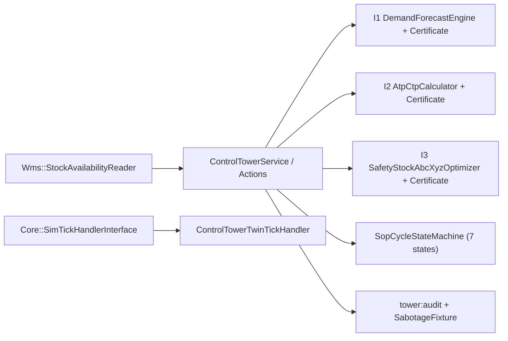

# Desain Teknis — Fase 53: Supply Chain Control Tower & S&OP

## 1. Ikhtisar Arsitektur

Modul `ControlTower` (`sct_`) menyediakan visibilitas rantai pasok multi-eselon, mesin peramalan permintaan deterministik, siklus kolaboratif S&OP, janji pesanan ATP/CTP berbasis kapasitas nyata, analisis dampak disrupsi, KPI eksekutif, serta What-If Digital Twin sandbox.

## 2. Skema Database Tambahan (`sct_*`)

Migrasi aditif baru `2026_11_13_000001_create_sct_sop_cycles_and_twin_scenarios_tables.php`:
1. `sct_sop_cycles`: siklus bulanan S&OP (`cycle_code`, `period`, `status`, `demand_plan_qty`, `supply_plan_qty`, `capacity_utilization_bps`, `gross_margin_est_idr`, `cash_impact_est_idr`, `scenario_type`, `signed_off_by_user_id` FK `users.id`, `signed_off_at`).
2. `sct_sop_events`: jejak transisi siklus S&OP (`sop_cycle_id` FK `sct_sop_cycles.id`, `from_status`, `to_status`, `actor_user_id` FK `users.id`, `notes`, `created_at`).
3. `sct_forecast_overrides`: riwayat override kolaboratif (`demand_forecast_id` FK `sct_demand_forecasts.id`, `previous_qty`, `new_qty`, `reason`, `overridden_by_user_id` FK `users.id`).
4. `sct_twin_scenarios`: skenario simulasi what-if (`scenario_code`, `name`, `shock_type`, `shock_magnitude_bps`, `duration_days`, `baseline_otif_bps`, `simulated_otif_bps`, `at_risk_orders_count`, `estimated_margin_delta_idr`, `status`, `created_by_user_id` FK `users.id`).

## 3. Algoritma Tersertifikasi (I1–I3)

- **I1 (`DemandForecastEngine`)**: Menghitung WMA, Exponential Smoothing (`alpha_bps`), Holt-Winters (`alpha_bps`, `beta_bps`, `gamma_bps`), dan Linear Regression dalam aritmetika integer (`intdiv` dengan pembulatan deterministik) serta metrik `mape_bps`, `mad_units`, `tracking_signal_bps`. Menghasilkan `ForecastAccuracyCertificate` yang dapat diverifikasi ulang oleh `ForecastAccuracyCertificateVerifier`.
- **I2 (`AtpCtpCalculator`)**: Mengevaluasi ATP kumulatif lintas bucket periode (`on_hand + scheduled_receipts - committed_orders`) dan memperluas ke CTP (kapasitas lini & ketersediaan bahan baku) bila ATP tidak mencukupi. Menghasilkan `OrderPromiseCertificate` yang menjamin `atp_allocated <= available_supply`.
- **I3 (`SafetyStockAbcXyzOptimizer`)**: Mengklasifikasikan SKU ke matriks 3x3 ABC/XYZ dan menghitung Dynamic Safety Stock (`z_factor_bps * sqrt_approx(...)`) sepenuhnya dalam integer. Menghasilkan `SafetyStockPolicyCertificate`.

## 4. State Machine S&OP 7-Status (`SopCycleStateMachine`)

Status valid: `draft`, `demand_review`, `supply_review`, `pre_sop_balancing`, `executive_signoff`, `published`, `archived`.
Transisi hanya diizinkan melalui peta transisi terdefinisi dan seluruhnya dicatat ke `sct_sop_events` dengan `actor_user_id` dan stempel waktu dari `ClockInterface`.

## 5. Rute HTTP, Policy & Perintah Artisan

- Policy: `ControlTowerOperationPolicy` (`viewAny`, `manageSop`, `overrideForecast`, `runTwin`).
- Rute baru di `modules/ControlTower/routes/web.php` (terdaftar di `tests/Architecture/route-roles.php`):
  - `GET /control-tower/sop` (`control_tower.sop.index`)
  - `POST /control-tower/sop` (`control_tower.sop.store`)
  - `POST /control-tower/sop/{cycle}/transition` (`control_tower.sop.transition`)
  - `GET /control-tower/forecasting` (`control_tower.forecasting.index`)
  - `POST /control-tower/forecasting/override` (`control_tower.forecasting.override`)
  - `GET /control-tower/twin` (`control_tower.twin.index`)
  - `POST /control-tower/twin/simulate` (`control_tower.twin.simulate`)
  - `GET /control-tower/kpi` (`control_tower.kpi.index`)
  - `GET /control-tower/export/echelon.csv` (`control_tower.export.echelon`)
- Commands: `tower:audit` (diperluas dengan verifikasi ATP/CTP, S&OP, & sabotage detection), `tower:sop-advance`, `tower:twin-simulate`, `tower:safety-stock-recalc`, `tower:kpi-snapshot`.

