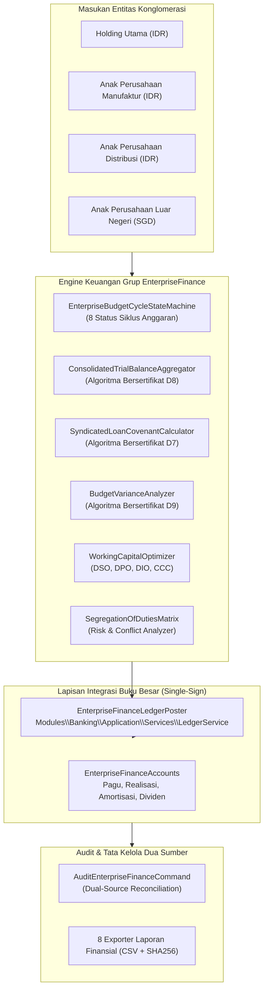
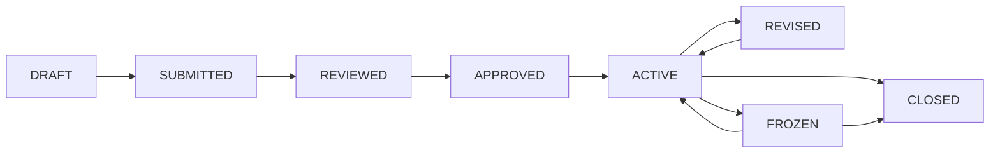

# Desain Arsitektur Fase 54: Keuangan Grup, Konsolidasi Multi-Entitas & Tata Kelola Korporat

**Modul**: `EnterpriseFinance` (`modules/EnterpriseFinance/`)  
**Prefiks Tabel**: `ef_`  
**Status Implementasi**: Perluasan W8-P5.3  
**Target Garis Mutu**: B1 $\ge 7.350$ baris, B3 $\ge 1.650$ baris, B2 0 pelanggaran ui:lint, Plafon Test $\le 5$ acceptance + 3 vektor.

---

## 1. Ikhtisar Arsitektur Modul EnterpriseFinance
Modul `EnterpriseFinance` berfungsi sebagai pusat orkestrasi permodalan, tata kelola anggaran (*budget guardrails*), pemantauan covenant fasilitas utang sindikasi, agregasi neraca saldo multi-entitas (*consolidated trial balance*), serta penegakan integritas kepatuhan regulasi di seluruh konglomerasi bisnis.

---

## 2. Cakupan 9 Sub-Item PROGRESS (54.1 s/d 54.9)
1. **54.1 Konsolidasi Trial Balance Multi-Entitas**:
   - Agregasi neraca saldo dari seluruh unit bisnis terdaftar.
   - Pengecekan keseimbangan debit-kredit teragregasi secara zero-sum ($\Sigma \text{Debit} - \Sigma \text{Kredit} = 0$).
   - Penyesuaian standar akuntansi IFRS/PSAK dan pelaporan kontribusi segmen bisnis.
2. **54.2 Guardrail Anggaran Departemen & Plafon Pengeluaran**:
   - Siklus anggaran multi-tahun dengan alokasi amplop anggaran (*envelope budgeting*).
   - Penegakan kendali ganda: *Hard-Stop* (menolak transaksi di luar pagu) dan *Soft-Stop* (peringatan toleransi varians).
   - Pelacakan saldo komitmen (*encumbrance*) sebelum realisasi kas aktual.
3. **54.3 Monitoring Covenant Utang Sindikasi & Rasio Keuangan**:
   - Pemantauan fasilitas pinjaman konsorsium bank dan emisi surat utang korporat.
   - Evaluasi otomatis kuartalan atas rasio: DSCR $\ge 1,25\times$, DER $\le 2,50\times$, ISCR $\ge 2,00\times$, dan Current Ratio $\ge 1,10\times$.
   - Sistem alarm dini pelanggaran covenant (*covenant breach warning engine*) dengan notifikasi audit trail.
4. **54.4 Treasury Korporat Grup & Liquidity Forecast**:
   - Proyeksi arus kas likuiditas konsolidasi 13-minggu berbasis rolling forecast.
   - Pemantauan saldo kas minimum operasional per entitas dan sweep surplus kas ke pooling holding.
5. **54.5 Manajemen Modal Kerja Grup (Working Capital Optimization)**:
   - Pelacakan empat metrik likuiditas operasional: Days Sales Outstanding (DSO), Days Payable Outstanding (DPO), Days Inventory Outstanding (DIO), dan Cash Conversion Cycle (CCC).
   - Strategi percepatan konversi kas dan alokasi modal kerja berbasis rating kesehatan anak perusahaan.
6. **54.6 Tata Kelola Konglomerasi & SoD Matrix**:
   - Matriks Segregation of Duties (SoD) multi-peran dengan kategorisasi risiko (CRITICAL, HIGH, MEDIUM).
   - Matriks Delegasi Wewenang (*Delegation of Authority / DoA*) berjenjang berdasarkan limit otorisasi belanja belanja modal (CAPEX) dan operasional (OPEX).
7. **54.7 Kepatuhan Regulasi & Reporting Deadlines**:
   - Jadwal terpadu kepatuhan pelaporan SPT Masa/Tahunan Pajak, laporan triwulanan OJK/IDX, pelaporan devisa Bank Indonesia, dan LKPM BKPM.
   - Perhitungan otomatis potensi denda dan bunga keterlambatan regulasi.
8. **54.8 Pelaporan Eksekutif C-Level & Board**:
   - Dashboard eksekutif berbasis Blade dengan widget ringkasan metrik kesehatan konglomerasi.
   - 8 Generator laporan CSV ber-checksum integritas SHA-256 di `modules/EnterpriseFinance/Application/Reports/`.
9. **54.9 Audit Terpadu Dua Sumber (Dual-Source Audit)**:
   - Rekonsiliasi independen antara tabel internal modul `ef_` dan mutasi transaksi di `bank_ledger_transactions`.

---

## 3. Desain State Machine: `EnterpriseBudgetCycleStateMachine`
Siklus anggaran konglomerasi dikelola secara ketat melalui 8 status siklik:
- `DRAFT`: Perumusan rancangan anggaran awal oleh kepala departemen.
- `SUBMITTED`: Pengajuan formal rancangan anggaran ke Komite Anggaran Grup.
- `REVIEWED`: Penelaahan kelayakan teknis dan justifikasi rasional oleh tim perencana korporat.
- `APPROVED`: Persetujuan resmi Direksi dan Dewan Komisaris (kunci pagu anggaran).
- `ACTIVE`: Anggaran aktif beroperasi untuk reservasi encumbrance dan realisasi belanja.
- `REVISED`: Penyesuaian pagu anggaran tengah tahun (*mid-year budget reallocation*).
- `FROZEN`: Pembekuan sementara hak belanja saat defisit kas atau audit mendadak.
- `CLOSED`: Penutupan buku anggaran di akhir tahun fiskal (sisa pagu dihanguskan).

---

## 4. Tiga Algoritma Bersertifikat
- **D7: SyndicatedLoanCovenantCalculator**:
  - Mengkalkulasi 4 rasio covenant utang menggunakan pembagian rasional bilangan bulat dalam satuan basis points / permille ($1.000\text{ permille} = 100\%$).
  - Menghasilkan `SyndicatedLoanCovenantCertificate` dengan hash SHA-256 payload deterministik.
- **D8: ConsolidatedTrialBalanceAggregator**:
  - Mengagregasikan saldo debit dan kredit dari seluruh akun multi-entitas, memvalidasi integritas penjumlahan tanpa selisih sen ($\Delta = 0$).
  - Menghasilkan `ConsolidatedTrialBalanceCertificate` dengan signature SHA-256.
- **D9: BudgetVarianceAnalyzer**:
  - Menghitung deviasi anggaran aktual terhadap alokasi, membedakan varians *favorable* dan *unfavorable*, serta menetapkan ambang eskalasi deviasi $> 10\%$.
  - Menghasilkan `BudgetVarianceCertificate` dengan signature SHA-256.

---

## 5. Tata Kelola Ledger Buku Besar Single-Sign
Setiap aktivitas finansial yang mengubah komitmen atau hak kepemilikan dana memicu pemostingan jurnal single-sign balance:
- Realisasi Belanja CAPEX/OPEX: Debit `ef:department_expense:IDR` (-), Kredit `ef:capex_clearing:IDR` (+). Netto = 0.
- Distribusi Dividen Subholding: Debit `ef:holding_dividend_receivable:IDR` (-), Kredit `ef:holding_dividend_income:IDR` (+). Netto = 0.
- Penarikan Fasilitas Sindikasi: Debit `ef:syndicated_loan_cash:IDR` (-), Kredit `ef:syndicated_loan_principal_liability:IDR` (+). Netto = 0.
- Pembayaran Bunga Sindikasi: Debit `ef:syndicated_interest_expense:IDR` (-), Kredit `ef:syndicated_interest_payable:IDR` (+). Netto = 0.
