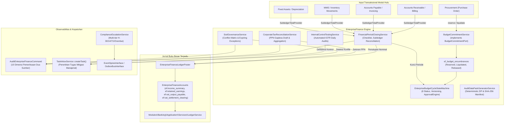
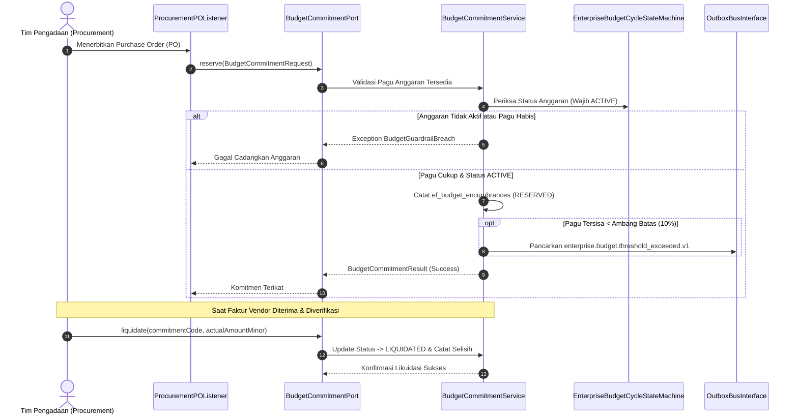
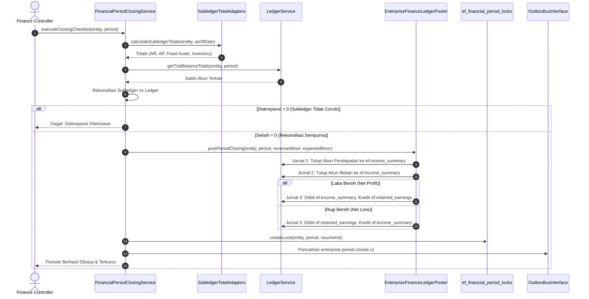

# Desain Teknis Arsitektur Fase 54 (Kelengkapan Tata Kelola Finansial Grup & Tutup Buku)

**Modul**: `EnterpriseFinance` (`modules/EnterpriseFinance/`)  
**Prefiks Tabel**: `ef_`  
**Paket Rilis**: W8-P5-b.1  
**Target Logika B1**: $\ge 6.000$ baris (Target: $6.300+$ baris)  
**Target Dokumentasi B3**: $\ge 1.200$ baris  
**Kepatuhan UI**: 0 pelanggaran `php artisan ui:lint`  

---

## 1. Arsitektur Komponen & Aliran Data

Modul `EnterpriseFinance` memegang peranan krusial sebagai orkestrator integritas tata kelola keuangan multi-entitas konglomerasi. Desain kelengkapan ini menghubungkan alur penganggaran operasional hingga penutupan siklus fiskal dan pembentukan bukti audit.



---

## 2. Diagram Interaksi & Alur Sequence D2

### A. Alur Siklus Komitmen Anggaran Pengadaan (Budget Encumbrance Lifecycle)
Diagram urutan interaksi reservasi pagu pengadaan barang, verifikasi threshold, hingga likuidasi saat penerbitan faktur:



### B. Alur Checklist Tutup Buku & Penutupan Akun Nominal Periode Fiskal
Diagram urutan eksekusi checklist tutup buku bulanan, rekonsiliasi total subledger terhadap buku besar, penutupan akun pendapatan dan beban ke ikhtisar laba rugi, pemindahan saldo bersih ke laba ditahan, serta penguncian periode permanen:



---

## 3. Detail Spesifikasi Komponen Logika Bisnis

### A. Kontrak `BudgetCommitmentPort`
Kontrak layanan yang disediakan oleh `EnterpriseFinance` untuk dipanggil oleh modul transaksional seperti Procurement:
```php
namespace Modules\EnterpriseFinance\Contracts;

use Modules\EnterpriseFinance\Domain\DTOs\BudgetCommitmentRequest;
use Modules\EnterpriseFinance\Domain\DTOs\BudgetCommitmentResult;

interface BudgetCommitmentPort
{
    /**
     * Mencadangkan pagu anggaran untuk komitmen baru (PO/Kontrak).
     */
    public function reserve(BudgetCommitmentRequest $request): BudgetCommitmentResult;

    /**
     * Melikuidasi komitmen yang telah terealisasi ke faktur/beban aktual.
     */
    public function liquidate(string $commitmentCode, int $actualAmountMinor): BudgetCommitmentResult;

    /**
     * Melepaskan komitmen terbuka yang dibatalkan atau tidak terpakai.
     */
    public function release(string $commitmentCode, string $reason): BudgetCommitmentResult;
}
```

### B. Kontrak `ComplianceDeadlineSource`
Kontrak penyedia daftar kewajiban kepatuhan hukum dan regulasi lintas modul:
```php
namespace Modules\EnterpriseFinance\Contracts;

interface ComplianceDeadlineSource
{
    /**
     * Nama sumber penyedia kewajiban kepatuhan.
     */
    public function getSourceName(): string;

    /**
     * Mengambil seluruh tenggat waktu aktif pada atau sebelum tanggal rujukan.
     *
     * @return list<array{
     *     code: string,
     *     title: string,
     *     category: string,
     *     due_date: string,
     *     responsible_role: string,
     *     entity_code: string,
     *     penalty_estimate_minor: int
     * }>
     */
    public function getDeadlines(string $asOfDate): array;
}
```

### C. Implementasi `EnterpriseBudgetCycleStateMachine` (8 Status)
Siklus status formal:
1. `DRAFT`: Inisiasi struktur hierarki mata anggaran (Directorate $\to$ Cost Center $\to$ Account). Guard: $\Sigma \text{Anak} \le \text{Induk}$.
2. `SUBMITTED`: Pengajuan anggaran untuk evaluasi. Guard: Struktur hierarki lengkap tanpa celah alokasi.
3. `REVIEWED`: Penelaahan awal oleh Tim Perencana Anggaran. Guard: Catatan review lengkap.
4. `APPROVED`: Persetujuan resmi melalui otorisasi *Four-Eyes Principle* (Maker $\neq$ Checker via `ApprovalEngine`).
5. `ACTIVE`: Pagu anggaran efektif berlaku. Guard: Tanggal saat ini berada dalam rentang tahun fiskal.
6. `FROZEN`: Pembekuan sementara akibat penguncian periode tutup buku. Guard: Transaksi komitmen baru ditolak.
7. `REVISED`: Revisi resmi disetujui. Guard: Anggaran versi lama ditandai final `REVISED`, dan entri anggaran versi baru diterbitkan dengan status `APPROVED $\to$ ACTIVE`.
8. `CLOSED`: Penutupan buku akhir tahun. Guard: Seluruh komitmen terbuka telah dilikuidasi atau dilepas.

---

## 4. Rincian Command Terjadwal & Integrasi

1. `enterprise:budget-sync`:
   - Frekuensi: Tiap jam.
   - Fungsi: Membandingkan total komitmen tercatat di `ef_budget_encumbrances` dengan Purchase Order berstatus disetujui di modul Procurement. Mendeteksi komitmen gantung (*dangling reservations*).
2. `enterprise:close-checklist {period} {--entity=}`:
   - Frekuensi: Akhir bulan fiskal.
   - Fungsi: Memvalidasi 4 prasyarat penutupan buku (Zero Subledger Discrepancy, Complete Asset Depreciation, Zero Unapproved Journal, All Bank Accounts Reconciled).
3. `enterprise:compliance-escalate`:
   - Frekuensi: Harian (pukul 07.00 WIB).
   - Fungsi: Memindai seluruh `ComplianceDeadlineSource` dan memicu eskalasi berjenjang (H-30, H-14, H-7, H-1, dan Overdue) ke bus notifikasi.
4. `enterprise:control-tests`:
   - Frekuensi: Harian (pukul 01.00 WIB).
   - Fungsi: Menjalankan uji kontrol otomatis RCM (Four-Eyes, 3-Way Match, Weighing Tolerances, Margin Floor), mencatat hasil uji ke `ef_control_test_runs`, dan menerbitkan tugas `CoreTask` saat terdeteksi anomali.
5. `enterprise:data-pack {period} {--entity=}`:
   - Frekuensi: Sesuai permintaan audit KAP.
   - Fungsi: Membangun arsip ZIP deterministik berstruktur standar berisi Buku Besar, Neraca Saldo, Mutasi Kas Bank Terverifikasi, Daftar Aset Tetap, Ringkasan Pajak, dan manifest integritas `manifest.sha256`.
6. `enterprise:sod-scan`:
   - Frekuensi: Harian.
   - Fungsi: Menilai pemetaan user-role terhadap 12 aturan konflik SoD korporat, menerbitkan event `enterprise.sod.violation_detected.v1` bila terdeteksi pelanggaran tanpa dispensasi aktif.
7. `enterprise:tax-recon {period} {--entity=}`:
   - Frekuensi: Bulanan.
   - Fungsi: Merekonsiliasi PPN Keluaran vs PPN Masukan, menghasilkan nomor seri faktur gapless simulasi, mengompilasi bukti potong PPh 21/23/4(2)/22, dan menghasilkan draf SPT Masa.
8. `enterprise:audit`:
   - Frekuensi: Harian & pasca perubahan.
   - Fungsi: Audit komprehensif dua sumber 10 dimensi untuk memverifikasi konsistensi data modul terhadap basis data buku besar dan fakta eksternal.
