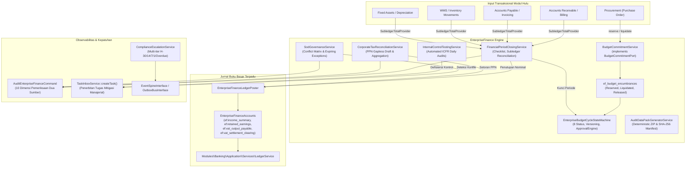
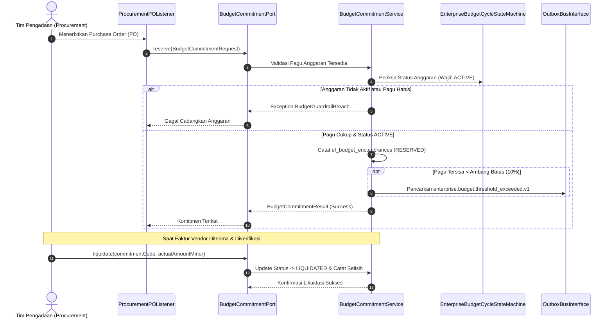
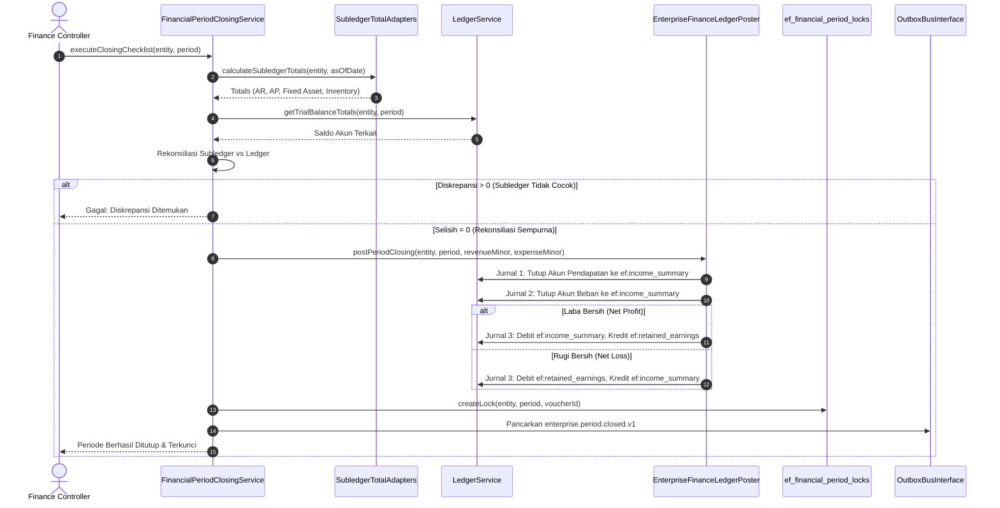

# Desain Teknis Arsitektur Fase 54 (Kelengkapan Tata Kelola Finansial Grup & Tutup Buku)

**Modul**: `EnterpriseFinance` (`modules/EnterpriseFinance/`)  
**Prefiks Tabel**: `ef_`  
**Paket Rilis**: W8-P5-b.1  
**Target Logika B1**: $\ge 6.000$ baris (Target: $6.300+$ baris)  
**Target Dokumentasi B3**: $\ge 1.200$ baris  
**Kepatuhan UI**: 0 pelanggaran `php artisan ui:lint`  

---

## 1. Arsitektur Komponen & Aliran Data

Modul `EnterpriseFinance` memegang peranan krusial sebagai orkestrator integritas tata kelola keuangan multi-entitas konglomerasi. Desain kelengkapan ini menghubungkan alur penganggaran operasional hingga penutupan siklus fiskal dan pembentukan bukti audit.



---

## 2. Diagram Interaksi & Alur Sequence D2

### A. Alur Siklus Komitmen Anggaran Pengadaan (Budget Encumbrance Lifecycle)
Diagram urutan interaksi reservasi pagu pengadaan barang, verifikasi threshold, hingga likuidasi saat penerbitan faktur:



### B. Alur Checklist Tutup Buku & Penutupan Akun Nominal Periode Fiskal
Diagram urutan eksekusi checklist tutup buku bulanan, rekonsiliasi total subledger terhadap buku besar, penutupan akun pendapatan dan beban ke ikhtisar laba rugi, pemindahan saldo bersih ke laba ditahan, serta penguncian periode permanen:



---

## 3. Detail Spesifikasi Komponen Logika Bisnis

### A. Kontrak `BudgetCommitmentPort`
Kontrak layanan yang disediakan oleh `EnterpriseFinance` untuk dipanggil oleh modul transaksional seperti Procurement:
```php
namespace Modules\EnterpriseFinance\Contracts;

use Modules\EnterpriseFinance\Domain\DTOs\BudgetCommitmentRequest;
use Modules\EnterpriseFinance\Domain\DTOs\BudgetCommitmentResult;

interface BudgetCommitmentPort
{
    /**
     * Mencadangkan pagu anggaran untuk komitmen baru (PO/Kontrak).
     */
    public function reserve(BudgetCommitmentRequest $request): BudgetCommitmentResult;

    /**
     * Melikuidasi komitmen yang telah terealisasi ke faktur/beban aktual.
     */
    public function liquidate(string $commitmentCode, int $actualAmountMinor): BudgetCommitmentResult;

    /**
     * Melepaskan komitmen terbuka yang dibatalkan atau tidak terpakai.
     */
    public function release(string $commitmentCode, string $reason): BudgetCommitmentResult;
}
```

### B. Kontrak `ComplianceDeadlineSource`
Kontrak penyedia daftar kewajiban kepatuhan hukum dan regulasi lintas modul:
```php
namespace Modules\EnterpriseFinance\Contracts;

interface ComplianceDeadlineSource
{
    /**
     * Nama sumber penyedia kewajiban kepatuhan.
     */
    public function getSourceName(): string;

    /**
     * Mengambil seluruh tenggat waktu aktif pada atau sebelum tanggal rujukan.
     *
     * @return list<array{
     *     code: string,
     *     title: string,
     *     category: string,
     *     due_date: string,
     *     responsible_role: string,
     *     entity_code: string,
     *     penalty_estimate_minor: int
     * }>
     */
    public function getDeadlines(string $asOfDate): array;
}
```

### C. Implementasi `EnterpriseBudgetCycleStateMachine` (8 Status)
Siklus status formal:
1. `DRAFT`: Inisiasi struktur hierarki mata anggaran (Directorate $\to$ Cost Center $\to$ Account). Guard: $\Sigma \text{Anak} \le \text{Induk}$.
2. `SUBMITTED`: Pengajuan anggaran untuk evaluasi. Guard: Struktur hierarki lengkap tanpa celah alokasi.
3. `REVIEWED`: Penelaahan awal oleh Tim Perencana Anggaran. Guard: Catatan review lengkap.
4. `APPROVED`: Persetujuan resmi melalui otorisasi *Four-Eyes Principle* (Maker $\neq$ Checker via `ApprovalEngine`).
5. `ACTIVE`: Pagu anggaran efektif berlaku. Guard: Tanggal saat ini berada dalam rentang tahun fiskal.
6. `FROZEN`: Pembekuan sementara akibat penguncian periode tutup buku. Guard: Transaksi komitmen baru ditolak.
7. `REVISED`: Revisi resmi disetujui. Guard: Anggaran versi lama ditandai final `REVISED`, dan entri anggaran versi baru diterbitkan dengan status `APPROVED $\to$ ACTIVE`.
8. `CLOSED`: Penutupan buku akhir tahun. Guard: Seluruh komitmen terbuka telah dilikuidasi atau dilepas.

---

## 4. Rincian Command Terjadwal & Integrasi

1. `enterprise:budget-sync`:
   - Frekuensi: Tiap jam.
   - Fungsi: Membandingkan total komitmen tercatat di `ef_budget_encumbrances` dengan Purchase Order berstatus disetujui di modul Procurement. Mendeteksi komitmen gantung (*dangling reservations*).
2. `enterprise:close-checklist {period} {--entity=}`:
   - Frekuensi: Akhir bulan fiskal.
   - Fungsi: Memvalidasi 4 prasyarat penutupan buku (Zero Subledger Discrepancy, Complete Asset Depreciation, Zero Unapproved Journal, All Bank Accounts Reconciled).
3. `enterprise:compliance-escalate`:
   - Frekuensi: Harian (pukul 07.00 WIB).
   - Fungsi: Memindai seluruh `ComplianceDeadlineSource` dan memicu eskalasi berjenjang (H-30, H-14, H-7, H-1, dan Overdue) ke bus notifikasi.
4. `enterprise:control-tests`:
   - Frekuensi: Harian (pukul 01.00 WIB).
   - Fungsi: Menjalankan uji kontrol otomatis RCM (Four-Eyes, 3-Way Match, Weighing Tolerances, Margin Floor), mencatat hasil uji ke `ef_control_test_runs`, dan menerbitkan tugas `CoreTask` saat terdeteksi anomali.
5. `enterprise:data-pack {period} {--entity=}`:
   - Frekuensi: Sesuai permintaan audit KAP.
   - Fungsi: Membangun arsip ZIP deterministik berstruktur standar berisi Buku Besar, Neraca Saldo, Mutasi Kas Bank Terverifikasi, Daftar Aset Tetap, Ringkasan Pajak, dan manifest integritas `manifest.sha256`.
6. `enterprise:sod-scan`:
   - Frekuensi: Harian.
   - Fungsi: Menilai pemetaan user-role terhadap 12 aturan konflik SoD korporat, menerbitkan event `enterprise.sod.violation_detected.v1` bila terdeteksi pelanggaran tanpa dispensasi aktif.
7. `enterprise:tax-recon {period} {--entity=}`:
   - Frekuensi: Bulanan.
   - Fungsi: Merekonsiliasi PPN Keluaran vs PPN Masukan, menghasilkan nomor seri faktur gapless simulasi, mengompilasi bukti potong PPh 21/23/4(2)/22, dan menghasilkan draf SPT Masa.
8. `enterprise:audit`:
   - Frekuensi: Harian & pasca perubahan.
   - Fungsi: Audit komprehensif dua sumber 10 dimensi untuk memverifikasi konsistensi data modul terhadap basis data buku besar dan fakta eksternal.


---

## 5. Kamus Data Lengkap Tabel Ekstensi Fase 54

### 5.1 Tabel `ef_budget_encumbrances` (Komitmen Pagu Anggaran)
Tabel ini mencatat seluruh komitmen pencadangan dana anggaran sebelum terjadinya pengeluaran kas riil:

| Nama Kolom | Tipe Data | Nullable | Nilai Baku | Keterangan & Aturan Bisnis |
| :--- | :--- | :--- | :--- | :--- |
| `id` | `uuid` | Tidak | Generated | Kunci utama UUID v4. |
| `budget_id` | `unsignedBigInteger` | Tidak | - | Relasi ke `ef_budgets(id)` cascade on delete. |
| `commitment_code` | `string(64)` | Tidak | - | Nomor unik komitmen transaksi (misal: `PO-2026-0001`), indeks unik. |
| `source_module` | `string(32)` | Tidak | - | Nama modul pemohon (misal: `Procurement`, `Logistics`, `Capex`). |
| `reference_number` | `string(64)` | Tidak | - | Nomor dokumen referensi pada modul asal. |
| `amount_minor` | `unsignedBigInteger` | Tidak | - | Nilai komitmen dicadangkan dalam minor IDR satuan terkecil (sen). |
| `liquidated_amount_minor` | `unsignedBigInteger` | Tidak | `0` | Akumulasi nilai komitmen yang telah direalisasikan menjadi tagihan. |
| `status` | `string(24)` | Tidak | `'RESERVED'` | Status komitmen: `RESERVED`, `LIQUIDATED`, `RELEASED`, `EXPIRED`. |
| `reserved_at` | `timestamp` | Tidak | - | Waktu awal permohonan reservasi disetujui. |
| `liquidated_at` | `timestamp` | Ya | `null` | Waktu saat faktur vendor diterima dan dicatat sebagai beban. |
| `released_at` | `timestamp` | Ya | `null` | Waktu pelepasan komitmen akibat pembatalan atau kelebihan reservasi. |
| `reason` | `text` | Ya | `null` | Alasan atau deskripsi operasional pengadaan. |
| `payload` | `json` | Ya | `null` | Metadata tambahan berformat JSON (item rincian, tax code, unit kerja). |
| `created_at` / `updated_at` | `timestamps` | Tidak | - | Jejak audit waktu pembuatan dan perubahan data. |

### 5.2 Tabel `ef_financial_period_locks` (Penguncian Periode Fiskal)
Tabel ini bertindak sebagai gerbang integritas absolut yang melarang perubahan akuntansi susulan:

| Nama Kolom | Tipe Data | Nullable | Nilai Baku | Keterangan & Aturan Bisnis |
| :--- | :--- | :--- | :--- | :--- |
| `id` | `uuid` | Tidak | Generated | Kunci utama UUID v4. |
| `entity_code` | `string(32)` | Tidak | - | Kode entitas pelapor (misal: `CORP-HOLDING`). |
| `period` | `string(7)` | Tidak | - | Periode akuntansi berformat `YYYY-MM`. Indeks unik gabungan `(entity_code, period)`. |
| `is_locked` | `boolean` | Tidak | `false` | Status penguncian periode fiskal: `true` melarang posting jurnal baru. |
| `locked_at` | `timestamp` | Ya | `null` | Waktu resmi penguncian buku dilaksanakan. |
| `locked_by` | `unsignedBigInteger` | Ya | `null` | Relasi ke `users(id)` pengguna bertindak sebagai Finance Controller. |
| `closing_voucher_id` | `string(64)` | Ya | `null` | Nomor bukti jurnal penutup (*closing voucher*) di buku besar. |
| `subledger_recon_summary` | `json` | Ya | `null` | Snapshot hasil verifikasi rekonsiliasi AR, AP, Aset, Persediaan. |
| `net_income_loss_minor` | `bigInteger` | Tidak | `0` | Saldo laba/rugi bersih periode yang dipindahkan ke Laba Ditahan. |
| `created_at` / `updated_at` | `timestamps` | Tidak | - | Jejak waktu audit sistem. |

### 5.3 Tabel `ef_sod_exceptions` (Dispensasi Otorisasi Pemisahan Tugas)
Tabel ini mendokumentasikan setiap pengecualian yang diberikan atas matriks konflik tugas:

| Nama Kolom | Tipe Data | Nullable | Nilai Baku | Keterangan & Aturan Bisnis |
| :--- | :--- | :--- | :--- | :--- |
| `id` | `uuid` | Tidak | Generated | Kunci utama UUID v4. |
| `sod_rule_id` | `string(32)` | Tidak | - | Kode aturan konflik SoD (misal: `SOD-01`, `SOD-02`). |
| `user_id` | `unsignedBigInteger` | Tidak | - | Relasi ke `users(id)` pengguna penerima dispensasi. |
| `granted_by` | `unsignedBigInteger` | Tidak | - | Relasi ke `users(id)` pejabat berwenang pemberi dispensasi. |
| `justification` | `text` | Tidak | - | Alasan bisnis mendalam pemberian dispensasi wewenang. |
| `status` | `string(24)` | Tidak | `'ACTIVE'` | Status dispensasi: `ACTIVE`, `EXPIRED`, `REVOKED`. |
| `granted_at` | `timestamp` | Tidak | - | Waktu otorisasi dispensasi disahkan. |
| `expires_at` | `timestamp` | Tidak | - | Batas waktu kedaluwarsa dispensasi (maksimal 30 hari). |
| `revoked_at` | `timestamp` | Ya | `null` | Waktu pencabutan dispensasi secara prematur jika penugasan berakhir. |

### 5.4 Tabel `ef_control_points` & `ef_control_test_runs` (Katalog & Hasil Uji Kendali Internal RCM)
Katalog kendali internal mendefinisikan titik uji operasional dan ambang batas deviasi yang diperbolehkan:

| Nama Kolom | Tipe Data | Nullable | Nilai Baku | Keterangan & Aturan Bisnis |
| :--- | :--- | :--- | :--- | :--- |
| `id` | `string(32)` | Tidak | - | Kunci utama kode titik kendali (misal: `CP-01-FOUR-EYES`). |
| `title` | `string(128)` | Tidak | - | Nama judul kendali internal. |
| `domain` | `string(32)` | Tidak | - | Domain operasional: `Procurement`, `Finance`, `Logistics`, `Sales`. |
| `control_type` | `string(24)` | Tidak | - | Tipe kendali: `PREVENTIVE`, `DETECTIVE`, `CORRECTIVE`. |
| `frequency` | `string(24)` | Tidak | - | Frekuensi pengujian otomatis: `DAILY`, `WEEKLY`, `MONTHLY`. |
| `tolerance_deviation` | `unsignedInteger`| Tidak| `0` | Batas toleransi deviasi yang diizinkan sebelum memicu status gagal. |

Riwayat pengujian otomatis pada `ef_control_test_runs`:
- `id`: UUID kunci utama pengujian.
- `control_id`: Referensi kunci asing ke `ef_control_points(id)`.
- `tested_at`: Stempel waktu pelaksanaan pengujian.
- `status`: Hasil evaluasi (`EFFECTIVE`, `DEFICIENT`, `FAILED`).
- `sample_count`: Ukuran populasi data transaksi yang diuji.
- `deviation_count`: Jumlah anomali yang ditemukan dalam sampel.
- `details`: Ringkasan temuan anomali dalam format JSON.
- `task_id`: Referensi tiket penugasan korektif (`CoreTask`) yang dibuat saat defisiensi.

---

## 6. Algoritma Perhitungan Perpajakan Nasional (Tax Engine)

### 6.1 Formula Pemotongan Pajak Penghasilan (Withholding Tax PPh)

1. **PPh Pasal 21 Karyawan & Tenaga Ahli (Tarif Efektif Rata-Rata / TER)**:
   Perhitungan berbasis kategori PTKP (Penghasilan Tidak Kena Pajak):
   - Kategori A: TK/0, TK/1, K/0
   - Kategori B: TK/2, TK/3, K/1, K/2
   - Kategori C: K/3
   Beban pajak bulanan dihitung dengan mengalikan penghasilan bruto sebulan dengan persentase TER tabel PP 58/2023. Pada bulan Desember, dilakukan penyesuaian perhitungan tahunan menggunakan tarif progresif Pasal 17 ayat (1) huruf a UU HPP:
   $$\text{Tarif Layer 1 (s.d. 60 Juta)} = 5\%$$
   $$\text{Tarif Layer 2 (> 60 Juta s.d. 250 Juta)} = 15\%$$
   $$\text{Tarif Layer 3 (> 250 Juta s.d. 500 Juta)} = 25\%$$
   $$\text{Tarif Layer 4 (> 500 Juta s.d. 5 Miliar)} = 30\%$$
   $$\text{Tarif Layer 5 (> 5 Miliar)} = 35\%$$

2. **PPh Pasal 22 (Pengadaan & Pembelian Barang oleh Instansi / Industri)**:
   - Pembelian barang umum dari rekanan pemerintah: $1.5\% \times \text{DPP}$
   - Pembelian bahan baku komoditas mineral/tambang dari pemasok: $1.5\% \times \text{DPP}$

3. **PPh Pasal 23 (Jasa Manajemen, Teknik, Konsultan, dan Sewa Harta Bergerak)**:
   - Jasa teknik, manajemen, dan konsultan berizin: $2.0\% \times \text{DPP}$
   - Sewa dan penghasilan lain sehubungan penggunaan harta selain tanah/bangunan: $2.0\% \times \text{DPP}$
   - Wajib Pajak tanpa NPWP dikenakan tarif $100\%$ lebih tinggi ($4.0\%$).

4. **PPh Pasal 4 ayat (2) Final (Sewa Tanah / Bangunan & Jasa Konstruksi)**:
   - Sewa unit usaha di Mall, gudang logistik, atau tanah bengkel: $10.0\% \times \text{DPP}$
   - Pelaksanaan pekerjaan konstruksi berkualifikasi usaha kecil: $1.75\% \times \text{DPP}$

---

## 7. Protokol Integritas Kriptografis Bukti Audit KAP (SHA-256)

Untuk mencegah pemalsuan berkas audit (*evidence tampering*), berkas `manifest.json` dibentuk menggunakan algoritma hashing deterministik:
```json
{
  "entity": "CORP-HOLDING",
  "period": "2026-10",
  "generated_at": "2026-11-12T05:00:00Z",
  "generator_version": "v8.54.1",
  "closing_voucher_id": "VOUCH-CLOSE-202610-001",
  "files": [
    {
      "name": "general_ledger_entries.csv",
      "rows": 15420,
      "sha256": "7db37236d4e28d8987df3a782ca231c84aa6b2a062829bfda491683b44e26d5b"
    },
    {
      "name": "trial_balance_summary.csv",
      "rows": 248,
      "sha256": "b7c994aef7c4320b0318d550ef0e1f7f064850ab4e6542f32ce2767b7710d497"
    }
  ]
}
```
Setiap berkas CSV diurutkan berdasarkan `transaction_id ASC, entry_id ASC` sebelum hashing dilakukan untuk menjamin sifat reproduksibilitas byte-by-byte (bit-exact reproducibility).
