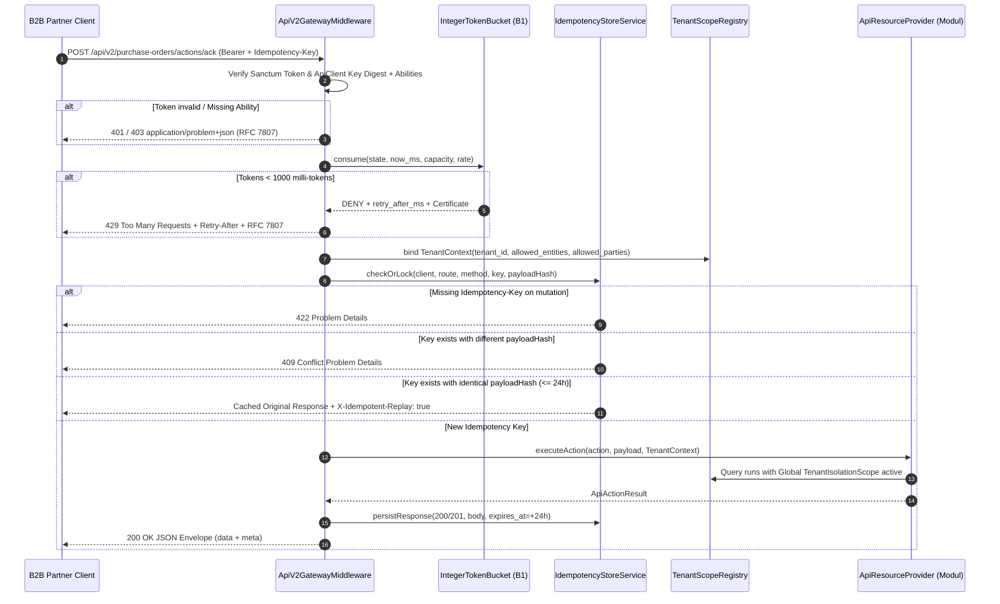
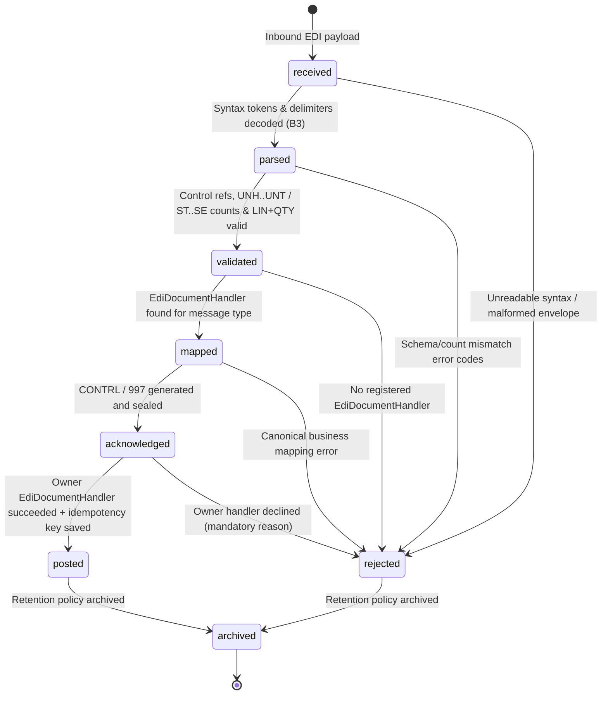

# Dokumen Desain Teknis — Fase 55: API v2, EDI, Webhook & Multi-Tenancy

**ID Fase:** Fase 55 (W8-P4.2)  
**Modul Pemilik Inti:** `Core` (`core_`)  
**Tautan DoR:** [`docs/dor/fase-55.md`](../dor/fase-55.md)  
**Tautan Konsep:** [`docs/konsep/batas-api-tenancy.md`](../konsep/batas-api-tenancy.md)

---

## 1. Tujuan & Batas Lingkup Arsitektur

Fase 55 menggantikan kerangka `IntegrationService` lama (yang dibiarkan terbengkalai tanpa `@deprecated` dan tidak dipakai di rute v2 nyata) dengan subsistem produksi penuh di `Modules\Core\Application\Api` dan `Modules\Core\Application\Tenancy`, sembari mempertahankan pemisahan batas modul ketat hasil Fase R4:
- **Core adalah Gateway & Kernel Kontrak:** Core tidak mengimpor `Modules\{Bisnis}\Domain\*`. Seluruh akses ke resource API v2, penerima dokumen EDI, target impor massal, daftar model ber-scope tenant, dan arsip retensi berjalan eksklusif lewat interface di `Modules\Core\Contracts\`.
- **Nol Duplikasi Mesin Antrean Webhook:** Pengiriman webhook memakai `OutboxBusInterface`, `CoreEventDelivery`, `EventDeliveryStateMachine`, `DeterministicBackoff` (A5), serta `DeadLetterQueueService` milik W8-P3 — bukan daemon retry terpisah.
- **Zero Ledger Posting (`U-3`):** Mesin EDI hanya mengurai dokumen (`EDIFACT` & `X12`), memvalidasi integritas sintaks (`B3`), menerbitkan pengakuan `CONTRL`/`997`, dan mendelegasikan dokumen kanonik ke `EdiDocumentHandler` modul pemilik (`Distribution`, `Procurement` draft AP invoice, `Wms` inbound dock ASN).

---

## 2. Diagram Alur Utama (D2 — Sequence Diagram API v2, Idempotency & Token Bucket)

---

## 3. State Machine EdiInterchange (8 Status — `W8-D49` & `D55-1`)

Siklus hidup dokumen EDI pada `CoreEdiInterchange` dan riwayat fakta append-only `CoreEdiTransition` diatur oleh `Modules\Core\Domain\StateMachines\EdiInterchangeStateMachine`:

Aturan pengaman mutlak State Machine:
1. **CONTRL / 997 selalu terbit:** Baik pada jalur `mapped -> acknowledged` (kode aksi `7` / `AK5*A`) maupun setiap penolakan `received|parsed|validated|mapped|acknowledged -> rejected` (kode aksi `4` / `AK5*R` dengan kode galat terurut), payload pengakuan disimpan permanen pada `core_edi_interchanges.contrl_payload`.
2. **Transisi `acknowledged -> posted` terproteksi guard:** Dilarang memindahkan ke `posted` tanpa bukti eksekusi nyata `EdiDocumentHandler::handle()` (`handler_idempotency_key` non-kosong dan `target_reference` terisi).
3. **Append-only History:** Model `CoreEdiTransition` menolak `updating` dan `deleting` pada level ORM (`DomainException`), serta mencatat pelaku, waktu dari `ClockInterface`, status asal, status tujuan, kode galat, dan ringkasan alasan.

---

## 4. Tiga Algoritma Inti Bersertifikat (B1, B2, B3)

1. **`IntegerTokenBucket` (B1 — `Modules\Core\Domain\Algorithms\Api`)**:
   Aritmetika murni bilangan bulat milli-token ($1 \text{ request} = 1.000 \text{ milli-token}$). Refill deterministik $\min(\text{capacity} \times 1.000,\ \text{tokens} + (t_{\text{ms}} - t_{\text{last}}) \times \text{rate\_per\_sec})$, deteksi kemunduran waktu `CLOCK_REGRESSION`, dan perhitungan tunggu bulat $\text{retry\_after\_ms} = \lceil (1.000 - \text{tokens}) / \text{rate} \rceil$ menggunakan pembagian integer `(1000 - tokens + rate - 1) / rate`. Diverifikasi oleh `TokenBucketCertificateVerifier`.
2. **`WebhookSignatureVerifier` (B2 — `Modules\Core\Domain\Algorithms\Api`)**:
   Pembuatan dan verifikasi header `X-Signature: t=<unix>,v1=<hex>[,v1=<hex>]` memakai HMAC-SHA256 (`RFC 2104`) atas `"<t>.<raw_payload>"`. Mendukung jendela replay $\le 300\text{ s}$, perbandingan konstan waktu `hash_equals()`, serta multi-v1/multi-secret untuk rotasi 7 hari tanpa downtime. Menghasilkan status diskret `OK`, `EXPIRED`, `MISMATCH`, atau `MALFORMED` dengan sertifikat SHA-256 terverifikasi `WebhookSignatureCertificateVerifier`.
3. **`EdiInterchangeCodec` (B3 — `Modules\Core\Domain\Algorithms\Edi`)**:
   Parser dan generator kanonik $\mathcal{O}(n)$ untuk subset `EDIFACT` (`ORDERS`, `INVOIC`, `DESADV`, pemisah default `' + : ?` beserta escape/unescape karakter pelepas `?+`, `?:`, `?'`, `??`) dan `X12` (`850` & `997`, pemisah `~` dan `*`). Memvalidasi referensi `UNH↔UNT`, `UNB↔UNZ`, hitungan segmen inklusif, wajib adanya `BGM` + minimal 1 `LIN` beserta `QTY` pendampingnya, menjamin generasi ulang **byte-identik** atas pesan valid, serta membangkitkan segmen aknowledgment `CONTRL` dan `997`. Diverifikasi oleh `EdiInterchangeCertificateVerifier`.

---

## 5. Multi-Tenancy, Bulk Pipeline, Retensi & Audit Dua Sumber

### 5.1 Isolasi Baris Multi-Tenant (`TenantContext` & `TenantScopeRegistry`)
- `TenantContext` menyimpan `tenantId`, daftar `allowedTenantIds`, `allowedNumericTenantIds`, `allowedEntityIds`, dan `allowedPartyIds` yang diturunkan dari pengguna terautentikasi atau konteks eksplisit pada job/command.
- `TenantScopeRegistry` memasang global scope `TenantIsolationScope` secara dinamis ke kelas model eksternal pada saat `CoreServiceProvider::booted()` — **tanpa mengedit satu pun kelas model bisnis**.
- Pengecualian sementara hanya lewat `TenantScopeRegistry::withoutTenantScope(string $ability, string $reason, callable $fn)` yang otomatis menulis baris audit ke `core_tenant_scope_bypasses`. Job dan command wajib membawa konteks tenant eksplisit (`TenantContextMissingException` / fail-closed).

### 5.2 Impor Streaming 500-Baris & Ekspor ZIP/XLSX
- Impor CSV (serta pembacaan sheet minimal XLSX berbasis ekstensi `zip`) memproses berkas memakai `SplFileObject` baris per baris tanpa memuat seluruh isi ke RAM.
- Fase 1 (**Validasi & Pratinjau Galat**): mencatat setiap baris invalid ke `core_bulk_import_errors` dan menulis CSV laporan kesalahan berisi nomor baris serta alasan.
- Fase 2 (**Approval & Eksekusi Batch 500**): job $> 10.000$ baris (mis. fixture 20.000 baris) wajib melalui `ApprovalEngineInterface` + `TaskInboxService::createTask()`. Setiap batch 500 baris dibungkus transaksi atomik dan menyimpan checkpoint `(job_id, last_processed_row)`. Penghentian di tengah jalan (`api:import {id} --resume`) melanjutkan tepat setelah `last_processed_row` tanpa memproses ulang baris sebelumnya.
- Ekspor asinkron (mis. 50.000 baris) menuliskan CSV per potongan, memaketkannya via `ZipArchive`, dan menerbitkan URL unduh bertanda tangan HMAC dengan masa berlaku 15 menit. Command `api:export-purge` membersihkan berkas kedaluwarsa secara idempoten.

### 5.3 Retensi > 5 Tahun & Perluasan `api:audit`
- `RetentionArchiveService` mengarsipkan baris berumur $> 5$ tahun pada 3 modul terdaftar (`core_audit_logs`, `lgx_tracking_events`, `prc_po_versions`) per potongan, membandingkan jumlah baris dan digest SHA-256 kanonik potongan sebelum menghapus baris asal, dan mencatat riwayat di `core_retention_runs`. Command `api:archive-drill` memulihkan potongan acak ke `core_archive_drill_restores` dan memverifikasi kecocokan hash 100%.
- Perluasan `api:audit` mempertahankan signature command tunggal milik `Integration` dan mengaitkan pemeriksaan Core lewat `ApiAuditCompositeCommand` di hooks Artisan `CoreServiceProvider` (0 duplikat `$signature`, 0 import `Modules\Integration` di Core, 0 perubahan berkas di `modules/Integration` selain `@deprecated`):
  1. Sinkronisasi OpenAPI v2 (`docs/openapi-v3.json`) vs rute `/api/v2/*` aktual & provider terdaftar.
  2. Kecocokan 100% tanda tangan `WebhookSignatureVerifier` B2 atas payload & secret tersimpan di `core_webhook_dispatches`.
  3. Integritas delivery webhook: status `delivered` wajib disertai `http_status` 2xx nyata dan entri `core_event_deliveries`.
  4. Integritas EDI: status `posted` wajib memiliki `handler_module` dan `handler_idempotency_key` non-kosong.
  5. Kesehatan klien B2B: tidak boleh ada klien aktif tanpa satu pun kunci aktif/rotating yang valid.
  6. Kepatuhan middleware seluruh rute `/api/v2/*` (Sanctum, Gateway Rate Limit & Idempotency).
  7. Cakupan `TenantScopeRegistry`: setiap model terdaftar wajib aktif global scope `TenantIsolationScope`-nya.

---

## 6. Rincian Target Berkas & Estimasi Baris (RAB Fase 55)

| Kategori Berkas | Perkiraan B1 (Baris) | Target Lokasi |
|---|---|---|
| Algoritma B1, B2, B3 + Verifiers & Certificates | 1.380 | `modules/Core/Domain/Algorithms/{Api,Edi}/*` |
| State Machine EDI + Domain Exceptions & Enums | 680 | `modules/Core/Domain/StateMachines/EdiInterchangeStateMachine.php`, `Domain/Enums/Api*`, `Domain/Exceptions/*` |
| 5 Kontrak Baru + 26 Adapter Modul Pemilik | 1.020 | `modules/Core/Contracts/*`, `modules/{Procurement,Wms,Logistics,Trade,Treasury,Finance,B2b,Distribution,Mall,Contract,Asset,Esg,Manufacturing}/Infrastructure/*` |
| Models `core_*` + `CoreTenant` | 580 | `modules/Core/Domain/Models/Core*.php` |
| Application Services (`Api`, `Edi`, `Bulk`, `Developer`, `Tenancy`, `Retention`, `Audit`) | 2.850 | `modules/Core/Application/{Api,Tenancy}/*` |
| HTTP Middleware, Controllers, FormRequests, Policies, Resources | 1.250 | `modules/Core/Http/{Middleware,Controllers,Requests,Policies}/*` |
| Console Commands (8 command + Core audit hook + Corruption Fixture) | 840 | `modules/Core/Console/Commands/*`, `app/Quality/Audit/Fixtures/ApiAuditCorruptionFixture.php` |
| **Total Estimasi B1** | **8.600** | Target B3 dokumentasi tulis-tangan: **≥ 1.750 baris**. |
