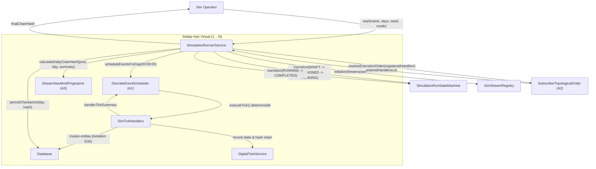

# Desain Teknis — Fase 67: Simulation Kernel, Twin Bus & Scale Provisioner

Dokumen ini menguraikan arsitektur dan spesifikasi teknis implementasi **Simulation Kernel**, **Digital Twin Bus**, dan **Scale Provisioner** pada modul `Core` SuperWeb Gelombang 8.

---

## 1. Arsitektur Komponen dan Alur Kerja Kernel

Kernel simulasi bertindak sebagai pengendali waktu virtual terpusat (`SimClockService`) yang mengompresi jalannya waktu bisnis dari hitungan bulan atau tahun menjadi hitungan detik tanpa memicu drift, ketergantungan wall-clock, atau manipulasi `Carbon::setTestNow()` di runtime produksi.

### D2: Diagram Sekuensial Siklus Eksekusi Harian Simulasi

---

## 2. State Machine: `SimulationRun` (8 Status)

Siklus hidup `SimulationRun` diatur oleh state machine formal `SimulationRunStateMachine` yang menjamin integritas transisi status dan mencatat riwayat transisi append-only pada tabel `sim_run_transitions`:

1. **`draft`**: Sesi simulasi baru dibuat, parameter seed, total hari, dan mode didefinisikan.
2. **`provisioned`**: Scale Provisioner telah menyiapkan data awal / baseline tier T1 atau T2.
3. **`running`**: Kernel sedang mengeksekusi siklus harian maju.
4. **`paused`**: Eksekusi dihentikan sementara secara aman oleh operator pada batas akhir hari virtual.
5. **`checkpointed`**: Checkpoint harian berhasil ditulis dan diverifikasi integritas rantai hash-nya.
6. **`completed`**: Seluruh hari simulasi telah selesai dieksekusi dan rantai fingerprint terbukti utuh.
7. **`failed`**: Terjadi kegagalan penanganan tick, pelanggaran ledger probe, atau galat fatal.
8. **`archived`**: Sesi simulasi telah diarsipkan dan berstatus read-only permanen.

### Matriks Transisi yang Diizinkan

- `draft` $\rightarrow$ `provisioned` (Guard: data prasyarat terverifikasi)
- `provisioned` $\rightarrow$ `running`
- `running` $\rightarrow$ `paused`
- `paused` $\rightarrow$ `running`
- `running` $\rightarrow$ `checkpointed`
- `checkpointed` $\rightarrow$ `running`
- `running` $\rightarrow$ `completed`
- `running` $\rightarrow$ `failed`
- `paused` $\rightarrow$ `failed`
- `checkpointed` $\rightarrow$ `failed`
- `failed` $\rightarrow$ `checkpointed` (Guard: pemulihan ke checkpoint valid terakhir)
- `completed` $\rightarrow$ `archived`
- `failed` $\rightarrow$ `archived`

---

## 3. Algoritma Bersertifikat (A1, A2, A3)

### A1: `DiscreteEventScheduler`
- Struktur data: Binary Min-Heap dengan kunci perbandingan 3-elemen: `(waktu_virtual_detik ASC, prioritas ASC, nomor_urut_global ASC)`.
- Kompleksitas: Jadwal $O(\log n)$, Pengambilan teratas $O(\log n)$.
- Invarian: Peristiwa yang dijadwalkan dengan timestamp lebih kecil dari waktu virtual saat ini langsung memicu `PastEventScheduledException` (`PAST_EVENT`).

### A2: `SubscriberTopologicalOrder`
- Algoritma Kahn untuk pemilahan topologis dependensi tick handler.
- Antrean siap (`in-degree = 0`) diurutkan alfabetis demi determinisme mutlak.
- Deteksi siklus: Bila tersisa simpul dengan `in-degree > 0`, melempar `CyclicDependencyException` yang memuat daftar simpul siklus terurut.

### A3: `StreamSeedAndFingerprint`
- MINSTD Lehmer LCG: $x_{k+1} = (x_k \times 48271) \bmod 2147483647$.
- Pembagian aliran acak deterministik: `split(seed, streamName)` mengalikan seed dengan CRC32 hash nama aliran modulo $2^{31}-1$.
- Rantai fingerprint kriptografis:
  $$h_0 = \text{SHA256}(\text{"sim-run|seed="} + \text{seed})$$
  $$h_i = \text{SHA256}(h_{i-1} + \text{"|"} + \text{hari} + \text{"|"} + \text{canonicalJson}(\text{ringkasan}))$$

---

## 4. Digital Twin Bus & Snapshot State

Model `SimTwinState` mengelola status kembar digital untuk entitas bernilai tinggi:
- Rantai hash sebelumnya (`prev_hash`) dihitung melalui `CanonicalHashChain`.
- Kolom saldo atau stok dilarang ada pada tabel `sim_twin_states` (menegakkan aturan arsitektur 67.5).
- Pembaruan twin bersifat idempoten: payload yang identik tidak menghasilkan duplikasi state.
- Snapshot per run disimpan pada `sim_twin_snapshots` untuk perbandingan what-if scenario.

---

## 5. Mode Transaksional Sandbox (W8-D35 / IZIN-4)

Simulasi dapat dijalankan dalam mode `--mode=sandbox`:
1. Seluruh operasi penulisan basis data dibungkus dalam transaksi basis data `DB::beginTransaction()`.
2. Sebelum rollback, dijalankan audit internal probe keseimbangan pembukuan: $\sum \text{debit} = \sum \text{credit}$ serta probe bahwa tabel transaksi riil tidak termutasi permanen.
3. Transaksi kemudian di-rollback (`DB::rollBack()`), menjamin isolasi total data riil.
4. Metadata run (riwayat transisi dan fingerprint akhir) disimpan menggunakan koneksi basis data terpisah setelah rollback berhasil.

