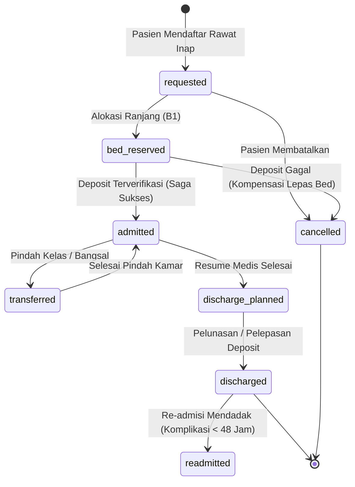
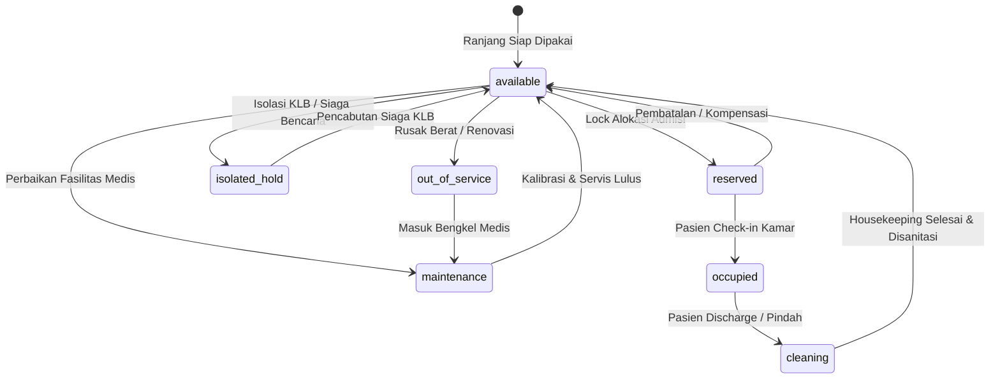
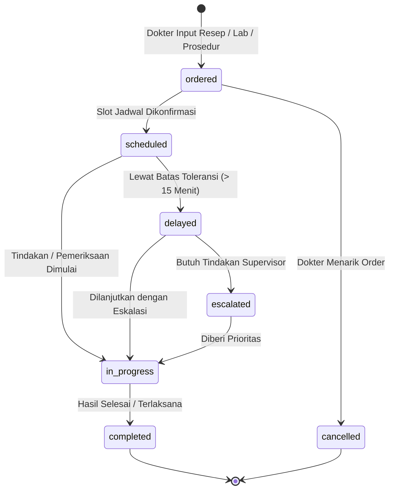
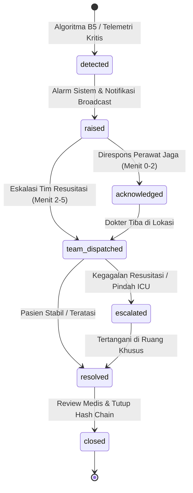
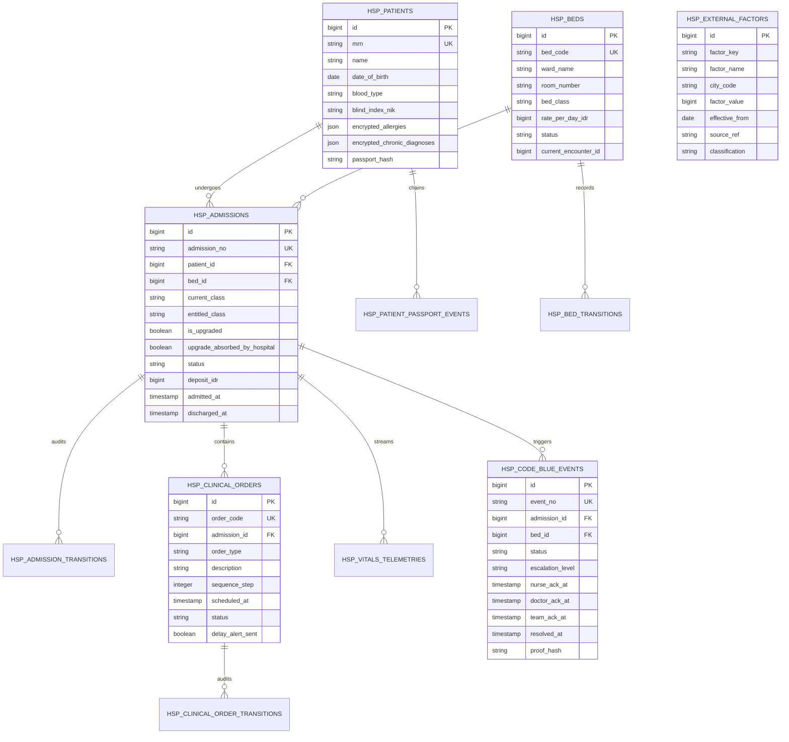
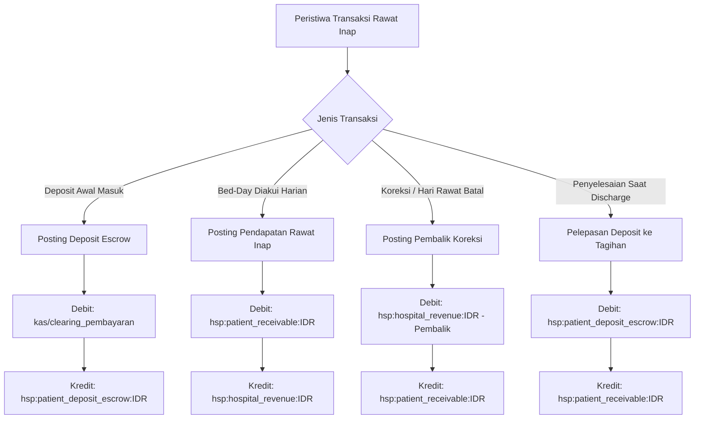
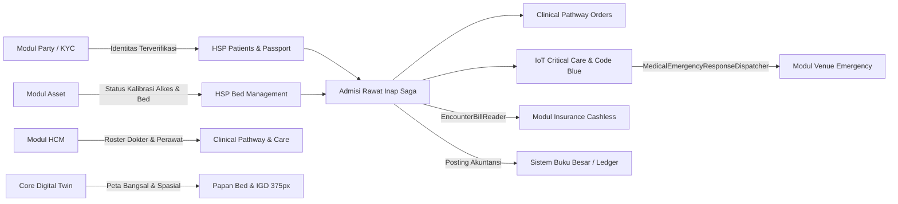
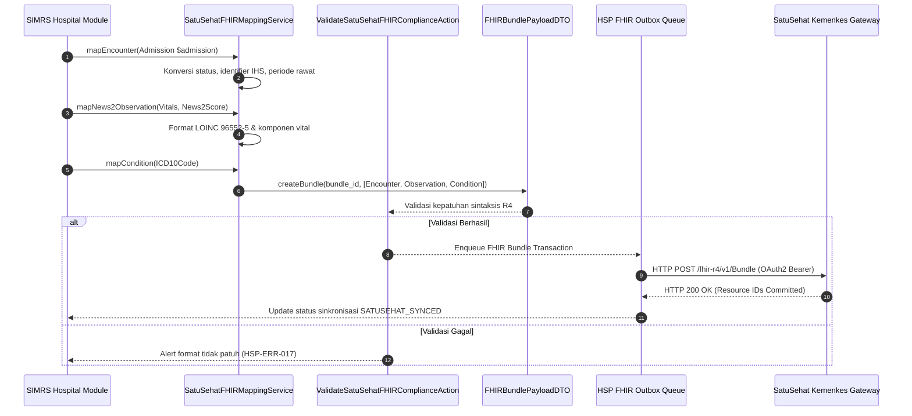
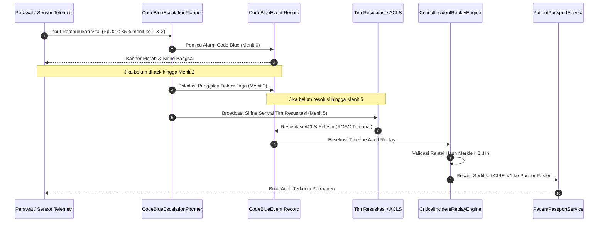

# Desain Arsitektur & Diagram — Fase 87: Rumah Sakit I

Dokumen ini memuat spesifikasi arsitektur teknis dan diagram Mermaid naratif untuk Fase 87.

## 1. State Diagrams (D1)

### 1.1 State Machine: Admission (8 Status)


### 1.2 State Machine: Hospital Bed (7 Status)


### 1.3 State Machine: Clinical Order (7 Status)


### 1.4 State Machine: Code Blue Event (7 Status)


## 2. Sequence Diagram Alur Utama & Saga Kompensasi (D2)

```mermaid
sequenceDiagram
    autonumber
    actor Reg as Petugas Admisi
    participant Saga as InpatientAdmissionSaga
    participant Opt as BedAssignmentOptimizer
    participant BedRepo as HospitalBedRepository
    participant Escrow as Payment/EscrowService
    participant EMR as PatientEmrService
    participant Ledger as HospitalLedgerService

    Reg->>Saga: execute(patientId, requiredClass, priority)
    Saga->>Opt: calculateOptimalBed(requestList, availableBeds)
    Opt-->>Saga: BedAssignmentCertificate(Bed#101, class=K1, upgraded=false)
    Saga->>BedRepo: lockForUpdate(Bed#101) & reserve()
    BedRepo-->>Saga: reserved_ok
    
    rect rgb(240, 248, 255)
        Note over Saga,Escrow: Langkah 2: Tangkap Deposit Rawat Inap
        Saga->>Escrow: captureDeposit(amount=5.000.000 IDR)
        alt Deposit Berhasil
            Escrow-->>Saga: deposit_captured(receiptRef)
            Saga->>Ledger: postDeposit(cash Clearing -> hsp:patient_deposit_escrow)
            Saga->>BedRepo: markOccupied(Bed#101)
            Saga->>EMR: createAdmissionRecord(status=admitted)
            Saga-->>Reg: AdmissionSuccess(admissionNo)
        else Deposit Ditolak / Saldo Kurang
            Escrow-->>Saga: deposit_failed(insufficient_funds)
            Note over Saga,BedRepo: KOMPENSASI OTOMATIS: Lepas Kuncian Bed
            Saga->>BedRepo: releaseReservation(Bed#101, status=available)
            Saga->>EMR: cancelAdmission(reason=deposit_failure)
            Saga-->>Reg: AdmissionFailedWithCompensation(error)
        end
    end
```

## 3. Entity-Relationship Diagram (D3)



## 4. Flowchart Posting Ledger (D4)



## 5. Flowchart Konteks Modul & Integrasi (D5)




## 6. Sequence Diagram Alur Pertukaran FHIR SatuSehat Kemenkes RI (D6)



## 7. Sequence Diagram Rekonstruksi Forensik Code Blue Replay (D7)



## 8. Matriks Hak Akses Peran & Kapabilitas Layanan (RBAC Matrix)

| Endpoint / Layanan Domain | `hospital_registration` | `bed_manager` | `nurse` | `doctor` | `rs_admin` |
| :--- | :---: | :---: | :---: | :---: | :---: |
| `/hospital/beds` (Papan Kontrol Ranjang) | Read-Only | **Read & Write** | Read-Only | Read-Only | **Read & Write** |
| `/hospital/er` (Papan Triase & IGD) | Read-Only | Read-Only | **Read & Write** | **Read & Write** | Read-Only |
| `/hospital/nursing` (Terminal Bangsal 375px) | Ditolak (403) | Ditolak (403) | **Read & Write** | Read-Only | Read-Only |
| `/hospital/critical-care` (Monitor ICU & Code Blue) | Ditolak (403) | Read-Only | **Read & Write** | **Read & Write** | Read-Only |
| `/hospital/efficiency` (Analisis Barber-Johnson) | Ditolak (403) | Read-Only | Ditolak (403) | Ditolak (403) | **Read & Write** |
| `/hospital/patients/{id}/passport` (Paspor Medis) | Read-Only | Ditolak (403) | Read-Only | **Read & Write** | Audit Log |
| `InpatientAdmissionSaga` (Admisi Rawat Inap) | Inisiasi | **Eksekusi** | Ditolak (403) | Ditolak (403) | **Eksekusi** |
| `BedDischargeAndCleaningSaga` (Pemulangan & Cuci) | Ditolak (403) | **Eksekusi** | Konfirmasi Cuci | Rekomendasi KRS | **Eksekusi** |
| `AdjustCapacityForEpidemicAction` (Kontingensi KLB) | Ditolak (403) | Ditolak (403) | Ditolak (403) | Ditolak (403) | **Eksekusi** |
| `hsp:audit` (Audit Dua Sumber & CLI) | Ditolak | Ditolak | Ditolak | Ditolak | **Eksekusi** |
