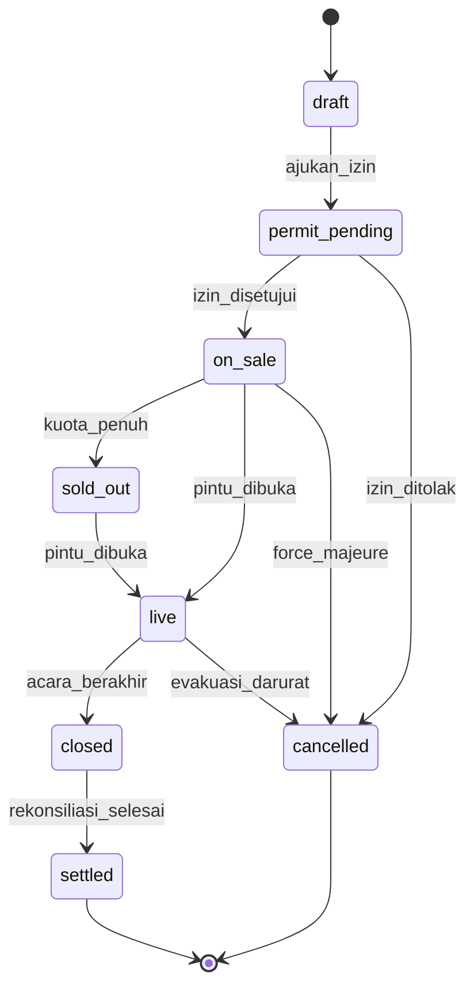
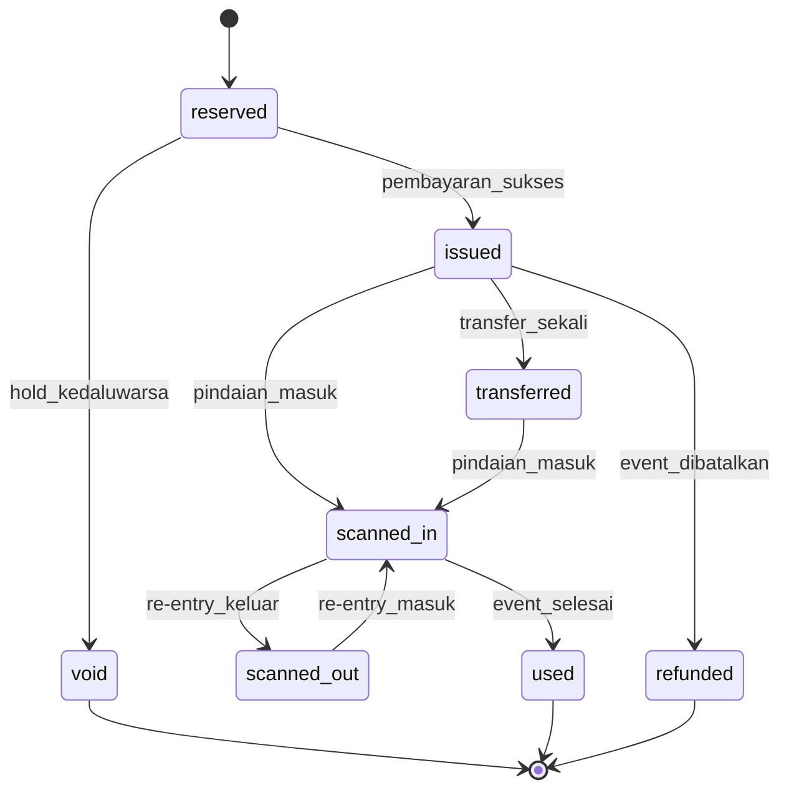
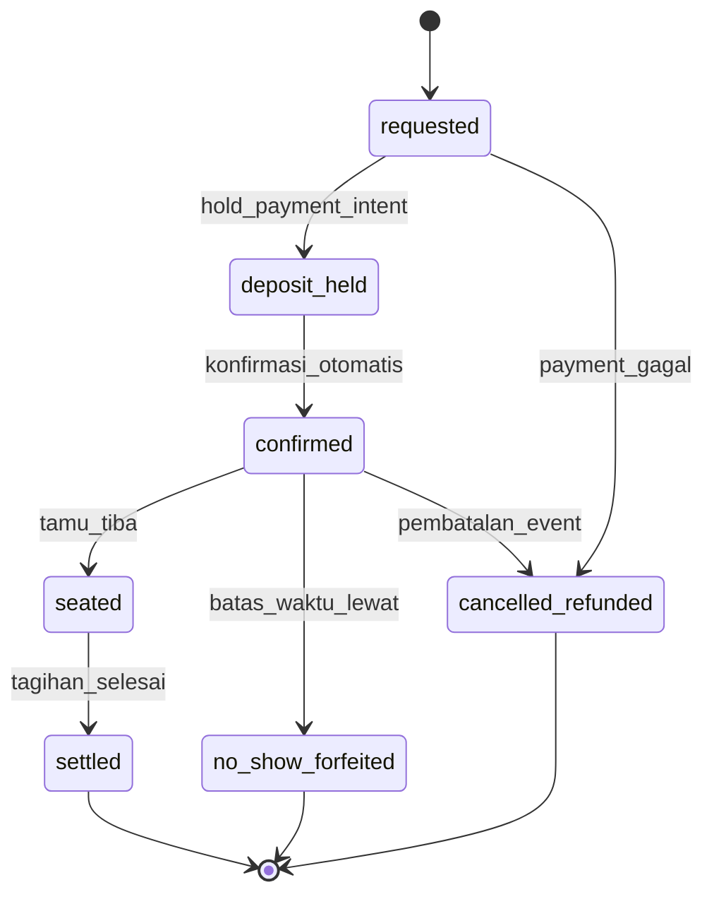
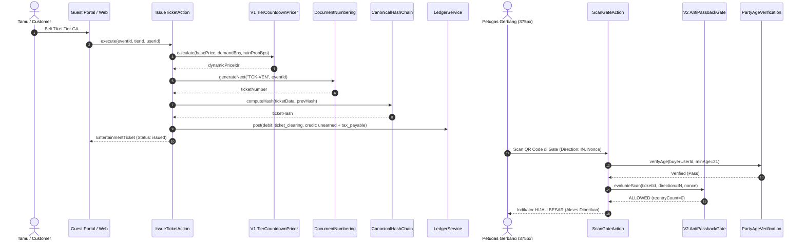
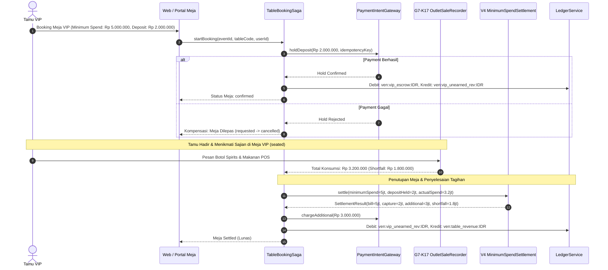
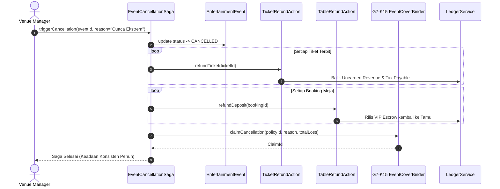
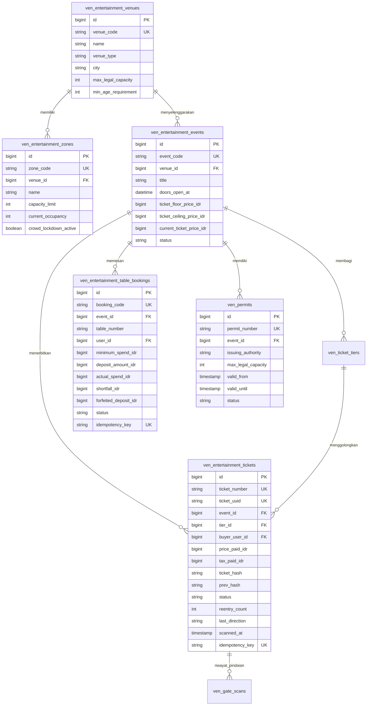
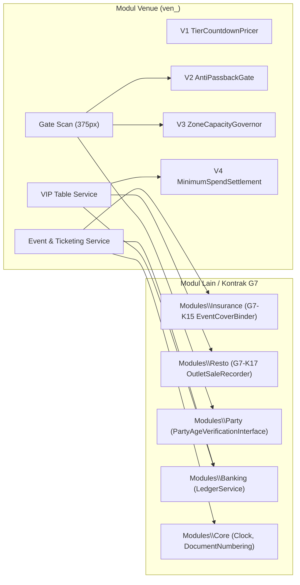

# Desain Arsitektur — Fase 89: Ticketing, Access Control, Usia & Venue Operations

**Domain:** Venue & Entertainment (`modules/Venue/`)  
**Basis Konsep:** KONSEP 10F, Lini 15; Aturan Rekayasa G7 & Standar Tambahan Ketat W8  

---

## 1. D1: Diagram Status (State Machine)

### a. Event State Machine (8 Status)

Transisi dan Guard Event SM:
1. `draft` $\to$ `permit_pending`: Diajukan manajer acara dengan lampiran dokumen kapasitas legal.
2. `permit_pending` $\to$ `on_sale`: Guard memverifikasi surat izin keramaian gapless berstatus `APPROVED` dan kapasitas legal $\ge$ total kuota tier tiket.
3. `on_sale` $\to$ `sold_out`: Guard memeriksa sisa tiket pada seluruh tier $= 0$.
4. `on_sale` / `sold_out` $\to$ `live`: Waktu sistem mencapai `doors_open_at` dan pos gerbang dibuka.
5. `live` $\to$ `closed`: Manajer acara atau trigger terjadwal menutup event. Memindahkan saldo `ven:ticket_unearned:IDR` ke `ven:ticket_revenue:IDR`.
6. `closed` $\to$ `settled`: Seluruh transaksi F&B, meja VIP, dan klaim asuransi telah terekonsiliasi penuh via `AuditVenueCommand`.
7. Transisi `cancelled`: Dipicu oleh pencabutan izin polisi atau cuaca ekstrem badai laut; memicu saga kompensasi penuh.

### b. Ticket State Machine (8 Status)

Guard Ticket SM:
1. `reserved` $\to$ `issued`: Pembayaran terkonfirmasi; nomor urut gapless dan hash SHA-256 diterbitkan.
2. `issued` $\to$ `transferred`: Tiket lama dibekukan, tiket baru diterbitkan ke pembeli baru. Maksimal 1 kali transfer seumur hidup tiket.
3. `issued`/`transferred` $\to$ `scanned_in`: Pindaian gerbang arah masuk. Guard memverifikasi usia $\ge 21$ tahun, anti-passback valid, dan zona belum penuh.
4. `scanned_in` $\to$ `scanned_out`: Pindaian gerbang arah keluar. Mengurangi okupansi zona fisik.
5. `scanned_out` $\to$ `scanned_in`: Masuk kembali (*re-entry*). Guard memastikan `reentry_count <= 2`.
6. `scanned_in` $\to$ `used`: Event mencapai status `closed`.
7. `issued` $\to$ `refunded`: Pembatalan event via saga kompensasi.

### c. Table Booking State Machine (7 Status)

Guard Table Booking SM:
1. `requested` $\to$ `deposit_held`: PaymentIntent berhasil mengunci deposit di kartu/rekening tamu.
2. `deposit_held` $\to$ `confirmed`: Nomor meja dialokasikan ke tamu secara permanen.
3. `confirmed` $\to$ `seated`: Tamu hadir di meja VIP sebelum batas toleransi waktu (pukul 23:00 WITA).
4. `confirmed` $\to$ `no_show_forfeited`: Tamu tidak hadir hingga batas waktu; algoritma V4 mengeksekusi forfeiture $50\%$.
5. `seated` $\to$ `settled`: Pesanan konsumsi POS dihitung, shortfall diakui, dan tagihan lunas.

---

## 2. D2: Diagram Sekuens Alur Utama & Saga Kompensasi

### a. Alur Pembelian Tiket & Pindaian Gerbang

### b. Alur Reservasi Meja VIP & Penagihan Minimum Spend (Saga)

### c. Saga Pembatalan Event & Kompensasi Terdistribusi

---

## 3. D3: Entity-Relationship Diagram (ERD) Fase 89

---

## 4. D4: Diagram Alur Posting Ledger Double-Entry

```mermaid
flowchart TD
    subgraph Penjualan_Tiket["1. Penjualan Tiket"]
        D1["Debit: ven:ticket_clearing:IDR"] --> C1["Kredit: ven:ticket_unearned:IDR"]
        D1 --> C2["Kredit: ven:entertainment_tax_payable:IDR"]
    end

    subgraph Penutupan_Event["2. Event Selesai (Closed)"]
        D2["Debit: ven:ticket_unearned:IDR"] --> C3["Kredit: ven:ticket_revenue:IDR"]
    end

    subgraph Deposit_Meja["3. Hold Deposit Meja"]
        D3["Debit: ven:vip_escrow:IDR"] --> C4["Kredit: ven:vip_unearned_rev:IDR"]
    end

    subgraph Penyelesaian_Meja["4. Capture / Settle Meja"]
        D4["Debit: ven:vip_unearned_rev:IDR"] --> C5["Kredit: ven:table_revenue:IDR"]
    end

    subgraph No_Show_Meja["5. No-Show Forfeiture (50%)"]
        D5["Debit: ven:vip_unearned_rev:IDR"] --> C6["Kredit: ven:vip_noshow_rev:IDR"]
    end

    subgraph Asuransi_Event["6. Premi Asuransi Event (G7-K15)"]
        D6["Debit: ven:event_insurance_expense:IDR"] --> C7["Kredit: ven:organizer_payable:IDR"]
    end
```

---

## 5. D5: Diagram Konteks Modul & Kontrak

