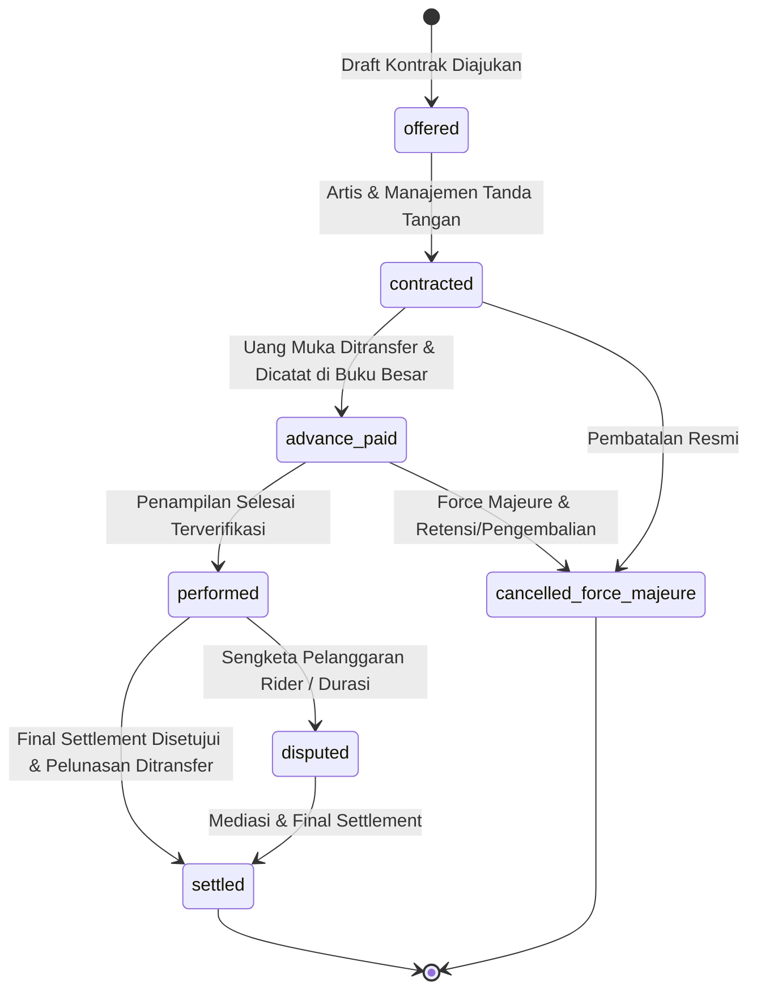

# Desain Arsitektur & Spesifikasi Detail — Fase 90: Artist Contracts, Bar Supply, Night Economics, Membership & Festival

**Domain:** Venue & Entertainment (`modules/Venue/`, tabel prefiks `ven_`)  
**Penanggung Jawab:** Tim Arsitektur & Pelaksana `[G7-P5]`  
**Target Git Branch:** `feature/g7-p5-fase-90` (basis `master`)  
**Status:** Diterima & Disetujui  

---

## 1. Ikhtisar Eksekutif & Sasaran Bisnis
Fase 90 memperluas ekosistem hiburan malam, beach club premium, dan festival multi-hari dari pengelolaan gerbang tiket dan reservasi meja (Fase 89) ke pilar ekonomi inti venue:
1. **Monetisasi & Kontrak Bakat (Artist Deals):** Perlindungan hukum finansial dalam mengontrak artis bertaraf internasional melalui mekanisme penjaminan minimal versus bagi hasil pintu (*guarantee vs door split*), pencatatan uang muka (*advance payment*), pemotongan pajak WHT (PPh 21/26), dan kompensasi penalti wanprestasi.
2. **Kendali Persediaan Bar & Cukai Minuman (Bar Supply Chain):** Pengawasan pergerakan botol bernilai tinggi, pencatatan tumpahan (*spillage*) dan varian stok per shift, serta kalkulasi harga pokok perolehan (*landed cost*) minuman beralkohol impor (MMEA) terintegrasi dengan modul Trade (PMK 160/2023).
3. **Ekonomi Malam Real-Time (Night Economics & RevPAT):** Analisis kinerja finansial meja VIP berbasis metrik *Revenue Per Available Table-Hour* (RevPAT), marjin kontribusi F&B per zona waktu malam, dan penyesuaian dinamis *minimum spend*.
4. **Keanggotaan Eksklusif & Retensi Tamu (Membership):** Program tiering bertingkat (Sun, Moon, Infinity) dengan hak istimewa *VIP fast track line*, loker penyimpanan botol (*bottle locker storage*), dan masa tenggang (*grace period*) evaluasi tahunan.
5. **Ekonomi Festival & Paket Bundling Multi-Vendor:** Perlakuan akuntansi pengakuan pendapatan diterima di muka untuk paket festival multi-layanan (tiket festival, kamar hotel rekanan, saldo F&B, dan cinderamata) berbasis *Standalone Selling Price* (SSP) sesuai PSAK 72 / IFRS 15 menggunakan metode Hamilton-Hare.
6. **Kemitraan Merek & Aktivasi Sponsor:** Kontrak sponsor berbasis jaminan eksposur terbobot (*weighted impressions*) pada layar LED panggung dan gerbang turnstile dengan pelunasan bertahap berbasis pencapaian KPI.

---

## 2. Arsitektur Domain & Empat Algoritma Bersertifikat (V5 s/d V8)

### 2.1 Algoritma V5: ArtistDoorSplitCalculator
- **Namespace:** `Modules\Venue\Domain\Algorithms\ArtistDoorSplitCalculator`
- **Sertifikasi:** Menggunakan `AlgorithmCertificate` PR2 dan divalidasi oleh `ArtistDoorSplitVerifier`.
- **Logika Perhitungan:**
  - Mengambil nilai terbesar antara `guarantee_idr` dan porsi bagi hasil dari laba kotor pintu setelah dipotong beban operasional acara yang disetujui:
    $$\text{Door Net} = \max(0, \text{door\_gross\_idr} - \text{approved\_expenses\_idr})$$
    $$\text{Door Share} = \left\lfloor \frac{\text{Door Net} \times \text{share\_bps}}{10.000} \right\rfloor$$
    $$\text{Gross Pay} = \max(\text{guarantee\_idr}, \text{Door Share})$$
  - Menghitung pajak penghasilan pasal 21/26:
    $$\text{WHT Amount} = \left\lfloor \frac{\text{Gross Pay} \times \text{wht\_bps}}{10.000} \right\rfloor$$
  - Menghitung sisa pembayaran kas setelah memperhitungkan uang muka (*advance paid*):
    $$\text{Net Payable IDR} = \max(0, \text{Gross Pay} - \text{WHT Amount} - \text{advance\_paid\_idr})$$
  - Jika kontrak menggunakan denominasi valuta asing (USD/SGD), menghitung ekuivalen valas dalam satuan minor (cents):
    $$\text{Valas Minor} = \left\lfloor \frac{\text{Net Payable IDR} \times 100}{\text{exchange\_rate\_idr}} \right\rfloor$$
- **Invarian:**
  $$\text{Gross Pay} \ge \text{guarantee\_idr}$$
  $$\text{Gross Pay} = \text{Net Payable IDR} + \text{WHT Amount} + \text{advance\_paid\_idr} - \text{excess\_advance\_refund}$$

### 2.2 Algoritma V6: BundleSspAllocator
- **Namespace:** `Modules\Shared\Domain\Algorithms\Settlement\BundleSspAllocator`
- **Sertifikasi:** Menggunakan `AlgorithmCertificate` PR2 dan divalidasi oleh `BundleSspVerifier`.
- **Logika Perhitungan:**
  - Menghitung total nilai jual mandiri (*total Standalone Selling Price*):
    $$\text{Total SSP} = \sum_{i=1}^n \text{ssp}_i$$
  - Mengalokasikan harga paket transaksi (*bundle price*) menggunakan Hamilton-Hare Largest Remainder Method:
    $$\text{Quota}_i = \frac{\text{Bundle Price} \times \text{ssp}_i}{\text{Total SSP}}$$
    $$\text{Base Alloc}_i = \lfloor \text{Quota}_i \rfloor, \quad \text{Remainder}_i = \text{Quota}_i - \text{Base Alloc}_i$$
    $$\text{Residual} = \text{Bundle Price} - \sum_{i=1}^n \text{Base Alloc}_i$$
    Membagikan 1 rupiah tambahan kepada item dengan remainder terbesar hingga `Residual` = 0.
  - Memotong komisi platform venue untuk setiap komponen:
    $$\text{Platform Fee}_i = \left\lfloor \frac{\text{Allocated}_i \times \text{platform\_fee\_bps}}{10.000} \right\rfloor$$
    $$\text{Vendor Net}_i = \text{Allocated}_i - \text{Platform Fee}_i$$
- **Invarian:**
  $$\sum_{i=1}^n \text{Allocated}_i = \text{Bundle Price}$$
  $$\sum_{i=1}^n (\text{Vendor Net}_i + \text{Platform Fee}_i) = \text{Bundle Price}$$

### 2.3 Algoritma V7: MembershipTierEngine
- **Namespace:** `Modules\Venue\Domain\Algorithms\MembershipTierEngine`
- **Sertifikasi:** Menggunakan `AlgorithmCertificate` PR2 dan divalidasi oleh `MembershipTierVerifier`.
- **Logika Evaluasi:**
  - Evaluasi kualifikasi tier berdasarkan total belanja bergulir 365 hari dan jumlah kunjungan terverifikasi di gerbang:
    - **Infinity:** `spend_365_days >= 75.000.000` DAN `visits_365_days >= 24`.
    - **Moon:** `spend_365_days >= 20.000.000` ATAU `visits_365_days >= 12`.
    - **Sun:** Tier dasar selain di atas.
  - Aturan penurunan tingkat (*downgrade grace period*):
    - Penurunan tingkat hanya dievaluasi pada tanggal peringatan tahunan (*anniversary date*).
    - Tamu berhak atas *grace period* 30 hari jika belanja mencapai minimal 80% dari ambang batas tier mereka sebelumnya. Penurunan tingkat dibatasi maksimal 1 tier per tahun evaluasi.
  - Perhitungan poin loyalitas (*lifestyle points*):
    $$\text{Base Points} = \lfloor \text{spend\_amount} / 10.000 \rfloor$$
    $$\text{Tier Multiplier} = \text{Sun: } 1,0; \text{Moon: } 1,5; \text{Infinity: } 2,0$$
    $$\text{Earned Points} = \lfloor \text{Base Points} \times \text{Tier Multiplier} \rfloor$$

### 2.4 Algoritma V8: SponsorExposureValuator
- **Namespace:** `Modules\Venue\Domain\Algorithms\SponsorExposureValuator`
- **Sertifikasi:** Menggunakan `AlgorithmCertificate` PR2 dan divalidasi oleh `SponsorExposureVerifier`.
- **Logika Perhitungan:**
  - Menghitung total impresi terbobot (*weighted impressions*) berdasarkan lalu lintas zona turnstile dan bobot visibilitas aset sponsor:
    $$\text{Weighted Impressions} = \sum_{z} (\text{zone\_footfall}_z \times \text{dwell\_weight}_z \times \text{screen\_share\_bps}_z / 10.000)$$
  - Menilai eksposur moneter ekuivalen:
    $$\text{Exposure Value} = \left\lfloor \frac{\text{Weighted Impressions}}{1.000} \right\rfloor \times \text{cpm\_rate\_idr}$$
  - Evaluasi pencapaian target milestone kontrak sponsor:
    $$\text{Achievement Bps} = \left\lfloor \frac{\text{Delivered Impressions} \times 10.000}{\text{Contract Target Impressions}} \right\rfloor$$
    - Jika `Achievement Bps >= 10.000`: Pembayaran termin 100% penuh.
    - Jika `7.000 <= Achievement Bps < 10.000`: Pembayaran pro-rata proporsional sesuai rasio pencapaian.
    - Jika `Achievement Bps < 7.000`: Termin ditahan (0%) karena di bawah batas minimum pemenuhan kontrak (*under-delivery default*).

---

## 3. Empat State Machine Terisolasi

1. **`ArtistEngagementStateMachine`:**
   - Status: `offered`, `contracted`, `advance_paid`, `performed`, `settled`, `disputed`, `cancelled_force_majeure`.
2. **`MembershipStateMachine`:**
   - Status: `applied`, `kyc_pending`, `active`, `grace`, `downgraded`, `suspended`, `cancelled`.
3. **`FestivalBundleStateMachine`:**
   - Status: `quoted`, `reserved`, `paid`, `fulfilled_partial`, `fulfilled`, `settled`, `refunded_partial`, `cancelled`.
4. **`SponsorDealStateMachine`:**
   - Status: `proposed`, `signed`, `activated`, `milestone_due`, `invoiced`, `paid`, `closed`.

---

## 4. Skema Basis Data (Tabel Prefiks `ven_`)

1. **`ven_artist_engagements`**:
   - `id`, `event_id`, `artist_name`, `management_company`, `contract_number`, `deal_type` (guarantee, door_split, versus), `guarantee_idr`, `door_share_bps`, `wht_bps`, `advance_paid_idr`, `net_paid_idr`, `status`, `currency`, `valas_cents`, `exchange_rate_idr`, `timestamps`.
2. **`ven_artist_riders`**:
   - `id`, `engagement_id`, `rider_category` (technical, hospitality, transport, security), `description`, `budget_idr`, `actual_spent_idr`, `is_fulfilled`, `receipt_reference`, `timestamps`.
3. **`ven_bar_inventory_items`**:
   - `id`, `sku`, `brand_name`, `category` (spirit_premium, wine_champagne, beer, non_alcoholic), `unit_volume_ml`, `current_stock_bottles`, `safety_stock_bottles`, `cost_per_bottle_idr`, `selling_price_per_bottle_idr`, `excise_tier` (A, B, C), `timestamps`.
4. **`ven_bar_shift_logs`**:
   - `id`, `venue_zone_id`, `shift_code`, `start_time`, `end_time`, `opening_bottles`, `closing_bottles`, `pos_sales_bottles`, `spillage_ml`, `variance_bottles`, `supervisor_user_id`, `status` (open, audited, reconciled), `timestamps`.
5. **`ven_table_revpat_metrics`**:
   - `id`, `table_id`, `date`, `zone_code`, `available_hours`, `occupied_hours`, `food_revenue_idr`, `beverage_revenue_idr`, `minimum_spend_shortfall_idr`, `revpat_idr`, `timestamps`.
6. **`ven_memberships`**:
   - `id`, `member_number`, `user_id`, `tier` (sun, moon, infinity), `joined_at`, `expires_at`, `current_points`, `spend_365_days_idr`, `visits_365_days`, `status`, `bottle_locker_number`, `timestamps`.
7. **`ven_festival_bundles`**:
   - `id`, `bundle_code`, `bundle_name`, `bundle_price_idr`, `total_ssp_idr`, `ticket_tier_id`, `hotel_room_type`, `hotel_nights`, `fnb_credits_idr`, `status`, `timestamps`.
8. **`ven_festival_bundle_allocations`**:
   - `id`, `bundle_order_id`, `component_name`, `vendor_id`, `ssp_idr`, `allocated_amount_idr`, `platform_fee_idr`, `vendor_net_idr`, `status` (unearned, redeemed, settled), `timestamps`.
9. **`ven_sponsor_deals`**:
   - `id`, `sponsor_name`, `brand_category`, `contract_value_idr`, `target_impressions`, `delivered_impressions`, `cpm_rate_idr`, `status`, `timestamps`.
10. **`ven_sponsor_milestones`**:
    - `id`, `deal_id`, `milestone_name`, `due_date`, `target_impressions`, `delivered_impressions`, `payout_ratio_bps`, `milestone_amount_idr`, `status` (pending, verified, invoiced, paid), `timestamps`.

---

## 5. Kontrak Aditif Lintas Modul

- **`G7-K16` (`Modules\Hotel\Contracts\RoomBlockReserver`)**:
  - Didefinisikan di namespace `Modules\Hotel\Contracts`.
  - Diimplementasikan oleh `Modules\Hotel\Application\Services\RoomBlockReserverService` di modul Hotel.
  - Memanggil `ReserveRoomWithInventoryNightLockAction` untuk mengunci dan membebaskan alokasi kamar hotel / tenda glamping mitra untuk bundling festival.
- **`G7-K17` (`Modules\Resto\Contracts\OutletSaleRecorder`)**:
  - Diinjeksi di modul Venue untuk merekam penjualan botol bar ke nomor meja VIP atau gelang cashless festival.
- **`G7-K18` (`Modules\Hcm\Contracts\ShiftBountyPublisher`)**:
  - Didefinisikan di namespace `Modules\Hcm\Contracts`.
  - Diimplementasikan oleh `Modules\Hcm\Application\Services\ShiftBountyPublisherService` di modul Hcm.
  - Membungkus `InternalGigEconomyService::postBounty` untuk mempublikasikan insentif lembur kru bartender dan petugas keamanan di malam festival.
- **`G7-K19` (`Modules\Trade\Contracts\ImportLandedCostQuoter`)**:
  - Didefinisikan di namespace `Modules\Trade\Contracts`.
  - Diimplementasikan oleh `Modules\Trade\Application\Services\ImportLandedCostQuoterService` di modul Trade.
  - Menghitung landed cost minuman impor beralkohol tinggi (tarif MMEA golongan C) menggunakan `CalculateIncotermsLandedCostAction`.

---

## 6. Antarmuka Pengguna & P-UI 1–10 (Komitmen $B2 \ge 2.100$ Baris)
Antarmuka pengguna dibangun menggunakan Blade, Alpine.js, dan Tailwind CSS dengan kepatuhan penuh pada standar P-UI 1–10:
1. `modules/Venue/resources/views/reports/pnl.blade.php`: Laporan laba rugi real-time per malam per zona venue, analisis RevPAT per jam meja, dan margin kontribusi F&B.
2. `modules/Venue/resources/views/artists/statement.blade.php`: Lembar penyelesaian kontrak artis, rekonsiliasi rider hospitality vs bukti belanja, dan kalkulasi PPh 21/26.
3. `modules/Venue/resources/views/members/profile.blade.php`: Portal profil keanggotaan VIP, status loker botol, poin loyalitas, riwayat transaksi, dan hitung mundur evaluasi tier.
4. `modules/Venue/resources/views/festivals/bundles/create.blade.php`: Form perancangan paket bundling festival, pratinjau kalkulasi alokasi SSP Hamilton-Hare secara langsung, dan alokasi kuota hotel.
5. `modules/Venue/resources/views/sponsors/report.blade.php`: Dasbor eksposur sponsor, heatmap tayang LED panggung utama, dan laporan pencapaian milestone impresi.
6. `modules/Venue/resources/views/bar/revpat.blade.php`: Manajemen stok bar per shift, pelaporan spillage botol, dan pengawasan audit varian stok.

---

## 7. Verifikasi & Audit Ekonomi Venue (`venue:audit-economy`)
Command konsol `php artisan venue:audit-economy` menjalankan verifikasi integritas menyeluruh:
- Audit matematis algoritma V5, V6, V7, V8.
- Validasi saldo buku besar nol ($\sum \text{Debit} - \sum \text{Kredit} = 0$).
- Validasi keselarasan alokasi bundling vendor dengan total transaksi konsumen.
- Deteksi anomali pada status loker botol anggota dan saldo uang muka artis.
