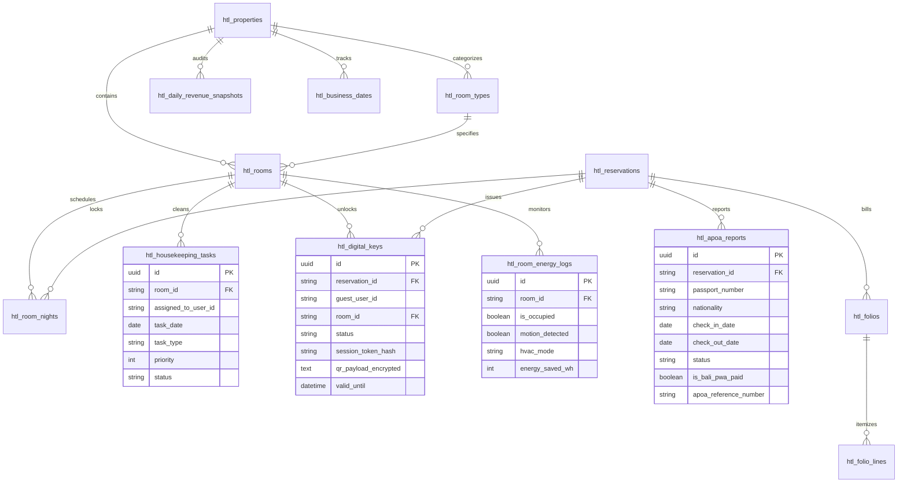
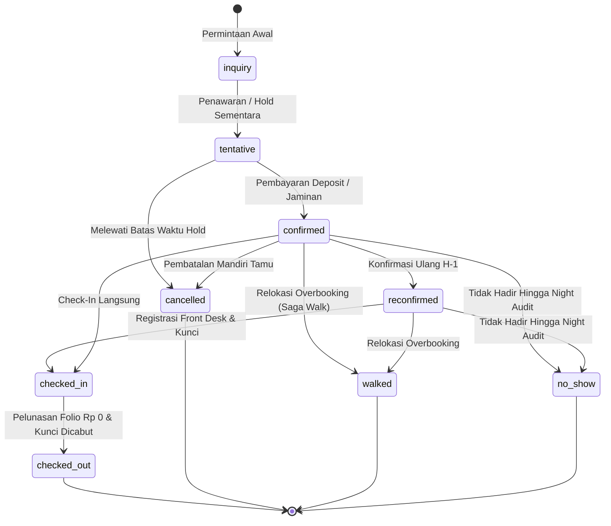
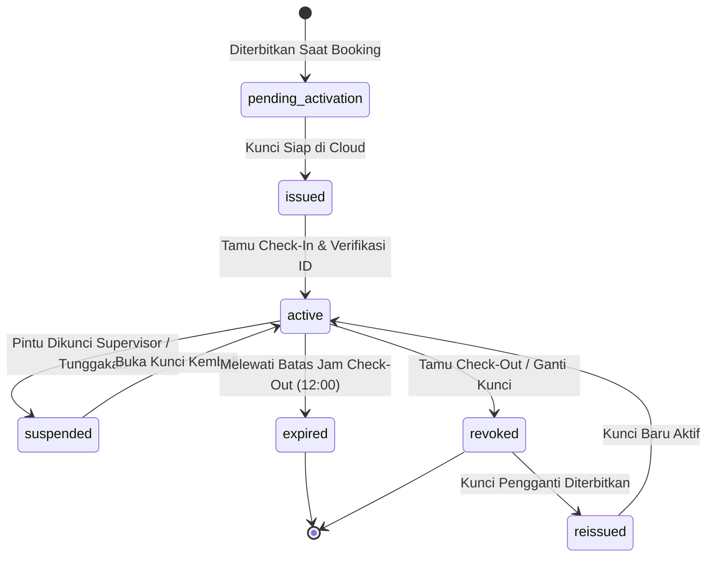
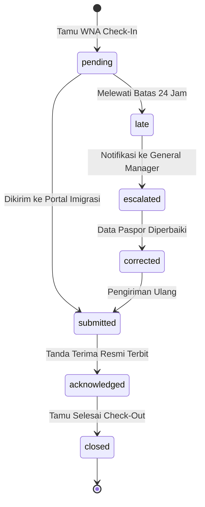
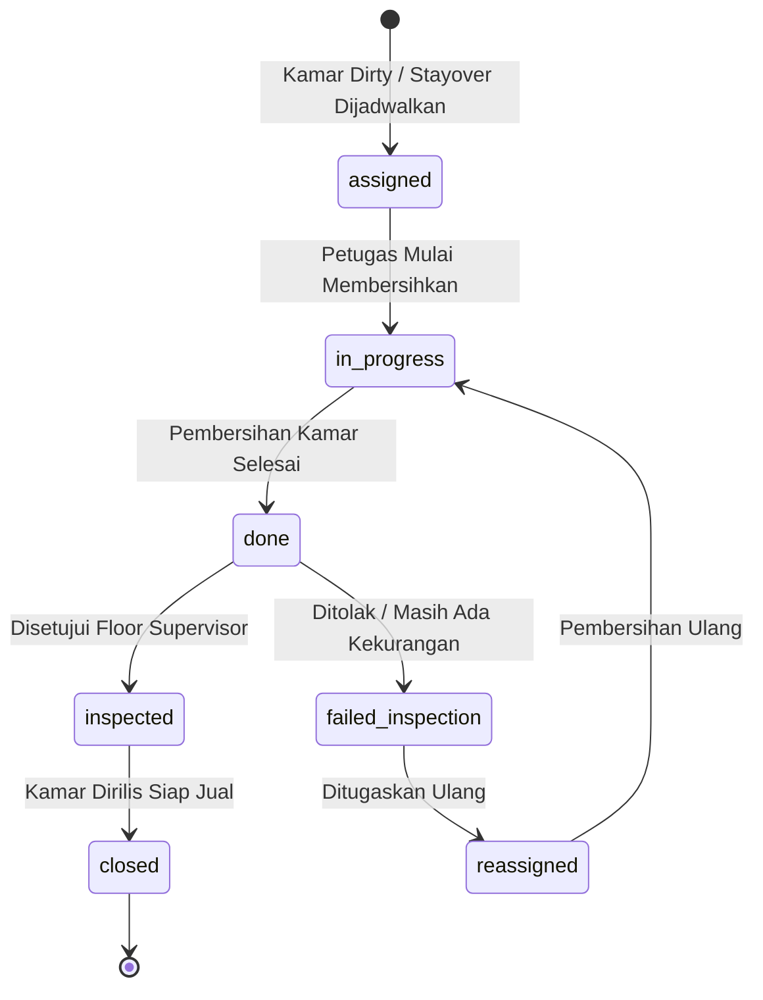
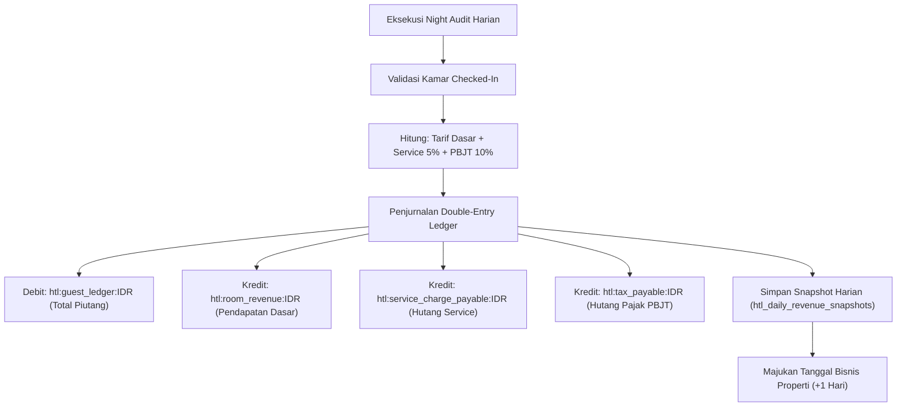
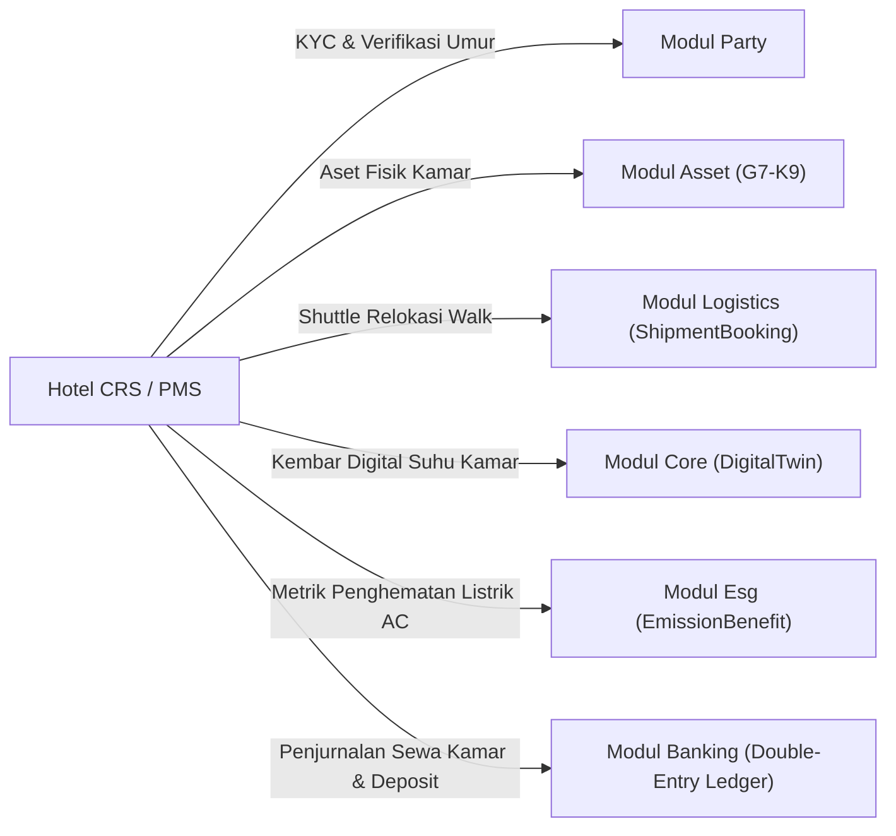

# Desain Arsitektur & Spesifikasi Teknis Fase 91: PMS, CRS, Rate Management & Smart Room

Dokumen ini berisi spesifikasi arsitektur teknis, diagram relasi entitas, diagram alur status, dan diagram posting buku besar berpasangan untuk Fase 91.

---

## 1. Diagram Relasi Entitas Database (D3 ER-Diagram)

---

## 2. Diagram Alur Status State Machine (D1)

### 2.1 State Machine Reservasi Tamu (ReservationStateMachine — 9 Status)

### 2.2 State Machine Kunci Digital Kamar (DigitalKeyStateMachine — 7 Status)

### 2.3 State Machine Pelaporan Orang Asing (ApoaReportStateMachine — 7 Status)

### 2.4 State Machine Tugas Tata Graha (HousekeepingTaskStateMachine — 7 Status)

---

## 3. Diagram Alur Transaksi Finansial Buku Besar (D4 Flowchart Posting)

---

## 4. Diagram Konteks Integrasi Lintas Modul (D5)

