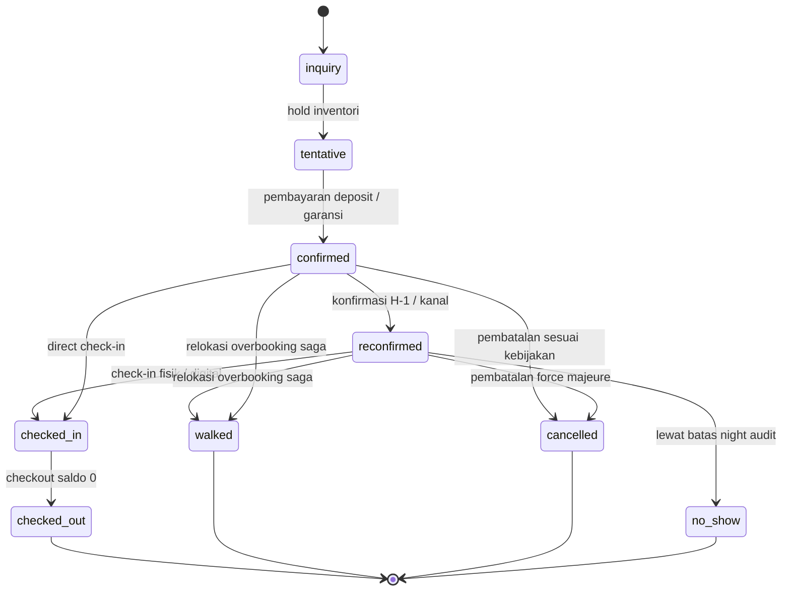
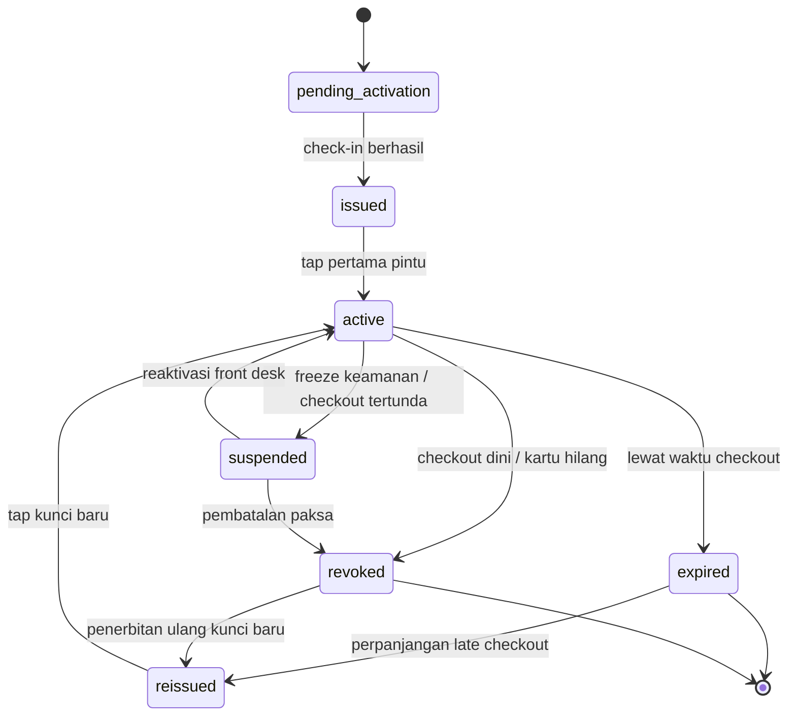
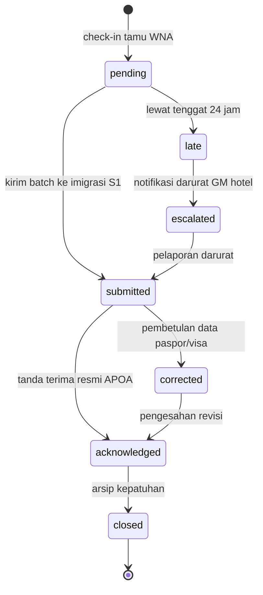
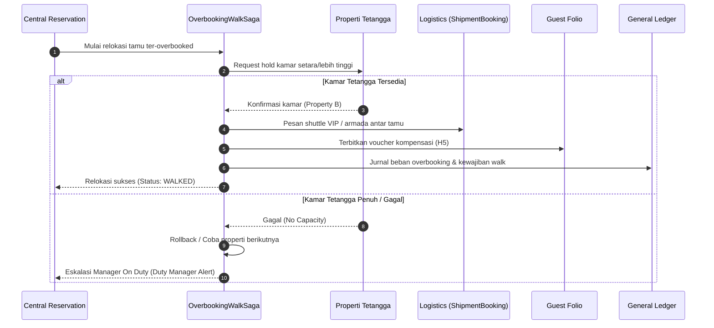
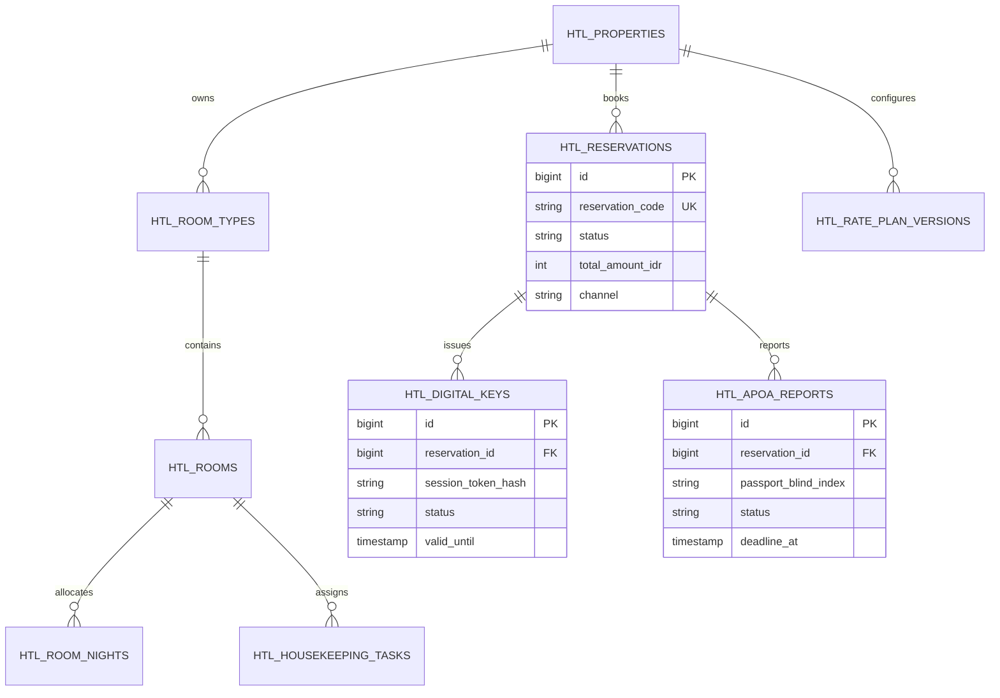
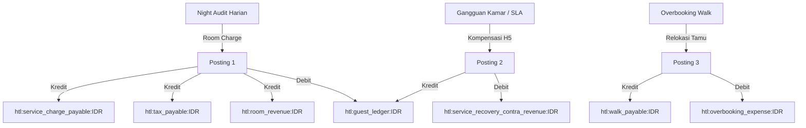
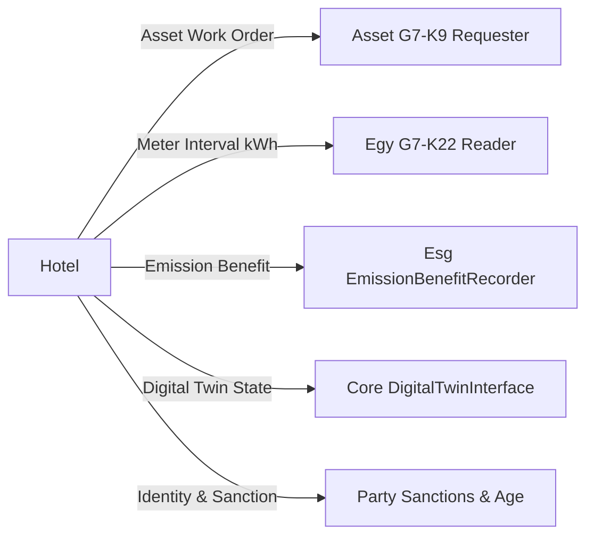

# Desain Teknis & Arsitektur — Fase 91: PMS, Central Reservation, Rate Management & Smart Room

**Modul Pemilik:** Hotel (`htl_`)  
**Status Eksekusi:** [🔵] Siap Verifikasi  
**Dokumen Pendukung:** `docs/dor/fase-91.md`, `docs/konsep/hotel.md`  

---

## 1. Diagram State Machine (D1)

### 1.1 State Machine Reservasi Tamu (9 Status)

### 1.2 State Machine Kunci Digital (7 Status)

### 1.3 State Machine Laporan APOA UU 6/2011 (7 Status)

---

## 2. Diagram Alur Utama & Saga Kompensasi (D2)

### Relokasi Overbooking Berjalan Sebagai Saga Terdistribusi

---

## 3. Diagram Entity-Relationship Database (D3)

---

## 4. Alur Posting Ledger Seimbang (D4)

---

## 5. Konteks Integrasi Lintas Modul (D5)

