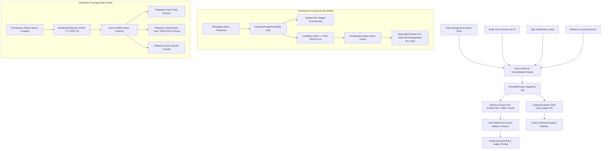

# Desain Arsitektur Fase 92: Folio Multi-Payer, Timeshare & Destination Package Engine

Dokumen ini mendefinisikan desain teknis dan arsitektur sistem untuk modul Perhotelan Fase 92 yang mencakup penyelesaian folio multi-payer, orkestrasi perjamuan (banquet), kepemilikan fraksional timeshare, dan bundel paket destinasi multi-vendor.

---

## 1. Arsitektur Komponen dan Aliran Data



---

## 2. Folio Multi-Payer dan Prinsip Folio Saldo Nol

### 2.1 Pemisahan Otomatis Beban Tagihan (FolioSplitRouter - H6)
Dalam skenario perjalanan bisnis korporat:
- **Biaya Pokok (Master Account / Corporate Ledger)**: Kamar (Room Charge), Pajak Hotel (10%), Service Charge (10%), dan Akses Internet Bisnis dibebankan langsung ke akun perusahaan pemberi otorisasi.
- **Biaya Insidental (Incidental / Personal Sub-Folio)**: Konsumsi F&B minibar, pesanan room service beralkohol, layanan spa pribadi, dan laundry tambahan diarahkan ke sub-folio tamu pribadi.
- Konservasi saldo:
  $$\text{Total Tagihan} = \sum \text{Baris Tagihan} = \text{Tagihan Korporat} + \text{Tagihan Personal}$$

### 2.2 Transaksi Ledger Double-Entry
Saat check-out dan penutupan folio dilakukan:
1. **Penagihan Personal**:
   - Debit: Kas / Bank Clearing (`clearing:external:IDR` / `bnk:clearing:IDR`)
   - Kredit: Piutang Tamu Personal (`htl:guest_ledger:IDR`)
2. **Penagihan Korporat (City Ledger AR)**:
   - Debit: Piutang Buku Besar Kota / Piutang Usaha Korporat (`htl:city_ledger:IDR`)
   - Kredit: Piutang Tamu Kamar (`htl:guest_ledger:IDR`)
3. **Validasi Mutlak**:
   - Status folio tidak dapat dialihkan menjadi `CLOSED` bila saldo sisa pada `htl:guest_ledger:IDR` belum tepat nol (`discrepancy === 0`).

---

## 3. Banquet Event Order (BEO) & Proteksi Marjin Kotor

Pemesanan acara banquet pernikahan atau seminar korporat dievaluasi menggunakan Bill of Materials (BOM) resep dapur yang terintegrasi dengan modul Resto:
$$\text{Gross Margin} = \frac{\text{Harga Kontrak Banquet} - \text{Total Biaya BOM (Bahan + Tenaga Gig)}}{\text{Harga Kontrak Banquet}}$$
- Jika $\text{Gross Margin} < 40\%$, sistem secara otomatis menolak permohonan persetujuan BEO (*BEO Approval Guardrail*) dan mewajibkan revisi menu atau penyesuaian harga minimum spend.

---

## 4. Timeshare & Fractional Villa Ownership (RWA)

Properti mewah (seperti resort villa atau executive suites) dibagi menjadi kepemilikan fraksional:
- Setiap 1 unit villa dipecah menjadi 52 fraksi hak minggu tinggal per tahun.
- Pemilik fraksi dapat memilih:
  1. **Menggunakan Sendiri**: Didaftarkan melalui `FractionalUsageScheduler` (H8).
  2. **Menyewakan ke Rental Pool**: Unit kamar dimasukkan ke CRS hotel untuk dijual kepada tamu umum dengan tarif BAR dinamis.
- Hasil penjualan sewa dikumpulkan dalam akun penampungan sewa villa. Setelah dipotong biaya operasional tata graha dan manajemen fee 15%, sisa dividen bersih didistribusikan secara pro-rata ke dompet pemegang token fraksional.

---

## 5. Integrasi Paket Destinasi Multi-Vendor

Paket bundling wisata mengombinasikan kamar hotel, tiket masuk beach club, voucher kuliner restoran, dan armada shuttle:
1. Tamu membayar satu harga bundel (misal: IDR 7.500.000).
2. `BundleSspAllocator` menghitung Stand-Alone Selling Price (SSP) proporsional tiap vendor untuk mengalokasikan nilai wajar transaksi.
3. Seluruh dana disetorkan ke rekening perantara penampungan (*Escrow Clearing Account*).
4. Saat tamu menggunakan voucher di venue (misal check-in beach club atau naik shuttle), vendor mengirim event pemenuhan (*milestone fulfillment*).
5. Sistem melepaskan dana dari escrow ke saldo likuid masing-masing vendor secara real-time.

---

## 6. Siklus Hidup Mesin Status (State Machine Lifecycle)

### 6.1 State Machine Perjamuan (HotelBanquetStateMachine)
```
DRAFT ---> CHEF_REVIEWED ---> SALES_CONFIRMED ---> IN_PREPARATION ---> SERVICE_COMPLETED ---> BILLED
  |              |                   |
  +--------------+-------------------+------> CANCELLED
```
- **DRAFT**: Penjualan awal menyusun draf proposal dengan perkiraan kuota pax dan opsi menu.
- **CHEF_REVIEWED**: Kepala juru masak memvalidasi kelayakan resep, ketersediaan inventori bahan, dan margin BOM minimum 40%.
- **SALES_CONFIRMED**: Klien menandatangani kontrak BEO dan menyetorkan uang muka deposit minimal 50%.
- **IN_PREPARATION**: Dapur produksi mulai melakukan persiapan bahan dan staf perbantuan HCM (K18) dipanggil.
- **SERVICE_COMPLETED**: Acara terlaksana dan piring saji telah selesai dibersihkan.
- **BILLED**: Seluruh tagihan konsumsi tambahan ditransfer ke folio induk kamar atau sub-folio korporat.

### 6.2 State Machine Rekening Escrow Paket Destinasi (HotelEscrowPackageStateMachine)
```
INITIATED ---> ESCROW_LOCKED ---> PARTIAL_RELEASED ---> FULLY_SETTLED
     |                |                    |
     v                v                    v
  REFUNDED        DISPUTED ------------> REFUNDED
```
- **INITIATED**: Tamu memilih paket wisata dan melakukan pembayaran melalui payment gateway.
- **ESCROW_LOCKED**: 100% dana tamu diamankan pada akun penampungan `htl:escrow:destination_package:IDR`.
- **PARTIAL_RELEASED**: Tamu menyelesaikan milestone check-in hotel (alokasi akomodasi dicairkan).
- **FULLY_SETTLED**: Seluruh milestone (venue konser K16 dan shuttle transportasi) telah terkonfirmasi selesai.
- **DISPUTED**: Tamu mengajukan komplain atas ketidakhadiran armada shuttle atau pembatalan tiket atraksi.
- **REFUNDED**: Dana escrow yang belum terserap dikembalikan ke rekening bank asal tamu.

---

## 7. Pola Saga Berkompensasi untuk Pembelian Paket Wisata (Compensating Saga)

Ketika tamu memesan paket liburan multi-vendor, orkestrasi transaksi dijalankan melalui rangkaian langkah saga terdistribusi:

```
+---------------------------------------------------------------------------------+
|                       ORCHESTRATED DESTINATION PACKAGE SAGA                     |
+---------------------------------------------------------------------------------+
| Step 1: Reservasi Kamar Hotel   --> [Gagal? Batalkan Seluruh Transaksi]         |
| Step 2: Kunci Tiket Venue K16   --> [Gagal? Lepaskan Kamar Hotel (Kompensasi)]  |
| Step 3: Alokasi Armada Transfer --> [Gagal? Lepaskan Venue & Kamar]             |
| Step 4: Kunci Dana Escrow       --> [Gagal? Batalkan Reservasi di Ketiga Pihak] |
+---------------------------------------------------------------------------------+
```

### 7.1 Tabel Aksi Kompensasi Transaksi Saga
| Tahapan Transaksi | Aksi Sukses (Forward Action) | Aksi Kompensasi (Reversal Action) |
|---|---|---|
| 1. Alokasi Kamar | `ReserveRoomWithInventoryNightLockAction` | `CancelReservationWithInventoryReleaseAction` |
| 2. Pemesanan Tiket | `VenueTicketBundleAdapter::reserveVenuePass` | `VenueTicketBundleAdapter::voidVenuePass` |
| 3. Armada Transfer | `TransportService::dispatchShuttleVehicle` | `TransportService::cancelShuttleAssignment` |
| 4. Escrow Locking | `Ledger::postDebitCredit(escrow_account)` | `Ledger::postCompensatingJournal(escrow_account)` |

---

## 8. Analisis Kompleksitas Komputasi Algoritma Fase 92

1. **FolioSplitRouter (Algoritma H6)**:
   - Kompleksitas Waktu: $\mathcal{O}(N \log N)$ dengan $N$ adalah jumlah baris transaksi dalam folio (pengurutan prioritas kategori charge kamar vs insidental).
   - Kompleksitas Ruang: $\mathcal{O}(N)$ untuk penampungan struktur alokasi sub-folio.
   
2. **LoyaltyNightTierEngine (Algoritma H7)**:
   - Kompleksitas Waktu: $\mathcal{O}(M)$ dengan $M$ adalah jumlah malam menginap terverifikasi dalam kurun waktu 365 hari.
   - Kompleksitas Ruang: $\mathcal{O}(1)$ dengan variabel akumulator status tingkatan tier.

3. **FractionalUsageScheduler (Algoritma H8)**:
   - Kompleksitas Waktu: $\mathcal{O}(W)$ dengan $W \le 52$ alokasi minggu tahunan vila fraksional.
   - Kompleksitas Ruang: $\mathcal{O}(W)$ untuk kalender partisi kepemilikan.

4. **ChurnRiskScorer (Algoritma H9)**:
   - Kompleksitas Waktu: $\mathcal{O}(1)$ evaluasi model regresi linier berbobot terhadap 5 parameter input utama tamu.
   - Kompleksitas Ruang: $\mathcal{O}(1)$ struktur output sertifikat risiko atrisi.


