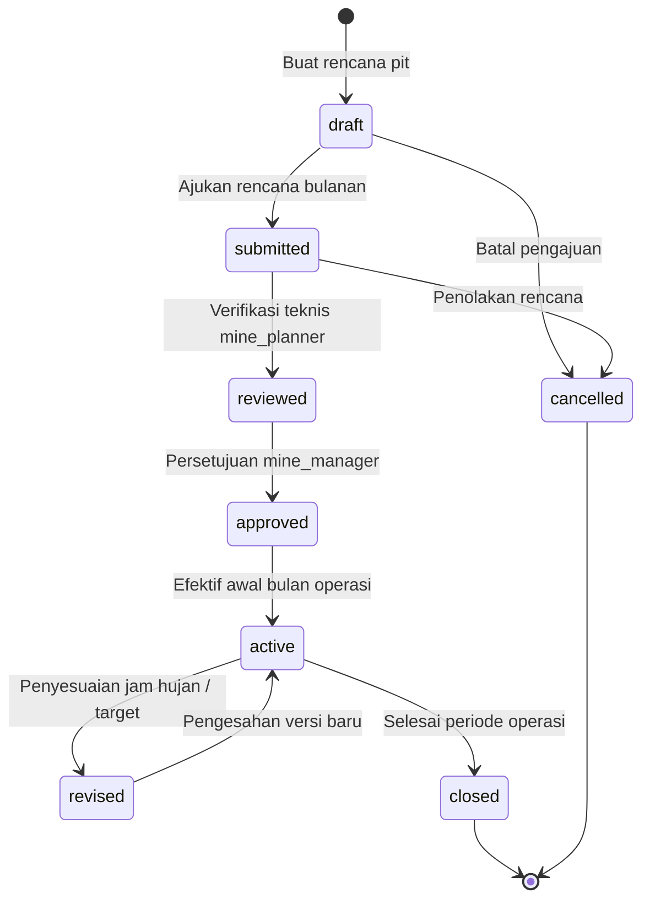
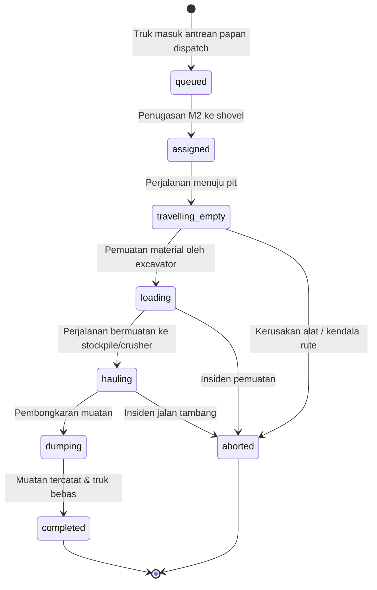
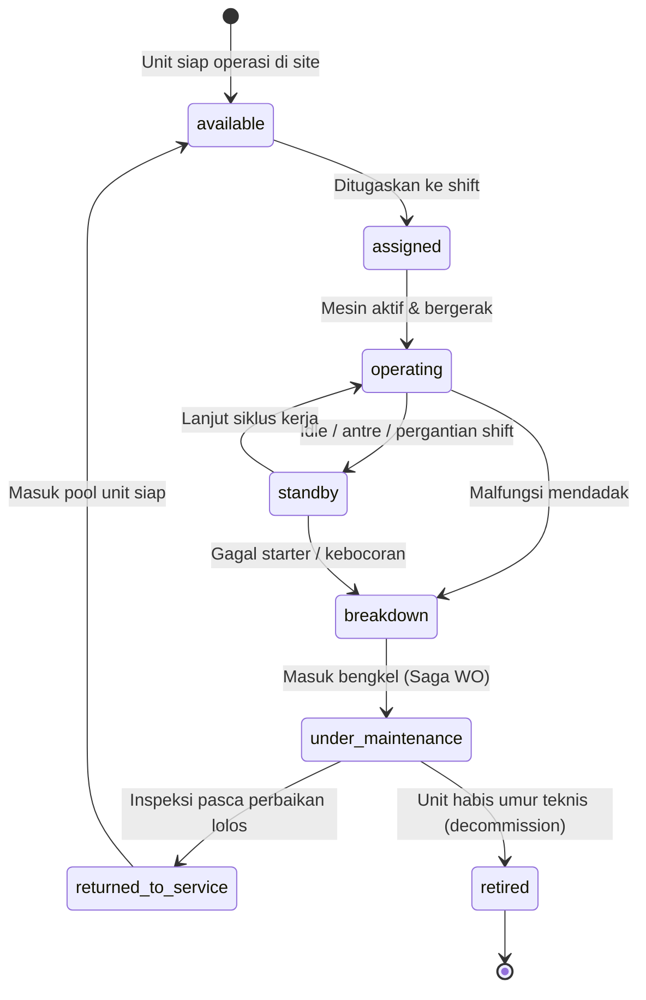
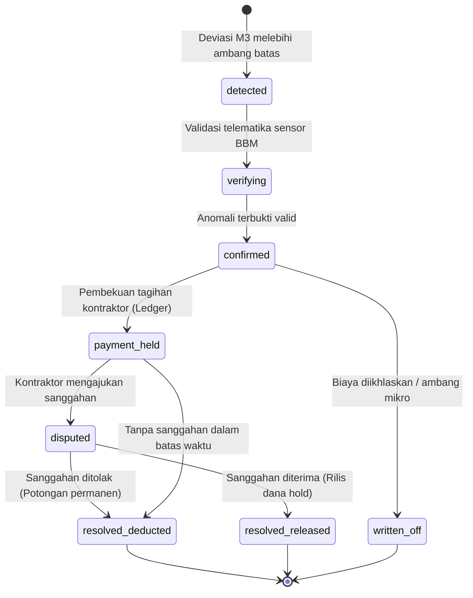
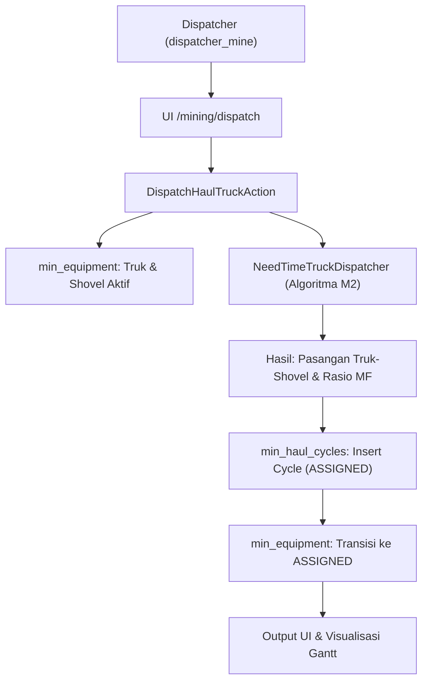
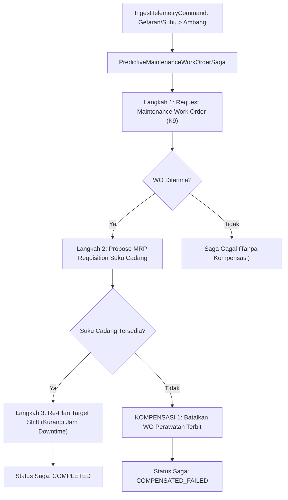
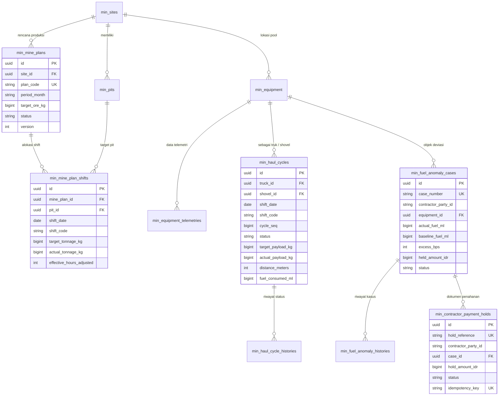
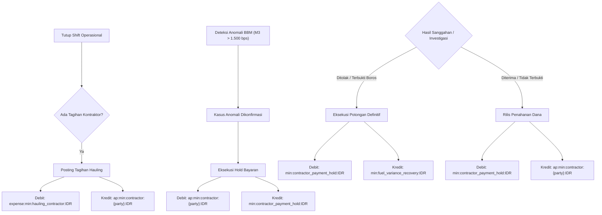
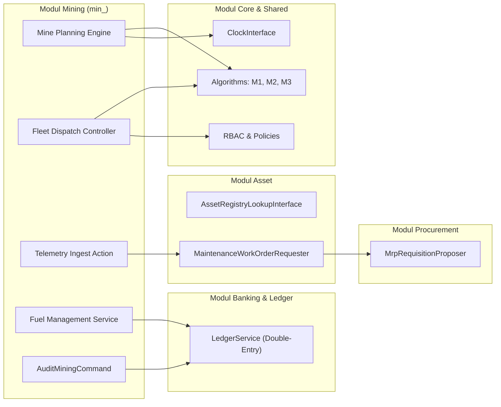

# Desain Teknis — Fase 93: Mine Planning, Fleet Dispatch & Fuel Management

Dokumen desain arsitektur teknis vertikal slice untuk Fase 93 mencakup perincian logika perancangan tambang, penugasan armada deterministik, telemetri IoT alat berat, saga perawatan prediktif, serta deteksi anomali bahan bakar.

---

## 1. Diagram State Machine (D1)

### 1.1 State Machine Perencanaan Tambang (`MinePlan`)
State machine 8 status untuk mengontrol siklus hidup rencana bulanan pit:



### 1.2 State Machine Siklus Angkut (`HaulCycle`)
State machine 8 status untuk pergerakan truk dalam satu siklus:



### 1.3 State Machine Peralatan Tambang (`Equipment`)
State machine 8 status untuk siklus ketersediaan alat berat:



### 1.4 State Machine Anomali Bahan Bakar Kontraktor (`FuelAnomalyCase`)
State machine 8 status untuk penanganan kasus deviasi BBM kontraktor:



---

## 2. Diagram Alur Utama & Saga Kompensasi (D2)

### 2.1 Alur Utama Dispatch Truk Berbasis Waktu Mulai Muat


### 2.2 Saga Perawatan Prediktif & Suku Cadang (dengan Kompensasi)

    else Work Order Ditolak
        Saga-->>Telemetry: Saga dibatalkan di awal
    end
```

---

## 3. Entity-Relationship Diagram (D3)



---

## 4. Flowchart Jurnal Akuntansi Buku Besar (D4)



---

## 5. Flowchart Konteks Modul & Batas Integrasi (D5)


