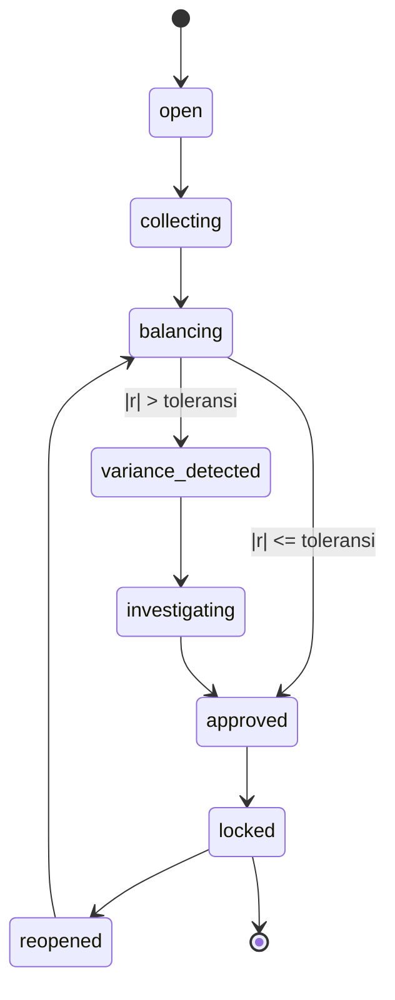
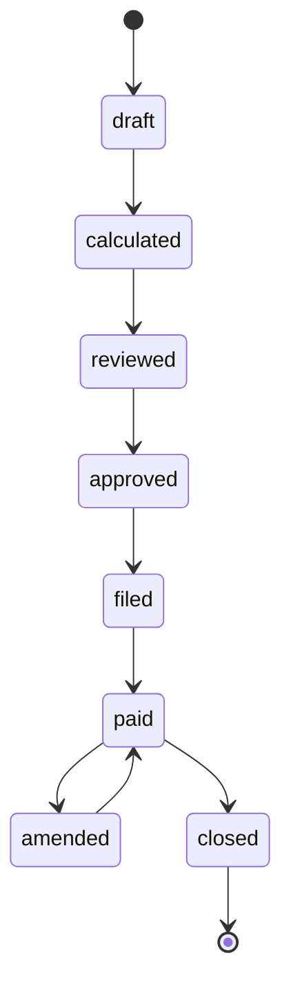
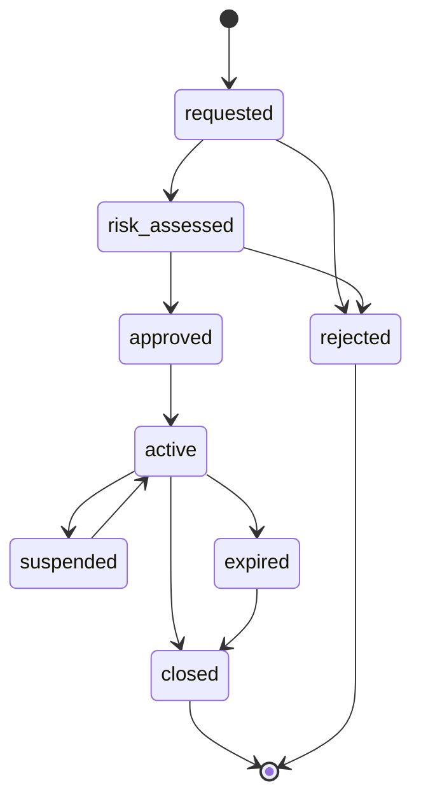
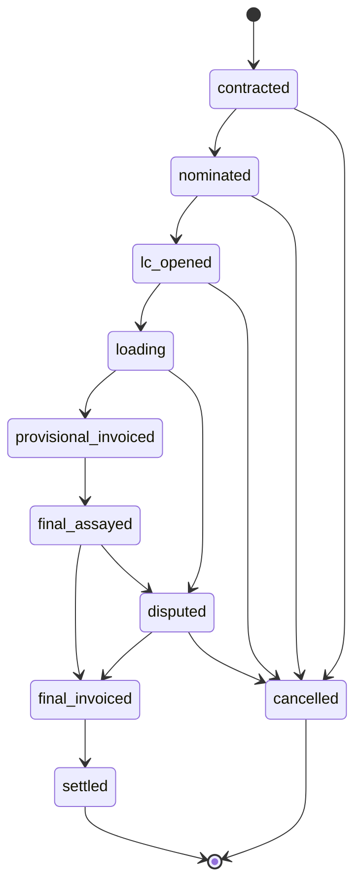
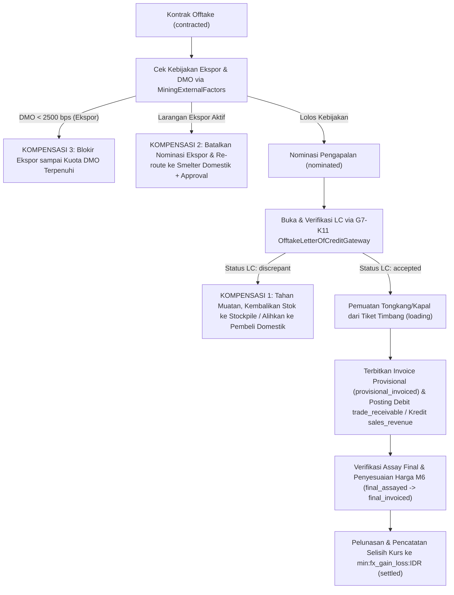
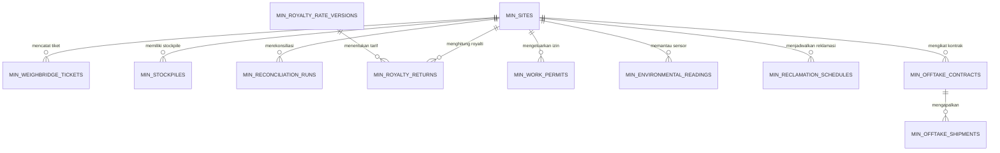
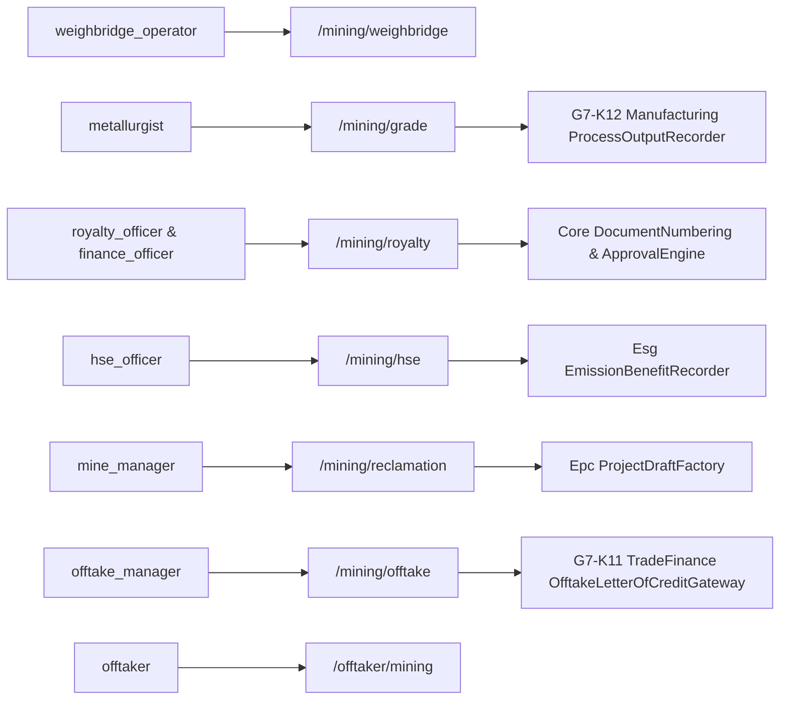

# Desain Arsitektur & Permodelan Teknis — Fase 94: Weighbridge, Grade Reconciliation, Royalty, HSE & Offtake

Dokumen ini menjabarkan desain naratif, diagram State Machine (D1), alur proses & saga dengan kompensasi (D2), struktur relasi entitas (D3), alur pembukuan buku besar (D4), dan konteks integrasi lintas modul (D5) untuk **Fase 94**.

---

## 1. Diagram State Machine (D1)

Fase 94 menegakkan 4 State Machine independen (tiga berstatus 8, satu berstatus 10):

### 1.1 `ReconciliationRunStateMachine` (8 Status — D94-1)


### 1.2 `RoyaltyReturnStateMachine` (8 Status — D94-4)


### 1.3 `WorkPermitStateMachine` (8 Status — D94-5)


### 1.4 `OfftakeShipmentStateMachine` (10 Status — D94-7)


---

## 2. Alur Utama & Saga Offtake Lintas Modul dengan 3 Cabang Kompensasi (D2)

Diagram berikut menggambarkan alur eksekusi `Modules\Mining\Application\Sagas\OfftakeShipmentLifecycleSaga` beserta ketiga cabang kompensasinya (LC diskrepan, larangan ekspor mendadak T-5, dan kuota DMO belum terpenuhi):



---

## 3. Diagram Relasi Entitas Database Fase 94 (D3)



---

## 4. Alur Pembukuan Buku Besar 8 Kejadian Fase 94 (D4)

```mermaid
flowchart TD
    P["MiningFase94LedgerPostingService"] --> J1["1. Royalti Terutang: Dr expense:min:royalty:IDR | Cr min:royalty_payable:IDR"]
    P --> J2["2. Bayar Royalti: Dr min:royalty_payable:IDR | Cr bank:clearing:IDR"]
    P --> J3["3. Invoice Provisional: Dr min:trade_receivable:IDR | Cr min:sales_revenue:IDR"]
    P --> J4["4. Penyesuaian Final Assay/Kalori: Dr/Cr min:trade_receivable:IDR <-> min:sales_revenue:IDR"]
    P --> J5["5. Susut Rekonsiliasi Disetujui: Dr min:inventory_shrinkage_expense:IDR | Cr min:ore_stockpile_inventory:IDR"]
    P --> J6["6. Unwinding Provisi Reklamasi: Dr min:reclamation_expense:IDR | Cr min:reclamation_provision_liability:IDR"]
    P --> J7["7. Denda Lingkungan: Dr min:environmental_penalty_expense:IDR | Cr min:environmental_penalty_payable:IDR"]
    P --> J8["8. Selisih Kurs Settlement: Dr/Cr min:fx_gain_loss:IDR <-> min:trade_receivable:IDR"]
```



---

## 5. Konteks Integrasi Lintas Modul & Role RBAC (D5)




---

## 6. Detail Spesifikasi Skema Basis Data & Migrasi Fase 94 (D6)

Fase 94 menambahkan sekumpulan tabel inti dan tabel audit pada skema `min_` yang dirancang untuk mendukung volume transaksi tinggi, keutuhan referensial, serta audit jejak forensik:

### 6.1 Tabel `min_weighbridge_tickets`
Menyimpan riwayat penimbangan digital per ritase truk dengan hash-chaining:
- `id` (UUIDv4, Primary Key): Pengenal unik tiket timbang.
- `ticket_number` (VARCHAR(40), Unique): Format terstandardisasi `WB-YYYYMM-XXXX`.
- `scale_id` (VARCHAR(32), Indexed): Pengenal unit jembatan timbang fisik.
- `truck_plate_number` (VARCHAR(20), Indexed): Plat nomor kendaraan angkut.
- `driver_name` (VARCHAR(80)): Nama pengemudi terdaftar.
- `gross_weight_kg` (INTEGER, Unsigned): Berat kotor saat truk masuk bermuatan.
- `tare_weight_kg` (INTEGER, Unsigned): Berat tarra saat truk keluar kosong.
- `net_weight_kg` (INTEGER, Unsigned): Berat bersih muatan (`gross - tare`).
- `commodity_type` (VARCHAR(32)): Jenis komoditas (`COAL_RAW`, `NICKEL_ORE_SAPROLITE`, dll).
- `source_pit` (VARCHAR(40)): Blok pit asal pemuatan.
- `destination_stockpile` (UUID, Foreign Key ke `min_stockpiles.id`).
- `moisture_pct` (DECIMAL(5,2)): Persentase kadar air sampel cepat.
- `ash_pct` (DECIMAL(5,2)): Persentase kandungan abu sampel cepat.
- `previous_ticket_hash` (VARCHAR(64)): Hash SHA-256 dari tiket sebelumnya pada timbangan yang sama.
- `ticket_hash` (VARCHAR(64), Indexed): Hash SHA-256 muatan tiket saat ini.
- `is_payload_violation` (BOOLEAN): Penanda apakah muatan melanggar $115\%$ GVW.
- `created_at`, `updated_at`: Stempel waktu audit sistem.

### 6.2 Tabel `min_reconciliation_runs`
Mencatat eksekusi penutupan neraca persediaan dan penyesuaian neraca massa:
- `id` (UUIDv4, Primary Key): Pengenal unik eksekusi rekonsiliasi.
- `run_number` (VARCHAR(40), Unique): Format `REC-YYYYMM-XXXX`.
- `site_id` (UUID, Foreign Key ke `min_sites.id`).
- `period_start` (DATE), `period_end` (DATE): Rentang periode rekonsiliasi.
- `status` (VARCHAR(32)): Status State Machine (`open`, `collecting`, `balancing`, `approved`, `locked`, dll).
- `feed_tonnage_meas` (DECIMAL(12,2)): Tonase umpan terukur.
- `concentrate_tonnage_meas` (DECIMAL(12,2)): Tonase konsentrat terukur.
- `tailings_tonnage_meas` (DECIMAL(12,2)): Tonase ampas terukur.
- `feed_tonnage_rec` (DECIMAL(12,2)): Tonase umpan terekonsiliasi (M5).
- `concentrate_tonnage_rec` (DECIMAL(12,2)): Tonase konsentrat terekonsiliasi (M5).
- `tailings_tonnage_rec` (DECIMAL(12,2)): Tonase ampas terekonsiliasi (M5).
- `chi_square_stat` (DECIMAL(8,4)): Nilai statistik uji Chi-Kuadrat WLS.
- `variance_weight_kg` (INTEGER): Selisih massa fisik yang disesuaikan ke buku besar.
- `certificate_hash` (VARCHAR(64)): Bukti sertifikat HMAC-SHA256 M5.

### 6.3 Tabel `min_royalty_returns`
Merekam pengakuan kewajiban royalti negara berbasis regulasi PP 19/2025:
- `id` (UUIDv4, Primary Key).
- `return_number` (VARCHAR(40), Unique): Format `ROY-YYYYMM-XXXX`.
- `site_id` (UUID, Foreign Key ke `min_sites.id`).
- `period_month` (VARCHAR(7)): Periode pelaporan dalam format `YYYY-MM`.
- `commodity` (VARCHAR(32)): `COAL` atau `NICKEL`.
- `production_tons` (DECIMAL(12,2)): Total produksi terverifikasi.
- `sales_tons` (DECIMAL(12,2)): Total tonase penjualan.
- `reference_price_usd_cents` (INTEGER): Harga acuan HBA/HMA resmi.
- `calorific_gar_kcal` (INTEGER): Rata-rata kalori batubara terverifikasi.
- `nickel_grade_pct` (DECIMAL(5,2)): Rata-rata kadar nikel terverifikasi.
- `effective_royalty_rate_bps` (INTEGER): Besaran tarif dalam basis points (misal 750 bps = 7.50%).
- `royalty_amount_usd_cents` (BIGINT): Total royalti dalam sen USD.
- `royalty_amount_idr` (BIGINT): Total kewajiban royalti dalam Rupiah.
- `dmo_allocation_tons` (DECIMAL(12,2)): Porsi kuota DMO yang dipenuhi.
- `status` (VARCHAR(32)): Status State Machine (`draft`, `calculated`, `reviewed`, `approved`, `filed`, `paid`, `closed`).
- `certificate_signature` (VARCHAR(64)): Tanda tangan kriptografis M4.

### 6.4 Tabel `min_work_permits`
Mengelola izin kerja berisiko tinggi lapangan (PTW):
- `id` (UUIDv4, Primary Key).
- `permit_number` (VARCHAR(40), Unique): Format `PTW-YYYYMM-XXXX`.
- `site_id` (UUID, Foreign Key ke `min_sites.id`).
- `worker_id` (VARCHAR(40)): Nomor induk personil pelaksana.
- `activity_type` (VARCHAR(32)): `BLASTING`, `CONFINED_SPACE`, `WORKING_AT_HEIGHTS`, `HOT_WORK`, `HIGH_VOLTAGE`.
- `geofence_zone` (VARCHAR(64)): Koordinat atau nama zona isolasi bahaya.
- `risk_level` (VARCHAR(16)): `LOW`, `MEDIUM`, `HIGH`, `CRITICAL`.
- `valid_from` (DATETIME), `valid_until` (DATETIME): Rentang waktu sah izin.
- `supervisor_name` (VARCHAR(80)): Pengawas bersertifikat K3 (POP/POM).
- `status` (VARCHAR(32)): `REQUESTED`, `APPROVED`, `ACTIVE`, `SUSPENDED`, `EXPIRED`, `CLOSED`, `REJECTED`.

### 6.5 Tabel `min_offtake_contracts` & `min_offtake_shipments`
Mengawal rantai niaga komoditas tambang:
- `min_offtake_contracts`: Menampung parameter perjanjian jual beli batubara/nikel jangka panjang (`contract_number`, `buyer_party_id`, `commodity`, `target_tonnage`, `base_price_cents`, `pricing_formula`, `quality_spec_json`, `status`).
- `min_offtake_shipments`: Merekam riwayat pengapalan individu (`shipment_number`, `contract_id`, `vessel_name`, `nominated_tonnage`, `loaded_tonnage`, `status`, `provisional_invoice_cents`, `final_invoice_cents`, `lc_number`, `lc_status`).

---

## 7. Penanganan Kegagalan Terdistribusi & Kompensasi Saga (D7)

Saga `OfftakeShipmentLifecycleSaga` mengorkestrasikan interaksi asinkron lintas modul dengan garansi konsistensi eventual (*eventual consistency*) menggunakan pola kompensasi mundur (*backward compensation*):

| Langkah Saga | Aksi Positif | Titik Kegagalan Potensial | Aksi Kompensasi Mundur |
|---|---|---|---|
| S1: Verifikasi Regulasi | Validasi kuota DMO $\ge 25\%$ & larangan ekspor. | Kuota DMO $< 25\%$ atau kebijakan larangan ekspor aktif. | **Kompensasi S1**: Batalkan pengapalan ekspor, alihkan kuota ke pembeli smelter domestik via re-routing otomatis. |
| S2: Verifikasi Finansial | Buka & konfirmasi keabsahan LC via `OfftakeLetterOfCreditGateway`. | Bank penerbit mengembalikan status `DISCREPANT` atau kadaluwarsa. | **Kompensasi S2**: Tahan muatan kargo di stockpile dermaga, batalkan sandar kapal, terbitkan notifikasi wanprestasi ke pembeli. |
| S3: Pemuatan Fisik | Catat akumulasi tiket timbang & draft survey pelabuhan. | Deviasi draft survey $> 2.0\%$ atau cuaca ekstrem. | **Kompensasi S3**: Hentikan belt conveyor pemuatan, jalankan aksi `ReconcileMoistureLossAction`, sesuaikan tonase faktur. |
| S4: Penerbitan Faktur | Terbitkan faktur provisional ($80\%$ - $90\%$ nilai LC) & posting jurnal piutang. | Kesalahan sistem posting GL atau kegagalan pembukuan. | **Kompensasi S4**: Balik jurnal provisional via ayat jurnal pembalik idempotensi. |
| S5: Rekonsiliasi Pelabuhan Bongkar | Terima COA pelabuhan bongkar, hitung penyesuaian kalori/penalti M6. | Kadar aktual melanggar batas penolakan mutlak (*Rejection Threshold*). | **Kompensasi S5**: Bekukan pencairan sisa LC, aktifkan klaim asuransi kargo, bentuk komite sengketa komersial. |

---

## 8. Prinsip Keamanan Sistem, Isolasi Tenant & Pencegahan IDOR (D8)

Setiap rute dan endpoint HTTP pada Fase 94 menerapkan prinsip pertahanan berlapis (*Defense in Depth*):
1. **Otentikasi & Otorisasi RBAC Ketat**:
   - Hanya peran berwenang yang dapat mengakses aksi spesifik: `weighbridge_operator` dibatasi pada `/mining/weighbridge`, `metallurgist` pada `/mining/grade`, `royalty_officer` pada `/mining/royalty`, dan `hse_officer` pada `/mining/hse`.
2. **Isolasi Mutlak Portal Pembeli Mandiri (Anti-IDOR)**:
   - Pengguna dengan peran `offtaker` hanya dapat mengakses `/offtaker/portal`.
   - Metode `MiningOfftakerPortalController::nominate` dan pengunduhan dokumen secara tegas memvalidasi:
     ```php
     if ($shipment->contract->buyer_party_id !== (string) $user->id) {
         abort(403, 'Anda tidak berhak mengakses atau menominasikan pengapalan pembeli lain.');
     }
     ```
   - Upaya injeksi UUID pengapalan milik offtaker lain langsung digagalkan dan dicatat dalam log keamanan.
3. **Integritas Kriptografis Anti-Penyangkalan**:
   - Seluruh tiket timbang dilindungi tanda tangan HMAC-SHA256 berantai sehingga upaya modifikasi nilai timbangan secara langsung pada basis data akan terdeteksi seketika saat verifikasi audit rantai timbang dijalankan.

---

## 9. Karakteristik Skalabilitas & Manajemen Kinerja Transaksi Tinggi (D9)

Untuk menangani operasi penambangan dengan ratusan armada truk angkut dan ratusan sensor lingkungan yang beroperasi 24/7 tanpa henti:
- **Transaksi Timbangan Atomik & Terindeks**: Kolom `scale_id`, `truck_plate_number`, dan `created_at` memiliki indeks komposit B-Tree untuk pencarian sub-milidetik.
- **Batching Sensor Lingkungan**: Aksi `IngestEnvironmentalSensorReadingAction` mendukung penyerapan batch hingga $1.000$ rekaman per detik dengan pencatatan ringkasan statistik harian untuk menjaga ukuran tabel partisi tetap optimal.
- **Perhitungan Deterministik Ringan**: Algoritma M4, M5, dan M6 dirancang dengan kompleksitas waktu $O(1)$ hingga $O(N)$ di mana $N \le 10$, memastikan latensi eksekusi $< 5\text{ ms}$ per pemanggilan.
