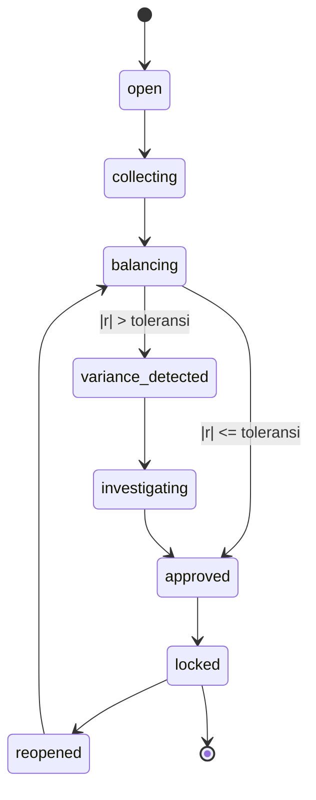
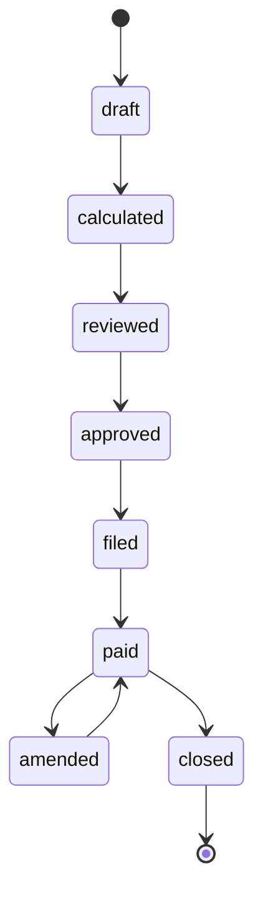
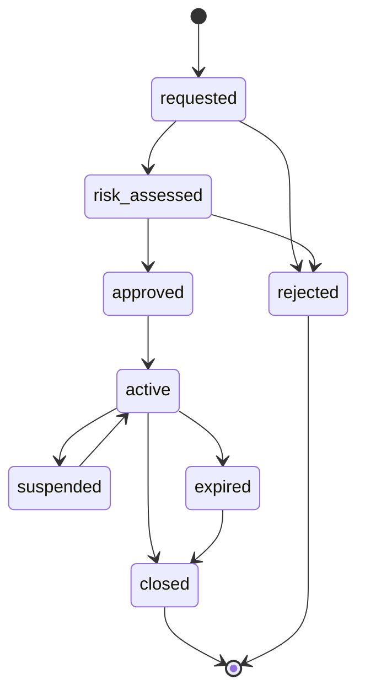
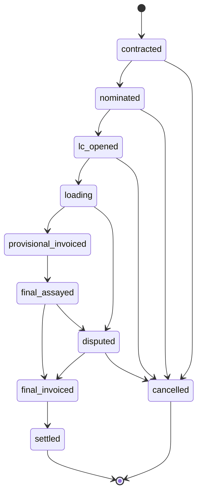
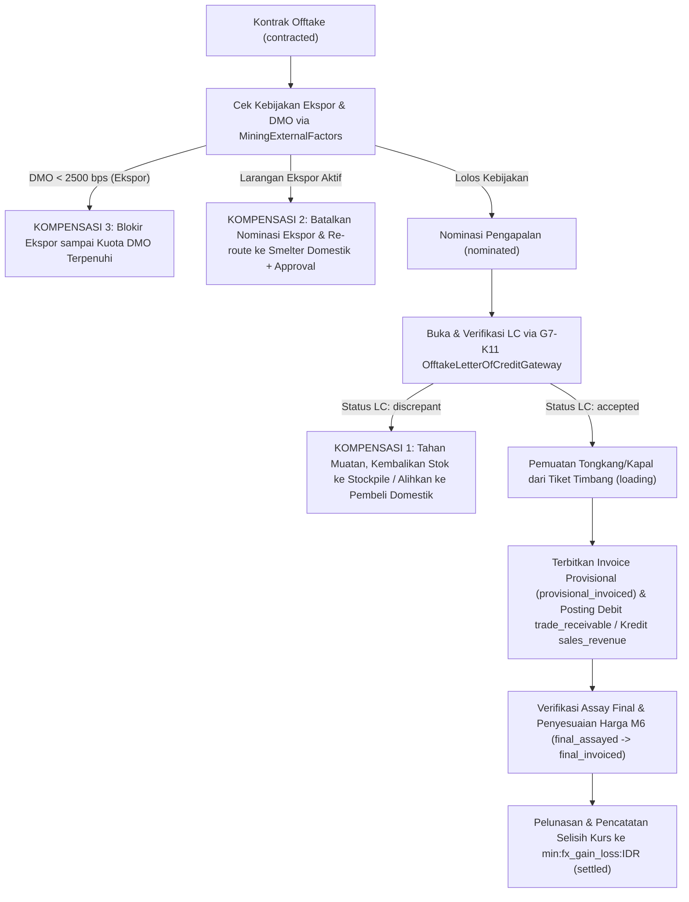
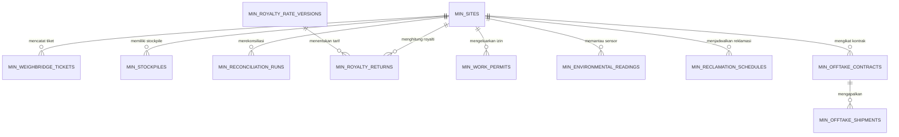
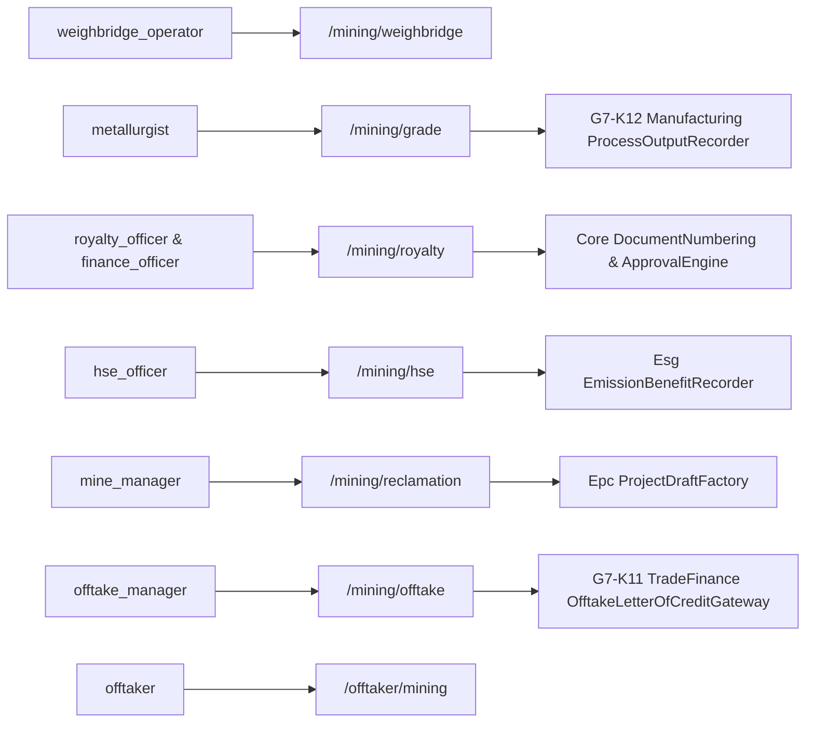

# Desain Arsitektur & Permodelan Teknis — Fase 94: Weighbridge, Grade Reconciliation, Royalty, HSE & Offtake

Dokumen ini menjabarkan desain naratif, diagram State Machine (D1), alur proses & saga dengan kompensasi (D2), struktur relasi entitas (D3), alur pembukuan buku besar (D4), dan konteks integrasi lintas modul (D5) untuk **Fase 94**.

---

## 1. Diagram State Machine (D1)

Fase 94 menegakkan 4 State Machine independen (tiga berstatus 8, satu berstatus 10):

### 1.1 `ReconciliationRunStateMachine` (8 Status — D94-1)

### 1.2 `RoyaltyReturnStateMachine` (8 Status — D94-4)

### 1.3 `WorkPermitStateMachine` (8 Status — D94-5)

### 1.4 `OfftakeShipmentStateMachine` (10 Status — D94-7)

---

## 2. Alur Utama & Saga Offtake Lintas Modul dengan 3 Cabang Kompensasi (D2)

Diagram berikut menggambarkan alur eksekusi `Modules\Mining\Application\Sagas\OfftakeShipmentLifecycleSaga` beserta ketiga cabang kompensasinya (LC diskrepan, larangan ekspor mendadak T-5, dan kuota DMO belum terpenuhi):

---

## 3. Diagram Relasi Entitas Database Fase 94 (D3)

---

## 4. Alur Pembukuan Buku Besar 8 Kejadian Fase 94 (D4)

```mermaid
flowchart TD
    P["MiningFase94LedgerPostingService"] --> J1["1. Royalti Terutang: Dr expense:min:royalty:IDR | Cr min:royalty_payable:IDR"]
    P --> J2["2. Bayar Royalti: Dr min:royalty_payable:IDR | Cr bank:clearing:IDR"]
    P --> J3["3. Invoice Provisional: Dr min:trade_receivable:IDR | Cr min:sales_revenue:IDR"]
    P --> J4["4. Penyesuaian Final Assay/Kalori: Dr/Cr min:trade_receivable:IDR <-> min:sales_revenue:IDR"]
    P --> J5["5. Susut Rekonsiliasi Disetujui: Dr min:inventory_shrinkage_expense:IDR | Cr min:ore_stockpile_inventory:IDR"]
    P --> J6["6. Unwinding Provisi Reklamasi: Dr min:reclamation_expense:IDR | Cr min:reclamation_provision_liability:IDR"]
    P --> J7["7. Denda Lingkungan: Dr min:environmental_penalty_expense:IDR | Cr min:environmental_penalty_payable:IDR"]
    P --> J8["8. Selisih Kurs Settlement: Dr/Cr min:fx_gain_loss:IDR <-> min:trade_receivable:IDR"]
```

---

## 5. Konteks Integrasi Lintas Modul & Role RBAC (D5)

