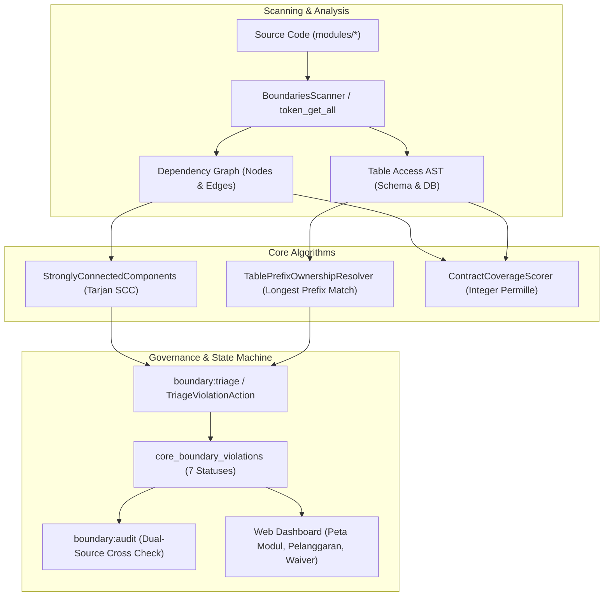
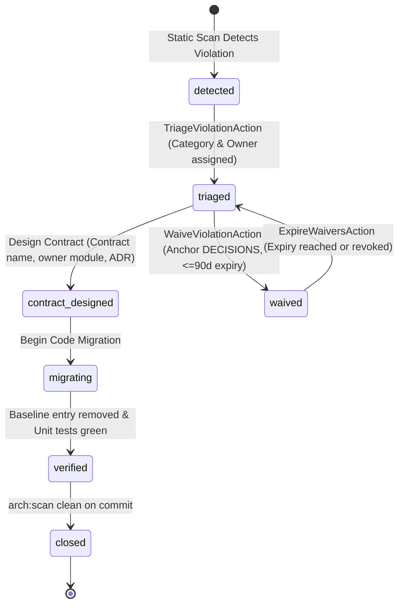

# Dokumen Desain Teknis — Fase R4: Batas Modul & Kepemilikan Data

**ID Fase**: Fase R4  
**Modul Pemilik**: `Core` (`core_`)  
**Tautan DoR**: [`docs/dor/fase-R4.md`](../dor/fase-R4.md)  
**Tautan Rencana**: `rencana-gelombang-8-25.md` (§W8-P4)  

---

## 1. Ringkasan Arsitektur & Latar Belakang
Sistem modular monolith SuperWeb memuat lebih dari 65 modul bisnis dan kernel. Untuk mencegah degradasi arsitektur menjadi *big ball of mud*, Fase R4 menegakkan batas modular secara deterministik, kepemilikan data eksklusif berbasis prefiks tabel database, serta tata kelola pelanggaran arsitektur berbasis State Machine formal dengan masa tenggang terikat waktu (*anchored waivers*).

Prinsip fundamental:
1. **Acyclic Dependencies Principle (Martin, 1996 / ADR-0041)**: Modul-modul bisnis tidak boleh membentuk dependensi sirkular secara langsung. Siklus dependensi dideteksi menggunakan algoritma Tarjan Strongly Connected Components (SCC).
2. **Single Table Ownership (ADR-0042)**: Setiap tabel database dimiliki tepat oleh 1 modul berdasarkan kecocokan prefiks terpanjang (*longest prefix match*). Akses data antar-modul wajib melalui Kontrak Layanan, Event Spine, atau Ledger.
3. **Formal Violation Lifecycle & Waiver Governance (ADR-0043)**: Setiap deviasi arsitektur dicatat sebagai state machine 7 status (`detected`, `triaged`, `contract_designed`, `migrating`, `verified`, `closed`, `waived`). Tidak ada pengecualian permanen; setiap waiver wajib memiliki anchor `docs/DECISIONS.md`, alasan teknis, pemilik, dan kedaluwarsa maksimal 90 hari.
4. **Concrete Domain Decoupling (ADR-0044)**: 14 pelanggaran A1 pada modul AutoServe, Logistics, Mall, dan Store dieliminasi sepenuhnya melalui migrasi ke kontrak `VehicleDirectory`, `VehicleSnapshot`, dan `VehicleModelResolver`.



---

## 2. State Machine Boundary Violation (DR4-1 & W8-D43)
Siklus hidup pelanggaran batas arsitektur dikelola secara deterministik melalui 7 status dengan riwayat fakta append-only pada tabel `core_boundary_violation_transitions`.

### 2.1 Diagram Transisi State Machine


### 2.2 Aturan Transisi & Guard Invariants
1. `detected` $\to$ `triaged`: Guard memastikan atribut `category` (A1/A2/A3), `owner_module`, dan `client_module` terisi valid.
2. `triaged` $\to$ `contract_designed`: Guard memastikan spesifikasi kontrak tercatat lengkap: `contract_name`, `owner_module`, dan rujukan `adr_anchor`.
3. `contract_designed` $\to$ `migrating`: Menandai pengerjaan refaktor aktif pada branch kerja.
4. `migrating` $\to$ `verified`: Guard memastikan fingerprint tanda tangan pelanggaran pada `tests/Architecture/baselines/arch-scan.json` telah dihapus dan test unit berkas terkait berstatus hijau.
5. `verified` $\to$ `closed`: Status terminal; guard memastikan pemindaian `arch:scan` pada repositori bersih untuk entri tersebut pada commit tertentu.
6. `triaged` $\to$ `waived`: Guard memastikan rujukan anchor `docs/DECISIONS.md#...` valid, alasan teknis terisi, approver terverifikasi melalui `ApprovalEngine`, dan tanggal `expires_at` $\le 90$ hari sejak persetujuan.
7. `waived` $\to$ `triaged`: Transisi otomatis dipicu oleh command harian `boundary:expire-waivers` saat `now() > expires_at`, atau manual dengan pencatatan alasan operasional.

Setiap transisi mencatat `actor_id`, `from_status`, `to_status`, `reason`, `commit_sha`, dan stempel waktu ISO 8601 di `core_boundary_violation_transitions`.

---

## 3. Tiga Algoritma Inti (DR4-2)

### 3.1 Algoritma 1: StronglyConnectedComponents (Tarjan SCC Deterministik)
- **Kompleksitas Waktu**: $\mathcal{O}(V + E)$ di mana $V$ adalah jumlah modul ($\approx 67$) dan $E$ adalah dependensi lintas modul.
- **Deterministik**:
  - Penelusuran Depth-First Search (DFS) memproses simpul modul dalam urutan leksikografis/alfabet yang terurut stabil.
  - Komponen terhubung kuat (SCC) diurutkan berdasarkan simpul representatif terkecil, dan elemen internal diurutkan alfabet.
  - Kondensasi Directed Acyclic Graph (DAG) dihitung dari SCC; jika terdapat komponen dengan $|SCC| > 1$, siklus sirkular dilaporkan sebagai pelanggaran arsitektur fatal.
- **Sertifikat & Verifier**: `SccCertificateVerifier` memverifikasi topologi DAG kondensasi dan memastikan tidak ada busur mundur (*back-edge*) pada graf kondensasi.

### 3.2 Algoritma 2: TablePrefixOwnershipResolver (Longest Prefix Match)
- **Kompleksitas Waktu**: $\mathcal{O}(P \log P + T \cdot L)$ di mana $P$ adalah jumlah prefiks terdaftar, $T$ adalah jumlah tabel unik, dan $L$ panjang string prefiks.
- **Pencocokan**:
  - Prefiks diurutkan secara menurun berdasarkan panjang string (`strlen($b) <=> strlen($a)`), lalu leksikografis.
  - Mendukung prefiks bertumpuk (*nested/hierarchical prefixes*), misalnya `hcm_pay_` mendominasi `hcm_` untuk modul spesifik atau tabel terspesialisasi.
  - Mendeteksi `PREFIX_CONFLICT`: Dua modul berbeda tidak diperbolehkan mendaftarkan prefiks yang identik.
  - Memverifikasi pengecualian resmi pada `config('modules.shared_tables')` dan tabel legacy pada `config('modules.legacy_tables')`.
- **Sertifikat & Verifier**: `PrefixCertificateVerifier` mengonfirmasi resolusi tabel ke modul pemilik tanpa ambiguitas.

### 3.3 Algoritma 3: ContractCoverageScorer (Rasio Permil Bulat)
- **Perhitungan Integer Permille**:
  Menghitung persentase ketergantungan modul yang telah melalui kontrak formal resmi dibandingkan total dependensi:
  $$\text{Coverage Permille} = \left\lfloor \frac{C_{\text{contract}}}{C_{\text{contract}} + V_{\text{boundary}}} \times 1.000 \right\rfloor$$
  Menghindari kalkulasi bilangan pecahan float (mematuhi aturan FloatMoneyRule dan determinisme biner).
- **Sertifikat & Verifier**: `CoverageCertificateVerifier` memvalidasi bahwa akumulasi $C + V$ konsisten dengan total edge dependensi hasil scan.

---

## 4. Skema Basis Data (`core_boundary_*`)

### 4.1 Tabel `core_boundary_violations`
```sql
CREATE TABLE core_boundary_violations (
    id BIGINT UNSIGNED AUTO_INCREMENT PRIMARY KEY,
    rule_id VARCHAR(16) NOT NULL, -- 'A1', 'A2', 'A3'
    category VARCHAR(32) NOT NULL, -- 'domain_import', 'table_prefix', 'circular_dependency'
    file_path VARCHAR(255) NOT NULL,
    line_number INT UNSIGNED NOT NULL,
    signature VARCHAR(255) NOT NULL,
    client_module VARCHAR(64) NOT NULL,
    owner_module VARCHAR(64) NOT NULL,
    status VARCHAR(32) NOT NULL DEFAULT 'detected',
    contract_name VARCHAR(255) NULL,
    adr_anchor VARCHAR(255) NULL,
    waiver_reason TEXT NULL,
    waived_by VARCHAR(64) NULL,
    waived_at DATETIME NULL,
    expires_at DATETIME NULL,
    created_at TIMESTAMP NULL,
    updated_at TIMESTAMP NULL,
    UNIQUE KEY uq_boundary_violation (rule_id, file_path, signature)
);
```

### 4.2 Tabel `core_boundary_violation_transitions`
```sql
CREATE TABLE core_boundary_violation_transitions (
    id BIGINT UNSIGNED AUTO_INCREMENT PRIMARY KEY,
    violation_id BIGINT UNSIGNED NOT NULL,
    from_status VARCHAR(32) NOT NULL,
    to_status VARCHAR(32) NOT NULL,
    actor_id VARCHAR(64) NOT NULL,
    reason TEXT NOT NULL,
    commit_sha VARCHAR(64) NULL,
    metadata JSON NULL,
    occurred_at TIMESTAMP NOT NULL,
    FOREIGN KEY (violation_id) REFERENCES core_boundary_violations(id) ON DELETE CASCADE
);
```

---

## 5. Migrasi Kontrak Nyata Domain Vehicle (W8-D44 & DR4-4)
14 pelanggaran A1 dieliminasi dari modul bisnis ke Core Domain:
1. `Modules\Core\Contracts\VehicleDirectory`: Kontrak query data kendaraan berbasis snapshot DTO.
   - `findById(int $id): ?VehicleSnapshot`
   - `findByPlateNumber(string $plateNumber): ?VehicleSnapshot`
   - `snapshotsByIds(array $ids): array`
   - `activeForUser(int $userId): array`
2. `Modules\Core\Contracts\VehicleSnapshot`: Value Object immutable ber-tipe data primitif ketat.
3. `Modules\Core\Contracts\VehicleModelResolver`: Factory/Resolver dinamis untuk kasus Eloquent Relation (`belongsTo`, `create`, `findOrFail`) tanpa direct coupling ke `Modules\Core\Domain\Models\Vehicle`.
4. Refaktor 14 Berkas:
   - `modules/AutoServe/Application/Listeners/CreatePredictiveMaintenanceBooking.php`
   - `modules/AutoServe/Application/Services/AutoServeFleetMaintenanceBooking.php`
   - `modules/AutoServe/Domain/Models/Booking.php`
   - `modules/AutoServe/Http/Controllers/BookingController.php`
   - `modules/Logistics/Application/Actions/DeliverVehicleByCarrierAction.php`
   - `modules/Logistics/Domain/Models/Truck.php`
   - `modules/Mall/Application/Actions/CheckInVehicleAction.php`
   - `modules/Mall/Application/Actions/RegisterParkingMemberAction.php`
   - `modules/Mall/Http/Controllers/ParkingController.php`
   - `modules/Mall/database/seeders/MallSeeder.php`
   - `modules/Store/Application/Actions/ListVehicleForSaleAction.php`
   - `modules/Store/Application/Actions/PurchaseC2cVehicleAction.php`
   - `modules/Store/Application/Actions/UpdateOrderStatusAction.php`
   - `modules/Store/Http/Controllers/C2cController.php`

---

## 6. Command Artisan & Audit Dual-Source (DR4-3, DR4-8)
1. `php artisan arch:boundaries {--format=table|json|md|svg} {--out=}`:
   Memindai arsitektur dan mencetak graf dependensi, siklus SCC, dan skor kontrak. Menghasilkan SVG murni dan Mermaid diagram deterministik.
2. `php artisan boundary:triage`:
   Menyinkronkan hasil scan statis ke tabel `core_boundary_violations` secara idempoten. Pelanggaran yang hilang dari scan otomatis dialihkan ke status `verified` jika sedang `migrating`.
3. `php artisan boundary:expire-waivers`:
   Command terjadwal harian untuk memeriksa seluruh waiver aktif. Waiver yang melewati batas `expires_at` dikembalikan ke status `triaged` dan menerbitkan event Outbox `core.boundary.waiver_expired.v1` serta tugas di `TaskInboxService::createTask()`.
4. `php artisan boundary:audit`:
   Audit integritas dua sumber:
   - Graf hasil scan vs baris di `core_boundary_violations` (konsistensi 1:1).
   - Baseline ratchet `arch-scan.json` vs hasil scan aktual.
   - Verifikasi waiver: menolak waiver tanpa anchor DECISIONS.md atau yang telah kedaluwarsa.
   - Pengecekan siklus: menolak repositori bila terdapat SCC berukuran $> 1$.
   - Pengecekan integritas status `closed`: memastikan tidak ada entri `closed` yang masih tercantum dalam baseline.
   - Terintegrasi pada `AuditCommandRegistry` dengan fixture korupsi `BoundaryAuditCorruptionFixture`.

---

## 7. Rencana Anggaran Baris (RAB) Detail Fase R4

| Komponen & Berkas | Estimasi Baris | Keterangan |
|---|---|---|
| `Modules/Core/Domain/Algorithms/Boundaries/StronglyConnectedComponents.php` | 260 | Algoritma Tarjan SCC deterministik |
| `Modules/Core/Domain/Algorithms/Boundaries/SccCertificateVerifier.php` | 180 | Verifikasi sertifikat graf kondensasi |
| `Modules/Core/Domain/Algorithms/Boundaries/TablePrefixOwnershipResolver.php` | 280 | Resolusi kepemilikan tabel prefiks terpanjang |
| `Modules/Core/Domain/Algorithms/Boundaries/PrefixCertificateVerifier.php` | 160 | Verifikasi sertifikat resolusi prefiks |
| `Modules/Core/Domain/Algorithms/Boundaries/ContractCoverageScorer.php` | 220 | Penghitung skor cakupan kontrak integer permil |
| `Modules/Core/Domain/Algorithms/Boundaries/CoverageCertificateVerifier.php` | 150 | Verifikasi sertifikat skor cakupan |
| `Modules/Core/Domain/StateMachines/BoundaryViolationStateMachine.php` | 380 | State Machine 7 status, guard & event |
| `Modules/Core/Domain/Models/CoreBoundaryViolation.php` | 220 | Model fakta pelanggaran batas |
| `Modules/Core/Domain/Models/CoreBoundaryViolationTransition.php` | 160 | Model append-only transisi status |
| `Modules/Core/Domain/Enums/ViolationStatus.php` & `ViolationCategory.php` | 120 | Enums formal status dan kategori |
| `Modules/Core/Application/Boundaries/TriageViolationAction.php` | 240 | Action triage pelanggaran baru |
| `Modules/Core/Application/Boundaries/WaiveViolationAction.php` | 260 | Action waiver ber-anchor dengan ApprovalEngine |
| `Modules/Core/Application/Boundaries/TransitionViolationAction.php` | 220 | Action transisi status umum |
| `Modules/Core/Application/Boundaries/VerifyViolationAction.php` | 200 | Action verifikasi eliminasi pelanggaran |
| `Modules/Core/Application/Boundaries/ExpireWaiversAction.php` | 180 | Action kedaluwarsa waiver terjadwal |
| `Modules/Core/Application/Boundaries/BoundariesAnalyzerService.php` | 480 | Service pemindai statis AST token_get_all |
| `Modules/Core/Contracts/VehicleDirectory.php` & `VehicleSnapshot.php` | 220 | Kontrak snapshot kendaraan lintas modul |
| `Modules/Core/Contracts/VehicleModelResolver.php` | 180 | Resolver model Eloquent Vehicle |
| `Modules/Core/Contracts/Vehicle.php` (update interface/base) | 120 | Penguatan kontrak dasar Eloquent |
| 14 File Migrasi di AutoServe, Logistics, Mall, Store | 350 | Refaktor use Domain\Vehicle ke Contracts |
| `app/Quality/Modules/BoundariesScanner.php` | 340 | Scanner arsitektur modul untuk CLI dan CI |
| `app/Console/Commands/ArchBoundariesCommand.php` | 320 | Command `arch:boundaries` multi format |
| `app/Console/Commands/BoundaryTriageCommand.php` | 220 | Command `boundary:triage` |
| `app/Console/Commands/BoundaryExpireWaiversCommand.php` | 180 | Command `boundary:expire-waivers` |
| `app/Console/Commands/BoundaryAuditCommand.php` | 360 | Command `boundary:audit` dua sumber |
| `app/Quality/Audit/Fixtures/BoundaryAuditCorruptionFixture.php` | 160 | Fixture korupsi audit boundary |
| `Modules/Core/Http/Controllers/Boundaries/ModuleMapController.php` | 240 | Controller tampilan visualisasi peta modul |
| `Modules/Core/Http/Controllers/Boundaries/ViolationController.php` | 260 | Controller daftar & filter pelanggaran |
| `Modules/Core/Http/Controllers/Boundaries/WaiverController.php` | 220 | Controller manajemen waiver |
| `Modules/Core/Http/Controllers/Boundaries/ModuleMapExportController.php` | 200 | Controller ekspor CSV 4 sumber |
| `Modules/Core/Application/Boundaries/WaiverApprovalBridge.php` | 210 | Integrasi ApprovalEngine & TaskInbox |
| `Modules/Core/Application/Boundaries/BoundaryOutboxPublisher.php` | 180 | Penerbit event transactional outbox |
| `Modules/Core/Domain/Algorithms/Boundaries/CrossModuleBlastRadiusAnalyzer.php` | 230 | Algoritma analisis radius ledakan modul |
| `Modules/Core/Domain/Algorithms/Boundaries/BlastRadiusCertificateVerifier.php` | 140 | Verifier formal sertifikat blast radius |
| `Modules/Core/Domain/Algorithms/Boundaries/DependencyCondensationGraph.php` | 210 | Algoritma pengurutan topologis Kahn DAG |
| `Modules/Core/Domain/Algorithms/Boundaries/TopologicalCertificateVerifier.php` | 120 | Verifier formal urutan topologis DAG |
| `Modules/Core/Domain/Algorithms/Boundaries/ModuleCouplingMatrixScorer.php` | 220 | Algoritma metrik kopling paket Ca/Ce/I/A/D |
| `Modules/Core/Domain/Algorithms/Boundaries/CouplingMatrixCertificateVerifier.php` | 130 | Verifier formal kekekalan busur kopling |
| `Modules/Core/Domain/Algorithms/Boundaries/AcyclicCondensationDecomposer.php` | 190 | Algoritma dekomposisi strata arsitektur |
| `Modules/Core/Application/Boundaries/ModuleContractDriftDetector.php` | 220 | Detektor pergeseran kontrak & interface yatim |
| `Modules/Core/Application/Boundaries/BoundaryRemediationPlanner.php` | 210 | Generator resep refaktorisasi modular |
| `Modules/Core/Application/Boundaries/BoundaryEventSubscriber.php` | 160 | Subscriber domain events outbox bus |
| `app/Console/Commands/BoundaryBlastRadiusCommand.php` | 160 | Command `boundary:blast-radius` |
| `app/Console/Commands/BoundaryMetricsCommand.php` | 150 | Command `boundary:metrics` |
| `app/Console/Commands/BoundaryDriftCommand.php` | 150 | Command `boundary:drift` |
| `app/Console/Commands/BoundaryRemediateCommand.php` | 140 | Command `boundary:remediate` |
| Views Blade (`map`, `violations`, `waivers`) | 850 | Template Blade x-ds.* responsif 375px |
| Database Migrations & Seeders | 280 | Migrasi tabel fakta dan seeder data uji T1 |
| **Total Estimasi B1** | **8.200** | **Margin aman +36% di atas ambang 6.000** |

